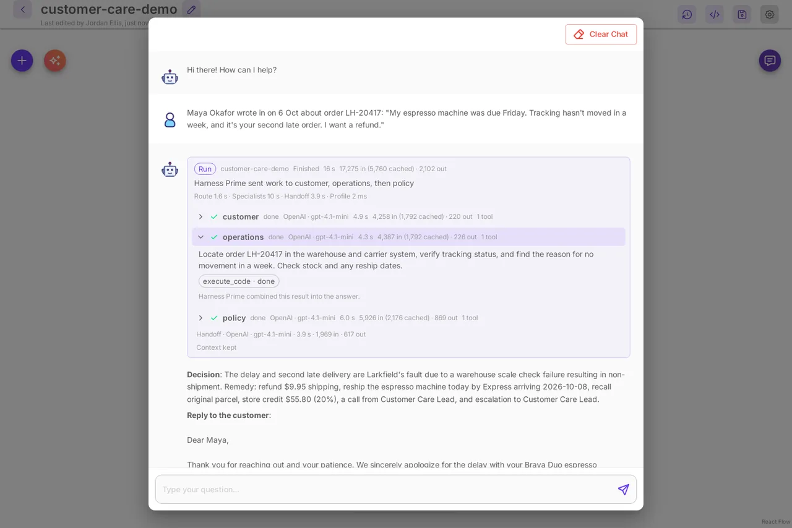
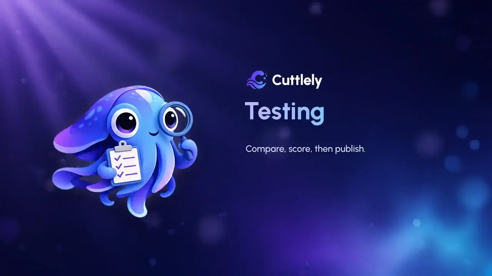
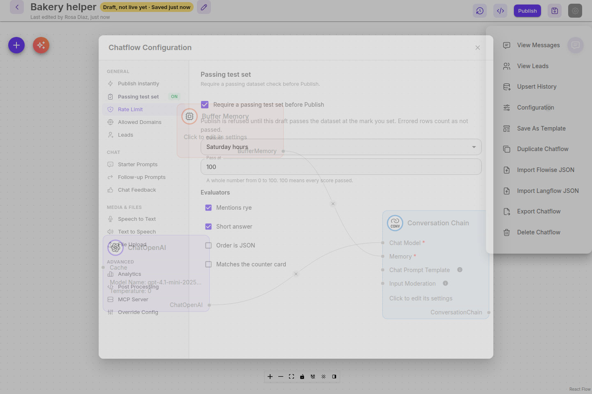
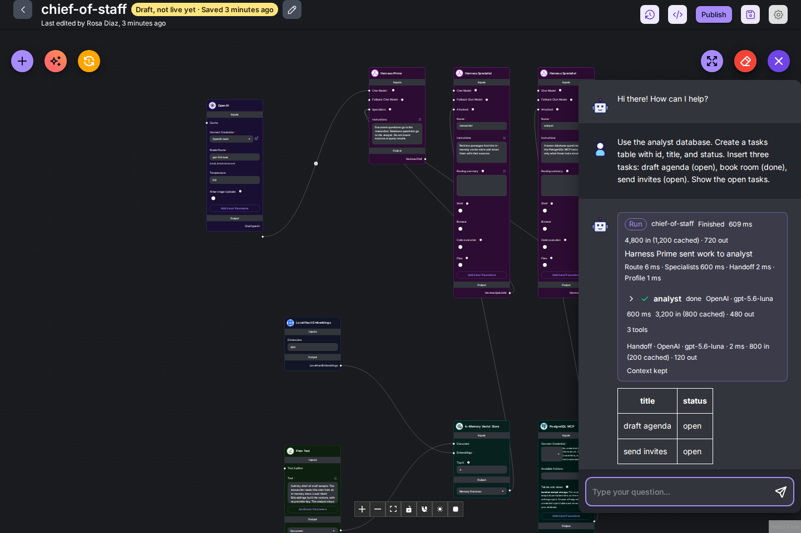
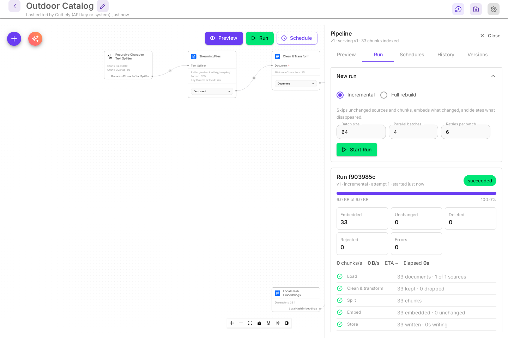
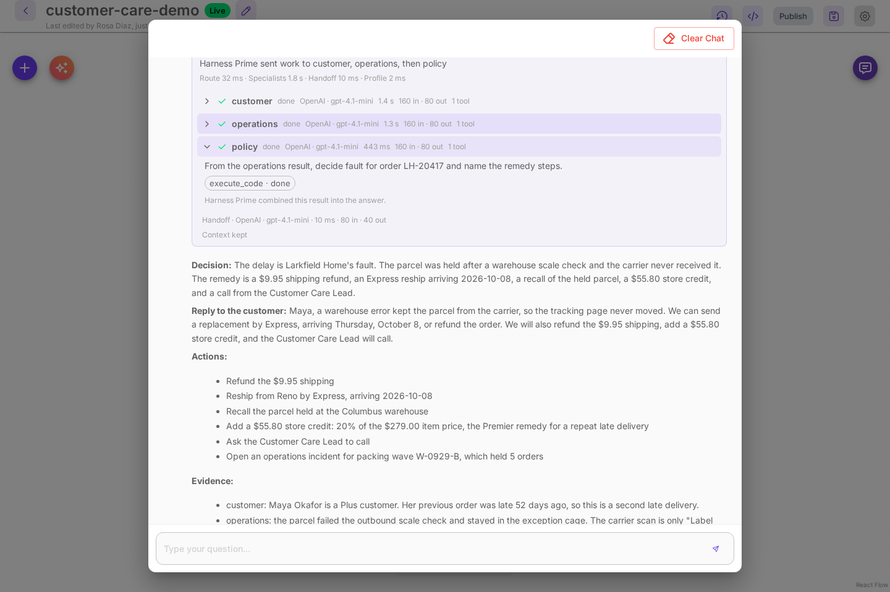

[English](./README.md) | [日本語](./README.ja.md) | 한국어 | [繁體中文](./i18n/README-TW.md) | [简体中文](./i18n/README-ZH.md)

<p align="center">
<picture>
<source media="(prefers-color-scheme: dark)" srcset="./assets/brand/readme/cuttlely-readme-header-dark.png">

</picture>
</p>

# Cuttlely

[](https://github.com/cuttlely/cuttlely/releases/latest)
[](https://github.com/cuttlely/cuttlely/blob/main/LICENSE.md)
[](https://github.com/cuttlely/cuttlely/pkgs/container/cuttlely)
[](https://www.npmjs.com/package/cuttlely)
[](https://github.com/cuttlely/cuttlely/actions/workflows/main.yml)

오픈소스 에이전트 플랫폼 · Apache-2.0

Cuttlely는 오픈소스 컨텍스트 인식 에이전트 오케스트레이션입니다. AI 에이전트 팀을 시각적으로 만들고, 각 에이전트는 필요한 컨텍스트만 받으므로 게시하기 전에 모든 실행이 무엇을 쓰고 비용이 얼마인지 확인할 수 있습니다. 무엇이든 바뀌기 전에 실제 질문을 Live와 초안에서 나란히 다시 실행해 보세요.

```bash
npx cuttlely start
```

Node 20+ 및 Docker

**프로덕션에 바로 쓰는 비주얼 에이전트 빌더.**

끌어다 놓아 만드는 에이전트에 제대로 된 거버넌스와 가벼운 컨텍스트를 더합니다. 오픈소스, Apache-2.0. Cuttlely("커들리"로 읽습니다)는 여러분이 관리하는 인프라 위에서 실행됩니다. 모든 변경은 초안에서 기다리고, 게시하기 전에 실제 질문을 Live와 초안에서 나란히 다시 실행해 볼 수 있으며, 각 스페셜리스트는 필요한 작업만 받습니다.

[10분 만에 시작하기](https://cuttlely.com/quickstart/) · [GitHub에서 스타 주기](https://github.com/cuttlely/cuttlely) · [이미 플로우가 있나요? 가져오세요](https://cuttlely.com/flowise/)

**1.4.4가 나왔습니다.** 1.4.3을 쓰고 있다면 업그레이드하세요. 모델을 바꾸면 재시작할 때까지 MCP 호출이 Unauthorized로 실패할 수 있었습니다. 1.4.3에서는 PostgreSQL MCP 노드의 애널리스트 질의를 더 안전하게 하고 직접 쓴 SQL 헬퍼용 **Allowed functions**를 추가했습니다. 1.4.2 이하에서 올린다면 [1.4.3 업그레이드 노트](./CHANGELOG.md#143---2026-10-25)를 먼저 읽으세요. [변경 기록](./CHANGELOG.md#144---2026-10-25)

## 목차

-   [팀이 불만을 해결하는 모습 보기](#watch-a-team-resolve-a-complaint)
-   [Live에 반영하기 전에 모든 변경을 다시 실행해 확인](#replay-every-change-before-it-goes-live)
    -   [초안, 테스트, 버전 기록](#drafts-tests-and-version-history)
-   [실제 팀을 위해](#made-for-real-teams)
-   [앱을 움직이는 에이전트 팀](#agent-teams-that-power-your-apps)
-   [앱에서 팀 사용하기](#use-a-team-from-your-app)
-   [모든 플로우를 MCP 서버로](#every-flow-an-mcp-server)
-   [IBM watsonx Orchestrate에서 플로우 호출하기](#call-a-flow-from-ibm-watsonx-orchestrate)
-   [작은 컨텍스트, 큰 답변](#small-context-big-answers)
-   [팀이 사용하는 도구](#tools-your-teams-use)
-   [처음 10분](#your-first-10-minutes)
-   [가이드](#guides)
-   [기존 플로우 가져오기](#bring-your-existing-flows)
-   [기여하기](#contributing)
-   [소개 및 크레딧](#about-and-credits)
-   [연락처](#contact)

## 팀이 불만을 해결하는 모습 보기

<a id="watch-a-team-resolve-a-complaint"></a>

<p align="center">
<a href="https://cuttlely.com/media/customer-care-demo.mp4?v=8ec56722"></a>
<br>
<a href="https://cuttlely.com/media/customer-care-demo.mp4?v=8ec56722">내레이션이 있는 실행 보기(78초, 소리 있음)</a>
</p>

한 고객이 늦어진 주문에 대해 문의합니다. 고객 스페셜리스트가 계정을 읽고, 운영 스페셜리스트가 소포가 창고를 한 번도 떠나지 않았다는 사실을 찾아내며, 운영 쪽 작업이 끝나면 정책 스페셜리스트가 문서로 된 정책을 확인합니다. 각자 자신의 데이터와 도구를 가지고 있습니다. Harness Prime이 결정, 회신, 조치를 근거와 함께 작성합니다. [Try the demo](./docs/how-to/try-the-demo.md)를 사용하면 이 팀이 여러분의 모델 키로 열립니다.

## Live에 반영하기 전에 모든 변경을 다시 실행해 확인

<a id="replay-every-change-before-it-goes-live"></a>

<a id="ab-test-every-change-before-it-goes-live"></a>
<a id="test-every-change-before-it-goes-live"></a>
<a id="ship-changes-safely-draft-compare-publish-roll-back"></a>

모든 편집은 초안에 저장되고, 그동안 Live는 계속 앱에 응답합니다. Publish 대화 상자의 Compare는 실제 질문을 Live와 초안에 모두 던지고, 게시하기 전에 각 답변을 Same, Changed, Error 중 하나로 표시합니다. passing test set(통과해야 하는 테스트 세트)을 켜면 Publish는 초안이 통과할 때까지 기다립니다. 최대 100개의 질문과 답변 쌍으로 테스트할 수 있으며, 더 늘리는 것은 로드맵에 있습니다.

<p align="center">
<a href="https://cuttlely.com/media/products/testing.mp4?v=d1873063"></a>
<br>
<a href="https://cuttlely.com/media/products/testing.mp4?v=d1873063">테스트 실행 보기(56초, 소리 있음)</a>
</p>



자세한 과정은 [Compare로 변경을 A/B 테스트하기](./docs/how-to/ab-testing.md)에서 설명합니다. 그 밖에 다루는 내용은 [초안, 테스트, 버전 기록](#drafts-tests-and-version-history)에 정리되어 있습니다.

### 초안, 테스트, 버전 기록

<a id="drafts-tests-and-version-history"></a>

-   **초안은 Live에 영향을 주지 않습니다.** 챗플로우, 에이전트플로우, 하네스, 파이프라인에서 캔버스는 초안에 저장합니다. API, 임베드, 공유 링크, 스케줄, 웹훅, 하네스의 외부 실행 라우트, 파이프라인의 예약 실행은 게시하기 전까지 계속 Live를 제공합니다. 캔버스의 테스트 채팅은 초안을 실행하며, 하네스 캔버스 채팅과 Try it도 마찬가지입니다. 파이프라인의 **Preview**는 초안을 실행하고 저장소에는 쓰지 않습니다.
-   **게시하기 전에 비교하세요.** 최근 질문을 Live와 초안에서 모두 실행하고, 각 답변에 Same, Changed, Error 표시를 붙입니다.
-   **실제 답변이 테스트가 됩니다.** [Add to test set](./docs/how-to/tests-from-answers.md)으로 답변 하나를 추가하거나, 특정 기간에 좋아요 또는 싫어요를 받은 답변을 한 번에 최대 500개의 새 행으로 추가할 수 있습니다.
-   **초안을 채점하세요.** 텍스트, JSON, 숫자, 모델 평가기가 Pass, Fail, Error를 판정하고 Live와 초안의 통과율을 보여 줍니다. [평가](./docs/how-to/evaluations.md)
-   **Publish는 통과를 기다립니다.** Passing test set 게이트는 채팅으로 시작하는 챗플로우나 에이전트플로우에서 사용할 수 있으며, 직접 켜기 전까지는 꺼져 있습니다. 켜면 현재 초안이 통과할 때까지 Publish가 비활성 상태로 유지됩니다. [`cuttlely check --gate`](./docs/how-to/ci-gate.md)는 같은 검사를 CI에서 실행합니다.
-   **모든 버전이 보관됩니다.** 이전 버전을 초안으로 열거나 Live를 한 번에 되돌릴 수 있고, Dev에서 Prod로 승격할 수도 있습니다. 승격한 버전은 Prod 소유자가 **Promote to Live**를 선택할 때만 Live가 됩니다.
-   챗플로우, 에이전트플로우, 하네스, 파이프라인은 저장된 각 버전을 무엇이 바뀌었고 누가 바꿨는지와 함께 보관합니다.
-   Dev와 Prod는 같은 GitHub 저장소에 연결됩니다. Prod는 Dev가 게시한 항목을 나열하고, 무엇이 바뀌는지와 어떤 자격 증명이 필요한지 보여 주며, 같은 나란히 비교 검사를 실행할 수 있습니다. 자격 증명은 서버마다 따로 보관하고, 오가는 것은 이름뿐입니다.

게이트는 현재 초안의 Publish만 다룹니다. Live 롤백, Promote from Dev, `PUT /api/v1/chatflows/:id`는 여전히 Live를 바꿉니다. [어떤 경우인지 보기](./docs/how-to/versioning.md#require-a-passing-test-set-before-you-publish).

챗플로우, 에이전트플로우, 하네스에서는 Publish 대화 상자가 최근 질문(4, 10, 25, 50, 100개 중 선택하며 처음에는 4가 선택되어 있습니다)을 Live에서 한 번, 초안에서 한 번 다시 실행하고, 두 답변을 각각에 든 토큰과 시간과 함께 나란히 보여 줄 수 있습니다. **Choose questions**를 사용하면 대신 저장된 질문을 직접 고를 수 있으며, 이때도 관리자가 정한 상한까지입니다. **Save as dataset**은 체크한 질문을 저장하고, 기대 답변은 비워 두어 Datasets에서 채울 수 있게 합니다. 폼, 웹훅, 스케줄로 시작하는 에이전트플로우는 대신 기록된 입력을 같은 개수만큼 다시 실행합니다. 파이프라인은 무엇이 바뀌었는지만 나열하고 이 검사는 실행하지 않습니다. 검사는 Live나 초안을 바꾸지 않으며 채팅 기록에도 아무것도 남기지 않습니다. 실제로 게시하거나 쓰기를 하는 단계가 있는 플로우는, 그래도 실행하겠다고 선택하지 않는 한 건너뜁니다. 챗플로우나 채팅으로 시작하는 에이전트플로우에서는 **Questions from**에서 **A dataset**을 선택하고, 평가기를 고른 뒤, passing test set을 켭니다. 하네스는 해당 실행에 한해서만 데이터셋을 채점할 수 있고, 폼, 웹훅, 스케줄로 시작하는 플로우는 할 수 없습니다. **Admin** > **Server Settings** > **Testing and Limits**에서 Publish 검사를 켜거나 끕니다. 이 설정은 다음 검사부터 적용되며 Publish 자체는 바꾸지 않습니다.


[버전 기록 가이드](./docs/how-to/versioning.md) · [게시하기 전에 최근 질문 검사하기](./docs/how-to/versioning.md#check-recent-questions-before-you-publish) · [플로우를 Dev에서 Prod로 옮기기](./docs/how-to/versioning.md#move-a-flow-from-dev-to-prod)

## 실제 팀을 위해

<a id="made-for-real-teams"></a>

역할, 팀별 분리, 로그인, 감사 로그를 여러분이 운영하는 서버에서.

-   [역할과 권한](./docs/how-to/roles-and-permissions.md). 팀, 기본 제공 역할, 각 페이지와 라우트의 권한 키.
-   [로그인](./docs/how-to/sign-in.md). 첫 계정을 만듭니다. 팀은 AuthKit 없이 로컬 사용자(`CUTTLELY_LOCAL_USERS`)로 로그인할 수 있습니다. AuthKit은 나중에 켤 수 있으며, 인증된 이메일이 기존 로컬 사용자와 연결됩니다.
-   [AuthKit 없이 사용자 관리하기](./docs/how-to/users-without-authkit.md). 로컬 사용자, 초대 및 재설정 링크, 기본 제공되는 Owner, Admin, Builder, Viewer 역할, 세션. 초대받은 사람은 AuthKit 사용 여부와 관계없이 본인에게 온 일회용 초대 링크로만 참여할 수 있습니다: [사용자 초대하기](./docs/how-to/sign-in.md#invite-people).
-   [감사 로그](./docs/how-to/audit-log.md). 로그인, 잠금, 초대, 재설정, 역할 변경, 사용자 비활성화, 설정 변경.
-   [서버 설정](./docs/how-to/server-settings.md). 로그인, 데이터베이스, 스토리지 등을 **Admin**에서 바꿉니다. 런타임 설정은 재시작 없이 적용됩니다. Testing and Limits, 보안 한도, 초대 및 재설정 만료, SMTP 호스트, 포트, secure 플래그, 사용자, `SENDER_EMAIL`, 초대 전달 방식, 설정 기록 상한, `CUTTLELY_AUDIT_RETENTION_DAYS`가 여기에 해당합니다. 비밀 값, `PORT`, 데이터 폴더, SMTP 비밀번호처럼 환경 변수로만 정하는 값은 Set 또는 Not set만 표시됩니다. 목록은 [시작 옵션](./docs/reference/startup-options.md)에 있습니다.

## 앱을 움직이는 에이전트 팀

<a id="agent-teams-that-power-your-apps"></a>

앱에 프롬프트 하나 대신 팀을 붙여 주세요. 에이전트 팀은 리더 에이전트와 스페셜리스트들로 이루어집니다. Cuttlely에서는 에이전트 팀을 harness(하네스)라고 부릅니다. 리더인 Harness Prime은 질문을 읽고, 여러 부분으로 나누고, 각 부분을 알맞은 스페셜리스트에게 보낸 뒤, 하나의 답변을 작성합니다. 스페셜리스트마다 자신의 모델, 도구, 플레이북, 데이터를 가질 수 있습니다. 챗플로우가 팀 전체를 이름으로 호출하므로, 앱, 공유 링크, 웹사이트 임베드에서 팀에 닿을 수 있습니다. 앱은 API로 팀에 질문을 보내고, 충분히 조사한 하나의 답변, 차트 또는 조치를 돌려받습니다. [하네스 가이드](./docs/how-to/harnesses.md)

-   **애널리스트**(The Analyst)는 전용 데이터베이스를 가진 스페셜리스트입니다. 테이블을 만들고, 행을 추가하고, 그에 대한 질문에 실제 숫자로 답합니다. Cuttlely 자체의 테이블은 절대 읽지 않습니다. 긴 결과는 페이지 단위로 돌아옵니다. 하네스 하나에 애널리스트를 여럿 둘 수도 있으며, 각자 자신의 데이터베이스를 가집니다. Harness Prime은 질문마다 알맞은 애널리스트에게 보냅니다. `CUTTLELY_ANALYST=auto`로 켭니다. [애널리스트 가이드](./docs/how-to/analyst.md)



## 앱에서 팀 사용하기

<a id="use-a-team-from-your-app"></a>

**Harness** 카드 하나로 된 챗플로우 뒤에 팀을 두고 게시한 다음, **API Keys**에서 키를 발급하세요. 그 키의 **Harnesses this key may run**에서 하네스를 체크하세요. 새 키는 어떤 하네스도 실행하지 못하며, 체크하기 전까지 호출은 `403`이 됩니다. 앱이 질문을 보내면 팀의 답변이 돌아옵니다. 다음은 `baker`와 `orders`라는 두 스페셜리스트가 있는 작은 빵집 팀을 실제로 호출한 예입니다.

```bash
curl -s http://localhost:43117/api/v1/prediction/<chatflow-id> \
  -H "Authorization: Bearer $CUTTLELY_API_KEY" \
  -H "Content-Type: application/json" \
  -d '{"question": "How much are two croissants and a sourdough loaf, and can I pick them up on Monday?"}' \
  | jq '{text, agents: [.agents[] | {name, task}]}'
```

```json
{
    "text": "Two croissants and a sourdough loaf cost $14.00. However, you cannot pick them up on Monday because the bakery is closed; pick up is possible Tuesday to Sunday from 7:00 to 15:00.",
    "agents": [
        {
            "name": "baker",
            "task": "How much are two croissants and a sourdough loaf?"
        },
        {
            "name": "orders",
            "task": "Can I pick up two croissants and a sourdough loaf on Monday?"
        }
    ]
}
```

Harness Prime이 질문을 나눴습니다. `baker`는 주문 가격을 계산했고 `orders`는 픽업 요일을 확인했습니다. 전체 응답에는 토큰, 소요 시간, 출처, 팀이 만든 이미지도 들어 있습니다. 나머지는 [API 가이드](./docs/api.md)에서 다룹니다. API 키, 스트리밍, 대화 메모리, 파일 업로드, 오류, 그리고 키를 여러분의 서버에만 두는 실행 가능한 예제 웹 앱이 있습니다. 오래 걸리는 턴은 같은 키로 `POST /api/v1/harnesses/<name>/runs/async`에서 백그라운드로 시작하고 답변은 나중에 가져올 수 있으며, 하네스를 cron 일정으로 실행할 수도 있습니다: [API 키로 앱에서 실행하기](./docs/how-to/harnesses.md#run-it-from-your-app-with-an-api-key), [일정으로 실행하기](./docs/how-to/harnesses.md#run-it-on-a-schedule). 참고: [하네스용 Prediction API](./docs/how-to/harnesses.md#prediction-api), [챗플로우에서 하네스 호출하기](./docs/how-to/harnesses.md#call-the-harness-from-a-chatflow).

## 모든 플로우를 MCP 서버로

<a id="every-flow-an-mcp-server"></a>

다른 에이전트가 여러분의 Live 플로우를 MCP로 호출할 수 있습니다. 편집한 내용은 게시할 때까지 초안에 남고, 무엇이 바뀌었는지는 먼저 나란히 다시 실행해 확인할 수 있습니다.

-   **켜기 전에는 꺼져 있습니다.** 플로우의 **MCP Server**를 켜면 Streamable HTTP 엔드포인트(`/api/v1/mcp/<flow id>`)와 베어러 토큰이 생깁니다.
-   **Live(게시된) 플로우만, 플로우 하나가 도구 호출 한 번입니다.** 호출은 게시된 버전을 실행하고 초안은 실행하지 않으며 이전 호출을 기억하지 않습니다. 플로우의 Rate Limit가 적용되고, 1 MB를 넘는 요청 본문은 거부됩니다.
-   **mcp-remote를 통한 MCP 클라이언트.** MCP 서버를 로컬 명령으로 실행하는 클라이언트는 `npx mcp-remote $CUTTLELY_URL/api/v1/mcp/<flow id> --header "Authorization: Bearer <MCP token>"`로 연결합니다. [mcp-remote로 연결하기](./docs/api.md#connect-with-mcp-remote)

[MCP 엔드포인트 참고 문서](./docs/api.md#mcp-endpoint)

## IBM watsonx Orchestrate에서 플로우 호출하기

<a id="call-a-flow-from-ibm-watsonx-orchestrate"></a>

게시된 챗플로우를 외부 에이전트로 등록하면 Orchestrate 네이티브 에이전트가 협업자로서 질문을 넘깁니다. 플로우에는 연결된 API 키가 필요하며, 키가 없는 플로우는 거부됩니다. 플로우를 원격 MCP 툴킷으로 가져오는 방법도 문서로 나와 있습니다. [Orchestrate에서 챗플로우 호출하기](./docs/how-to/orchestrate.md) · [챗플로우를 Orchestrate 툴킷으로 사용하기](./docs/how-to/orchestrate-mcp.md)

## 작은 컨텍스트, 큰 답변

<a id="small-context-big-answers"></a>

긴 채팅, 큰 테이블, 긴 규칙집이 있다고 해서 프롬프트가 길어져야 하는 것은 아닙니다. 각 에이전트는 자기 일에 필요한 것만 보고, 모든 실행은 사용한 토큰을 보여 줍니다.

-   **스페셜리스트마다 자기 일을 맡깁니다.** 흔한 방식은 모든 에이전트에게 채팅 전체를 넘깁니다. Harness Prime은 스페셜리스트마다 그것만으로 완결되는 작업을 최근 대화의 짧은 요약과 함께 작성해 줍니다.
-   **데이터는 데이터베이스에 둡니다.** 흔한 방식은 쿼리 결과를 프롬프트에 붙여 넣습니다. 애널리스트는 한 페이지 분량의 행만 돌려줍니다. "더 보여 줘"라고 하면 다음 페이지가 나옵니다. 앞선 페이지는 다음 프롬프트에 들어가지 않습니다.
-   **체크한 테이블만.** 흔한 방식은 데이터베이스 스키마 전체를 프롬프트에 붙여 넣습니다. URL로 연결한 데이터베이스에서 PostgreSQL MCP 노드의 **Tables and views**에서 테이블과 뷰를 체크하면, 애널리스트의 프롬프트에는 각각에 대해 열 이름이 담긴 한 줄만 들어갑니다. `describe` 도구는 애널리스트가 필요할 때 테이블 하나의 열, 키, 텍스트 값 샘플을 돌려줍니다. 내부 벤치마크에서, 가상의 베이커리 데이터베이스의 테이블과 뷰 20개 중 6개를 체크하자 애널리스트의 프롬프트가 2,562토큰에서 663토큰으로 줄었습니다. `scripts/analyst-schema-tokens.mjs`로 다시 실행할 수 있습니다. 목록 아래 **Rules** 상자에는 어떤 뷰가 어떤 질문에 답하는지 같은, 그 애널리스트를 위한 지시를 2,000자까지 쓸 수 있습니다. Rules는 모델에 대한 지시일 뿐, 체크한 테이블을 넓히거나 쓰기를 허용하지 못합니다. [직접 규칙 쓰기](./docs/how-to/analyst.md#write-your-own-rules).
-   **규칙은 필요할 때 불러옵니다.** 흔한 방식은 모든 지시를 거대한 시스템 프롬프트 하나에 넣습니다. 긴 규칙은 플레이북에 넣습니다. 스페셜리스트는 질문에 필요할 때만 그것을 엽니다.
-   **짧은 인계.** 흔한 방식은 최종 답변을 쓰는 프롬프트에 문서 전체를 붙여 넣습니다. Harness Prime은 각 스페셜리스트 답변 중 상한이 정해진 일부만 읽으며, 출처 이름과 짧은 발췌가 함께 붙습니다. 문서는 응답에 담겨 앱으로 돌아갑니다.
-   **모든 토큰이 보입니다.** Run 카드에는 입력 토큰과 출력 토큰, 모델이 보고하는 경우 캐시된 토큰, 각 단계에 걸린 시간이 나옵니다. API 응답에도 같은 숫자가 담깁니다. Publish 검사는 Live와 초안을 각각 사용한 토큰과 시간과 함께 나란히 보여 줍니다.

[Cuttlely가 컨텍스트를 작게 유지하는 방법](./docs/how-to/context-and-tokens.md)

## 팀이 사용하는 도구

<a id="tools-your-teams-use"></a>

### 지식 파이프라인(ETL): 여러분의 데이터에서 나오는 답변

파일, CSV, 코드 저장소를 불러와 정리하고 나눈 뒤, 임베딩을 만들어 검색용으로 저장합니다. 실행할 때마다 바뀐 부분만 임베딩하고, 스케줄로 실행할 수 있으며, 로컬 임베딩을 쓰면 제공자 키가 없어도 됩니다. 팀과 챗플로우는 **ETL Retriever**로 결과를 검색합니다. [ETL 가이드](./docs/how-to/etl.md)



### 챗플로우: 바로 내놓을 수 있는 어시스턴트 하나

채팅 모델, 답변하는 에이전트나 체인, 메모리, 도구를 하나의 캔버스에 담습니다. 챗플로우마다 Prediction API, 웹사이트용 임베드, 공유 가능한 링크가 생기며, **Harness** 카드가 있는 챗플로우는 그 뒤에 팀 전체를 둡니다. [캔버스 가이드](./docs/how-to/canvas.md)


### 에이전트플로우: 단계별 워크플로

단계별로 실행되며 채팅 메시지, 폼, 웹훅, 스케줄로 시작할 수 있는 워크플로입니다. 카드를 선택하면 사이드 패널에 설정이 열립니다. [캔버스 가이드](./docs/how-to/canvas.md#workflows)


### 어디에나 기본 탑재

-   **모든 캔버스에 Build with AI.** 팀, 어시스턴트, 파이프라인, 워크플로를 설명하면 첫 버전이 캔버스에 올라옵니다. 모든 부품과 연결은 그 전에 검사됩니다. 만드는 데 쓰는 모델은 여러분의 자격 증명 중 하나입니다. [팀 만들기](./docs/how-to/harnesses.md#build-a-team-with-ai), [챗플로우 만들기](./docs/how-to/canvas.md#build-a-chatflow-with-ai), [파이프라인 만들기](./docs/how-to/etl.md#build-a-pipeline-with-ai)
-   **에이전트 런타임 기본 포함.** 스페셜리스트는 Cuttlely와 함께 제공되고 함께 시작되는 에이전트 런타임에서, 같은 서버 위에서 실행됩니다. 따로 설치하거나 호스팅할 것이 없습니다. [하네스 가이드](./docs/how-to/harnesses.md#agent-runtime-health)

## 처음 10분

<a id="your-first-10-minutes"></a>
<a id="chat-with-a-team-in-minutes"></a>

에이전트가 처음이신가요? 코드를 작성할 필요가 없습니다. **Build with AI**로 팀을 설명하면 첫 버전이 스타터 질문과 함께 캔버스에 올라옵니다. 테스트 채팅에서 그 질문을 하면 Run 카드에 어떤 스페셜리스트가 작업했는지 나옵니다. 답변이 만족스러우면, 팀을 호출하는 챗플로우에서 공유 링크와 웹사이트용 임베드를 받을 수 있으므로 다른 사람도 대화할 수 있습니다.

필요한 것은 Docker와 모델 키 하나입니다. 아래 단계에서는 OpenAI를 사용합니다. **Credentials**에 나열된 채팅 모델 제공자라면 어떤 것이든 같은 방식으로 사용할 수 있습니다.

1. Cuttlely를 받아 실행합니다.

    ```bash
    git clone https://github.com/cuttlely/cuttlely.git
    cd cuttlely
    docker compose up -d
    ```

    Compose는 게시된 Cuttlely 이미지를 가져옵니다. 가져올 수 없으면 대신 체크아웃에서 이미지를 빌드하는데, 처음에는 몇 분이 걸리며 긴 빌드 단계마다 네 단계 중 몇 번째인지 표시됩니다. `docker compose ps`는 Cuttlely가 준비될 때까지 `(health: starting)`을, 준비되면 `(healthy)`를 보여 줍니다. [http://localhost:43117](http://localhost:43117)을 일찍 열면 **Cuttlely is starting** 페이지가 나오고, 준비되면 Cuttlely가 자동으로 열립니다.

    Node 20+와 Docker가 있으면 클론을 건너뛸 수 있습니다. `npx cuttlely start`가 이미지를 가져와 실행합니다.

    ```bash
    npx cuttlely start
    ```

    이 명령은 `ghcr.io/cuttlely/cuttlely`를 가져오고, 준비되면 [http://localhost:43117](http://localhost:43117)을 엽니다. `stop`, `status`, `logs`, `upgrade`는 [npm으로 설치하기](./docs/how-to/docker.md#install-with-npm)에 있습니다.

    Docker가 없다면 Node 24로 [소스에서 빌드하기](./docs/how-to/from-source.md)를 사용할 수 있습니다(`.nvmrc`는 24.15.0으로 고정되어 있습니다).

2. 실행되면 서버가 일회용 설정 링크를 출력합니다. 다음 명령으로 확인합니다.

    ```bash
    docker compose logs cuttlely | grep "Setup code"
    ```

    아직 아무것도 없나요? 아직 시작하는 중입니다. 몇 초 뒤에 명령을 다시 실행하세요.

3. 링크를 열고 계정을 만듭니다. 비밀번호는 8자 이상이어야 하며 소문자, 대문자, 숫자, 특수 문자를 하나 이상 포함해야 합니다. 로그인된 상태로 **Chatflows**가 열립니다.
4. 데모를 사용해 봅니다. **Chatflows**에 **Try the demo** 카드가 보입니다. **Add a model key**를 선택하고, **OpenAI API**를 고른 뒤 이름을 붙이고 키를 붙여 넣은 다음 **Add**를 선택합니다. 키는 암호화되어 저장됩니다. 이어서 **Try the demo**를 선택하면 미리 만들어진 고객 지원 팀이 채팅이 열린 상태로 열립니다. 첫 번째 스타터 질문, 즉 늦게 도착한 에스프레소 머신에 대한 불만을 선택합니다. Run 카드에는 Harness Prime이 고객 스페셜리스트와 운영 스페셜리스트에게 작업을 보낸 다음 정책 스페셜리스트에게 보내는 과정이 나오고, 답변에는 결정, 고객에게 보낼 회신, 조치, 근거가 담깁니다. 모든 데이터는 가상의 것입니다. 각 단계와 같은 카드에 있는 빵집 퀵스타트는 [Try the demo](./docs/how-to/try-the-demo.md)에서 볼 수 있습니다.

    

5. 나만의 팀을 만듭니다. **Harness · Agent Team**을 열고 **New agent team**을 선택한 다음 **Build with AI**(반짝이 버튼)를 선택합니다. **Chat model that builds**에는 여러분의 모델과 키가 이미 선택되어 있습니다. 예시 하나를 고르고 **Build**를 선택한 뒤, 채팅을 열고 스타터 질문을 선택합니다.
6. 다음부터는 [http://localhost:43117/signin](http://localhost:43117/signin)에서 **Sign in**으로 로그인합니다.

다음 단계: [팀 뒤에 파이프라인 두기](./docs/how-to/etl.md), [스페셜리스트에게 전용 테이블 주기](./docs/how-to/analyst.md), [챗플로우 게시하기](./docs/how-to/canvas.md#build-a-chatflow-with-ai). Docker 설정, 볼륨, 업그레이드는 [Docker](./docs/how-to/docker.md)에 있습니다. 코드를 바꾸려면 [소스에서 빌드하고 개발 서버 실행하기](./docs/how-to/from-source.md)를 참고하세요.

## 가이드

<a id="guides"></a>

-   [Docker](./docs/how-to/docker.md). SQLite를 사용해 컨테이너 하나로 Cuttlely를 설치하고 실행합니다. `npx cuttlely`도 같은 이미지를 시작합니다.
-   [소스에서 빌드하고 개발 서버 실행하기](./docs/how-to/from-source.md). Cuttlely를 직접 빌드해 실행하고, 라이브 리로드로 코드를 바꿉니다.
-   [하네스](./docs/how-to/harnesses.md). 에이전트 팀을 만들고, 사용해 보고, 챗플로우에서 호출합니다.
-   [컨텍스트와 토큰](./docs/how-to/context-and-tokens.md). 팀이 각 프롬프트를 눈앞의 일로만 한정하는 방법과, 실행이 사용한 토큰을 보여 주는 위치.
-   [애널리스트 모드](./docs/how-to/analyst.md). 스페셜리스트에게 전용 데이터베이스를 줍니다.
-   [ETL](./docs/how-to/etl.md). 여러분의 데이터를 불러오고, 임베딩하고, 검색합니다.
-   [캔버스 카드](./docs/how-to/canvas.md). 챗플로우, 에이전트플로우, Build with AI.
-   [버전 기록](./docs/how-to/versioning.md). 초안, Publish 검사, 복원, Dev에서 Prod로.
-   [평가](./docs/how-to/evaluations.md). 테스트 세트를 만들고, 답변을 채점하고, 통과할 때까지 Publish를 기다리게 합니다.
-   [실제 답변을 테스트로 만들기](./docs/how-to/tests-from-answers.md). 평가가 달린 답변 하나, 또는 특정 기간의 답변들을 테스트 세트의 행으로 저장합니다.
-   [답변이 바뀌면 빌드 실패시키기](./docs/how-to/ci-gate.md). `cuttlely check`로 파이프라인에서 Publish 검사를 실행합니다.
-   [채팅 공유 및 임베드](./docs/how-to/share-and-embed.md). 공개 링크나 웹사이트의 채팅을 여러분의 Cuttlely 서버에서 제공합니다.
-   [여러분의 웹 앱에서 API 사용하기](./docs/api.md). 여러분의 사이트나 앱에서 플로우를 호출합니다. 실행 가능한 예제가 포함되어 있습니다.
-   [Render](./docs/how-to/render.md). Postgres를 사용하는 호스팅 설치.

소스에서 실행하는 방법과 API 레퍼런스를 포함한 전체 문서는 [docs/README.md](./docs/README.md)에 있습니다.

## 기존 플로우 가져오기

<a id="bring-your-existing-flows"></a>

다른 도구로 만든 플로우가 있나요? **Chatflows**의 **Import** 메뉴는 내보내기 파일을 검사한 뒤 알맞은 캔버스에서 한 번에 플로우 하나씩 엽니다. 자격 증명은 다시 고릅니다. 무엇이 그대로 옮겨지고 무엇이 아직 지원되지 않는지는 [기존 플로우 가져오기](./docs/bring-your-flows.md)에 있습니다.

## 기여하기

<a id="contributing"></a>

[CONTRIBUTING.md](./CONTRIBUTING.md)와 [소스에서 빌드하고 개발 서버 실행하기](./docs/how-to/from-source.md)를 참고하세요. 풀 리퀘스트 전에 Node 24에서 `pnpm verify`를 실행하세요. 보안 신고는 [SECURITY.md](./SECURITY.md)로 보내 주세요. 모듈 경계 지도는 [ARCHITECTURE.md](./ARCHITECTURE.md)에 있습니다.

## 소개 및 크레딧

<a id="about-and-credits"></a>

Cuttlely는 Apache 2.0 라이선스의 오픈소스입니다. 릴리스마다 바뀐 내용은 [변경 기록](./CHANGELOG.md)에, 어떤 버전이 수정을 받는지는 [릴리스와 지원](./docs/releases.md)에 있습니다. 1.3.1에는 1.3.0까지의 버전을 위한 보안 수정 두 건이 들어 있습니다: [GHSA-2v98-33pc-jj6f](https://github.com/cuttlely/cuttlely/security/advisories/GHSA-2v98-33pc-jj6f), [GHSA-4p9j-8j59-gwr7](https://github.com/cuttlely/cuttlely/security/advisories/GHSA-4p9j-8j59-gwr7). 라이선스 전문은 [LICENSE.md](./LICENSE.md)에, 저작자 표시는 [NOTICE](./NOTICE)에 있습니다.

Cuttlely에는 Flowise, Nous Research의 Hermes, React Flow의 오픈소스 작업이 포함되어 있습니다. [CREDITS.md](./CREDITS.md)에 각 프로젝트의 라이선스와 링크가 정리되어 있습니다.

## 연락처

<a id="contact"></a>

질문, 파트너십, 언론 문의: [info@cuttlely.com](mailto:info@cuttlely.com). 버그와 기능 아이디어는 [issues](https://github.com/cuttlely/cuttlely/issues)에, 취약점은 [SECURITY.md](./SECURITY.md)를 통해 알려 주세요.
