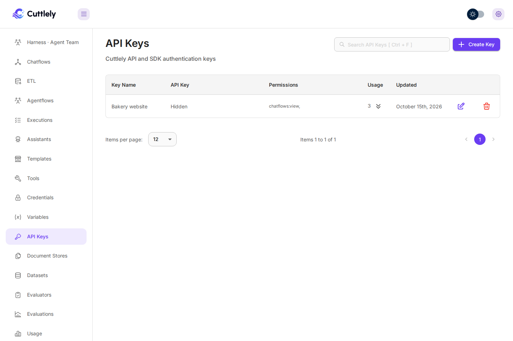

# Use the Cuttlely API in your own web app

Every chatflow, agentflow and harness you build in Cuttlely can answer questions for your own website or app. Your server sends the question to Cuttlely's prediction API with an API key, and Cuttlely sends back the answer, either whole or token by token. This guide covers how to do that safely.

Bakery outputs on this page come from real runs against a local Cuttlely server with the `gpt-4.1-mini` model, using a made-up bakery. Session tokens are replaced with `<session token>`. Larkfield Home order snippets in the Orchestrate examples are illustrative made-up demo data, not a recorded model run.

-   [Before you start](#before-you-start)
-   [Create an API key](#create-an-api-key)
-   [Create a key from a script](#create-a-key-from-a-script)
-   [Ask a chatflow](#ask-a-chatflow)
-   [Call a chatflow from Orchestrate](#call-a-chatflow-from-orchestrate)
-   [MCP endpoint](#mcp-endpoint)
-   [Call a chatflow over A2A](#call-a-chatflow-over-a2a)
-   [Agentflows and harnesses](#agentflows-and-harnesses)
-   [Run a harness in the background](#run-a-harness-in-the-background)
-   [Stream the answer](#stream-the-answer)
-   [Keep the conversation going](#keep-the-conversation-going)
-   [Send a file with the question](#send-a-file-with-the-question)
-   [Change settings for one request](#change-settings-for-one-request)
-   [Which version answers: Live, draft, Dev and Prod](#which-version-answers-live-draft-dev-and-prod)
-   [Errors, rate limits and allowed origins](#errors-rate-limits-and-allowed-origins)
-   [The example web app](#the-example-web-app)
-   [When to use the chat widget instead](#when-to-use-the-chat-widget-instead)
-   [More APIs](#more-apis)

## Before you start

You need:

-   A Cuttlely server. The examples use `$CUTTLELY_URL`, for example `http://localhost:3000`.
-   A flow that answers in the canvas chat, and has been published (see [Which version answers](#which-version-answers-live-draft-dev-and-prod)). Its id is in the browser address bar on the canvas, and in **API Endpoint** (the `</>` button at the top right of the canvas). The examples use `$FLOW_ID`.
-   An API key, in `$CUTTLELY_API_KEY`.

Keep the API key on your server. Never put it in a web page, a mobile app or a public repository: anyone who has it can ask your flow questions on your model account. The [example web app](#the-example-web-app) shows the pattern: the browser talks to your server, and only your server talks to Cuttlely.

## Create an API key

1. In the sidebar, open **API Keys** and select **Create Key**.
2. Give the key a name, such as `Bakery website`, and choose at least one permission. Permissions decide what the key can do on Cuttlely's management API (for example `chatflows:view`). Asking a flow does not need a permission; see the next step.
3. Copy the key when it is shown. Cuttlely stores only a hash, so it cannot show the key again.



Then choose which flows the key can call. On each flow's canvas, open **API Endpoint** (`</>`), and pick the key in the drop-down at the top right.

-   **A flow with a key** answers only requests that send that key as `Authorization: Bearer <key>`.
-   **A flow with "No Authorization"** answers anyone who knows its id. Use that only for flows you mean to be public, such as one behind the chat widget.

A request without the key, or with the wrong one, gets 401:

```bash
curl -s "$CUTTLELY_URL/api/v1/prediction/$FLOW_ID" \
  -H 'Authorization: Bearer not-a-real-key' \
  -H 'Content-Type: application/json' \
  -d '{"question":"hi"}'
```

```json
{ "statusCode": 401, "success": false, "message": "Unauthorized", "stack": {} }
```

To check a key without asking a flow, send it in the same header to `GET /api/v1/verify/apikey`. `GET /api/v1/chatflows/apikey` lists the flows the key can call. Both read the key only from `Authorization: Bearer`. The older form with the key in the URL path (`/api/v1/verify/apikey/<key>`, `/api/v1/chatflows/apikey/<key>`) answers 400 and does not check the key, because proxies, browser history and access logs keep URLs.

```bash
curl -s "$CUTTLELY_URL/api/v1/verify/apikey" -H "Authorization: Bearer $CUTTLELY_API_KEY"
```

## Create a key from a script

On a source install that uses the local owner account (`CUTTLELY_LOCAL_ADMIN=true`, see [Build from source](./how-to/from-source.md)), you can set up without the UI.

1. Create the owner account. Type the password at the prompt:

    ```bash
    CUTTLELY_LOCAL_ADMIN=true pnpm user --email you@example.com
    ```

2. Sign in and keep the session cookie. The `x-request-from: internal` header is required. Without it, sign-in answers `401 {"message":"Unauthorized"}` even when the password is right. If the server isn't running with `CUTTLELY_LOCAL_ADMIN=true`, the route answers 404.

    ```bash
    curl -s -c cookies.txt "$CUTTLELY_URL/api/v1/auth/login" \
      -H 'x-request-from: internal' \
      -H 'Content-Type: application/json' \
      -d "{\"email\":\"you@example.com\",\"password\":\"$CUTTLELY_PASSWORD\"}"
    ```

3. Create the key with that session. `permissions` must list at least one permission:

    ```bash
    curl -s -b cookies.txt "$CUTTLELY_URL/api/v1/apikey" \
      -H 'x-request-from: internal' \
      -H 'Content-Type: application/json' \
      -d '{"keyName":"Bakery script","permissions":["chatflows:view"]}'
    ```

    The answer lists your keys. The new one includes its `apiKey` in plain text. That's the only time you see it, so store it as `$CUTTLELY_API_KEY`. To let the key run harnesses, add `"harnesses": ["<harness name>"]` (see [Let the key run the harness](#let-the-key-run-the-harness)).

Then bind the key to a flow in **API Endpoint**, as in [Create an API key](#create-an-api-key). Delete `cookies.txt` when you're done.

## Ask a chatflow

`POST /api/v1/prediction/<flow id>` with a JSON body. `question` is the only required field.

```bash
curl -s "$CUTTLELY_URL/api/v1/prediction/$FLOW_ID" \
  -H "Authorization: Bearer $CUTTLELY_API_KEY" \
  -H 'Content-Type: application/json' \
  -d '{"question":"What time do you open on Saturday?"}'
```

```json
{
    "text": "We open at 7:00 on Saturday.",
    "question": "What time do you open on Saturday?",
    "chatId": "e1a548e9-20b6-427d-ac51-f2e85e67c7eb",
    "chatMessageId": "553ffb4a-faea-434d-b624-cf1aa660c604",
    "isStreamValid": false,
    "sessionId": "e1a548e9-20b6-427d-ac51-f2e85e67c7eb",
    "memoryType": "Buffer Memory",
    "sessionToken": "<session token>"
}
```

`text` is the answer. `chatId` and `sessionToken` continue the conversation; see [Keep the conversation going](#keep-the-conversation-going).

## Call a chatflow from Orchestrate

IBM watsonx Orchestrate can call a published chatflow as an `external_chat` collaborator. Bind an API key to the chatflow, then set the agent's `api_url` to `$CUTTLELY_URL/api/v1/orchestrate/<flow id>`. Both `POST /api/v1/orchestrate/<flow id>` and `POST /api/v1/orchestrate/<flow id>/chat/completions` run the same handler. The body is OpenAI-style chat completions. This route does not accept `overrideConfig`, uploads, or a client session token.

**Auth.** Send the flow's API key as `Authorization: Bearer <key>` or `X-API-Key: <key>`. If both headers are present they must match. A flow with no bound key is refused (`403` `keyless_flow`). A missing or wrong key is `401` `unauthorized`.

**Threads.** Optional `X-IBM-THREAD-ID` continues one conversation on that flow and key. Omit it and each call is a new chat; earlier `user` and `assistant` turns in `messages` become history. A second stream on the same thread while the first is still open is `409` `thread_busy`. In queue mode with more than one API replica, that busy check is per replica: two streams routed to different replicas are both accepted.

**Streaming.** `"stream": true` writes `text/event-stream` frames. The frame and the non-stream `chat.completion` object below use made-up Larkfield Home demo data (order LH-30112); they are not a recorded model run:

```text
event: thread.message.delta
data: {"id":"chatcmpl-…","object":"thread.message.delta","thread_id":"…","model":"…","created":1792430000,"choices":[{"delta":{"role":"assistant","content":"LH-30112 is a walnut side table."}}]}
```

Without `"stream": true` the body is a `chat.completion` object whose `choices[0].message.content` is the answer.

**Errors** before any stream starts use `{ "error": { "message", "type", "code" } }`, except a body over 1 MB. Common codes: `content_type_invalid` (415, Content-Type must be `application/json`), `messages_invalid` (400), `thread_id_invalid` (400, Orchestrate routes only), `credentials_conflict` (400), `unauthorized` (401), `keyless_flow` (403), `origin_not_allowed` (403), `flow_not_found` (404), `thread_busy` (409), `internal_error` (500, generic message). A body over 1 MB is 413 from the global error handler (`{ "statusCode": 413, "success": false, "message", "stack" }`), not `{ "error": { "code" } }`. A2A over 1 MB is 413 `{ "error": { "message": "Request body too large", "type": "invalid_request_error", "code": "body_too_large" } }`. The flow's prediction rate limit answers 429 with the same plain text as `/prediction`. The how-to [troubleshooting table](./how-to/orchestrate.md#troubleshooting) lists each code.

```bash
curl -s "$CUTTLELY_URL/api/v1/orchestrate/$FLOW_ID/chat/completions" \
  -H "Authorization: Bearer $CUTTLELY_API_KEY" \
  -H 'Content-Type: application/json' \
  -d '{"model":"any","messages":[{"role":"user","content":"What is the status of order LH-30112?"}]}'
```

```json
{
    "id": "chatcmpl-…",
    "object": "chat.completion",
    "created": 1792430000,
    "model": "any",
    "choices": [
        {
            "index": 0,
            "message": { "role": "assistant", "content": "LH-30112 is a walnut side table, arriving Oct 21." },
            "finish_reason": "stop"
        }
    ]
}
```

Cuttlely accepts optional `X-IBM-THREAD-ID` on these Orchestrate routes only, not on A2A. When the header is present, a flow that uses Buffer Memory can continue from stored turns. When it is omitted, earlier `user` and `assistant` turns in `messages` become history if the flow reads them. Whether Orchestrate actually sends that header, or instead resends earlier turns, is an open item in the how-to until the A2A live test.

The how-to is [Call a chatflow from IBM watsonx Orchestrate](./how-to/orchestrate.md). The Larkfield Home orders demo is [Record the Orchestrate demo](./how-to/orchestrate-demo.md).

A second Orchestrate chat on the same flow is a different conversation: it does not know a name given in the first chat, and the server log `thread=` hash is different.

## MCP endpoint

`POST /api/v1/mcp/:id` exposes a published chatflow or agentflow as a Streamable HTTP MCP server. The path is on the public whitelist, like prediction: a caller with the MCP Bearer token does not need a signed-in session. On the canvas, open **Configuration** and turn on **Expose as MCP Server** to mint the token. Auth is `Authorization: Bearer <MCP token>`, not an API key. GET answers **405** with `Allow: POST, DELETE, OPTIONS` and a JSON-RPC `-32000` body. DELETE is also **405** (`Session termination is not supported in stateless mode.`). The POST body follows **Largest upload** (`CUTTLELY_FILE_SIZE_LIMIT`, 50mb by default). [Use a chatflow as an Orchestrate toolkit](./how-to/orchestrate-mcp.md).

Orchestrate users who want a remote toolkit instead of an `external_chat` collaborator point the toolkit URL at this endpoint. The how-to for native collaborators is [Call a chatflow from IBM watsonx Orchestrate](./how-to/orchestrate.md).

## Call a chatflow over A2A

A2A 0.3.0 is shipped, not yet tested live with Orchestrate.

Orchestrate can also call the same published chatflow as an A2A 0.3.0 collaborator (`external_chat/A2A/0.3.0`). Bind an API key to the chatflow. The RPC URL, which is also the card `url`, is `$CUTTLELY_URL/api/v1/a2a/<flow id>`. The agent card is `GET /api/v1/a2a/<flow id>/.well-known/agent-card.json`. Do not point `api_url` at the card path. How Orchestrate registers an A2A 0.3.0 agent (the **AI Gateway** → **Agent directory** → **Add agent** path, IBM's `orchestrate agents discover` CLI, or another IBM flow) is an open item; do not treat any registration path as fact. Auth is the same as the Orchestrate chat-completions route: `Authorization: Bearer <key>` or `X-API-Key: <key>`.

`A2A_PUBLIC_BASE_URL` sets the origin used in the card `url` (for example `https://tunnel.example`). It must be an origin with no path and no trailing slash; anything else refuses to start. When it is unset, the card uses the request `Host` and `X-Forwarded-Proto` (with `TRUST_PROXY`).

`POST /api/v1/a2a/<flow id>` is JSON-RPC 2.0: `message/send`, `message/stream`, `tasks/get`, and `tasks/cancel`. JSON-RPC answers are HTTP 200 with an error object (`-32700` parse, `-32600` invalid request, `-32601` method not found, `-32602` invalid params, `-32603` internal, `-32001` task not found, `-32002` task not cancelable, `-32003` push not supported, `-32004` unsupported, `-32005` content type, `-32007` extended card). Auth, type, and rate refusals stay HTTP (401, 403, 404, 409 `thread_busy`, 415, 429) with the same bodies as the Orchestrate chat-completions route. A body over 1 MB is 413 `{ "error": { "message": "Request body too large", "type": "invalid_request_error", "code": "body_too_large" } }`, not the Orchestrate 413 body. A flow that pauses for a person is stored `failed` (`human_input_unsupported`). Tasks live in memory on that process for one hour, at most 1000 per flow, and are not shared across replicas.

`message/stream` writes `text/event-stream` JSON-RPC events: a `submitted` task, a `working` status, token `artifact-update`s, a closing artifact chunk, and a final `completed` or `failed` status. `Content-Type` must be `application/json`; a charset parameter is accepted.

If a live A2A chat sends no `contextId`, `taskId`, or `referenceTaskIds`, each turn is a new context on the wire and continuity cannot be mapped. After an A2A chat that used the name Ada, a new Orchestrate chat on the same flow must not know Ada, and its `thread=` hash must differ. A2A request logs use `context=`; Orchestrate request logs use `thread=`.

```bash
curl -s "$CUTTLELY_URL/api/v1/a2a/$FLOW_ID/.well-known/agent-card.json" \
  -H "X-API-Key: $CUTTLELY_API_KEY"
```

```bash
curl -s "$CUTTLELY_URL/api/v1/a2a/$FLOW_ID" \
  -H "Authorization: Bearer $CUTTLELY_API_KEY" \
  -H 'Content-Type: application/json' \
  -d '{"jsonrpc":"2.0","id":1,"method":"message/send","params":{"message":{"kind":"message","messageId":"m1","role":"user","parts":[{"kind":"text","text":"What time do you open on Saturday?"}]}}}'
```

## Agentflows and harnesses

The same route serves every kind of flow. Only the flow id changes.

**An agentflow** returns the answer in `text`, plus `executionId` and `agentFlowExecutedData`, one entry per step that ran:

```bash
curl -s "$CUTTLELY_URL/api/v1/prediction/$AGENTFLOW_ID" \
  -H "Authorization: Bearer $CUTTLELY_API_KEY" \
  -H 'Content-Type: application/json' \
  -d '{"question":"I would like a chocolate cake for Saturday, please."}'
```

```text
"text": "You'd like a chocolate cake for pickup on Saturday; please note we need 48 hours' notice for custom cakes."
"agentFlowExecutedData": [{"nodeId":"startAgentflow_0","nodeLabel":"Start", ...}, {"nodeId":"llmAgentflow_0", ...}]
```

**A harness** (an agent team) is called through a chatflow that holds one **Harness** card set to the harness's name. Build it as in [Call the harness from a chatflow](./how-to/harnesses.md#call-the-harness-from-a-chatflow), bind your key to that chatflow, tick the harness under **Harnesses this key may run** on that key, and call its id. A Harness card, or an Agent's harness tool, naming a harness that is not on the flow key's list fails with `This API key may not run harness "<name>".` The same list applies when that flow runs from a webhook, its MCP endpoint, or its schedule. The in-app chat and Try it run the card for the signed-in person instead. A flow with no key runs its Harness cards for anyone who has its id, with no list. An API key can read or change that flow's MCP settings, including its token, set or clear its webhook secret, or switch its schedule, only when the flow is bound to that key or to no key and every harness the flow names is on the key's list; otherwise it gets `403`. To call the harness by name with an API key instead, and get a run id back at once, see [Run a harness in the background](#run-a-harness-in-the-background).

```bash
curl -s "$CUTTLELY_URL/api/v1/prediction/$HARNESS_CHATFLOW_ID" \
  -H "Authorization: Bearer $CUTTLELY_API_KEY" \
  -H 'Content-Type: application/json' \
  -d '{"question":"Can I pick up a gluten-free loaf on Monday?"}'
```

The response has `text`, and also `harness`, `agents` (which specialists ran), `sources`, `artifacts`, `timings` and `report`:

```text
"text": "You cannot pick up a gluten-free loaf on Monday because Rosa's Bakery is closed that day. Gluten-free loaves are available only on Tuesdays and Fridays from 7:00 to 15:00."
"harness": "bakery-team"
"agents": [{"name":"orders","status":"completed","ms":1143,"task":"Can I pick up a gluten-free loaf on Monday?","model":"ChatOpenAI · gpt-4.1-mini","tokens":{"prompt":129,"completion":52,"cached":0}}]
"timings": {"routeMs":855,"specialistsMs":1145,"handoffMs":787}
```

## Run a harness in the background

A long harness turn does not have to hold a request open. Start the run, keep the run id, and ask for its status and answer later. The run is the same as one from the harness page: it uses the published harness, and it shows under **Runs** on the harness page with its run card, tokens and trace.

The responses in this section are examples with made-up data.

### Let the key run the harness

An API key runs no harness until the harness is on that key's list. In **API Keys**, create or edit the key:

1. Under **Permissions**, tick **Create** or **Update** under **CHATFLOWS** to start runs. **View** is ticked with it and lets the key read runs.
2. Under **Harnesses this key may run**, tick each harness the key may call, for example `bakery-team`.
3. Save.

The list is checked on every request, so removing a harness stops the key at its next call. The harness has to be in the key's team. The same list also applies to `POST /api/v1/harnesses/<name>/runs` (the call that waits for the answer), to the run history routes, to `GET`, `POST` and `DELETE` of a harness by name, and to a Harness card on a chatflow or agentflow bound to the key. `GET /api/v1/harnesses` lists only the harnesses on the key's list. With a key, a harness canvas whose name is not on the list is `403` on `/api/v1/chatflows/:id`, on every `/api/v1/flow-drafts/:id` route (draft save, Publish, Roll back, and the publish check, including reading one), and on Restore, and `GET /api/v1/chatflows` leaves it out. A key cannot save a canvas that names a harness off its list anywhere in it, including an Agent's harness tool, or change a flow's key while that flow names one (`403`). A signed-in person is checked by role only.

A key sees only the runs it started: the run list, a run, and a result return the key's own runs, and another caller's run is `404`. A `chatId` that already has runs from another key, or from a person, is refused with `403`, so one caller cannot continue another's conversation.

`POST /api/v1/apikey` and `PUT /api/v1/apikey/<id>` take the list as `harnesses`, an array of harness names. Leaving `harnesses` out of an update keeps the list as it is. A name whose harness was deleted is dropped from the list. When the caller is itself an API key, it may only grant harnesses on its own list.

### Start a run

`POST /api/v1/harnesses/<name>/runs/async` with `question`. `chatId` is optional: send the same one to continue a conversation, or leave it out for a fresh one each time.

```bash
curl -s "$CUTTLELY_URL/api/v1/harnesses/bakery-team/runs/async" \
  -H "Authorization: Bearer $CUTTLELY_API_KEY" \
  -H 'Content-Type: application/json' \
  -d '{"question":"How many rye loaves did we sell last Saturday?"}'
```

The answer is `202 Accepted`:

```json
{
    "runId": "run_7d1c2a4e-5b6f-4c3d-9e8f-0a1b2c3d4e5f",
    "harness": "bakery-team",
    "chatId": "api-3f2e1d0c-9b8a-4765-8432-10fedcba9876",
    "status": "queued",
    "statusUrl": "/api/v1/harnesses/bakery-team/runs/run_7d1c2a4e-5b6f-4c3d-9e8f-0a1b2c3d4e5f",
    "resultUrl": "/api/v1/harnesses/bakery-team/runs/run_7d1c2a4e-5b6f-4c3d-9e8f-0a1b2c3d4e5f/result"
}
```

### Read the status and the answer

`GET` the `resultUrl` until `finished` is `true`. A few seconds between reads is plenty.

```bash
curl -s "$CUTTLELY_URL/api/v1/harnesses/bakery-team/runs/run_7d1c2a4e-5b6f-4c3d-9e8f-0a1b2c3d4e5f/result" \
  -H "Authorization: Bearer $CUTTLELY_API_KEY"
```

While it runs:

```json
{ "runId": "run_7d1c2a4e-5b6f-4c3d-9e8f-0a1b2c3d4e5f", "harness": "bakery-team", "status": "running", "finished": false, "result": null }
```

When it is done:

```json
{
    "runId": "run_7d1c2a4e-5b6f-4c3d-9e8f-0a1b2c3d4e5f",
    "harness": "bakery-team",
    "status": "succeeded",
    "finished": true,
    "source": "api",
    "startedAt": "2026-10-17T09:00:00.000Z",
    "finishedAt": "2026-10-17T09:00:04.120Z",
    "latencyMs": 4120,
    "tokens": { "prompt": 812, "completion": 64 },
    "error": null,
    "result": {
        "text": "You sold 38 rye loaves last Saturday.",
        "agents": [{ "name": "orders", "status": "completed", "ms": 1980 }],
        "sources": [],
        "artifacts": [],
        "report": { "tokens": { "prompt": 812, "completion": 64 } }
    }
}
```

`status` is `queued`, `running`, `succeeded`, `completed_with_errors` (a tool failed and the team still answered), `failed`, or `cancelled`. A failed run has `error` with a `code` and a `message`, for example `busy` when the same `chatId` already has a turn running, `over_budget` when the turn ran past its time budget, or `interrupted` when the server stopped during the run. Image bytes are not kept with the answer; `artifacts` keeps their names. `GET /api/v1/harnesses/<name>/runs/<runId>` returns the run history row with its trace, the same row the harness page shows, without the full answer.

### Errors and limits

| Status | When                                                                         | Body                                                                     |
| ------ | ---------------------------------------------------------------------------- | ------------------------------------------------------------------------ |
| 400    | No `question`, or a `chatId` that is not 1 to 128 letters, numbers or `_.:-` | `message` says what to fix                                               |
| 403    | The `chatId` already has runs from another key or a person                   | `{"message":"That chatId belongs to another caller. Use a new chatId."}` |
| 401    | No key, or a key Cuttlely does not know                                      | `{"error":"Unauthorized Access"}`                                        |
| 403    | The key lacks the permission                                                 | `{"message":"Forbidden"}`                                                |
| 403    | The harness is not on the key's list                                         | `{"message":"This API key may not run harness \"bakery-team\"."}`        |
| 404    | No harness or run with that name in the key's team                           | `message` names what was not found                                       |
| 429    | More than 60 starts, or 600 reads, in a minute for that key                  | `{"message":"Too many harness runs. The limit is 60 a minute."}`         |

Starts are `POST .../runs` and `POST .../runs/async` together. Reads are the run list, a run, and a result. The limits count per API key, so two keys do not share one. Each server process keeps its own count, so with several processes behind one address a key can reach the limit once per process. A restart or shutdown waits for a background run, up to its usual wait. At the next start, a run still open that began more than the turn lock time plus 15 seconds earlier is marked `interrupted`. Every start through `POST .../runs/async` is an **Admin** > **Audit log** row of type `harness_run`. A start on either run route that an API key is refused because the harness is not on its list is a `harness_run` row too; a refusal for a missing permission or the rate limit is not. Changing a key's harness list is a `harness_access` row.

### Schedule a harness

A harness can also run on a cron schedule that a signed-in person sets on the harness page. The same calls are on the API for a signed-in session. An API key can read a schedule for a harness on its list, and cannot change one, because a schedule runs with its owner's permissions.

| Call                                            | What it does                                                                            |
| ----------------------------------------------- | --------------------------------------------------------------------------------------- |
| `GET /api/v1/harnesses/<name>/schedule`         | The schedule, or `{"schedule":null}`                                                    |
| `PUT /api/v1/harnesses/<name>/schedule`         | Create or replace it. The caller becomes the owner                                      |
| `POST /api/v1/harnesses/<name>/schedule/pause`  | Pause it                                                                                |
| `POST /api/v1/harnesses/<name>/schedule/resume` | Resume it. The next run is counted from now, and the person who resumes it is the owner |
| `DELETE /api/v1/harnesses/<name>/schedule`      | Delete it                                                                               |

`PUT` takes `cron` (five fields), `timezone` (an IANA place name such as `Europe/Paris`, or `UTC`; offsets and abbreviations such as `+02:00` or `CET` are `400`), `question` (up to 4,000 characters), and optionally `active: false` to save it paused. The zone comes back in canonical spelling. The day-of-month and day-of-week rule, and what happens when the clocks change, are in [Run it on a schedule](./how-to/harnesses.md#run-it-on-a-schedule). The response to a signed-in person, with made-up data:

```json
{
    "schedule": {
        "harness": "bakery-team",
        "cron": "0 7 * * 1-5",
        "timezone": "Europe/Paris",
        "question": "Summarise yesterday's orders.",
        "status": "active",
        "nextRunAt": "2026-10-19T05:00:00.000Z",
        "lastRunId": null,
        "lastRunAt": null,
        "lastResult": null,
        "lastReason": null,
        "owner": { "id": "8a7b6c5d-4e3f-4a2b-9c1d-0e1f2a3b4c5d", "name": "Sam Baker", "email": "sam@rosas-bakery.example" }
    }
}
```

`question` is shown with secrets such as connection strings and keys hidden, the same way run history stores a question. Sending that shown text back unchanged in a `PUT` keeps the stored question. An API key gets `owner` with `name` only, without `id` or `email`.

Changing a schedule needs the same permissions as starting a run, and an API key gets `403`. A bad cron, a day of the month no chosen month has when the day-of-week field starts with `*` (such as `0 9 30 2 *`), or a bad time zone is `400` with a `message`. `lastResult` is `starting` while a due time is being started (shown as `failed` once it has been starting for more than a minute), `running`, a run status such as `succeeded`, or `skipped`, `refused`, or `failed` for a due time that did not start a run, with `lastReason` saying why. Each scheduled run is a run with `source` `schedule`, readable through the run routes above by a signed-in person; an API key reads only the runs it started, so it does not see scheduled runs. Saves, pauses, resumes and deletes are limited to 30 a minute per person, counted in each server process, and are `harness_schedule` audit rows, and so is every run a schedule starts (`run_started`, with the run id).

### Delete a harness

`DELETE /api/v1/harnesses/<name>` needs `chatflows:delete` or `agentflows:delete`, and with an API key the harness on the key's list. It removes things in a fixed order, and stops at the first step that fails:

1. The harness name is removed from every API key's harness list in its team, in one transaction.
2. Its schedule is removed.
3. The harness itself is deleted.

If step 1 fails, the answer is `500` `Harness "bakery-team" was not deleted, because it could not be removed from API key lists. Try again.`, and nothing has changed. If step 2 fails, the answer is `500` `Harness "bakery-team" was not deleted, because its schedule could not be removed. Try again.` The harness and its schedule are still there, but no key lists the harness any more, so tick it again on any key that should keep running it. Either way the harness is kept, so a new harness created later with the same name never inherits the old key grants or the old owner's schedule. Runs already in run history stay.

### How the API reads a path

Before it decides whether a route is public, or refused to an API key, the server reads the path the way its routes do: decoded, in lower case (ASCII letters only), and with repeated slashes collapsed. So `/api/v1/Internal-Prediction`, `/api/v1//internal-prediction` and `/api/v1/%69nternal-prediction` are refused to an API key exactly like `/api/v1/internal-prediction`, and `/api/v1/Ping` is public like `/api/v1/ping`. An encoded slash (`%2F`) is not decoded, so it does not split a path segment and cannot reach a different route. `DENYLIST_URLS` entries are compared the same way, with spaces around each entry ignored. The schedule write routes (`PUT`, `DELETE`, `.../pause`, `.../resume`) refuse an API key in the route itself, so a path spelled in another case is refused too.

### Known limits

-   **A flow with no API key.** A chatflow or agentflow with **No Authorization** runs every harness its Harness cards and Agent harness tools name, in its team, for anyone who has its id. No key list applies to it. A key's list only limits what that key may save into such a flow, not who may call it. Bind a key to any flow that names a harness you do not want public.
-   **Credentials that hold another key.** Execute Flow, Chatflow Tool and Agent as Tool call `POST /api/v1/prediction/<flow id>` with the API key stored in their credential (the Chatflow API and Agentflow API credentials). The flow they call runs its Harness cards under its own bound key's list. So anyone who can use a credential holding a key's token, a person or another key, can run that key's flow and that key's harnesses through such a node; the list does not follow the credential. Keep keys that list harnesses out of shared credentials.

## Stream the answer

Add `"streaming": true` and Cuttlely answers with server-sent events (`Content-Type: text/event-stream`) as the model writes. Each event is two lines and a blank line. The JSON on the `data:` line has an `event` name and its `data`:

```bash
curl -sN "$CUTTLELY_URL/api/v1/prediction/$FLOW_ID" \
  -H "Authorization: Bearer $CUTTLELY_API_KEY" \
  -H 'Content-Type: application/json' \
  -d '{"question":"Do you have rye bread today? Today is Wednesday.","streaming":true}'
```

```text
message:
data:{"event":"start","data":""}

message:
data:{"event":"token","data":"Yes"}

message:
data:{"event":"token","data":","}

message:
data:{"event":"token","data":" we"}

...

message:
data:{"event":"token","data":"."}

message:
data:{"event":"metadata","data":{"chatId":"c93448cb-bb1f-4305-938f-bab00980a01b","chatMessageId":"2336eadb-3a42-4fed-8a0d-d5bf17c9885c","question":"Do you have rye bread today? Today is Wednesday.","sessionId":"c93448cb-bb1f-4305-938f-bab00980a01b","memoryType":"Buffer Memory"}}

message:
data:{"event":"end","data":"[DONE]"}
```

Join the `token` events for the answer ("Yes, we have rye bread today since it's Wednesday."). The events each kind of flow sends:

| Flow      | Events, in order                                                                                                                                            |
| --------- | ----------------------------------------------------------------------------------------------------------------------------------------------------------- |
| Chatflow  | `start`, `token` (many), `metadata`, `end`                                                                                                                  |
| Agentflow | `agentFlowEvent`, `nextAgentFlow` and `agentFlowExecutedData` as steps run, `token`, `calledTools`, `usageMetadata`, `metadata`, `end`                      |
| Harness   | `harness.route`, `harness.specialist` and `harness.partial` while specialists work, `harness.handoff`, `start`, `token`, `harness.final`, `metadata`, `end` |

An `error` event carries a message when the run fails after streaming started. Ignore events you do not use; new ones can be added.

### JavaScript (fetch)

This runs in Node 18 or newer, or in a browser page served by your own server:

```js
const res = await fetch(`${process.env.CUTTLELY_URL}/api/v1/prediction/${process.env.FLOW_ID}`, {
    method: 'POST',
    headers: { 'Content-Type': 'application/json', Authorization: `Bearer ${process.env.CUTTLELY_API_KEY}` },
    body: JSON.stringify({ question: 'Which days do you bake gluten-free loaves?', streaming: true })
})
if (!res.ok) throw new Error(`Cuttlely answered ${res.status}`)
const reader = res.body.getReader()
const decoder = new TextDecoder()
let buffer = ''
let answer = ''
for (;;) {
    const { done, value } = await reader.read()
    if (done) break
    buffer += decoder.decode(value, { stream: true })
    const blocks = buffer.split('\n\n')
    buffer = blocks.pop() // keep a half-received event for the next chunk
    for (const block of blocks) {
        const line = block.split('\n').find((l) => l.startsWith('data:'))
        if (!line) continue
        const { event, data } = JSON.parse(line.slice(5))
        if (event === 'token') answer += data
        if (event === 'metadata') console.info('chatId:', data.chatId)
        if (event === 'error') throw new Error(data)
    }
}
console.info('answer:', answer)
```

```text
chatId: 7c4d51e5-837b-418d-a0e1-91491501effa
answer: We bake gluten-free loaves on Tuesdays and Fridays. Happy baking!
```

### Python

Standard library only:

```python
import json, os, urllib.request

req = urllib.request.Request(
    f"{os.environ['CUTTLELY_URL']}/api/v1/prediction/{os.environ['FLOW_ID']}",
    data=json.dumps({"question": "How much notice do you need for a custom cake?", "streaming": True}).encode(),
    headers={"Content-Type": "application/json", "Authorization": f"Bearer {os.environ['CUTTLELY_API_KEY']}"},
    method="POST",
)
answer = ""
with urllib.request.urlopen(req) as res:
    for raw in res:  # one line at a time
        line = raw.decode().strip()
        if not line.startswith("data:"):
            continue
        event = json.loads(line[5:])
        if event["event"] == "token":
            answer += event["data"]
            print(event["data"], end="", flush=True)
        elif event["event"] == "metadata":
            chat_id = event["data"]["chatId"]
print("\nchatId:", chat_id)
```

```text
We need 48 hours' notice for a custom cake.
chatId: 415c7f11-4262-440a-a5c5-72b847794bce
```

## Keep the conversation going

A flow with memory (for example a Buffer Memory card) remembers earlier questions in the same conversation. Cuttlely picks the conversation id, not your app: the first answer returns a new `chatId` and a `sessionToken` that proves the conversation is yours. Send both back with the next question.

```bash
curl -s "$CUTTLELY_URL/api/v1/prediction/$FLOW_ID" \
  -H "Authorization: Bearer $CUTTLELY_API_KEY" \
  -H 'Content-Type: application/json' \
  -d '{"question":"My name is Sam. I want two croissants."}'
```

```text
"text": "Hello Sam! Two croissants will be 7.00. Would you like to pick them up today?"
"chatId": "5e4c0ed8-c1f1-4be5-bb28-c8bd4782b4e2"
"sessionToken": "<session token>"
```

```bash
curl -s "$CUTTLELY_URL/api/v1/prediction/$FLOW_ID" \
  -H "Authorization: Bearer $CUTTLELY_API_KEY" \
  -H 'Content-Type: application/json' \
  -d '{"question":"What is my name, and how much do I owe?",
       "chatId":"5e4c0ed8-c1f1-4be5-bb28-c8bd4782b4e2",
       "sessionToken":"<session token>"}'
```

```text
"text": "Your name is Sam, and you owe 7.00 for two croissants."
"chatId": "5e4c0ed8-c1f1-4be5-bb28-c8bd4782b4e2"
```

The same `chatId` without its token, or an id your app made up, starts a new conversation with a new `chatId`. That keeps one visitor from reading another's chat:

```text
"text": "I don't know your name based on the information provided."
"chatId": "7c915f06-ac82-4002-a5e3-776b73cda2f2"
```

You can send the token in the body (`sessionToken`) or in the `x-cuttlely-session-token` header. A streamed answer does not include the token in its events. It comes in a cookie instead: `Set-Cookie: cuttlely_session=<chat id>.<token>; Path=/api/v1; HttpOnly; SameSite=Lax`. Either send that cookie back (curl `-c jar -b jar`), or read the token from it and send it in the header. Both were run:

```bash
# first question, streamed: keep the cookie
curl -sN -c jar -b jar "$CUTTLELY_URL/api/v1/prediction/$FLOW_ID" -H "Authorization: Bearer $CUTTLELY_API_KEY" \
  -H 'Content-Type: application/json' -d '{"question":"I am Priya. Please note I need a cake for Saturday.","streaming":true}'
# next question: the chatId from the metadata event, and the same cookie jar
curl -sN -c jar -b jar "$CUTTLELY_URL/api/v1/prediction/$FLOW_ID" -H "Authorization: Bearer $CUTTLELY_API_KEY" \
  -H 'Content-Type: application/json' -d '{"question":"What is my name and what did I ask for?","chatId":"<chatId>","streaming":true}'
```

```text
Hi Priya, please place your custom cake order by Thursday to allow the required 48 hours notice.
Your name is Priya, and you asked for a cake for Saturday.
```

Keep the token on your server, next to your own session for that visitor, as the [example web app](#the-example-web-app) does.

## Send a file with the question

Send `multipart/form-data` with the question in `question` and the file in `files`. Cuttlely reads text from documents (text, PDF, Word, spreadsheets and similar) and gives it to the flow with the question. Turn on file uploads for the flow first: **Configuration**, **File Upload**, **Enable Full File Upload**. A document over 25 MB is refused with 400, and the flow's allowed file types (in the same settings) apply.

```bash
curl -s "$CUTTLELY_URL/api/v1/prediction/$FLOW_ID" \
  -H "Authorization: Bearer $CUTTLELY_API_KEY" \
  -F 'question=What is the Sunday special and its price?' \
  -F 'files=@specials.txt;type=text/plain'
```

`specials.txt` held three lines: the weekend specials, `Saturday: cardamom buns, 4.00 each` and `Sunday: apple galette, 22.00 whole`.

```text
"text": "The Sunday special is an apple galette, priced at 22.00 for a whole galette."
```

Images and audio go to cards that accept them, such as a chat model with image uploads turned on. For harnesses, see [Prediction API](./how-to/harnesses.md#prediction-api) in the harness guide.

The server takes only the uploads the flow accepts, the same ones its chat shows upload buttons for: images when a card has image uploads on, audio when Speech to Text is on, documents when file uploads are on, and chat files of the types a vector store with file upload takes. Anything else is refused before it is stored. An upload kind that is off gets 403 (`Image uploads are not turned on for this flow`), and a file type the flow does not take gets 400 (`File type 'image/svg+xml' is not allowed for this flow`). A file for a document loader input you allowed in Override Config is still taken.

### Files in an Agent's answer

When an Agent card makes a file (a chart, a spreadsheet, a report), its answer links to it at `/api/v1/get-upload-file`. The link is signed: it carries `expires` and `signature`, so it opens without the API key, for that one file in that conversation of that flow, for 15 minutes. Pass it on to your user as it is. Changing any part of it, or opening it after 15 minutes, gives 401. To fetch the file later, call the same address without `expires` and `signature` from your server, with the API key and the conversation's session token. The signature uses a secret the server makes on first start, so there is nothing to set up.

## Change settings for one request

`overrideConfig` changes a flow's settings for one request, but only the settings the flow's owner allowed. Turn it on in the canvas under **Configuration**, **Advanced**, **Override Config**, and pick each setting a request may change. Credentials, URLs, code and file inputs can never be changed this way. The full rules are in [Override configuration](./reference/override-config.md).

The same request, before and after the owner allowed **System Message** on the Conversation Chain card:

```bash
curl -s "$CUTTLELY_URL/api/v1/prediction/$FLOW_ID" \
  -H "Authorization: Bearer $CUTTLELY_API_KEY" \
  -H 'Content-Type: application/json' \
  -d '{"question":"When are you open on Sunday?",
       "overrideConfig":{"systemMessagePrompt":"You are the helper for Rosa'\''s Bakery. Open Tuesday to Sunday, 7:00 to 15:00, closed Mondays. Always answer in Spanish, in one sentence."}}'
```

```text
not allowed: "text": "We are open on Sunday from 7:00 to 15:00."
allowed:     "text": "Estamos abiertos el domingo de 7:00 a 15:00."
```

A setting that is not allowed is ignored, not refused, and the server logs the ignored names. If your app takes input from visitors, decide on your server what goes into `overrideConfig`; never pass a visitor's JSON through.

## Which version answers: Live, draft, Dev and Prod

The API always runs a flow's **Live** version. Saving on the canvas makes a **draft**, which only the canvas test chat uses, until you select **Publish**. A new flow serves nothing until its first Publish. The same is true for embeds, shared links, schedules and webhooks. See [Drafts and Publish](./how-to/versioning.md#drafts-and-publish).

Here a draft added "End every answer with: Happy baking!" to the system message:

```text
after saving the draft: "Yes, we have croissants available every day we're open."
after Publish:          "Yes, we have croissants available every day we're open, priced at 3.50 each. Happy baking!"
```

With two servers, a flow promoted from Dev to Prod is a separate flow on Prod with its own id, and Prod keeps its own credentials and API keys. Point your app's Prod settings at the Prod server, the Prod flow id and a key made on Prod. See [Move a flow from Dev to Prod](./how-to/versioning.md#move-a-flow-from-dev-to-prod).

## Errors, rate limits and allowed origins

Errors come back as JSON with a status code:

| Status | When                                                                            | Body (from real runs)                                                                                                |
| ------ | ------------------------------------------------------------------------------- | -------------------------------------------------------------------------------------------------------------------- |
| 400    | A bad request, such as a file over 25 MB or a type the flow refuses             | `message` says what to fix                                                                                           |
| 401    | No key, or the wrong key                                                        | `{"statusCode":401,"success":false,"message":"Unauthorized","stack":{}}`                                             |
| 403    | The request's `Origin` is not on the flow's allowed list                        | `{"statusCode":403,"success":false,"message":"This site is not allowed to use the bakery helper.","stack":{}}`       |
| 404    | No flow with that id                                                            | `{"statusCode":404,"success":false,"message":"Chatflow 00000000-0000-4000-8000-000000000000 not found","stack":{}}`  |
| 429    | The flow's rate limit was reached, or the model provider kept refusing with 429 | The flow's limit message, as plain text; for the provider, `message` says how long to wait                           |
| 500    | The flow failed while it ran                                                    | `message` describes the failure                                                                                      |
| 503    | The server is restarting or shutting down                                       | `{"statusCode":503,"success":false,"message":"Cuttlely is restarting. Try again in a minute.","code":"UNAVAILABLE"}` |

Show your visitors a short message of your own, not Cuttlely's: an error message can name your flow or settings.

A 503 comes with `Retry-After`: send the request again after that many seconds. A streamed answer that was still running when the server had to stop ends with an `error` event carrying `"status":503` and `"code":"UNAVAILABLE"`.

**Rate limits.** In the flow's **Configuration** (settings menu on the canvas), **Rate Limit** sets how many requests one client may send in a time window, and the message to send back. With 2 requests per 60 seconds, the third request got:

```text
HTTP/1.1 429 Too Many Requests
X-RateLimit-Limit: 2
X-RateLimit-Remaining: 0
Retry-After: 59
Content-Type: text/html; charset=utf-8

Too many questions at once. Please wait a minute and try again.
```

When the model provider (OpenAI, Anthropic and so on) keeps answering 429, Cuttlely tries the call up to 3 times within about 20 seconds, then answers `429` with `Retry-After`: the provider's own wait when it sent one, otherwise 30 seconds. A streamed answer ends with an `error` event carrying `"status":429`, `"code":"RATE_LIMITED"` and `"retryAfter"` in seconds. A provider account that is out of credit is not a rate limit and still fails with 500.

The server also limits a few routes per client address, whatever the flow says: sign-in (`/api/v1/auth`, `/api/v1/account`), the API-key check (`/api/v1/verify`), OAuth credentials, custom MCP servers, and node and credential icons. Each of those routes keeps its own count, and the budget is **Page loads a minute** in Server settings (3000 by default; the icon routes get more, see [Server settings](./how-to/server-settings.md)). Over it, the route answers 429 with the plain text `Too many requests, please try again later.` Behind a reverse proxy, set `TRUST_PROXY`, or every client shares one count.

Query values are checked for their type. A `feedbackType` that is not a string or a list of strings is ignored. Clearing a flow's messages (`DELETE /api/v1/chatmessage/<flow id>`) with a `feedbackType` that names no known rating answers 400 and clears nothing. The file download (`/api/v1/get-upload-file`) answers 400 when `chatflowId`, `chatId` or `fileName` is sent more than once. An evaluation run refuses a flow id that is not 1 to 64 letters, digits, `_` or `-` before it calls the flow.

Wait for `Retry-After` seconds before trying again. The flow's limit counts by client address, so all requests from your server share one limit: set it for your whole site's traffic, and rate-limit visitors on your own server.

**Allowed origins (CORS).** A browser sends an `Origin` header; a server does not. **Allowed Domains**, next to **Rate Limit** in the flow's **Configuration**, lists the sites whose pages may call it. A request with another origin gets 403, and a listed origin gets the CORS header the browser needs:

```text
Origin: https://other-site.example  ->  HTTP/1.1 403 Forbidden
Origin: https://rosas-bakery.example  ->  HTTP/1.1 200 OK
                                          Access-Control-Allow-Origin: https://rosas-bakery.example
```

A request with no `Origin`, such as one from your server, is not checked against the list, so the list does not replace the API key. The `CORS_ORIGINS` environment variable on the Cuttlely server adds origins allowed for every flow.

## The example web app

[`examples/web-app`](../examples/web-app) is a small bakery helper: a plain HTML and JavaScript page, and a Node server with no dependencies. The page sends the question to the app's own `/api/ask`. The server adds the API key, asks Cuttlely with streaming on, and passes the events through. It also keeps each visitor's Cuttlely `chatId` and session token, so the browser holds neither the key nor the token, only the app's own conversation id.

```bash
cd examples/web-app
CUTTLELY_URL=http://localhost:3000 CUTTLELY_FLOW_ID=<flow id> CUTTLELY_API_KEY=<key> node server.mjs
# Bakery helper on http://localhost:8080
```


The server also refuses empty or very long questions, never forwards `overrideConfig` or other fields from the browser, and turns Cuttlely's errors into a short message (429 stays 429). Its tests run with `node --test examples/web-app/server.test.mjs` and are part of `pnpm verify`.

## More APIs

The routes above are how an app asks a published flow. These management routes are documented on their own pages, including the request, the response, who may call them, and the errors.

-   `GET /api/v1/flow-drafts/:id/check/history` lists stored chat questions so a caller can pick them. [Question history](./reference/drafts-api.md#question-history).
-   `POST /api/v1/flow-drafts/:id/check` accepts `questionIds` for that pick. [Start a check](./reference/drafts-api.md#start-a-check).
-   `POST /api/v1/datasets/from-questions` stores the ticked questions as a dataset. Expected answers are empty. [Datasets API](./reference/datasets-api.md).
-   `GET /api/v1/server-settings/history` pages settings changes. Testing and Limits, including `CUTTLELY_PUBLISH_CHECK`, apply on the next use. [Server settings API](./reference/server-settings-api.md).
-   `POST /api/v1/auth/local/login`, `POST /api/v1/auth/local/logout`, `POST /api/v1/auth/local/password`, and `POST /api/v1/auth/local/accept` are local password sign-in. [Auth API](./reference/auth-api.md).
-   `GET /api/v1/auth/options` reports which methods are on, including `status` after AuthKit is linked. [Which methods are on](./reference/auth-api.md#which-methods-are-on).
-   `POST /api/v1/account/invite` with `link: true`, and `POST /api/v1/users/:id/reset-link`, return a one-time URL. An invited person is pending until they open their own invite link; a sign-in with a matching email alone never activates them. With AuthKit on, an invite always returns or emails the link. [One-time links](./reference/auth-api.md#one-time-links).
-   `POST /api/v1/users/:id/disable`, `POST /api/v1/users/:id/enable`, and `GET /api/v1/users/:id/sessions` manage local users. [Local users, roles, and sessions](./reference/local-directory-api.md).
-   `GET /api/v1/audit` lists sign-in, role, and settings events. [Audit API](./reference/audit-api.md).

## When to use the chat widget instead

If you want a chat bubble on your site and do not need your own interface, use Cuttlely's chat widget instead of the API. It needs no server code, but the flow behind it must be public ("No Authorization"), so protect it with **Allowed Domains** and a rate limit. Open **API Endpoint** (`</>`) on the canvas and choose **Embed** or **Share Chatbot**. Build your own app with the API when you need the key kept private, your own design, your own sign-in, or to combine the answer with other data. The [sharing guide](how-to/share-and-embed.md) walks through the shared link, the embed snippet, Allowed Domains and troubleshooting.
