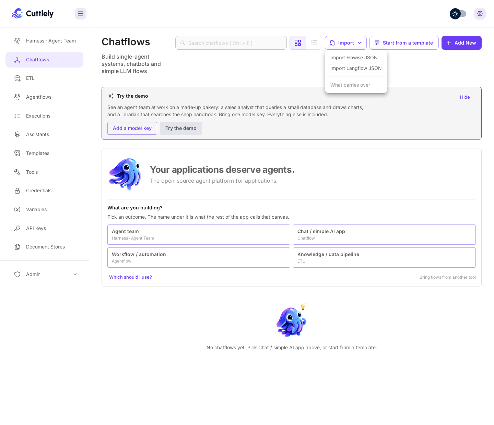
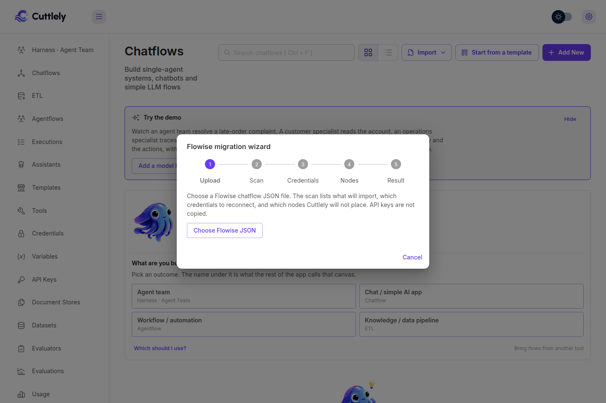
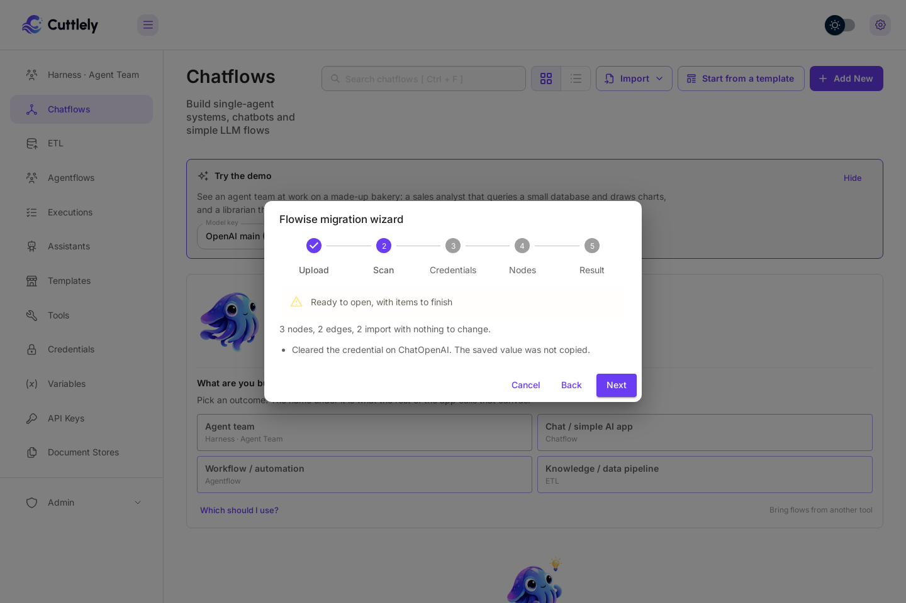
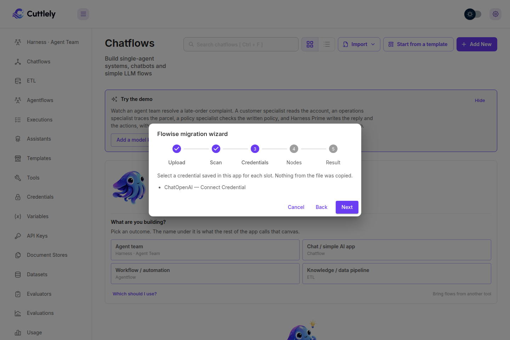
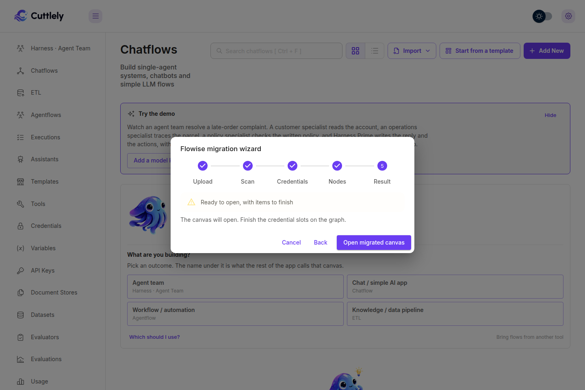

# Bring your existing flows

Built flows in another tool? Cuttlely can open many of them, so you don't start from zero. This page lists what works today, what works in part, and what is not supported yet.

Two things are true for every import:

-   **Keys never travel in a file.** API keys, passwords and saved credential ids are removed before the canvas opens. Save your keys under **Credentials** and select one on each card that needs it.
-   **An import is a new flow.** Nothing is saved until you select **Save**. Every import's first Save creates the published flow. The next canvas save is a draft. See [Drafts and Publish](./how-to/versioning.md#drafts-and-publish).

Install and sign in first: [Docker](./how-to/docker.md) and [Sign in](./how-to/sign-in.md).

## From Flowise

### Import a chatflow or agentflow file

1. In Flowise, export the flow to a JSON file. A file that holds one flow's `nodes` and `edges`, or a saved flow whose `flowData` holds them, both work. Template files with `nodes` and `edges` work the same way.
2. In Cuttlely, open **Chatflows**, select **Import** at the top right, then **Import Flowise JSON**. On a chatflow canvas, the gear menu has **Import Flowise JSON** too.

    

3. The **Flowise migration wizard** opens. Select **Choose Flowise JSON** and pick your file.

    

4. **Scan** counts the nodes and edges and lists what the wizard fixed, such as a credential it cleared. Select **Next**.

    

5. **Credentials** lists each card that needs a credential. Note them, then select **Next**.

    

6. **Nodes** lists older nodes that still work but are on their way out, and nodes Cuttlely cannot place. Select **Next**.
7. **Result** is green when nothing is left to do, and amber when the canvas can open but something still needs you. Select **Open migrated canvas**.

    

8. The flow opens on the canvas that fits it: a chatflow on the chatflow canvas, and an agentflow on the agentflow canvas. Select a credential on each card the wizard named, then select **Save**.

    

This picture shows classic cards, with every setting on the card. With the default compact cards, select a card to set its credential in the side panel. See [Canvas cards](./how-to/canvas.md).

What the scan checks, rule by rule: [Flowise migration wizard](./flowise-migration-wizard.md).

### What carries over

-   **Nodes.** A node whose name is in Cuttlely's node catalog opens as it is, with its settings. The catalog has about 300 nodes. Older nodes that are being retired still open, and the wizard lists them.
-   **Connections.** Every edge between two nodes that exist. An edge that points at a missing node is dropped, and the wizard says so.
-   **Chatflows and agentflows.** Both open on their own canvas. Older multi-agent and sequential-agent flows open on the legacy agentflow canvas. They run and save there, but the app no longer offers that canvas for new work.
-   **The prediction API.** A chatflow answers on `POST /api/v1/prediction/:id` with the same request body, so code that already calls that route keeps working once you point it at Cuttlely and use the new flow id.
-   **Website embeds.** An old embed script does not carry over. Copy the new snippet from the chatflow's **Embed** tab: it loads Cuttlely's own chat from your Cuttlely server (`/embed/chat.js`) and uses the flow's Share settings. See [Share and embed a chat](./how-to/share-and-embed.md).
-   **Custom tools.** On **Tools**, **Load** reads an exported tool JSON file and opens it in the **Add New Tool** dialog to save.
-   **Settings names.** Environment variables that start with `FLOWISE_`, such as `FLOWISE_SECRETKEY_OVERWRITE`, keep their names and meaning. `CUTTLELY_SECRETKEY_OVERWRITE`, `CUTTLELY_FILE_SIZE_LIMIT` and `DISABLE_CUTTLELY_TELEMETRY` are compatibility aliases for those settings. When both names are set, the `CUTTLELY_` name is used, except the encryption key: if those two values differ, Cuttlely refuses to start.

### Move a whole install

A Flowise `3.1.4` install from source keeps its database and encryption key in `~/.flowise`. Stop it, back that folder up, and move it to `~/.cuttlely` before you start Cuttlely for the first time:

```bash
mv ~/.flowise ~/.cuttlely
```

A Flowise Docker install keeps the same folder in the volume mounted at `/root/.flowise`. Copy its contents into Cuttlely's data volume at `/var/cuttlely/data` before Cuttlely starts.

Cuttlely upgrades the database when it starts. Your flows, credentials and the rest of that database come with it, as long as the encryption key in that folder comes too. A database from a release older than `3.1.4` stops with `unsupported upgrade path, upgrade via Flowise 3.1.4 first`. Upgrade it there first, then move it. More on where Cuttlely keeps its data: [From source](./how-to/from-source.md#where-your-data-lives).

### Not yet supported

-   A whole-workspace export (several flows, tools and variables in one file). Import one flow at a time.
-   LlamaIndex nodes. Cuttlely removed them, and the wizard names each one and does not open the file.
-   The Arize, LangFuse, LangSmith, LangWatch, Lunary, Opik, Phoenix, and AssemblyAI configuration cards. Cuttlely removed them. The wizard drops each one, with a note on the Scan step, and still opens the file. Set up tracing in Analytics (Chatflow Configuration > Analytics) and transcription in Speech to Text instead.
-   A node Cuttlely does not have, or a node saved without its input and output lists. The wizard names it and does not open the file.
-   Matching or creating credentials inside the wizard. Select them on the canvas after it opens.
-   Rewriting an older completion model into the chat model of the same provider. The wizard keeps it as it is.
-   Keeping the saved zoom and position of the canvas.

## From Langflow

### Import a simple chat

Cuttlely opens a Langflow export when it is one chat: exactly one chat model, at most one prompt, and chat input and output.

1. In Langflow, export the flow to a JSON file.
2. In Cuttlely, open **Chatflows** and select **Import**, then **Import Langflow JSON**, and pick the file. The same option is on the chatflow canvas gear menu.
3. The chat opens on the chatflow canvas. The prompt becomes the system message, and a note on the canvas says the API key was not copied.

    

4. Select a credential on the chat model card, then select **Save**.

Supported chat models: OpenAI, Anthropic, Google, Groq, Ollama, Mistral, Azure OpenAI and xAI. The model name, the temperature and a positive max token count are copied. Buffer Memory is added, because the chat needs one. The full mapping: [Langflow import](./langflow-import.md).

### Not yet supported

-   Agents, tools, vector stores, retrievers and file loaders.
-   More than one chat model, or more than one prompt.
-   A chat model from a provider not in the list above.
-   Any other component.

A file like that stays on the import screen with `Langflow import is not supported yet`, and nothing opens.

## After the import

-   Try the flow in the canvas chat. It runs your draft.
-   Select **Publish** when it is ready. On a chatflow or agentflow, the Publish dialog can ask a few questions on your draft first. See [Check recent questions before you publish](./how-to/versioning.md#check-recent-questions-before-you-publish).
-   Every save is kept in [Version history](./how-to/versioning.md).
-   To add a team of specialists behind the flow, see [Harnesses](./how-to/harnesses.md). To answer from your own files, see [ETL](./how-to/etl.md).
