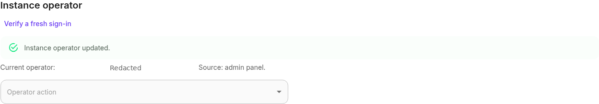
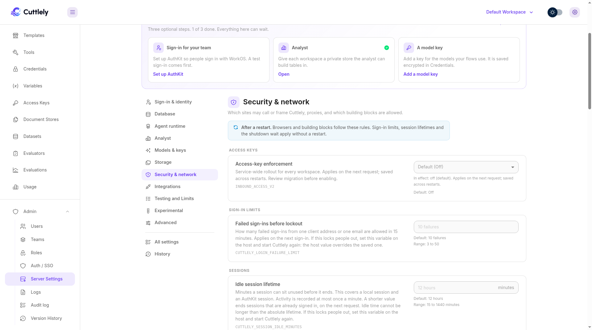
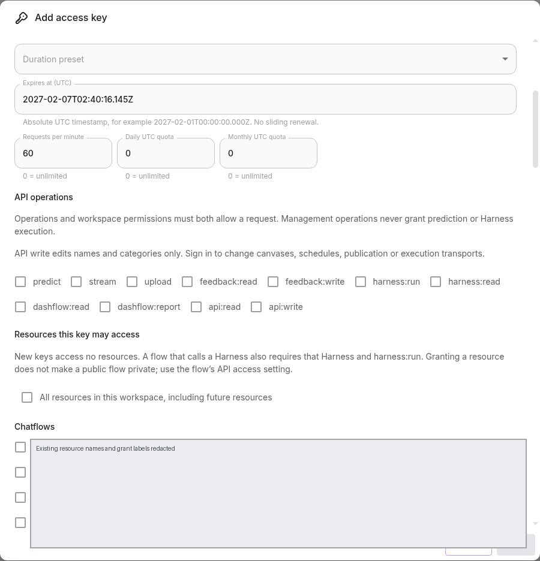
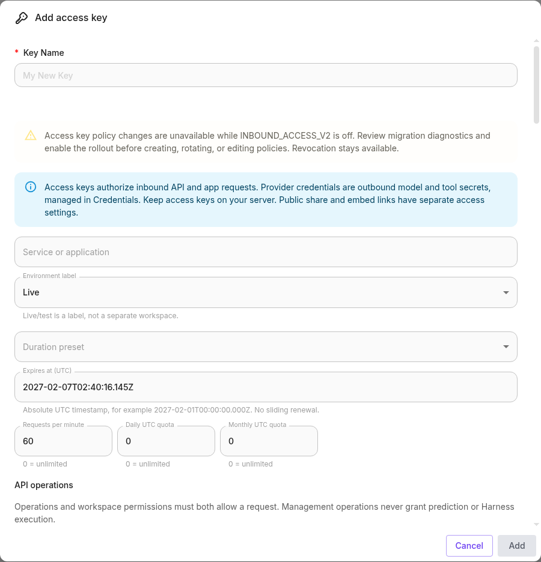

# Give your app a scoped access key

Use an access key when your server calls a private Cuttlely flow. This guide creates a key for one flow, calls it, then rotates and revokes the key. Access keys are inbound credentials, not provider secrets in **Credentials** or public share/embed links. Keep them on your server, never in browser code, a screenshot, a URL or a shared terminal transcript.

## Before you start

You need a signed-in workspace account allowed to manage keys and grant the selected operations and resources. A key cannot create another key. You also need a published Chatflow or Agentflow and its ID. If it calls a Harness, note that Harness too.

Scoped keys require enforcement **On**. Enforcement is **Off** by default; installing or upgrading does not turn it on. Do not activate it on a live installation merely to follow this guide. Have the instance operator complete the rollout below in a restored test installation first, then schedule production activation separately.

Legacy installations without an actual host binding use **Admin > Server settings > Instance operator** for an explicit one-time claim with a code printed only to the host log. Only verified host CLI bindings grandfather automatically; no legacy account, login method or owner role is inferred. The panel supports transfer, revocation with a durable Disabled tombstone, and separately confirmed host-proof recovery/rebind. The CLI is emergency recovery only. Any defined `CUTTLELY_INSTANCE_OPERATOR` value disables panel lifecycle changes; JSON/`none` precedence and invalid/empty fail-closed behavior remain. Read host-log proof in the hosting dashboard or Docker/Compose logs. Only the designated operator can change service settings. See [operator onboarding and recovery](./instance-operator.md).

The figures below were captured on product 1.6.1 at feature head `5c08b125`, before the 1.7.0 version bump. Enforcement remained Off, no key was created, and the create dialog was cancelled. Existing identities and resource names are redacted. The figures show the available screens and an unsubmitted policy preview.



## 1. Prepare enforcement with the instance operator

1. Back up the database, installation encryption key and settings directory. Keep the encryption key: replacing it invalidates modern credentials. Rehearse migration on a restored backup using the [migration report and diagnostics](../reference/access-keys.md#rollout-and-migration). Resolve every `requiresReview` result before activation.
2. Check private custom-assistant integrations before proceeding. Exact custom ASSISTANT grants are unsupported; existing private integrations can work in Off or Shadow but return `401` in On. Keep those installations Off or Shadow until an alternative is ready.
3. Verify a fresh sign-in (within ten minutes) using Instance operator in Server settings, then as the designated operator open **Admin > Server settings > Security & network > Access keys > Access-key enforcement**. Confirm the effective mode and its source. A nonempty host `INBOUND_ACCESS_V2` overrides and locks the selector, including host-set `off`.
4. Review a change to **Shadow** and type **APPLY**. Shadow serves legacy decisions and records scoped flow comparisons without charging quotas. It is not a simulation of every route or quota. Check the audit comparisons and separately exercise the routes your app uses in the restored installation.
5. When ready for that installation, review a change to **On** and type **APPLY**. This affects every workspace on the service, not just yours. A saved mode applies on the next request and persists across restarts. New scoped keys cannot be issued in Off or Shadow.



<!-- SCREENSHOT PENDING AK02: actual mode-change review and APPLY, before committing the change; docs/images/access-keys/enforcement-review.png. Action-only shot not captured. -->

Enforcement supports one API instance (`CUTTLELY_API_KEY_INSTANCES=1`). Minute counters are process-local and reset on restart; do not promise exact cross-replica limits. MySQL/MariaDB schema changes may commit partially on failure; the release has not validated those migrations against a live server. Read the reference before planning that upgrade.

## 2. Create the key

1. In the intended workspace, open **Access Keys** and click **Create Key**. SDK/Settings and per-flow keys share this list; first check that you are in the right workspace.
2. Enter a **Key Name** and **Service or application**, for example `Orders integration`. Set the **Environment label** to Live or Test. This label does not isolate data or create a separate workspace.
3. Under **Permissions**, select only the workspace permissions the caller needs. Under **API operations**, select `predict` for a normal prediction request. Permissions and operation scopes must both allow the call.
4. Under **Resources this key may access**, select the exact flow. If it invokes a Harness, also select that Harness and add `harness:run`, with its execution permissions. Add `stream` for JSON streaming. Multipart prediction needs `predict`, `upload` and `stream` up front; ordinary feedback uses `feedback:read` or `feedback:write` instead of Harness execution authority. See the [route matrix](../reference/access-keys.md#api-route-matrix) for other operations.
5. Leave **All resources in this workspace, including future resources** off for a single-flow integration. That privileged option requires `apikeys:grant-all` and a separate confirmation. It grants resources, not every operation, and does not remove caller restrictions or quotas.
6. Choose **Duration preset**, or enter an absolute **Expires at (UTC)** timestamp. The default is 90 days; 30 days, 90 days and No expiry are available. Prefer a finite expiry and plan rotation before it.
7. Set **Requests per minute**, **Daily UTC quota** and **Monthly UTC quota**. The defaults are 60 per minute and unlimited day/month totals; `0` means unlimited. Start with limits appropriate for this integration.
8. Click **Add**. Copy the secret once into your server's secret manager, then click **Done**. Cuttlely stores a verifier, not a recoverable secret. Closing the reveal loses the ability to copy it again; rotate if necessary. Do not include the reveal in screenshots.






New keys start with no scopes and no resource grants. An empty policy can be saved, but it authorizes no runtime calls. Exact grants follow stable IDs: a deleted resource recreated with the same name does not inherit the deleted resource's grant.

## 3. Make the flow private

Open the flow's **API Endpoint** dialog and select **Private (selected access keys)** when the flow must require a bearer. A resource grant alone does not make a public flow private. Keep public embeds separate; do not paste this key into embed configuration. See [Share and embed](./share-and-embed.md).

<!-- SCREENSHOT PENDING AK06: actual flow API Endpoint access control, Private selected, no bearer shown; docs/images/access-keys/private-flow.png. Action-only shot not captured. -->

## 4. Restrict callers, if needed

Edit the key to add **Allowed origins (one per line)**. Each entry must be an exact HTTP(S) origin, such as `https://app.example.com`, with no path or wildcard. An origin allowlist rejects callers with no Origin unless you check **Allow server callers without an Origin header**. Server-to-server calls commonly omit that header. An empty list has no origin restriction. Origin and CORS are not a replacement for authentication.

**Allowed IP addresses or CIDRs (one per line)** accepts IPv4, IPv6 and CIDRs. An empty list has no IP restriction. Ask the operator to check the trusted-proxy boundary before relying on this: the server uses its resolved client IP, not arbitrary forwarded headers.

Click **Save** after editing. When editing a migrated legacy policy, saving replaces migration compatibility with the explicit policy shown. Check scopes and resources before saving; the old secret value does not change.


## 5. Call the flow from your server

Have your secret manager supply `CUTTLELY_API_KEY` to the calling process. Set `CUTTLELY_BASE_URL` to your server URL and `FLOW_ID` to the selected flow's ID. Never use a browser environment variable that gets bundled into client code. This example makes a real prediction; use your approved test installation and test flow first.

```bash
: "${CUTTLELY_API_KEY:?Supply the key through your secret manager}"
: "${CUTTLELY_BASE_URL:?Set the Cuttlely server URL}"
: "${FLOW_ID:?Set the granted flow ID}"
curl --silent --show-error --include \
  "${CUTTLELY_BASE_URL}/api/v1/prediction/${FLOW_ID}" \
  --header "Authorization: Bearer ${CUTTLELY_API_KEY}" \
  --header 'Content-Type: application/json' \
  --data '{"question":"What can this team help with?","streaming":false}'
```

A successful nonstreaming prediction returns its JSON response. Do not use verbose HTTP tracing in shared logs: it can expose the Authorization header. Test the actual route your app uses; a credential-check endpoint does not prove that scopes, resources or quotas permit a prediction.

One accepted HTTP operation counts once, not once per token, streamed chunk or nested Harness task. Authorization refusals do not consume the key's quota. Application failures after complete authorization remain charged. Daily/monthly windows use UTC; rotation shares the same principal's policy and counters and does not reset its budget. Separate flow/IP prediction-attempt limits can still apply, including to refused attempts.

## 6. Rotate without dropping callers

1. Open the key and find **Credentials and usage**.
2. Set **Rotation grace (seconds, 0–86400)**. The default is 3600 seconds. Use `0` only when immediate retirement is intended.
3. Click **Rotate and reveal successor once**. Store the successor in the calling service's secret manager. Do not screenshot or log it.
4. Roll out that secret to every caller within the grace period. Confirm your approved test calls work with the successor before retiring the previous credential.
5. Revoke the previous credential with **Revoke credential**, or **Revoke legacy credential** for a retained legacy bearer. Repeated rotations do not extend an earlier cutoff.

<!-- SCREENSHOT PENDING AK08: actual Credentials and usage with grace and credential metadata, reveal closed; docs/images/access-keys/rotation-and-usage.png. Action-only shot not captured. -->

Extending the principal's expiry does not extend an already issued credential. Rotate to issue a credential with the new expiry. An expired or revoked credential does not revive through a policy edit.

## 7. Revoke access

Use the list's **Revoke** action to revoke the principal and block new requests from every credential belonging to it. Use credential revocation to retire just one secret. Already admitted streams or background runs may finish. Inspect usage and **Admin > Audit log** for lifecycle and policy changes; usage events are aggregated/deduplicated, not a complete per-request ledger.

<!-- SCREENSHOT PENDING AK09: actual principal-revocation confirmation, then revoked list state, using a disposable key; docs/images/access-keys/revoke-confirmation.png and revoked-key.png. Action-only shot not captured. -->

## Troubleshoot and recover

| What you see                                   | What to check                                                                                                                                                                                                                                                                                                                      |
| ---------------------------------------------- | ---------------------------------------------------------------------------------------------------------------------------------------------------------------------------------------------------------------------------------------------------------------------------------------------------------------------------------- |
| Creation or rotation unavailable               | Check effective enforcement mode. New scoped principals require On; do not change a service-wide mode without an operator rollout plan.                                                                                                                                                                                            |
| `401`                                          | Missing, expired, revoked or invalid credential; wrong endpoint or workspace; private custom ASSISTANT integration under On. A supplied invalid bearer does not fall through to public access.                                                                                                                                     |
| `403`                                          | Current permissions, scope, exact resource and caller policy. A Harness-backed flow also needs the Harness grant and `harness:run`.                                                                                                                                                                                                |
| `404`                                          | Check IDs and route ownership; some routes conceal resources the caller cannot access.                                                                                                                                                                                                                                             |
| `429`                                          | Honor `Retry-After`; check the principal's minute/UTC quota and separate flow/IP limits. Rotating is not a quota reset.                                                                                                                                                                                                            |
| `503`                                          | Ask the operator to inspect invalid host mode, authentication/quota storage availability or unsupported instance count. Do not retry without a bound.                                                                                                                                                                              |
| A new same-name resource fails                 | Grant the new stable ID explicitly. Do not expect deletion/recreation to restore authority.                                                                                                                                                                                                                                        |
| Only the instance operator can change settings | Open **Instance operator**. Eligible active owners use the one-time panel claim, recovery or rebind with host-log proof. A defined host override locks panel management. A binding created by the 1.7.0 host CLI supplies the automatic default; CLI binding is an emergency recovery path, not a mandatory existing-install step. |

To roll back enforcement, the designated operator reviews **Off** in the selector. If browser administration is unavailable, the host can set `INBOUND_ACCESS_V2=off` in the application's actual process environment and restart/recreate the service. With Compose, confirm the variable is forwarded into the service; setting an arbitrary host `.env` entry alone is not sufficient. This restores legacy decisions and refuses new scoped principals; it does not turn modern credentials into legacy secrets. Do not drop migration tables as a rollback.

Use the panel for routine operator transfer/revoke and fresh host-log proof for a changed-connection rebind. Disabled or invalid authority uses the separate RECOVER flow, never ordinary CLAIM. If nobody can sign in or files are unsafe, use the host CLI as the application OS user. Host JSON overrides the managed state; `none`, empty and invalid overrides close panel claims and mutations. See [operator recovery](./instance-operator.md#provisioning-failures-and-recovery).

For complete route details and current limits, use the [access-key reference](../reference/access-keys.md). For server sign-in and settings recovery, use [Server settings](./server-settings.md) and [Startup options](../reference/startup-options.md).
