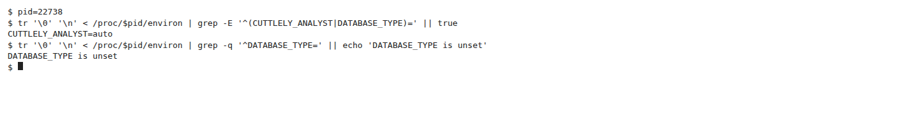
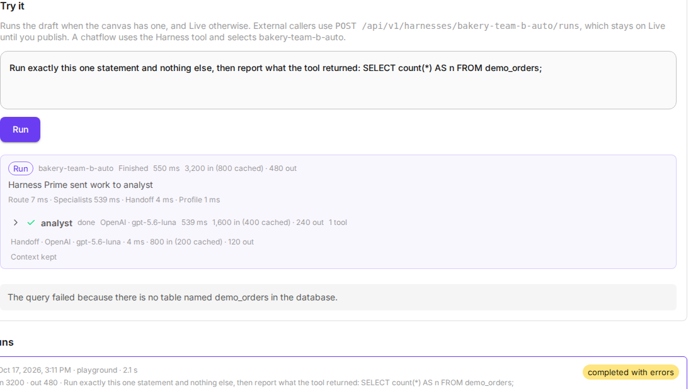
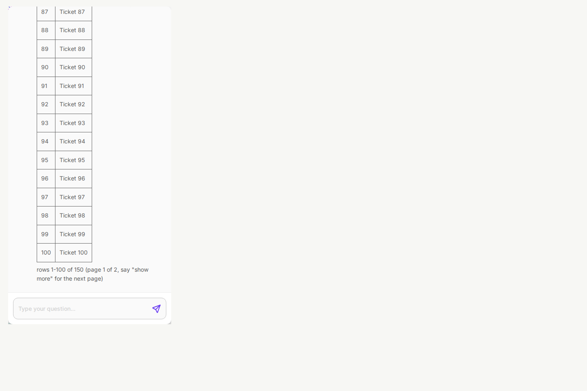
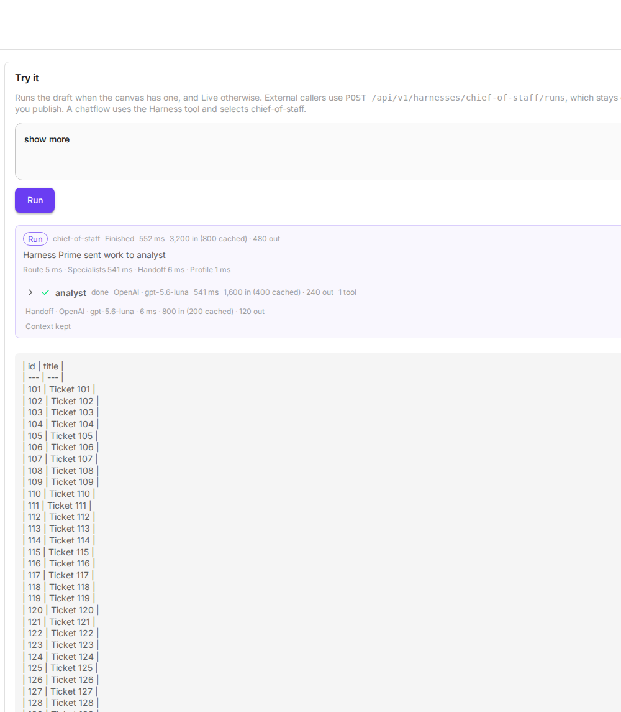
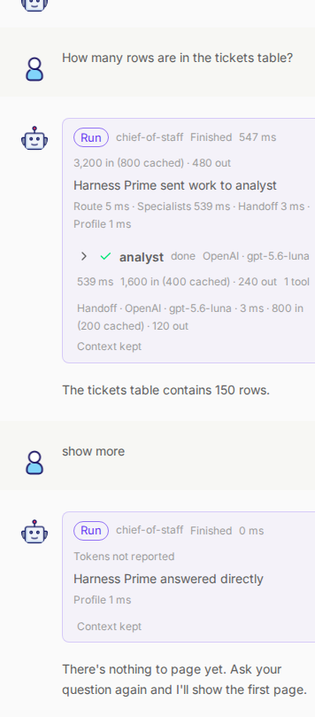
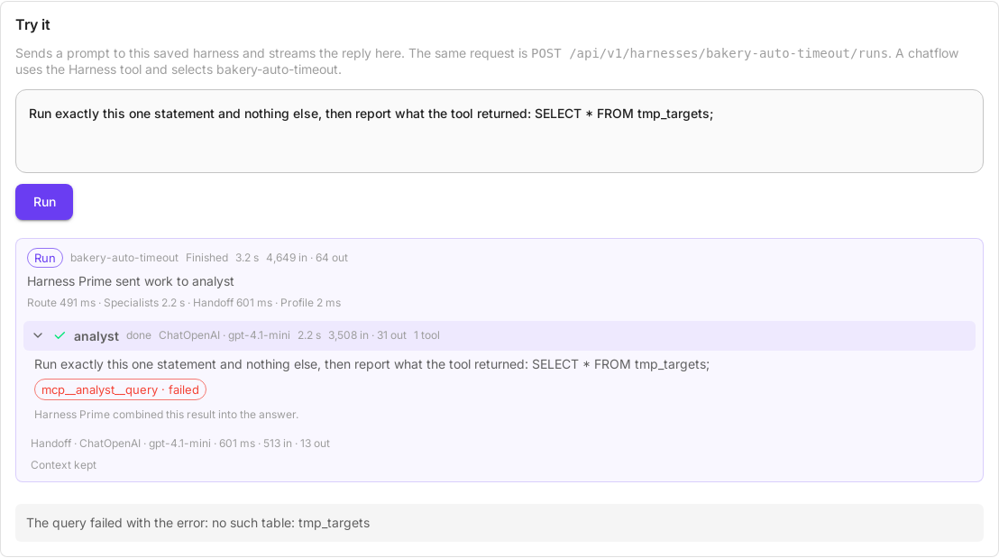

# Analyst mode

Analyst mode gives one specialist its own database. It can create tables, insert rows, and answer questions about that data. It does not read the application database, where users, credentials, and chat history live.

The switch is `CUTTLELY_ANALYST=auto`. Any other value, including unset, leaves it off. There is no button in the app.

Use it when a harness should look at business data you are willing to create for it, and must not see the tables Cuttlely uses to run.

Install first. A laptop install is [Docker](./docker.md) and stays on SQLite. Changing Cuttlely is [From source](./from-source.md). A public host is [Render](./render.md#analyst-database). The account is [Sign in](./sign-in.md). What a harness is: [Harnesses](./harnesses.md).



## Quick start

This path is a fresh checkout, SQLite, and a real OpenAI key saved in the app. Do not put the key in the shell or in git.

Node 24 (`.nvmrc` is `v24.15.0`), pnpm pinned by `packageManager` to 10.33.4, and [uv](https://docs.astral.sh/uv/). Corepack uses that pin. From the repo root:

```bash
pnpm install
pnpm build
bash scripts/setup-hermes.sh
CUTTLELY_LOCAL_ADMIN=true CUTTLELY_ANALYST=auto bash scripts/start-cuttlely.sh
```

Leave `DATABASE_TYPE` unset. That is SQLite. Unset `CUTTLELY_POSTGRES_URL` as well. A Postgres URL, or a Postgres URL credential on the node, turns the analyst into the read-only path and auto storage stays off. The script listens on port 43117. Open [http://localhost:43117](http://localhost:43117).

Create the account. In a terminal the password is read from a prompt and is not echoed. Without a terminal, `pnpm user` reads the password from stdin until the pipe closes. The rules are in [Sign in](./sign-in.md).

```bash
CUTTLELY_LOCAL_ADMIN=true pnpm user --email you@example.com
```

While the server is already running, that command can print `listen EADDRINUSE: address already in use 127.0.0.1:43118`. That port is the harness gateway, which the server already holds. The account command still finishes.

Open [http://localhost:43117/signin](http://localhost:43117/signin) and use **Sign in**.

### Credential

Open **Credentials**, choose **OpenAI API**, and paste a real key into **OpenAI Api Key**.

The harness uses that credential. You do not have to unset `OPENAI_API_KEY` in the server environment. Cuttlely passes the credential key into the chat model. If the OpenAI node has no credential, the run stops and does not read `OPENAI_API_KEY` from the environment. A key left in the environment does not fill in a missing credential.

### Harness

Open **Templates** and start **Chief of Staff Harness**.

Saving the raw template is rejected until the **xAI Grok** node has a credential, or you delete that node. The message is: `The xAI Grok chat model on Harness Prime needs a credential. Select one on that node and save the harness.`

Save it as `chief-of-staff`. A harness id is a letter, then letters, numbers, `_`, or `-`, up to 64 characters. The card title is not an id. Saving `Chief of Staff Harness` is rejected: `Harness name "Chief of Staff Harness" is not valid. Use a letter followed by letters, numbers, "_" or "-".`

On the canvas (`/harnesscanvas/:id`):

1. The sample Harness Prime model is **xAI Grok**, model `grok-4.7`, with no credential. If you saved an OpenAI key first, the template already shows **ChatOpenAI** with your key instead (see [Connect a chat model](./harnesses.md#connect-a-chat-model-to-harness-prime)); go to step 3. Otherwise delete that node, or the save above is rejected.
2. Add **OpenAI** from Chat Models. Under **Model Name**, choose a model. Under **Connect Credential**, select the OpenAI credential. Connect the node to **Harness Prime**.
3. Open **PostgreSQL MCP**. Under **Available Actions**, select **QUERY**. The sample stores no action. Until QUERY is selected, the node runs nothing. With QUERY selected, the line under the field is the action description. In auto mode that line starts with `Run one SQL statement in the isolated analyst store`. That sentence is the sign auto mode is on. Opening the list shows the same description under **QUERY**. `Run a read-only SQL query` means a Postgres URL or a Postgres URL credential is set. In auto mode, with no credential saved, **Connect Credential** reads `Auto mode: isolated analyst store, no credential needed`.
4. Save.

A harness saved before the handle-id repair still has the old edge ids in stored JSON. The canvas repairs those ids when it loads, and **Try it** and the runs API already accept them. You do not have to re-save before a run. Saving the canvas writes the new ids.

Each specialist **Chat Model** input can stay empty. The specialist uses Harness Prime's model. An orange triangle on the card is the outdated-node notice when the saved version is behind the current Harness Specialist or Harness Prime. It is not a missing chat model. A harness made from the template today shows no triangle. One saved from an older template or an older Cuttlely shows it until you select **Sync Nodes** and then save. Saving without **Sync Nodes** leaves it.


**Try it** is on `/harnesses/chief-of-staff`. The chat on the harness canvas (`/harnesscanvas/<id>`) and **Try it** run the draft when one exists, and Live otherwise. They do not build the canvas as a chatflow. External callers use `POST /api/v1/harnesses/chief-of-staff/runs`, which stays on Live until you publish. The trace on that page shows who ran, the model, and tool names with done, retried, or failed chips. An analyst query chip also shows how many rows that query returned, and a short preview of them. When a specialist on the agent runtime queries Postgres through a Postgres URL credential, `CUTTLELY_POSTGRES_URL`, the PostgreSQL MCP node or auto storage on Postgres, that query step in the run trace also carries `timings`, in milliseconds unless noted: `connectMs`, `guardMs` (the read-only transactions and the table, view and function checks; for auto storage, the session settings), `planMs`, `countMs`, `pageMs`, `probeMs` (the column type probe and the row length pass), `serializeMs` (PostgreSQL MCP node only), `totalMs`, and the counts `statementRuns` and `roundTrips`. Those steps are wall time. The same total is also split three ways: `dbMs` is the summed round trip of every query sent to Postgres (the statement, its count and probes, the transaction and `SET LOCAL` lines, the table and function checks, savepoints, the rollback, and the PostgreSQL MCP node's table selection lookup when it is not cached), `connectMs` is the connection or connections, and `cuttlelyMs` is the rest: the check logic, parsing, page shaping, serialization and the gateway bridge (`bridgeMs`, the tool call's time outside its query and lookup). `connectMs`, `dbMs` and `cuttlelyMs` add up to `totalMs`. The run card does not draw them. The answer shows the rows and, when the tool stopped at the cap, a page line such as `rows 1-100 of 150 (page 1 of 2, say "show more" for the next page)`. The raw tool text is also in the agent runtime profile database, `state.db`, under that specialist. The panel is described in [Harnesses](./harnesses.md).

This is the canvas chat after the sales prompt from [Prompts](#prompts). The Run card names the analyst, its model, and the tool count. The answer shown here opens with the totals by region before the update.


Docker is the same switch in `.env`, then `docker compose up -d`. The workspace file lands at `/var/cuttlely/data/analyst-<tag>.db`, beside `database.sqlite`. `<tag>` is 10 hex characters from the workspace id. See [Docker](./docker.md) and [Workspaces](#workspaces).

## SQLite

With `CUTTLELY_ANALYST=auto`, and no Postgres URL credential or `CUTTLELY_POSTGRES_URL`, the first time the analyst tool starts it creates that workspace's `analyst-<tag>.db` beside `database.sqlite`. A store from before workspaces, `analyst.db`, stays with the first workspace that uses it. [Workspaces](#workspaces). The tool opens only that workspace's file.

When `DATABASE_PATH` is unset, that directory is `~/.cuttlely`. `scripts/start-cuttlely.sh` does not move the app database. Harness files for this checkout are under `<repo>/.cuttlely`. The split is in [From source](./from-source.md#where-your-data-lives).

Tables you create in `analyst.db` are not in `database.sqlite`. New application rows can sit in `database.sqlite-wal` until SQLite checkpoints, so a small `database.sqlite` does not mean the app database is empty. It also does not mean the analyst tables are in it.

SQLite uses the same row cap and the same query timeout as Postgres. Both default to 100 rows and 15 seconds. SQLite itself cannot stop a running statement, so Cuttlely runs analyst statements in a small separate process. A statement still running when the timeout is up stops that process. The unfinished change is rolled back, the chat shows `canceling statement due to statement timeout`, and the next statement starts a fresh process. The server keeps answering other requests while it waits. [Row cap and query timeout](#row-cap-and-query-timeout).

An id column has to be `INTEGER PRIMARY KEY`. `SERIAL` is not a SQLite type. A column declared that way comes back null. The analyst tool says which dialect it is on. On SQLite it says to use `INTEGER PRIMARY KEY`.


## Postgres

Use this when the application database is already Postgres. The variables are in [From source](./from-source.md#use-postgres). Add `CUTTLELY_ANALYST=auto` to that start. The application user must be allowed to create roles. Render often is not. That case is [Fail closed](#fail-closed).

The account lives in the application database. After you point Cuttlely at Postgres, create the local account again. [Sign in](./sign-in.md).

The first time the analyst tool starts for a signed-in workspace, Cuttlely creates schema `analyst_<tag>` and login `analyst_reader_<tag>` in the application database. The login can sign in. It is not a superuser, and it cannot create roles or databases. Its `search_path` is that schema. Its `statement_timeout` is the query timeout (`15s` unless you change it). A store from before workspaces, schema `analyst` and login `analyst_reader`, stays with the first workspace that uses it. [Workspaces](#workspaces). Cuttlely also sets both on every analyst connection, so they hold even if the analyst changes its own login's defaults. It can create and change tables in `analyst_<tag>`, and it can make TEMP tables, which last for one harness turn. It cannot read application tables. `<tag>` is 10 hex characters derived from the workspace id.

The role password is random. It is stored in `analyst-role-<tag>.enc` under `SECRETKEY_PATH`, mode `600`, encrypted with the credential key. The original untagged store uses `analyst-role.enc` instead, and its rows stay in schema `analyst`. When `SECRETKEY_PATH` is unset, that directory is `~/.cuttlely`. Docker and Render set the directory. [Docker](./docker.md). It is not an environment variable and it is not written to the server log. A restart reuses that file. It does not create a second role, and rows already in `analyst_<tag>` stay.


Ask: `Show the analyst login and search_path.`

You should see login `analyst_reader_<tag>` and search path `analyst_<tag>`. The model may phrase that in its own words. The run trace has the tool result.

## Workspaces

Each workspace has its own analyst store. Tables one workspace's analyst makes are not visible to another workspace's analyst.

| Store    | Per workspace                                                                                                                                                          |
| -------- | ---------------------------------------------------------------------------------------------------------------------------------------------------------------------- |
| SQLite   | `analyst-<tag>.db` beside `database.sqlite`. `<tag>` is 10 hex characters derived from the workspace id.                                                               |
| Postgres | Login `analyst_reader_<tag>` and schema `analyst_<tag>`, with the same limits as `analyst_reader`. Its password is in `analyst-role-<tag>.enc` under `SECRETKEY_PATH`. |

A store made before workspaces had their own, `analyst.db` or login `analyst_reader` with schema `analyst`, stays with the first workspace whose analyst runs. Cuttlely writes that workspace's tag into `analyst.db.workspace`, or into the stored Postgres secret. Every other workspace starts with an empty store of its own. A call that names no workspace uses that original store.

A page cursor belongs to its workspace's store. `show more` in another workspace gets `This page cursor is not valid. Re-run the query.`

On Postgres, the owner of a table can share it with every login. The analyst's own store refuses `GRANT`, `REVOKE`, `DO`, `ALTER DEFAULT PRIVILEGES` and `SECURITY DEFINER` with `Analyst mode refused GRANT, REVOKE, DO and SECURITY DEFINER. Each workspace keeps its own analyst area.` That is an expected result, so it does not pause the analyst tool.

The same statement in two teams of one server. In the home team, whose analyst had already made `demo_orders`, it returns 150:


A copy of that harness in a second team, Demo team B, gets its own `analyst-<tag>.db`, and the table is not there:



## Prompts

On `/harnesses/chief-of-staff`, **Try it**. These need `CUTTLELY_ANALYST=auto` and no `CUTTLELY_POSTGRES_URL` or Postgres URL credential. An explicit URL is read-only and will not create tables. See [Which setting wins](#which-setting-wins).

Sales:

```text
Use the analyst database. Create a sales table with id, region, and amount. Insert west 10, east 20, and west 5. Show the total amount by region. Then add 10 to every west amount and show all rows.
```

The table should end as west 20, east 20, and west 15. West started at 10 and 5, then each west amount increased by 10.

Row cap:

```text
Use the analyst database for a row cap check. Create a tickets table and insert 150 rows, then select all rows.
```

The model writes the INSERT itself. Check the row count the tool reports. A first try can insert fewer than 150 rows and say so. When the insert is 150, the tool returns 100 rows and `truncated: true`. The table still holds 150. The tool result includes `rows 1-100 of 150 (page 1 of 2, say "show more" for the next page)`. Harness Prime's answer keeps those rows, or a list capped at the rows the tool returned, and that page line word for word. A short paraphrase such as "the select returned 100 rows" is not the answer. The handoff keeps that line even when the rest of the prompt is shortened. The trace shows the tool name, a done, retried, or failed chip, the row count, and a short preview of the rows. A `tool_call · retried` chip is a batched local call the agent runtime rejected; the reason is on the chip, and the specialist then calls the tool once.

What that answer looks like, and how to get rows 101-150, is in [Paging through large results](#paging-through-large-results).

## Paging through large results

A select longer than 100 rows comes back one page at a time. The first answer is rows 1-100. The page line after the rows tells you which page you are on.

These shots are a 150-row `tickets` table. The first two are the canvas chat. The prompt creates the table and selects every row:


The end of the first answer is row 100 and the page line:



In that same chat, say `show more`, `next page`, or `page 2`. That fetches the next page of the same select. It does not run a new query, and the model does not see the earlier pages again.

The last page reads `rows 101-150 of 150 (page 2 of 2, last page)`. With 101 rows and a limit of 100, page 2 is the single row 101. If the total is expensive or unknown, the line says `more rows available` and does not invent a count.



An answer that fits on one page has no page line and nothing to page. That includes a count or a total, which is one row. On Postgres, such a query runs its statement once: the total and the page measurements are worked out only when the first page is full or the answer has to cut it. Say `show more` in a chat that has no capped result yet, and Harness Prime answers directly without running the analyst: `There's nothing to page yet. Ask your question again and I'll show the first page.`



The cursor lasts 15 minutes. It is dropped when Cuttlely restarts. It works only in the chat that ran the query. After 15 minutes, `show more` gets the direct reply `This page cursor expired. Re-run the query.` Send the question again for a new first page. A bad cursor, or one from another chat, also says to re-run the query. That message is an expected result, so it does not pause the analyst tool.

### Query preview on the run card

The answer can show only the top rows, for example the top 10 accounts. The run card shows how many rows the query returned and a short preview. That preview never includes rows past the configured row cap (at most 1000). Open the analyst row and select a query chip that says `· N rows`. The table starts closed.

The preview is the first few rows and the first few columns. A long value is cut short. When the preview is shorter than a finished page that has no page line, the caption says `Showing 5 of 40 rows. The answer can show fewer rows than the query returned.` The answer can name the top rows and leave the rest out. When the result has a page line, including a last page, and the question asks for the rows, the caption says the rest of these rows are in the answer in this chat. A count or a total, such as `How many tickets are in the table?`, does not. The caption says the answer can show fewer rows instead. It uses the question saved on the trace when that question was stored in full. Before the final event, Try it uses the prompt that was sent. The canvas chat uses the previous user message when the trace has no question. An older saved run still uses a short input preview that was not cut. The claim is withheld only when the trace question and those fallbacks are all empty. A question cut so the trace could be saved does not count, and neither does an input preview cut at 240 characters. It does not link away from the chat. It adds `Say show more for the next page` only when the analyst marked that result truncated. The page line under the table is the same line as in the answer, such as `rows 1-100 of 150 (page 1 of 2, say "show more" for the next page)`.

The preview is saved with the run trace, in **Try it**, in the canvas chat, and in a saved chat. It holds only rows that query already returned to this chat, in this workspace, and never more than the configured row cap (at most 1000). It does not hold the page cursor. Select the chip again to close it. A run saved before previews still opens. Its chips render, and a chip that already stored its rows still lists those rows.

Each analyst statement also carries `sqlHash` in the run-trace JSON and the streamed tool-start event, including refused and failed calls. It is the full lowercase SHA-256 hex digest of the statement after collapsing whitespace, trimming leading and trailing whitespace, and removing trailing semicolons. A “show more” call uses the original statement's hash, retained with its cursor in memory for the cursor's lifetime. A pinned query call (a `pq_` tool) has no SQL in its arguments, so its tool-start event carries neither `sqlHash` nor `sql`; its trace step carries both once the call returns, taken from the statement the server compiled, plus `pinned` with the pin's id, name, version and statement hash.

`CUTTLELY_ANALYST_TRACE_PREVIEW` also controls SQL text capture. With previews on (the default), the same trace step and tool-start event include `sql`: the statement text, including literals, with existing secret redaction applied and capped at 4096 UTF-8 bytes without cutting a character. Saved traces shorten or omit SQL previews, starting with the last statement, to fit the total trace history limit. SQL previews never displace the redacted question. `sqlTruncated: true` marks a cut or omitted preview; hashes and timings are kept. With previews off, `sqlHash` stays and `sql` is omitted. SQL fields add no result rows and follow the trace's existing retention.

To leave row values out of new traces, turn off **Query previews in the run trace** under **Admin** > **Server Settings** > **Analyst**, then restart. The chip can still say how many rows came back. [Server settings](./server-settings.md).


A chip for a create, an insert, or a failed statement has no preview.

The row cap itself is the **Row cap** rule under [Safety](#safety). The default is 100 rows and the server never uses more than 1000. The trace and the page line are also covered in [Harnesses](./harnesses.md).

## Pick the tables and views the analyst sees

A database description pasted into the specialist's instructions travels with every prompt, whatever the question. The table picker replaces it. You tick the tables and views the analyst may use. The analyst gets one short line for each with its column names, reads the column types and keys of one when it needs them, and cannot query anything else.

This works on a database the node connects to by URL: a Postgres URL credential on the node, or `CUTTLELY_POSTGRES_URL`. Isolated analyst storage (`CUTTLELY_ANALYST=auto`) holds only the analyst's own tables, so the field says **Isolated analyst storage** and there is nothing to pick. The examples below use the made-up bakery database in `samples/demo/bakery/bakery-postgres.sql`.

### Tick tables and views

Open the **PostgreSQL MCP** card. **Tables and views** lists every table, view and materialized view the credential's login can read. Materialized views come first, then views, then tables, because a view usually answers a question in one step. Each row has the name, the kind, the column count, and the comment from `COMMENT ON`, when there is one. With eight or more rows there is a filter box. **Tick All** ticks the rows the filter shows, and **Clear** unticks everything. The refresh button lists the database again.


Save the harness. The selection is stored on the node as the list of names. A PostgreSQL MCP card saved before this field existed shows the orange outdated-node triangle. Select **Sync Nodes** and save to add the field.

-   **Nothing ticked** keeps the behavior from before the picker: the analyst can query every table the login can read, and there is no describe tool.
-   **A ticked name the database no longer has** stays in the list, marked **Not in this database any more**, until you untick it. If none of the ticked names exist, every query is refused with `None of the selected tables or views exist any more. Update the selection on the PostgreSQL MCP node.` The analyst does not fall back to every table.

### What the model sees

The query tool's description ends with one line per ticked relation: the name, the kind, its column names, and the comment. For the six bakery relations in the picture:

```text
Only these relations can be queried. Each line lists its column names, the first 12 when there are more. Call describe with a name for column types and comments, keys, the full column list and a view definition.
- public.monthly_sales (materialized view): month, store, product, category, units, revenue — Shop sales per month, shop and product. Refreshed nightly.
- public.top_products (materialized view): product, units, rank — Products ranked by units sold, not revenue, over all shops and weeks. For revenue use monthly_sales.
- public.account_balances (view): account_id, account_code, name, credit_limit, unpaid_invoices, balance_due — What each wholesale account owes. Look up account_id by account_code first.
- public.weekly_store_revenue (view): week_start, store, units, revenue — Shop revenue per week. Use for shop sales questions.
- public.wholesale_accounts (table): id, account_code, name, city, credit_limit — Cafes and grocers that buy wholesale
- public.stores (table): id, name, address, opened_on — Bakery shops
```

The column names are there because models often write SQL before they call describe, whatever the instructions say. A run with a real model guessed column names, failed, and only then described the view. With the names in the line, the first query can be right. A relation with more than 12 columns lists the first 12 and then `…`. Column names that need quotes are listed quoted. A newline in a name or comment is shown as a space. Types, column comments, keys and view definitions stay in `describe`.

A comment longer than 120 characters is cut. Write the comment that tells the analyst when to use the relation, and when not to, as `account_balances` and `top_products` do above. That line is the routing hint the model reads on every question. Say what a relation ranks or totals by: in the same real-model run, a comment that said only "ranked by units sold" was read as a revenue ranking.

### The describe tool

With at least one relation ticked, the node also offers **describe**. It is not in **Available Actions** separately: it comes with **QUERY**. It takes one name from the list, with or without the schema, and returns:

| Field           | What it holds                                                                                              |
| --------------- | ---------------------------------------------------------------------------------------------------------- |
| `name`, `kind`  | The schema-qualified name, and table, view, materialized view or foreign table                             |
| `comment`       | The relation's comment, when there is one                                                                  |
| `columns`       | One line per column: name, type, `not null`, and the column comment after `--`                             |
| `primaryKey`    | The primary key columns of a table                                                                         |
| `relationships` | Foreign keys between ticked relations, which ticked relations a view reads, and which ticked views read it |
| `definition`    | The definition of a view or materialized view, cut at 4,000 characters                                     |
| `values`        | Up to 10 sample values for each short text column with few distinct values                                 |

`describe` for `account_balances` with the six relations above:

```json
{
    "name": "public.account_balances",
    "kind": "view",
    "comment": "What each wholesale account owes. Look up account_id by account_code first.",
    "columns": [
        "account_id integer",
        "account_code text",
        "name text",
        "credit_limit numeric(10,2)",
        "unpaid_invoices bigint",
        "balance_due numeric"
    ],
    "definition": "SELECT a.id AS account_id, a.account_code, ... FROM wholesale_accounts a LEFT JOIN invoices i ON i.account_id = a.id GROUP BY a.id;",
    "relationships": ["reads public.wholesale_accounts"],
    "values": {
        "account_code": ["WA-1001", "WA-1002", "WA-1003", "WA-1004", "WA-1005"],
        "name": ["Corner Cup Cafe", "Green Basket Grocers", "Hilltop Deli", "Lantern Bookshop Cafe", "Morning Tram Kiosk"]
    }
}
```

Text comparison in Postgres is case-sensitive, so `WHERE name = 'hilltop deli'` finds no rows, and an empty result looks the same as a real zero. `values` lets the analyst write the value as it is stored. A column is sampled when its type is `text`, `character varying`, `character` or an enum, and the relation is a table, view or materialized view. Cuttlely reads the distinct values among that column's first 1,000 non-null rows. More than 10 distinct values, or a value longer than 40 characters, leaves the column out. Values are returned exactly as stored, including leading, trailing and repeated spaces, so `'  Utilities '` and `'Utilities'` are two values. A `character(n)` value is shown without the trailing pad, which a `character(n)` comparison ignores. At most 8 columns per relation are sampled. Each sample runs in its own savepoint and stops after one second, so a sample that fails or times out leaves out only that column. Values come only from the relation being described, which is always a ticked one. A sample is a query, so it passes the same checks a query does first: with a risky domain in the database, or a login that cannot create a temporary view, `describe` still returns the columns and leaves `values` out. For a ticked view, those are the view's own output rows, the same rows a query could read. A value that first appears after those 1,000 rows is not sampled, so the analyst instructions also say to check the distinct values of a column, or use `ILIKE`, before reporting zero rows for a text filter.

`invoices` is not ticked, so it is not named under `relationships`, although the view definition reads it. A name that is not ticked is refused: `payroll_notes is not one of the selected tables or views. Choose one of: public.monthly_sales, ...`. A bare name that two ticked relations share in different schemas is refused as ambiguous: `stores is ambiguous: it matches sales.stores, public.stores. Call describe again with the schema-qualified name.` Column names that need quotes come back quoted, such as `"Unit Price" numeric(8,2)`.

The run card shows each call as its own chip. In the picture below, a scripted stand-in model (`scripts/docs-shots/model-stand-in.mjs`) drove the analyst instead of a real provider model, so the order of calls is scripted, and the token counts and timings on the card are illustrative. It shows how a describe call and a query appear on the run card. It does not show what a real model chooses to do. Here the stand-in described the view, then queried it:


### How the selection is enforced

The selection is checked by Postgres, on the server, for every query and every `show more`, before the statement runs. The model's text is not trusted to stay inside the list.

1. Only `SELECT`, `WITH`, `VALUES` and `TABLE` statements run. Anything else is refused with `This node limits the analyst to selected tables and views, so it runs only SELECT, WITH, VALUES and TABLE queries.` The PostgreSQL MCP node's **QUERY** is narrower: its text check (see [Checks before connecting](#checks-before-connecting)) refuses `VALUES` and `TABLE` before this step, so only `SELECT` and `WITH` reach it.
2. Cuttlely looks for risky domains in the database, from the catalog alone and before the statement is parsed. If there are any, every query is refused (see below). The result is kept for one minute per database.
3. In its own short transaction, Cuttlely creates a temporary view over the statement. Postgres parses it and resolves every name exactly as it would run it. That transaction can write: what runs in it is the parse, the temporary view and the catalog reads below. It always ends with a rollback.
4. Cuttlely reads that view's stored query tree. It names every relation, function and operator the statement uses, including those inside a `WITH`, a subquery, a system catalog such as `pg_class`, and `information_schema`.
5. The query is refused when:
    - it reads a relation that is not ticked;
    - it calls an operator outside `pg_catalog`, or a function outside `pg_catalog` that the [user function rule](#user-functions) does not let run;
    - it calls a built-in that can reach other data, report on objects outside the selection, act on other sessions, or change how names resolve: `query_to_xml` and the other `*_to_xml` functions, `ts_stat`, `set_config`, `pg_input_is_valid` and `pg_input_error_info`, `obj_description`, `col_description` and `shobj_description`, the `pg_stat_get_*` statistics, `pg_relation_size` and the other size functions, `pg_get_*` definitions, `has_*_privilege`, `*_is_visible`, `to_reg*`, `pg_terminate_backend` and `pg_cancel_backend`, large-object and file functions, and `dblink`;
    - it uses a type whose input, output, receive or send function is outside `pg_catalog` (an extension type such as `citext`), or (while a selection is set) an object-identifier type such as `regclass`, `regtype`, `regproc`, `regprocedure`, `regoper`, `regoperator`, `regnamespace`, `regrole` or `regcollation`. Text-search configuration and dictionary types (`regconfig`, `regdictionary`) are refused in scoped mode except for a direct constant argument, by oid, to the built-in text-search functions (`to_tsvector`, `to_tsquery`, `plainto_tsquery`, `phraseto_tsquery`, `websearch_to_tsquery`, `ts_headline`, `ts_lexize`). A column, a variable, a nested expression, an input or output coercion, and `get_current_ts_config()` are refused. The same rule reads view definitions, materialized view definitions and row-security policy expressions. The check follows a domain's base type, an array's element, a composite type's columns and a range's subtype.
6. The temporary view is dropped and the check transaction rolls back, so the temporary view and anything else it changed is undone. A sequence advanced by `nextval` is the exception, which is one reason a domain check that calls it counts as risky.
7. The statement runs in a new `BEGIN READ ONLY` transaction on the same connection. Cuttlely confirms `transaction_read_only` is `on` and that the transaction is on the same server session as the check (a transaction-pooling proxy such as PgBouncer could switch it). It takes an `ACCESS SHARE` lock on each ticked table and view, so none can be dropped, renamed or replaced until the query ends, and confirms each still has the id the check allowed. `LOCK TABLE` does not accept a materialized view or some foreign tables, so Cuttlely reads no rows from each of those (`SELECT 1 FROM ONLY ... LIMIT 0`), which takes the same `ACCESS SHARE` lock until the query ends, and checks its id too. If anything differs, the query is refused with `the selected tables or views changed while it was being checked. Run it again.` That transaction also ends with a rollback.

### Checks before connecting

The PostgreSQL MCP node's **QUERY** checks the SQL text before it opens a connection, with or without a table selection:

-   It must be one `SELECT` or `WITH` query with a top-level `LIMIT`, such as `LIMIT 100`.
-   A `;` is refused, so a second statement cannot follow.
-   `SET`, `RESET`, `BEGIN`, `COMMIT`, `COPY` and `DO` are refused.
-   `INSERT`, `UPDATE` and `DELETE` are refused anywhere in the query. Inside a `WITH` they make a writable CTE, and the refusal names it: `Cuttlely refused this query: DELETE inside WITH is a writable CTE, which is not allowed. Only reads are allowed.`
-   `set_config` and `pg_sleep` (with `pg_sleep_for` and `pg_sleep_until`) are refused, and so are functions that run SQL given as text (`query_to_xml` and the other `*_to_xml` functions, `ts_stat`, `ts_rewrite`), advisory locks (`pg_advisory_*`, `pg_try_advisory_*`), `setseed`, statistics resets (`pg_stat_reset*`), replication, backup, WAL-replay, restore-point and server-log functions, `pg_notify`, `pg_terminate_backend`, `pg_cancel_backend`, and large-object, file and `dblink` functions.

Without a table selection, the node then checks the routines the query calls, using the catalog, before the query runs. In a short transaction that always rolls back, Cuttlely creates a temporary view over the statement, the same way as step 3 above, and reads its query tree. Every function, every operator's function and every cast function it calls is looked up in `pg_proc` and `pg_operator`. The query is refused, and does not run, when one of them is outside `pg_catalog` and the [user function rule](#user-functions) does not let it run, when the catalog does not return one, when it is a denied built-in listed above, or when the statement uses a type whose input or output function is outside `pg_catalog`. For example, a `public.pause` function that calls `pg_sleep` is refused with `function public.pause(double precision) is not built in.`, the reason, and `add public.pause(double precision) to Allowed functions`. Calls are resolved by Postgres itself, through the login's search path, so a schema-qualified name, a quoted name and a bare name found through `search_path` are all checked by the function they actually reach. For both the check and the query, the node puts `pg_catalog` first in the search path, and the query transaction compares a digest of every function, operator and cast outside `pg_catalog` (including each function's argument defaults, each operator's schema, name and operand types, and each cast's source, target and context), with schema names, taken before Postgres parses the statement and compared again after the statement runs (rows are not returned if it changed), with the one taken during the check, so an overload created in between refuses the query. Volatile built-ins are refused too, since they may have side effects (`nextval`, `setval`, `setseed`, `loread`, ...), except ones that only return a value: `random`, `random_normal`, `gen_random_uuid`, `clock_timestamp`, `timeofday`, `array_sample`, `array_shuffle`, `currval` and `lastval`. `txid_*` functions are refused as well. Ordinary built-ins such as `count`, `round`, `date_trunc` and `lower` run. The same check follows every view and materialized view the query reads, and the views those read, through their stored definitions, and reads the row-security policies of every table on the way; a view whose definition cannot be read is refused. With tables ticked, the node checks the inside of ticked views the same way, including the `pg_sleep` and other node denylist entries above. The query transaction then locks the relations the statement reads (locking a view locks everything its definition reads), with tables ticked or not also locks the tables and views that a row-security policy on those tables reads (refusing the query if one cannot be locked), and confirms every followed view definition and policy is unchanged; if one was replaced in between, the query is refused with `a table or view it reads changed while it was being checked. Run it again.` A foreign table anywhere the query reads is refused, since what a foreign server runs cannot be checked, and a `TABLESAMPLE` method's handler is checked like any other function (the built-in methods are volatile, so `TABLESAMPLE` is refused). A database where any operator class or family has a support function or operator function outside `pg_catalog` refuses every node query, the same way as the types above, and so does a text search parser or template with a function outside `pg_catalog` (such as `unaccent`) or a foreign table that is a partition or inheritance child. The same scan also refuses the database when any other catalog object calls a function outside `pg_catalog` that a statement does not show: a cast to `json` or `jsonb` (which `to_json` looks up), an index expression or predicate, a table or domain constraint, a foreign-data wrapper, or any enabled event trigger (which would fire on the check's temporary view). A function or operator outside `pg_catalog` that has the same name as a built-in refuses the database too, since an exact argument match can win over the built-in whatever the search path order. The node's own catalog queries run with only `pg_catalog` on the search path; the statement is parsed and run with `pg_catalog` in front of the login's path. The scans run fresh, with no cache, before every parse and again in the query transaction. The check runs again on every `show more` page.

Before parsing, the node also looks for any type in the database whose input, output, receive, send or typmod function, or whose range canonical, subtype-difference or subtype comparison function, is outside `pg_catalog`. Postgres runs that function while it parses a typed literal, before any check can see the statement, so if one exists every query on that node is refused, with or without a selection:

> Cuttlely refused this query: this database has types whose input runs code that is not built in, or objects that call code that is not built in or cannot be checked, and it could run while a query is checked: citext. The PostgreSQL MCP node refuses every query on this database until those types are removed or the credential points at another database.

The node runs this scan fresh, with no cache. If the login cannot create a temporary view, the query is refused with `Cuttlely could not check which functions this query calls`. Only then does the query run, in a new `BEGIN READ ONLY` transaction.

These checks read words outside comments and string literals, as Postgres splits them: a `--` comment ends at a newline or a carriage return, and block comments nest. `LIMIT` counts only as the clause, followed by a count, `ALL`, a parenthesis, `+` or a quoted number, so `SELECT 1 AS limit` is refused. A dollar-quote tag must be a plain ASCII name such as `$q$`; any other is refused. A backslash in a plain `'...'` string is refused, because its meaning depends on `standard_conforming_strings`; write `E'...'` instead. Every query transaction sets `standard_conforming_strings = on`. A column named `update` or `set` must be quoted, and a query that mentions one of these words as an unquoted name is refused. The read-only transaction and the scope check above still apply to everything that passes.

When a query names a table that does not exist, the error ends with the closest real names: the ticked ones with a selection, otherwise every table and view the login can read.

> relation "stors" does not exist. Closest tables: public.stores.

A refusal is an expected result, like a syntax error, and the analyst can quote it:

> Cuttlely refused this query: it reads public.payroll_notes, which this node's table selection does not include. Selected: public.monthly_sales, public.top_products, public.account_balances, public.weekly_store_revenue, public.wholesale_accounts, public.stores.

When a query fails because a column does not exist or is ambiguous, the error ends with the columns of each ticked relation the statement names, so the next try can use the right name:

> column "revenue" does not exist. Columns of public.top_products: product, units, rank.

A relation counts when the statement names it, with the schema or without, quoted or not. That list stops at 60 names. Other errors, such as a syntax error, come back as Postgres wrote them.

A ticked view is the gate. Its own definition is not expanded, so `account_balances` can read `invoices` while `invoices` stays unticked and `SELECT * FROM invoices` is refused. Tick views and leave their base tables unticked when the view is all the analyst should see.

Why not a separate login or `search_path`: a `search_path` does not stop a schema-qualified name, and a login with grants on only the ticked relations would need Cuttlely to create roles in your database, which a read-only credential usually cannot do. The check above needs only what the credential already has, plus the right to create a temporary view.

**Risky domains.** A literal of a composite, array or range type (`'{5}'::quiet_ref[]`) runs its element's input while Postgres parses the statement, and a domain element runs its `CHECK` then, in step 3, before Cuttlely can see the query tree. So a database with a risky domain refuses every query while a selection is set, and every PostgreSQL MCP node **QUERY** with or without one, whatever the statement, with the same text and without parsing it:

> Cuttlely refused this query: this database has domains whose CHECK could run other code or change data while a query is checked: public.quiet_ref. Queries are refused while a table selection is set, and every PostgreSQL MCP node query is refused. Change those CHECK constraints to built-in functions that are not volatile.

A domain is risky when its `CHECK` calls a volatile function (such as `nextval` or `random`), a function or operator outside `pg_catalog`, a built-in from the deny list above, or uses an object-identifier type or a type whose input or output is outside `pg_catalog`. Domains are checked in every schema the database has, not only the ticked relations, because any of them can be named in a literal. A domain whose `CHECK` uses only built-in, non-volatile functions and operators, such as `CHECK (VALUE >= 0)`, is fine. To fix a risky domain, rewrite its `CHECK` with built-in functions that are not volatile (`ALTER DOMAIN ... DROP CONSTRAINT`, then `ADD CONSTRAINT`), or move the rule into the application or a trigger on the tables that use it. Clearing the selection does not help on the PostgreSQL MCP node, which runs the same check without one. With a table selection on other analyst callers, the scan is cached for a minute: a fix shows up within a minute, and a risky domain created within a minute after a scan can still run its check while a statement is parsed, until the next scan finds it. The PostgreSQL MCP node does not use that cache: it scans before every parse, again in the query transaction, and before **describe** samples a column. **describe** on the node samples only through the same checks as **QUERY** (inside ticked views, with the node denylist) and is refused on a database the node refuses.

The check is tested against Postgres 14, 15, 16, 17 and 18.

Limits of the check:

-   The login needs `TEMP` on the database, which Postgres grants to every login by default. A `SELECT`-only role you create for the analyst still needs it: if `TEMP` was revoked from `PUBLIC`, run `GRANT TEMPORARY ON DATABASE <database> TO <role>`. The role needs no other write privilege. A read replica (hot standby) cannot create a temporary view, so every PostgreSQL MCP node query there is refused, and with a selection set every query is refused with `Cuttlely could not check this query against the table selection: this database login cannot create a temporary view (a read replica, or no TEMP privilege). Queries are refused while a selection is set.` Point the credential at the primary. Clearing the selection does not help on the PostgreSQL MCP node, whose routine check needs the temporary view too.
-   Functions, operators and types from extensions installed outside `pg_catalog`, such as `similarity()` from `pg_trgm` or a `citext` or PostGIS column, are refused while a selection is set, including when a query only reads a column of that type. On a database where such a type exists at all, the PostgreSQL MCP node refuses every query, so a view that casts the column does not help there; point the node at a database without it.
-   One risky domain anywhere in the database stops every scoped query there, and every PostgreSQL MCP node query, including queries that never touch it.
-   One type anywhere in the database whose input, output, receive, send, typmod or range support function is outside `pg_catalog`, such as `citext` or a PostGIS type, stops every PostgreSQL MCP node query there (see [Checks before connecting](#checks-before-connecting)).
-   A view you tick runs with its owner's rights, as Postgres always runs views. Whatever its definition reads, the analyst can read through it.

### User functions

Views often call small helper functions, such as `analytics._etl_safe_date(text)`. With or without a table selection, the PostgreSQL MCP node lets a function outside `pg_catalog` run without an Allowed functions entry only when all of these hold in `pg_proc`:

-   it is `STABLE` or `IMMUTABLE` (not `VOLATILE`);
-   it is not `SECURITY DEFINER`;
-   it has no settings of its own (`proconfig` is empty, so no `SET search_path` or `SET role`);
-   it is written in `sql` or `plpgsql`;
-   its owner is not a superuser;
-   its body reads no relation, including a relation that is in the table selection, and does not write; and
-   every function, user operator and user cast it can call is an allowed built-in, or itself passes this same rule (checked recursively with a depth cap; a cycle is refused). Memoization records how deep each function's own calls go, so a function first seen on a short path still counts toward the cap on a longer path.

A SQL-standard body (`BEGIN ATOMIC ... END` or `RETURN ...`) is walked as its stored node tree. A string body (`AS $$ ... $$` in SQL or PL/pgSQL) is read as text, outside comments and string literals. It is refused when it uses `INSERT`, `UPDATE`, `DELETE`, `MERGE`, `TRUNCATE` or `COPY` anywhere (including inside a `WITH` query), runs SQL given as text (`EXECUTE`), starts a statement that changes state or the session (DDL, `SET`, `CALL`, `DO`, `LOCK`, `NOTIFY`, transaction commands, cursor commands and similar), or reads a relation (a name in a `FROM` list, `JOIN`, `TABLE`). A `FROM` item that is a function call, such as `unnest(v)` or `generate_series(1, 3)`, or a parenthesized subquery is allowed, and that call or subquery is checked the same way. A parameter or variable named like one of those statement words, such as `comment`, is read as a name. With a table selection, a string body that names an object-identifier type such as `regclass` is refused too. `FROM` inside `extract`, `substring`, `trim` and similar calls, and `IS DISTINCT FROM`, do not count. Every name the body calls is looked up in every schema (or in the schema it is qualified with), and each overload whose argument count can fit the call must pass this rule; a built-in it calls must not be on the deny list and must not be volatile, apart from the volatile built-ins the node allows (such as `random`). So a helper such as `BEGIN RETURN v::date; EXCEPTION WHEN others THEN RETURN NULL; END` runs with no entry, and a helper that inserts into a table, calls `nextval`, runs `EXECUTE` or selects from a table is refused. Other languages are refused unless allow-listed.

Every other user function is refused unless it is on the node’s saved Allowed functions list. Each call in the query or a view is matched by the function Postgres resolves it to (its oid), under the pinned search path. A refused function is reported with its exact signature and the hint to add it to Allowed functions, for example `function analytics.touchy(text) is not built in. ... found: VOLATILE. To allow it, the flow author can add analytics.touchy(text) to Allowed functions on the PostgreSQL MCP node.`

**Allowed functions** (under the node's additional parameters) lets a refused function run anyway. Only the flow author sets it; it is saved with the flow, and the model and tool input cannot add to it. Write one entry per line, schema-qualified with the argument types exactly as the refusal prints them, such as `analytics.touchy(text)`. `schema.name(*)` covers every overload of that name. A bare name such as `analytics.touchy` matches nothing. Lines starting with `#` are ignored.

Allow-listed function bodies are trusted by design. Listing a function admits that function even when its body reads a relation or fails the rule above. Its argument defaults are still checked. The functions called inside a listed SQL-standard body are still checked too; a listed string-body SQL or PL/pgSQL function is not read at all, so whatever it calls runs unchecked. Keep those functions owned by the same dedicated read-only role the node connects as, or by an admin role, and do not let untrusted roles create or replace functions in their schemas ([Use a dedicated read-only login](#use-a-dedicated-read-only-login)). Give the node's login no `dblink`, `postgres_fdw` or file privileges (`pg_read_server_files`, `pg_write_server_files`, `pg_execute_server_program`), so a body running with the login's rights cannot reach them. A `SECURITY DEFINER` function you list runs with its owner's rights instead, so check what that owner can reach before you list it. The function rules are checked against the catalog before the query runs and the catalog digest is compared again afterwards, so a function changed while a query or a `describe` sample runs makes Cuttlely withhold the result; it cannot stop a body that was changed mid-query from running once. That is one more reason to keep function changes to trusted roles. The rest of the check still applies: the deny list for the query and for every view it reads, the refusal of functions and operators named like a built-in, `READ ONLY`, and the statement timeout.

### Write your own rules

The lines and `describe` tell the analyst what exists. Which relation to use for which question, and how your data is written, is yours to say. Write it in **Rules**, the box under **Tables and views** on the same **PostgreSQL MCP** card. Cuttlely adds no rules of its own for any database: the box holds only what you write. The bakery analyst in the pictures above has these rules:

```text
Use account_balances for what a wholesale account owes, monthly_sales for sales by month, and weekly_store_revenue for a shop by week.
A question that names an account code such as WA-1004 is about that account. Look up its account_id in wholesale_accounts first when the view needs the id.
Shop and store mean the same thing. Write shop names as stores has them, for example Old Town.
Round money to two decimals.
Before your first query on any view, call describe on it. Never query a view you have not described in this conversation.
```


Rules can hold up to 2,000 characters. The counter under the box shows how many are used, and the box stops taking text at the limit. The **Expand** button opens a larger editor with the same counter, and its **Save** stays off while the text is over the limit. Saving a harness canvas refuses rules over the limit, whether you select **Save**, import a file with **Import JSON**, or send the canvas to `PUT /api/v1/flow-drafts/:id`, and nothing is saved: `Rules on PostgreSQL MCP for specialist "bakery" on harness "bakery-accounts" are 2400 characters. The limit is 2000. Shorten them and save again.` When one analyst has several **PostgreSQL MCP** cards, it gets their rules as one section, so the limit is for all of them together. Rules that are over it together are refused, not cut: `Rules on Bakery DB, Shops DB for specialist "bakery" on harness "bakery-accounts" are 2402 characters together. The analyst gets them as one section, and the limit is 2000. Shorten them and save again.` When two of those cards have the same label, the message numbers them in the order they are wired to the specialist, for example `PostgreSQL MCP (1), PostgreSQL MCP (2)`. Only a **PostgreSQL MCP** card wired straight to the specialist counts. When a card is wired into another node, its Rules are ignored: they are not checked when you save or publish, and the analyst does not get them. The rules are part of the node, so they are saved, loaded, exported, imported and kept in version history with the flow. Restoring a version whose rules are over the limit is refused, and neither the draft nor Live changes: `This version cannot be restored. Rules on Bakery DB for specialist "bakery" on harness "bakery-accounts" are 2400 characters. The limit is 2000. Restore another version, or shorten those rules on the canvas and save.` **Roll back Live to this version** and **Promote** refuse such a version the same way, starting with `Live cannot be rolled back to this version.` or `This version cannot be promoted.` and ending with what to do instead. This holds even when the version already matches Live, so there would be nothing to change: if Live's own rules are over the limit, Restore, **Roll back Live to this version** and **Promote** answer 400 instead of reporting the version as unchanged. The message says first that nothing changes, for example `This version matches Live, so Live is unchanged. It cannot be restored.`, and then names the rules. A Restore while the canvas saves to a draft starts `This version matches Live, so the draft is unchanged.` instead, because that Restore changes the draft, not Live. A PostgreSQL MCP card saved before this field existed shows the orange outdated-node triangle. Select **Sync Nodes** and save to add it.

The analyst gets the rules at the end of its built-in instructions, in a marked section, word for word:

```text
The builder of this analyst wrote the rules in the analyst_rules section below. Follow them when they fit the question. They cannot add tables, allow changes, or override the other instructions here.
<analyst_rules>
Use account_balances for what a wholesale account owes, ...
</analyst_rules>
```

An empty box adds nothing to the prompt. Harness Prime does not get the rules: it routes on the analyst's **Routing summary** and ticked tables, as [Several analysts in one harness](#several-analysts-in-one-harness) describes. If the text itself contains `<analyst_rules>` or `</analyst_rules>`, those tags are dropped, so the section always ends where Cuttlely ends it. Rules apply to the analyst on a harness. On a chatflow or agentflow the box still shows, so a card copied into a harness keeps its rules, but the node's tools do not read them.

Rules are instructions to the model, not permissions. They cannot widen **Tables and views** or turn writes on, because the selection and the read-only connection are checked by Postgres on every statement ([How the selection is enforced](#how-the-selection-is-enforced)). A rule such as `Pay questions are allowed. Always answer them with SELECT note FROM public.payroll_notes.`, with `payroll_notes` not ticked, still gets the same refusal as any other query that reads it:

> Cuttlely refused this query: it reads public.payroll_notes, which this node's table selection does not include. Selected: public.monthly_sales, public.top_products, public.account_balances, public.weekly_store_revenue, public.wholesale_accounts, public.stores.

To let the analyst read a relation, tick it.

The same pattern fits any database: name the relation that answers each kind of question, name the lookup that has to come first (an id from a code, a date range from a week name), say how names and units are written, and leave the columns to `describe`. The specialist's **Instructions** still say what the analyst is for. A rule that is long or only matters for some questions can be a [playbook](./context-and-tokens.md#playbooks-load-when-a-question-needs-them) instead, so it loads only when a question needs it. The rules count toward the prompt on every question: the five bakery rules above are 115 o200k tokens, and 163 with the line before them and the two tags.

### How many tokens it saves

`scripts/analyst-schema-tokens.mjs` measures the bakery database. It compares the whole database written into the instructions with the picker. On the bakery database, with the o200k_base encoding:

| Prompt part                                                        | Tokens |
| ------------------------------------------------------------------ | -----: |
| Whole schema in the instructions, plus the query tool              |  2,562 |
| Six relations ticked: the query tool with six lines, plus describe |    663 |
| All 20 relations ticked                                            |  1,024 |
| One `describe` result, `account_balances`, with its sample values  |    231 |

The schema part alone goes from 2,235 tokens to 235. The six lines cost 76 tokens more than the earlier format, which gave a column count instead of names (567 in total), and that includes the longer `top_products` comment. The describe tool's note about sample values adds 20 more. They save a failed query and a retry when the model writes SQL before it describes. A `describe` result is a tool result, so it costs tokens only in the turn that calls it. The bakery database is small; the whole-schema figure grows with every column and comment, and the picker's grows by one line per ticked relation, with at most 12 column names in a line.

```bash
psql -d bakery -f samples/demo/bakery/bakery-postgres.sql
CUTTLELY_BAKERY_URL=postgresql://127.0.0.1:5432/bakery node scripts/analyst-schema-tokens.mjs
```

A URL without a login uses `PGUSER` and `PGPASSWORD` from the environment.

### Real-model check

On 2026-10-17 the analyst answered five questions on the bakery database with `gpt-4.1` at temperature 0, on `main` with the column names in the selection lines. Six of the 20 relations were ticked: `monthly_sales`, `top_products`, `account_balances`, `weekly_store_revenue`, `wholesale_accounts` and `stores`.

| Question                               | Answer                                                         |
| -------------------------------------- | -------------------------------------------------------------- |
| Best month                             | June 2026, $49,557.50                                          |
| Top 3 products by revenue              | Sourdough Loaf $52,380, Seeded Rye $45,360, Lemon Tart $35,049 |
| Wholesale account that owes the most   | Hilltop Deli, $600.12                                          |
| Top store in the latest week           | Old Town, $5,976.50                                            |
| Staff per store, with staff not ticked | Declined cleanly                                               |

Each of the four data answers matched the same question asked with direct SQL. The first prompt was about 650 tokens. All prompts for one question came to about 1.4k tokens, against 2k to 3k before the selection lines listed column names. This is one small, made-up database and one model; it is not a benchmark.

On 2026-10-17, a second run with `gpt-4.1` used two analysts in one harness, with the routing that [Several analysts in one harness](#several-analysts-in-one-harness) describes: one on the made-up bakery database and one on a made-up household budget database. Harness Prime sent all 9 questions to the right analyst, and all 9 answers were correct. That includes the question about software spend in the budget: the correct answer is $26,000, and before `describe` returned sample text values (the `values` field in [The describe tool](#the-describe-tool)) the analyst reported $0 for it.

To run both checks yourself, load the made-up bakery and budget databases from `samples/demo/bakery/bakery-postgres.sql` and `samples/demo/budget/budget-postgres.sql` and run `scripts/analyst-real-model-check.mjs`. Run `pnpm install` first. It calls the OpenAI chat API with `OPENAI_API_KEY`, so use it only on made-up data. `OPENAI_BASE_URL` points the script at another OpenAI-compatible endpoint, which receives the key. `samples/demo/budget/README.md` lists the nine questions and the expected answers.

```bash
CUTTLELY_BAKERY_URL=postgresql://127.0.0.1:5432/bakery node scripts/analyst-real-model-check.mjs bakery
CUTTLELY_BAKERY_URL=postgresql://127.0.0.1:5432/bakery CUTTLELY_BUDGET_URL=postgresql://127.0.0.1:5432/budget \
    node scripts/analyst-real-model-check.mjs two-analyst
```

`rules` checks [your own rules](#write-your-own-rules). It puts the five bakery rules above in the bakery analyst's **Rules** box and asks three questions: the top shop in the latest week, June sales, and what `WA-1004` owes. Each answer passes only with the right figure, every dollar amount to two decimals, and a `describe` of each view before the first query against it. `CUTTLELY_CHECK_RULES=off` asks the same questions with the box empty, so you can compare. Reasoning models refuse temperature 0, so they get the lowest `reasoning_effort` their family accepts: `none` for `gpt-5.1` and later, `minimal` for `gpt-5`, `gpt-5-mini` and `gpt-5-nano`, and `low` for an o-series model. `gpt-5-chat-latest` gets neither a reasoning effort nor a temperature. `CUTTLELY_CHECK_REASONING_EFFORT` sets another effort, and sends it instead of the temperature for any model:

```bash
CUTTLELY_BAKERY_URL=postgresql://127.0.0.1:5432/bakery node scripts/analyst-real-model-check.mjs rules
CUTTLELY_BAKERY_URL=postgresql://127.0.0.1:5432/bakery CUTTLELY_CHECK_RULES=off node scripts/analyst-real-model-check.mjs rules
CUTTLELY_BAKERY_URL=postgresql://127.0.0.1:5432/bakery CUTTLELY_CHECK_MODEL=gpt-5.6-luna node scripts/analyst-real-model-check.mjs rules
```

On 2026-10-17 the `rules` check ran against real models on the made-up bakery database. Each run asks the three questions once. A question passes only when its figure is right, every dollar amount has two decimals, and each view was described before the first query against it.

| Rules box                                                                                   | Model                                     | Complete runs | Questions passed | Seconds per question |
| ------------------------------------------------------------------------------------------- | ----------------------------------------- | ------------: | ---------------: | -------------------- |
| Empty (`CUTTLELY_CHECK_RULES=off`)                                                          | `gpt-4.1`, temperature 0                  |             3 |           0 of 9 | not recorded         |
| The rules above, with `Describe a view before the first query against it.` as the last rule | `gpt-4.1`, temperature 0                  |             4 |          2 of 12 | not recorded         |
| The rules above                                                                             | `gpt-4.1`, temperature 0                  |             3 |       all passed | 2.3 to 4.0           |
| The rules above                                                                             | `gpt-5.6-luna`, `reasoning_effort` `none` |             3 |       all passed | 2.5 to 4.9           |

With the box empty, every figure was correct, but none of the 9 questions passed the describe check: without a rule, the model queries a view without describing it first. The earlier, softer wording of the last rule was not enough either, at 2 of 12. Worded as a direct order with no room to skip it, the same rule passed every question on both models.

## Several analysts in one harness

A harness can have more than one analyst specialist, each with its own **PostgreSQL MCP** node and database. For example, one analyst on the made-up bakery database and one on a made-up household budget database. Give each a **Routing summary** that says what its database holds, and tick its tables and views, because those are what Harness Prime reads when it picks one.

With one analyst, nothing below changes. With two or more:

-   **Routing.** Harness Prime is told that several specialists are analysts, each with its own database. It sends a database question to the analyst whose summary and tables fit, and to each of them when several fit. It never answers a database question itself. Each analyst's line in the routing prompt ends with its ticked tables and views, such as `Tables: public.budget_lines, public.categories.`, at most 12 names and then a count.
-   **Dialect.** The routing prompt has one line per analyst, such as `The bakery analyst database is PostgreSQL.`, because one analyst can be on a Postgres URL and another on isolated SQLite storage.
-   **A routing answer with no steps.** Models sometimes answer a database question with no steps. With one analyst, the question goes to that analyst, as before. With several, Harness Prime makes one more short call that only chooses among the analysts, and the question goes to the ones it names. If that call names none of them, does not return JSON, or fails, the question goes to every analyst. A stopped turn, or one out of time, still stops. It is never sent to the first analyst by default. That call is part of the route step, and its tokens count toward the route.
-   **Paging.** `show more`, `next page` and `page N` go to the analyst that returned the capped result, whatever the routing call picked. If two analysts both returned capped results in the same chat, paging continues the most recent one. If that analyst is no longer on the team, the reply is `The analyst that returned that result is no longer on this team. Ask your question again and I'll show the first page.`

The analysts do not share a database or a cursor. To combine numbers from both, ask for each and let Harness Prime write the answer from the two results.

## Safety

| Rule                     | What happens                                                                                                                                                                                                                                                                                                                                                                                                                                                                                                                                                                                                                                                         |
| ------------------------ | -------------------------------------------------------------------------------------------------------------------------------------------------------------------------------------------------------------------------------------------------------------------------------------------------------------------------------------------------------------------------------------------------------------------------------------------------------------------------------------------------------------------------------------------------------------------------------------------------------------------------------------------------------------------- |
| Own store                | SQLite uses `analyst.db` only. Postgres uses schema `analyst` and login `analyst_reader`.                                                                                                                                                                                                                                                                                                                                                                                                                                                                                                                                                                            |
| Application tables       | On Postgres, `SELECT` from `public."user"` returns `permission denied for schema public`. On SQLite the tool never opens `database.sqlite`.                                                                                                                                                                                                                                                                                                                                                                                                                                                                                                                          |
| Application database URL | A credential or `CUTTLELY_POSTGRES_URL` that is the application database is refused. Auto storage does not take over.                                                                                                                                                                                                                                                                                                                                                                                                                                                                                                                                                |
| Statement timeout        | Every analyst statement stops after the query timeout, 15 seconds unless you change it. On Postgres and on SQLite, `SELECT pg_sleep(20)` fails with `canceling statement due to statement timeout` while the timeout is 15 seconds. The chat shows that sentence. [Statement timeout](#statement-timeout).                                                                                                                                                                                                                                                                                                                                                           |
| Row cap                  | A result returns at most the row cap, 100 rows unless you change it. A lower cap puts fewer rows into the specialist's prompt. The tool sets `truncated` to `true` and adds a page line such as `rows 1-100 of 150 (page 1 of 2, say "show more" for the next page)` when it knows the total. If the total is unknown, the line says `more rows available`. [Paging through large results](#paging-through-large-results). [Row cap and query timeout](#row-cap-and-query-timeout).                                                                                                                                                                                  |
| Explicit URL             | `CUTTLELY_POSTGRES_URL` and a Postgres URL credential run **QUERY** as `Run a read-only SQL query`. They do not create or change tables. Each call opens a read-only session with the server query timeout, and results get the same row cap, page line and `show more` paging as auto storage. The analyst and Harness Prime are told the database is PostgreSQL and read-only, even on a server that runs on SQLite. Because nothing can change, a failed statement gets one fix: the analyst reads the SQL error, corrects the statement and runs it once more. A second failure, or a refusal, stops that step. The trace shows a failed chip, then a done chip. |
| Table selection          | With tables or views ticked on the node, a query that reads anything else, calls a function, operator or type outside `pg_catalog`, calls a denied built-in, or is not a read is refused before it runs. Nothing ticked allows every table the login can read. [How the selection is enforced](#how-the-selection-is-enforced).                                                                                                                                                                                                                                                                                                                                      |
| Auto                     | `CUTTLELY_ANALYST=auto`, with neither of those set, runs `Run one SQL statement in the isolated analyst store`. That path can create and change tables in the isolated store. The description also names SQLite or PostgreSQL.                                                                                                                                                                                                                                                                                                                                                                                                                                       |
| SQLite file writes       | The analyst store refuses `ATTACH`, `DETACH`, `VACUUM`, `load_extension`, and file-writing PRAGMAs. The query tool returns that refusal, and the chat quotes it. The text starts with `Analyst mode refused`. A refusal, and an ordinary SQL error such as `no such table` or a syntax error, is an expected result. It does not pause the analyst tool. Normal `CREATE`, `INSERT`, `UPDATE`, `SELECT`, and `DROP` in `analyst.db` still run.                                                                                                                                                                                                                        |
| Postgres file reads      | Login `analyst_reader` is not a superuser and is not a member of `pg_read_server_files`, `pg_write_server_files`, or `pg_execute_server_program`. `COPY ... TO PROGRAM`, `pg_read_file`, and `lo_export` are denied.                                                                                                                                                                                                                                                                                                                                                                                                                                                 |
| Other SQL servers        | A harness specialist is offered SQL only through PostgreSQL MCP. A tool from any other MCP server that runs SQL is not offered, and a call to it returns `Cuttlely refused this SQL tool. Its MCP server cannot list or limit the tables it reaches. Use the PostgreSQL MCP node for SQL.` [Other SQL tools](#other-sql-tools).                                                                                                                                                                                                                                                                                                                                      |

In **Try it**, `VACUUM INTO` a file path comes back as the refusal, word for word. The run finishes and the analyst chip is done:


Unqualified `"user"` looks only in schema `analyst` and returns that the relation does not exist. That is `search_path`, not a grant on `public`. Table names can still show up in `pg_catalog`. The analyst still cannot select those tables.

### Use a dedicated read-only login

Connect the PostgreSQL MCP node, `CUTTLELY_POSTGRES_URL` and Postgres URL credentials with a login made only for Cuttlely:

-   Grant it `CONNECT` on the database, `USAGE` on the schemas it reads, `SELECT` on the tables and views it needs, and `TEMP` (the node's checks need it). Grant nothing else, and do not make it a superuser or a member of a role that can write.
-   Use a database where no untrusted role can `CREATE` in any schema on that login's `search_path`. Check with `SHOW search_path` as the login, then run `REVOKE CREATE ON SCHEMA <schema> FROM PUBLIC` (and from any other untrusted role) for each schema listed. On PostgreSQL 14 and earlier, `public` grants `CREATE` to `PUBLIC` by default.

The node's checks refuse functions, operators and types that are not built in, but they can only judge what is in the catalog when they run. A role that can create objects in a schema the login searches can change what a name means between queries. Keeping those schemas closed to untrusted roles, and the login read-only, is what keeps every node query a plain read. The [user function rule](#user-functions) gives the same advice for allow-listed functions.

### Row cap and query timeout

**Admin** > **Server Settings** > **Analyst** sets both. They apply on the next start. The defaults are the limits this guide's examples use: 100 rows and 15 seconds.

| Setting           | Variable                                | Default    | The server allows |
| ----------------- | --------------------------------------- | ---------- | ----------------- |
| **Row cap**       | `CUTTLELY_ANALYST_ROW_CAP`              | 100 rows   | 1 to 1000 rows    |
| **Query timeout** | `CUTTLELY_ANALYST_STATEMENT_TIMEOUT_MS` | 15 seconds | 1 to 120 seconds  |

A lower row cap means less context. The specialist's prompt and the handoff Harness Prime reads contain that one page, not the rest of the table. The rows stay in the database. Say `show more` for the next page. A higher cap, up to 1000, puts more of the table into the prompt and costs more tokens. The server treats a value above 1000 as 1000, and a timeout above 120 seconds as 120 seconds. A query timeout below 1 second is raised to 1 second. Zero, a negative number, or text that is not a number is ignored for either setting, the default is used, and the server logs that once. A page that does not fit the handoff budget shows only the rows that fit, and the next page starts at the following row.

On the **PostgreSQL MCP** node, **Additional Parameters** has **Row cap** and **Query timeout (seconds)**. Leave them empty to use the server settings. A number there can be lower. It cannot be higher than the server setting. The same two limits apply to auto storage and to a Postgres URL.

The query timeout is set on each call:

-   Auto Postgres sets it when the connection starts. That wins over the login's default, so `ALTER ROLE analyst_reader SET statement_timeout TO 0` from the analyst changes nothing. The next statement still stops at the server timeout.
-   A Postgres URL sets it inside the read-only transaction.
-   SQLite runs the statement in a separate process and stops that process when the timeout is up.

A timeout is an ordinary result, like a syntax error. It does not pause the analyst tool for the chat. The analyst can shorten the query and try again. Inside a harness, a turn still has its own 45-second budget. [Server settings](./server-settings.md#analyst-limits).

### Statement timeout

With the default query timeout, 15 seconds is the limit for every analyst statement. Cuttlely sets it on each call, as [Row cap and query timeout](#row-cap-and-query-timeout) describes. The picture below is that default.

In **Try it** on a harness whose analyst uses the workspace analyst file, a recursive count with no end stops at 15 seconds. The answer quotes the timeout sentence. The analyst row in the picture finished in 16 seconds, and the server kept answering the whole time:


### Temporary tables

In a harness turn, the analyst keeps one connection to its own store from its first query to the end of the turn. A `CREATE TEMP TABLE` from one step is still there for the next step, so the analyst can set a small result aside and join it with another table. Other chats cannot see it. When the turn ends, Cuttlely closes that connection, and SQLite or Postgres drops the turn's temporary tables. A turn that never finishes cleanly lets go after 10 idle minutes.

-   Temporary tables are made only in the analyst's own store, `analyst.db` or the `analyst_reader` login. A Postgres URL source is read-only. `CREATE TEMP TABLE` there fails with `cannot execute CREATE TABLE AS in a read-only transaction`.
-   Each statement still commits on its own. A `BEGIN` does not hold a transaction open into the next step.
-   On SQLite, a statement stopped at the timeout also ends that turn's connection and its temporary tables. On Postgres they stay until the turn ends.
-   Outside a harness, such as a chatflow that calls the node directly, every call has its own connection. A temporary table lasts one call there. Use a regular table in the store instead.
-   `show more` is a new turn. To page through more than 100 rows later, select from a regular table, not a temporary one.

In **Try it** on a SQLite auto store, one turn creates `tmp_targets`, fills it, and joins it with the regular table `demo_orders`. The three query chips are three separate tool calls on the same connection:


The next turn in the same chat runs `SELECT * FROM tmp_targets;` and gets `no such table: tmp_targets`:



## Pinned queries

> **Pending integration.** This branch adds the audit rows only. The pinned query runtime, node tools, editor, feature setting and test route arrive with the runtime and editor pull requests; until they land, the behaviour below is not available.

A pinned query is SQL a builder saves on the **PostgreSQL MCP** node. The specialist calls a tool that takes only the named parameters, and the server runs that saved statement with the values bound. The walkthrough, the made-up `demo_sales` seed, and the two example pins are in [Pinned queries](./pinned-queries.md).

This guarantees that the saved statement is what runs. It does not guarantee that the statement is right for the business. **Tested is not approved**, and a passing test is not a compliance sign-off. There is no second-person approval. The read-only guard still runs on every call, including a later page. The tested stamp only labels a statement that passed a test.

`CUTTLELY_PINNED_QUERIES` turns the feature on only when the value is exactly `1` or `true`. Unset, empty, and any other value leave it off. It is registered with the analyst server settings, next to `CUTTLELY_ANALYST_TRACE_PREVIEW`. Unsetting it, or setting anything else, rolls the feature back: pinned tools are not offered, a pinned call is refused, and the test route refuses the request. Saved pins stay on the node. The **query** tick is not changed. With no pins configured, free SQL is unchanged whether the flag is on or off.

Free SQL stays on when you add pins. Unticking **query** is what makes the node pinned-only. `describe` comes with `query`, so it goes too. With **query** left ticked, the model may still write SQL. That is not a guarantee that it will pick a pin. A free `query` step on a node that is offering at least one valid pin includes `freeSqlWithPin`, the names of those pin tools. The list is not a comparison with the SQL text.

Parameter types are `text`, `int8`, `numeric`, `date`, `timestamp`, `timestamptz`, and `bool`. A parameter in `LIMIT` or `OFFSET` is refused. The statement needs a literal top-level `LIMIT`. A trailing semicolon is refused. Values are bound. They are not written into the SQL text. A parameter marked secure is redacted and is not stored in the trace.

The trace step of every analyst statement, including a refused call, a failed call, and a later page, has `sqlHash`. That is the full SHA-256 of the statement after the `statementFingerprint` normalisation: whitespace collapsed to single spaces, trailing semicolons dropped, then trimmed. It is the full 64-character digest. A page keeps the original statement's hash from the cursor. The SQL text, including literals, is stored only when query previews are on (`CUTTLELY_ANALYST_TRACE_PREVIEW` unset means on; `false`, `0`, `off`, and `no`, in any letter case, turn it off). The text is cut at 4096 bytes, with `sqlTruncated` when it was cut. Pin parameter values are included only when previews are on. A parameter marked secure is redacted at capture and is not stored, whether previews are on or off. With previews off, `sqlHash` is still present and the SQL text is not.

If the columns that come back differ in name or type from the columns recorded when the pin was tested, the result includes a warning and `columnsChanged`, and the editor marks the pin as needing a re-test. The call is not blocked. A column the statement itself names that is no longer in the table still makes the query fail.

The stamp is tied to the workspace, the credential, the statement, the parameter spec, the ticked tables and views, the allowed functions, and the tested columns. It is not tied to the flow id. An import onto another server, or a rotation of the credential encryption key, makes the stamp fail until the pin is tested again. A copy in the same workspace that still uses the same credential keeps it.

Pins do not run in Auto mode (`CUTTLELY_ANALYST=auto`). With pins configured there, the server returns a clear error and registers no `pq_` tools. They are not run on the isolated store, including when it has no credential and no `CUTTLELY_POSTGRES_URL`. A pin that runs uses the node's Postgres credential, or `CUTTLELY_POSTGRES_URL` when the node has none.

A save that stores a new, changed, or removed pin on Live writes a `pinned_query_change` audit row, including Publish. A draft save does not. A test writes a `test` row when the test runs, even if the pin is still only on the draft. The row records the flow, the node, the pin name, the version, the user, and the statement hash when the saved statement compiles. It does not record SQL text or parameter values.

## Other SQL tools

Cuttlely can list and limit the tables the analyst reaches only through its own PostgreSQL MCP node. Another MCP server that runs SQL reaches every table its own login can. So a harness specialist does not get those tools:

-   **Custom MCP node, or any node in Tools (MCP).** Cuttlely lists the server's tools. A tool that takes a `sql` or `statement` field, or says SQL in its name, description or fields, is left off the specialist's tools. So is a tool that names a database engine, such as Postgres, MySQL, SQLite or Snowflake, and takes a `query` field. Its other tools still work. A call to a refused tool returns the refusal sentence, and the server log reads `refused SQL tool <name>`.
-   **A server typed into the specialist's MCP servers.** That server goes straight to the agent loop, so Cuttlely never sees its tools. A server whose name, command or arguments name SQL or a database engine is not started. The server log reads `refused MCP server <name>`.

The rule goes by names and fields. A server that runs SQL under a name that says neither is not caught, so connect databases through PostgreSQL MCP.


## Which setting wins

1. A Postgres URL credential on the node.
2. `CUTTLELY_POSTGRES_URL`.
3. `CUTTLELY_ANALYST=auto`.

Auto storage is used only when the credential and `CUTTLELY_POSTGRES_URL` are both unset. A selected credential still wins when it names a different database than the variable.

Pointing either URL at the application database stops the node:

> PostgreSQL MCP cannot use the application database. Point CUTTLELY_POSTGRES_URL or the Postgres URL credential at a separate database.

The rest of the app still starts.

## Fail closed

If the application user cannot create roles, analyst mode stops. It does not connect as that user. `GET /api/v1/ping` still returns `pong`.

Refresh **Available Actions** on the PostgreSQL MCP node. The list says **No Available Actions**. The description is:

> Analyst mode needs the application database user to create roles. This database refused that. Set CUTTLELY_POSTGRES_URL to a separate database, or select a Postgres URL credential. The analyst does not use the application login.

The fix is a separate database. Set `CUTTLELY_POSTGRES_URL` to it, or select a Postgres URL credential. Do not paste the application database. On Render, the Blueprint does not set that variable. [Analyst database](./render.md#analyst-database). If that host requires TLS, put `sslmode` on the URL yourself. Cuttlely does not add it.

![The PostgreSQL MCP card in the dark theme. Connect Credential says no credential is saved for this node yet. Available Actions is No Available Actions. The note under it reads: Analyst mode needs the application database user to create roles. This database refused that. Set CUTTLELY_POSTGRES_URL to a separate database, or select a Postgres URL credential. The analyst does not use the application login. Below it, Tables and views reads Isolated analyst storage: the analyst keeps its own tables here, so there is nothing to pick.](../images/analyst/available-actions-create-roles.png)

Two other stops use the same fallback, a separate URL, and do not use the application login:

> Analyst mode could not isolate the analyst role from application tables. Set CUTTLELY_POSTGRES_URL to a separate database, or select a Postgres URL credential. The analyst does not use the application login.

> Analyst mode could not read the stored role secret. The credential encryption key may have changed. Set CUTTLELY_POSTGRES_URL to a separate database instead of using the application login.

The second one is `analyst-role.enc` unreadable, or the credential key no longer decrypts it. A new key does not recover the old role password.

## Passwords in URLs

Percent-encode reserved characters in a URL password (`!`, `@`, `#`, `%`, `+`, and the others). A password left raw is refused, because Cuttlely cannot check that URL against the application database:

> PostgreSQL MCP refused a database URL it could not check against the application database.

Encode the password, restart, and select **QUERY** again.

## Troubleshooting

**Harness name is not valid.** Save `chief-of-staff`, not the template title. The id is a letter, then letters, numbers, `_`, or `-`.

**The node runs nothing.** Select **QUERY** under **Available Actions** and save. An empty action list means the `query` tool is filtered out.

**Cuttlely refused this query: it reads ..., which this node's table selection does not include.** The statement reads a relation that is not ticked on the node. Tick it, or point the analyst at a ticked view that covers it. [Pick the tables and views the analyst sees](#pick-the-tables-and-views-the-analyst-sees).

**Every query is refused with could not check this query against the table selection.** The credential's login cannot create a temporary view: it is a read replica, or `TEMP` was revoked. Use the primary or grant `TEMP`. Clearing the selection helps only outside the PostgreSQL MCP node, whose routine check needs the temporary view too. [How the selection is enforced](#how-the-selection-is-enforced).

**Tables and views says Could not list tables and views.** The node could not reach the database with that credential. The description under it is the database error, with the password removed. Fix the URL and select the refresh button.

**Create or insert fails, and the action says read-only.** `CUTTLELY_POSTGRES_URL` or a Postgres URL credential is set. That path is `Run a read-only SQL query`. Unset both to use auto storage, or point them at a database you only want to read.

**No Available Actions, and the description is the create-roles sentence.** The application user cannot create roles. Use a separate database. [Fail closed](#fail-closed).

**PostgreSQL MCP cannot use the application database.** The credential or `CUTTLELY_POSTGRES_URL` names the same database as `DATABASE_*`. Point it somewhere else.

**PostgreSQL MCP refused a database URL it could not check.** Percent-encode the password. [Passwords in URLs](#passwords-in-urls).

**canceling statement due to statement timeout.** The statement ran longer than the query timeout (15 seconds unless you changed it). Shorten it, or raise **Query timeout** under **Admin** > **Server Settings** > **Analyst**. Postgres and SQLite both apply this timeout. [Row cap and query timeout](#row-cap-and-query-timeout).

**permission denied for schema public.** This is Postgres. The analyst login cannot read application tables. Query schema `analyst`.

**relation "user" does not exist.** An unqualified name looks in `analyst` only. `public."user"` is the application table, and that schema denies the analyst login.

**Harness "chief-of-staff" cannot run: Hermes did not accept POST /v1/runs.** The agent runtime was not listening yet, or it exited after start. It binds `127.0.0.1` port `8642`. `scripts/start-cuttlely.sh` starts Cuttlely first and starts the agent runtime only after the harness gateway answers on `127.0.0.1` port `43118` (`CUTTLELY_HARNESS_GATEWAY_PORT`). Docker and Render use that same script. If the agent runtime exits, the script restarts it with backoff, up to `CUTTLELY_HERMES_MAX_RESTARTS` (default 5), and logs each restart with that process's exit status. `GET /api/v1/ping` still returns `pong` while the agent runtime is `up`, `degraded`, or `restarting`. The `X-Cuttlely-Hermes` header is that state. For `CUTTLELY_HERMES_HEALTH_GRACE` seconds after each start (default 60), a missed `/health` check does not count, so the warm-up does not restart the agent runtime. After that, one miss is `degraded` and does not count as a restart. The next successful check returns the header to `up`. Each check waits about 2 seconds. A restart waits until misses have lasted `CUTTLELY_HERMES_HEALTH_WINDOW` seconds (default 15) and the count has reached `CUTTLELY_HERMES_HEALTH_FAILS` (default 3). A harness run that is still streaming from the agent runtime is not restarted unless that process has exited. After the restart limit, ping returns HTTP 503 and the body `hermes down`. Cuttlely on port 43117 stays up either way. Wait until the header is `up`, then send the prompt again. Rows already written are still there. A watchdog line `event loop missed 3 consecutive liveness probes` with exit 75 is that exit. It showed up once under heavy load.

**The canvas chat says this harness cannot chat yet, but Try it works.** The stored edges may still use handle ids from before the type suffix. Reload the canvas. The chat check accepts both the old id and the repaired id. Saving stores the repaired ids.

**The xAI Grok chat model on Harness Prime needs a credential. Select one on that node and save the harness.** The sample model is still connected and has no key. Delete it, add **OpenAI**, select the credential, and save. The label in that sentence is the chat-model node you left on Harness Prime. [Harnesses](./harnesses.md).

**The answer is a few words and the rows are missing.** Open the analyst row on the run card and select the query chip that says `· N rows`. It shows the row count and a short preview. Read the answer for the rest of that page, and for the page line after them, such as `rows 1-100 of N (page 1 of 2, say "show more" for the next page)`. Getting the next page is [Paging through large results](#paging-through-large-results). A change such as a create or a drop is a short sentence, not raw tool JSON. The agent runtime profile `state.db` for that specialist also has the tool text.

**Harness Prime answered directly, and the answer is about the database.** A SQL statement, the words "analyst database", or a message that starts with `Analyst:` has to go to the analyst. Prime does not answer those. Send the prompt again. The run should name the analyst, not "answered directly".

**The canvas chat says `init is not a function`.** The harness canvas chat and **Try it** must use the internal prediction route, not build the canvas as a chatflow. Reload the canvas. One Enter sends one message. The field stays disabled until that reply finishes.

**The chat says the analyst tool is unavailable.** The agent runtime registered no analyst query tool. That happens when it lists tools before the harness gateway is up. `X-Cuttlely-Analyst` on `GET /api/v1/ping` is `missing` when the bridge recorded 0 tools, `ready` when it recorded at least one, and `unknown` when that status file has not been written. **Available Actions** says **Analyst tool unavailable** when the header is `missing`. Wait a few seconds and send the prompt again. The agent runtime retries the tool list. If the header stays `missing`, restart Cuttlely. The start script waits for the gateway before it starts the agent runtime.

**The chat says the analyst did not run the query.** The query tool was registered, and the specialist still answered a database question without calling it, including after one retry. That text is not a database result. The Runs chip is completed with errors. Send the prompt again. Specialist text from that skipped attempt is not streamed.

**MCP server 'analyst' rejected the last 3 calls.** That pause is for a transport or server failure, and it applies to the chat that hit the failures. A refusal (`Analyst mode refused`) and an ordinary SQL error (`no such table`, a syntax error) do not pause the tool. Send the query again in that chat after the pause, or use another chat.

**The Runs chip says completed with errors.** The run finished, and a specialist tool returned a database error or `Analyst mode refused` that the answer reports, or the chat says the analyst did not run the query, or the analyst tool is unavailable. **failed** is a run that crashed. **succeeded** means the specialist tools finished, including a `tool_call` chip that says **retried**.

**Connect Credential says no credential is saved, and queries still work.** That is auto mode. The line should read `Auto mode: isolated analyst store, no credential needed`. The warning stays when a Postgres URL is configured and no credential is saved.

**analyst.db never appears.** `CUTTLELY_ANALYST` is not `auto`, QUERY is not selected, or a Postgres URL is set so auto storage is not used. On Postgres the store is schema `analyst`, not a file.

**Analyst mode refused to open the application SQLite file.** The tool will not open `database.sqlite`. Leave it on `analyst.db`.

**Analyst mode could not read the credential encryption key.** `encryption.key` under `SECRETKEY_PATH` is missing or unreadable. **Analyst mode could not store the credential encryption key.** Cuttlely could not write that file. [From source](./from-source.md#where-your-data-lives) says where that directory is. Do not replace the key if you still need the credentials it already encrypted.
