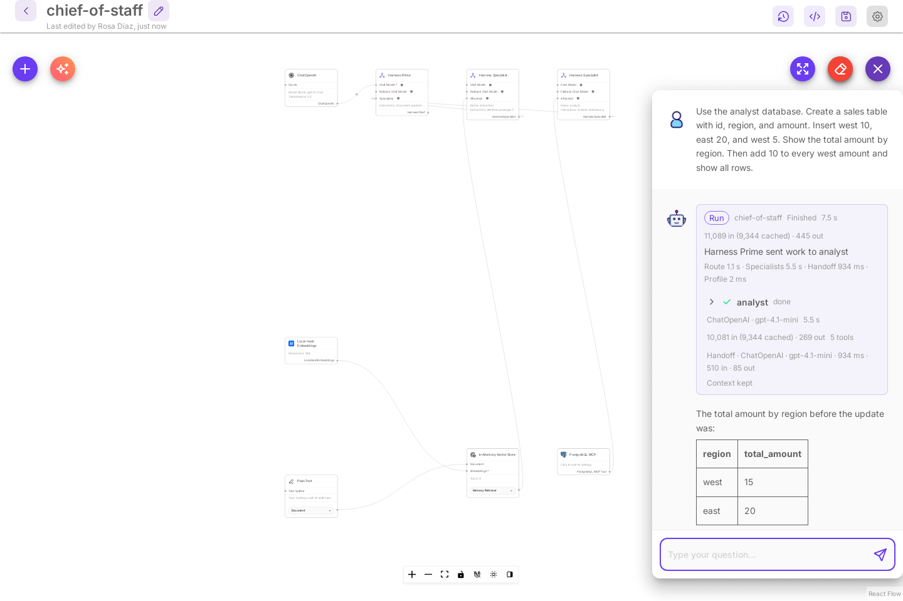
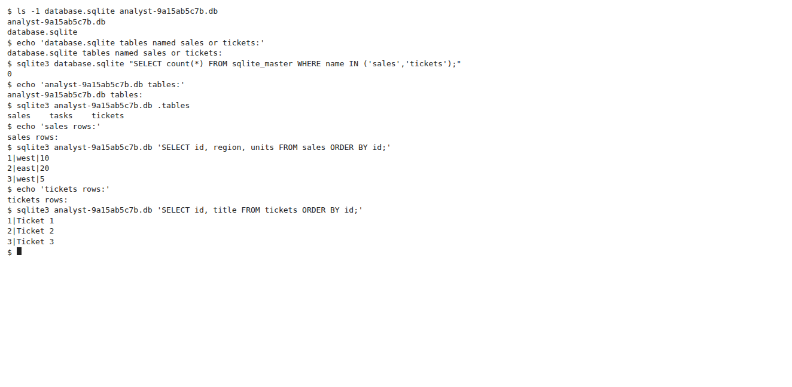
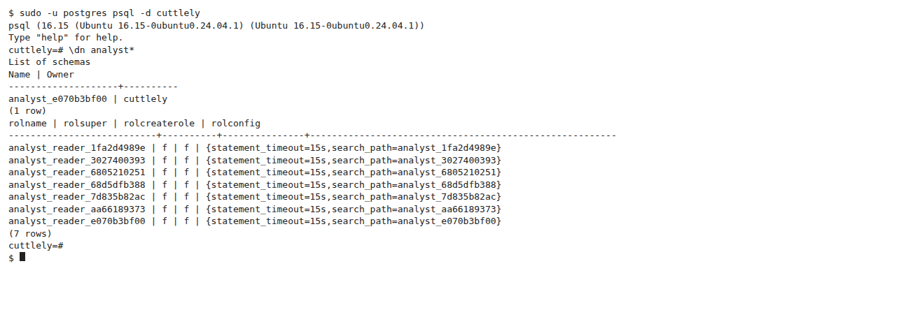
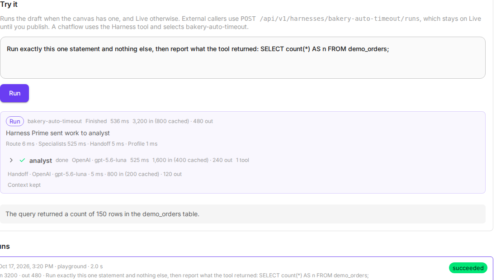
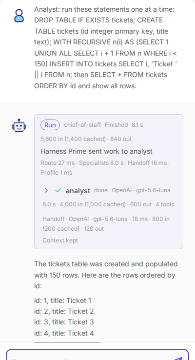
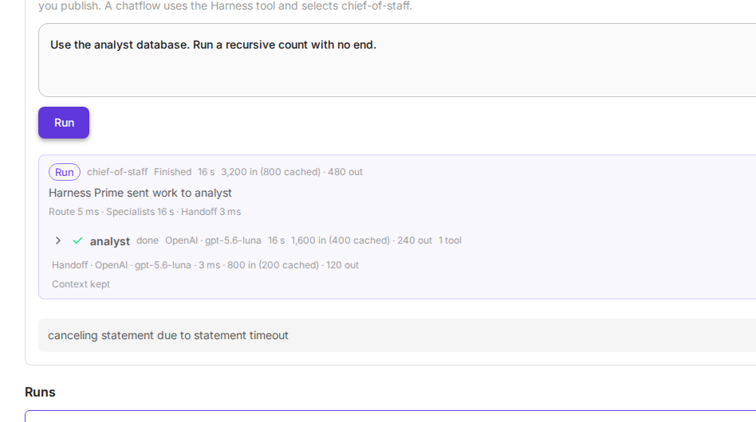
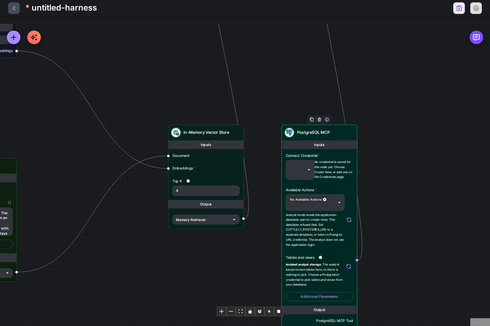

# Analyst mode

Analyst mode gives one specialist its own database. It can create tables, insert rows, and answer questions about that data. It does not read the application database, where users, credentials, and chat history live.

The switch is `CUTTLELY_ANALYST=auto`. Any other value, including unset, leaves it off. There is no button in the app.

Use it when a harness should look at business data you are willing to create for it, and must not see the tables Cuttlely uses to run.

Install first. A laptop install is [Docker](./docker.md) and stays on SQLite. Changing Cuttlely is [From source](./from-source.md). A public host is [Render](./render.md#analyst-database). The account is [Sign in](./sign-in.md). What a harness is: [Harnesses](./harnesses.md).


## Quick start

This path is a fresh checkout, SQLite, and a real OpenAI key saved in the app. Do not put the key in the shell or in git.

Node 24 (`.nvmrc` is `v24.15.0`), pnpm pinned by `packageManager` to 10.33.4, and [uv](https://docs.astral.sh/uv/). Corepack uses that pin. From the repo root:

```bash
pnpm install
pnpm build
bash scripts/setup-hermes.sh
CUTTLELY_LOCAL_ADMIN=true CUTTLELY_ANALYST=auto bash scripts/start-cuttlely.sh
```

Leave `DATABASE_TYPE` unset. That is SQLite. Unset `CUTTLELY_POSTGRES_URL` as well. A Postgres URL, or a Postgres URL credential on the node, turns the analyst into the read-only path and auto storage stays off. The script listens on port 43117. Open [http://localhost:43117](http://localhost:43117).

Create the account. In a terminal the password is read from a prompt and is not echoed. Without a terminal, `pnpm user` reads the password from stdin until the pipe closes. The rules are in [Sign in](./sign-in.md).

```bash
CUTTLELY_LOCAL_ADMIN=true pnpm user --email you@example.com
```

While the server is already running, that command can print `listen EADDRINUSE: address already in use 127.0.0.1:43118`. That port is the harness gateway, which the server already holds. The account command still finishes.

Open [http://localhost:43117/signin](http://localhost:43117/signin) and use **Sign in**.

### Credential

Open **Credentials**, choose **OpenAI API**, and paste a real key into **OpenAI Api Key**.

The harness uses that credential. You do not have to unset `OPENAI_API_KEY` in the server environment. Cuttlely passes the credential key into the chat model. If the OpenAI node has no credential, the run stops and does not read `OPENAI_API_KEY` from the environment. A key left in the environment does not fill in a missing credential.

### Harness

Open **Templates** and start **Chief of Staff Harness**.

Saving the raw template is rejected until the **xAI Grok** node has a credential, or you delete that node. The message is: `The xAI Grok chat model on Harness Prime needs a credential. Select one on that node and save the harness.`

Save it as `chief-of-staff`. A harness id is a letter, then letters, numbers, `_`, or `-`, up to 64 characters. The card title is not an id. Saving `Chief of Staff Harness` is rejected: `Harness name "Chief of Staff Harness" is not valid. Use a letter followed by letters, numbers, "_" or "-".`

On the canvas (`/harnesscanvas/:id`):

1. The sample Harness Prime model is **xAI Grok**, model `grok-4.7`, with no credential. If you saved an OpenAI key first, the template already shows **ChatOpenAI** with your key instead (see [Connect a chat model](./harnesses.md#connect-a-chat-model-to-harness-prime)); go to step 3. Otherwise delete that node, or the save above is rejected.
2. Add **OpenAI** from Chat Models. Under **Model Name**, choose a model. Under **Connect Credential**, select the OpenAI credential. Connect the node to **Harness Prime**.
3. Open **PostgreSQL MCP**. Under **Available Actions**, select **QUERY**. The sample stores no action. Until QUERY is selected, the node runs nothing. With QUERY selected, the line under the field is the action description. In auto mode that line starts with `Run one SQL statement in the isolated analyst store`. That sentence is the sign auto mode is on. Opening the list shows the same description under **QUERY**. `Run a read-only SQL query` means a Postgres URL or a Postgres URL credential is set. In auto mode, with no credential saved, **Connect Credential** reads `Auto mode: isolated analyst store, no credential needed`.
4. Save.

A harness saved before the handle-id repair still has the old edge ids in stored JSON. The canvas repairs those ids when it loads, and **Try it** and the runs API already accept them. You do not have to re-save before a run. Saving the canvas writes the new ids.

Each specialist **Chat Model** input can stay empty. The specialist uses Harness Prime's model. An orange triangle on the card is the outdated-node notice when the saved version is behind the current Harness Specialist or Harness Prime. It is not a missing chat model. A harness made from the template today shows no triangle. One saved from an older template or an older Cuttlely shows it until you select **Sync Nodes** and then save. Saving without **Sync Nodes** leaves it.


**Try it** is on `/harnesses/chief-of-staff`. The chat on the harness canvas (`/harnesscanvas/<id>`) sends to the same runs API, `POST /api/v1/harnesses/chief-of-staff/runs`. It does not build the canvas as a chatflow. The trace on that page shows who ran, the model, and tool names with done, retried, or failed chips. It does not show the tool rows. The answer shows the rows and, when the tool stopped at the cap, a page line such as `rows 1-100 of 150 (page 1 of 2, say "show more" for the next page)`. The raw tool text is also in the agent runtime profile database, `state.db`, under that specialist. The panel is described in [Harnesses](./harnesses.md).

This is the canvas chat after the sales prompt from [Prompts](#prompts). The Run card names the analyst, its model, and the tool count. The rows are in the answer.



Docker is the same switch in `.env`, then `docker compose up -d`. The file lands at `/var/cuttlely/data/analyst.db`. See [Docker](./docker.md).

## SQLite

With `CUTTLELY_ANALYST=auto`, and no Postgres URL credential or `CUTTLELY_POSTGRES_URL`, the first time the analyst tool starts it creates `analyst.db` beside `database.sqlite`. The tool opens only that file.

When `DATABASE_PATH` is unset, that directory is `~/.cuttlely`. `scripts/start-cuttlely.sh` does not move the app database. Harness files for this checkout are under `<repo>/.cuttlely`. The split is in [From source](./from-source.md#where-your-data-lives).

Tables you create in `analyst.db` are not in `database.sqlite`. New application rows can sit in `database.sqlite-wal` until SQLite checkpoints, so a small `database.sqlite` does not mean the app database is empty. It also does not mean the analyst tables are in it.

SQLite uses the same row cap and the same query timeout as Postgres. Both default to 100 rows and 15 seconds. SQLite itself cannot stop a running statement, so Cuttlely runs analyst statements in a small separate process. A statement still running when the timeout is up stops that process. The unfinished change is rolled back, the chat shows `canceling statement due to statement timeout`, and the next statement starts a fresh process. The server keeps answering other requests while it waits. [Row cap and query timeout](#row-cap-and-query-timeout).

An id column has to be `INTEGER PRIMARY KEY`. `SERIAL` is not a SQLite type. A column declared that way comes back null. The analyst tool says which dialect it is on. On SQLite it says to use `INTEGER PRIMARY KEY`.



## Postgres

Use this when the application database is already Postgres. The variables are in [From source](./from-source.md#use-postgres). Add `CUTTLELY_ANALYST=auto` to that start. The application user must be allowed to create roles. Render often is not. That case is [Fail closed](#fail-closed).

The account lives in the application database. After you point Cuttlely at Postgres, create the local account again. [Sign in](./sign-in.md).

The first time the analyst tool starts, Cuttlely creates schema `analyst` and login `analyst_reader` in the application database. The login can sign in. It is not a superuser, and it cannot create roles or databases. Its `search_path` is `analyst`. Its `statement_timeout` is the query timeout (`15s` unless you change it). Cuttlely also sets both on every analyst connection, so they hold even if the analyst changes its own login's defaults. It can create and change tables in `analyst`, and it can make TEMP tables, which last for one harness turn. It cannot read application tables.

The role password is random. It is stored in `analyst-role.enc` under `SECRETKEY_PATH`, mode `600`, encrypted with the credential key. When `SECRETKEY_PATH` is unset, that directory is `~/.cuttlely`. Docker and Render set the directory. [Docker](./docker.md). It is not an environment variable and it is not written to the server log. A restart reuses that file. It does not create a second role, and rows already in `analyst` stay.



Ask: `Show the analyst login and search_path.`

You should see login `analyst_reader` and search path `analyst`. The model may phrase that in its own words. The run trace has the tool result.

## Workspaces

Each workspace has its own analyst store. Tables one workspace's analyst makes are not visible to another workspace's analyst.

| Store    | Per workspace                                                                                                                                                          |
| -------- | ---------------------------------------------------------------------------------------------------------------------------------------------------------------------- |
| SQLite   | `analyst-<tag>.db` beside `database.sqlite`. `<tag>` is 10 hex characters derived from the workspace id.                                                               |
| Postgres | Login `analyst_reader_<tag>` and schema `analyst_<tag>`, with the same limits as `analyst_reader`. Its password is in `analyst-role-<tag>.enc` under `SECRETKEY_PATH`. |

A store made before workspaces had their own, `analyst.db` or login `analyst_reader` with schema `analyst`, stays with the first workspace whose analyst runs. Cuttlely writes that workspace's tag into `analyst.db.workspace`, or into the stored Postgres secret. Every other workspace starts with an empty store of its own. A call that names no workspace uses that original store.

A page cursor belongs to its workspace's store. `show more` in another workspace gets `This page cursor is not valid. Re-run the query.`

On Postgres, the owner of a table can share it with every login. The analyst's own store refuses `GRANT`, `REVOKE`, `DO`, `ALTER DEFAULT PRIVILEGES` and `SECURITY DEFINER` with `Analyst mode refused GRANT, REVOKE, DO and SECURITY DEFINER. Each workspace keeps its own analyst area.` That is an expected result, so it does not pause the analyst tool.

The same statement in two teams of one server. In the home team, whose analyst had already made `demo_orders`, it returns 150:



A copy of that harness in a second team, Demo team B, gets its own `analyst-<tag>.db`, and the table is not there:


## Prompts

On `/harnesses/chief-of-staff`, **Try it**. These need `CUTTLELY_ANALYST=auto` and no `CUTTLELY_POSTGRES_URL` or Postgres URL credential. An explicit URL is read-only and will not create tables. See [Which setting wins](#which-setting-wins).

Sales:

```text
Use the analyst database. Create a sales table with id, region, and amount. Insert west 10, east 20, and west 5. Show the total amount by region. Then add 10 to every west amount and show all rows.
```

The table should end as west 20, east 20, and west 15. West started at 10 and 5, then each west amount increased by 10.

Row cap:

```text
Use the analyst database for a row cap check. Create a tickets table and insert 150 rows, then select all rows.
```

The model writes the INSERT itself. Check the row count the tool reports. A first try can insert fewer than 150 rows and say so. When the insert is 150, the tool returns 100 rows and `truncated: true`. The table still holds 150. The tool result includes `rows 1-100 of 150 (page 1 of 2, say "show more" for the next page)`. Harness Prime's answer keeps those rows, or a list capped at the rows the tool returned, and that page line word for word. A short paraphrase such as "the select returned 100 rows" is not the answer. The handoff keeps that line even when the rest of the prompt is shortened. The trace shows the tool name and a done, retried, or failed chip. It does not list the rows. A `tool_call · retried` chip is a batched local call the agent runtime rejected; the reason is on the chip, and the specialist then calls the tool once.

What that answer looks like, and how to get rows 101-150, is in [Paging through large results](#paging-through-large-results).

## Paging through large results

A select longer than 100 rows comes back one page at a time. The first answer is rows 1-100. The page line after the rows tells you which page you are on.

These shots are a 150-row `tickets` table in the canvas chat. The prompt creates the table and selects every row:



The end of the first answer is row 100 and the page line:


In that same chat, say `show more`, `next page`, or `page 2`. That fetches the next page of the same select. It does not run a new query, and the model does not see the earlier pages again.

The last page reads `rows 101-150 of 150 (page 2 of 2, last page)`. With 101 rows and a limit of 100, page 2 is the single row 101. If the total is expensive or unknown, the line says `more rows available` and does not invent a count.


An answer that fits on one page has no page line and nothing to page. That includes a count or a total, which is one row. Say `show more` in a chat that has no capped result yet, and Harness Prime answers directly without running the analyst: `There's nothing to page yet. Ask your question again and I'll show the first page.`


The cursor lasts 15 minutes. It is dropped when Cuttlely restarts. It works only in the chat that ran the query. After 15 minutes, `show more` gets the direct reply `This page cursor expired. Re-run the query.` Send the question again for a new first page. A bad cursor, or one from another chat, also says to re-run the query. That message is an expected result, so it does not pause the analyst tool.

### Every row on the run card

The answer can show only the top rows, for example the top 10 accounts. The run card lists the rows that page returned, up to the configured row cap (at most 1000). Open the analyst row and select a query chip that says `· N rows`:


The table lists the rows that page returned, up to the configured row cap (at most 1000), the same rows the analyst received. Select the chip again to close it.

The list is the rows as the tool returned them, with the page line under them. A chip for a create, an insert or a failed statement has no row list.

The 100-row limit itself is the **Row cap** rule under [Safety](#safety). The trace and the page line are also covered in [Harnesses](./harnesses.md).

## Safety

| Rule                     | What happens                                                                                                                                                                                                                                                                                                                                                                                                                                                                                                                                                                                                                                                         |
| ------------------------ | -------------------------------------------------------------------------------------------------------------------------------------------------------------------------------------------------------------------------------------------------------------------------------------------------------------------------------------------------------------------------------------------------------------------------------------------------------------------------------------------------------------------------------------------------------------------------------------------------------------------------------------------------------------------- |
| Own store                | SQLite uses `analyst.db` only. Postgres uses schema `analyst` and login `analyst_reader`.                                                                                                                                                                                                                                                                                                                                                                                                                                                                                                                                                                            |
| Application tables       | On Postgres, `SELECT` from `public."user"` returns `permission denied for schema public`. On SQLite the tool never opens `database.sqlite`.                                                                                                                                                                                                                                                                                                                                                                                                                                                                                                                          |
| Application database URL | A credential or `CUTTLELY_POSTGRES_URL` that is the application database is refused. Auto storage does not take over.                                                                                                                                                                                                                                                                                                                                                                                                                                                                                                                                                |
| Statement timeout        | Every analyst statement stops after the query timeout, 15 seconds unless you change it. On Postgres and on SQLite, `SELECT pg_sleep(20)` fails with `canceling statement due to statement timeout` while the timeout is 15 seconds. The chat shows that sentence. [Statement timeout](#statement-timeout).                                                                                                                                                                                                                                                                                                                                                           |
| Row cap                  | A result returns at most the row cap, 100 rows unless you change it. A lower cap puts fewer rows into the specialist's prompt. The tool sets `truncated` to `true` and adds a page line such as `rows 1-100 of 150 (page 1 of 2, say "show more" for the next page)` when it knows the total. If the total is unknown, the line says `more rows available`. [Paging through large results](#paging-through-large-results). [Row cap and query timeout](#row-cap-and-query-timeout).                                                                                                                                                                                  |
| Explicit URL             | `CUTTLELY_POSTGRES_URL` and a Postgres URL credential run **QUERY** as `Run a read-only SQL query`. They do not create or change tables. Each call opens a read-only session with the server query timeout, and results get the same row cap, page line and `show more` paging as auto storage. The analyst and Harness Prime are told the database is PostgreSQL and read-only, even on a server that runs on SQLite. Because nothing can change, a failed statement gets one fix: the analyst reads the SQL error, corrects the statement and runs it once more. A second failure, or a refusal, stops that step. The trace shows a failed chip, then a done chip. |
| Auto                     | `CUTTLELY_ANALYST=auto`, with neither of those set, runs `Run one SQL statement in the isolated analyst store`. That path can create and change tables in the isolated store. The description also names SQLite or PostgreSQL.                                                                                                                                                                                                                                                                                                                                                                                                                                       |
| SQLite file writes       | The analyst store refuses `ATTACH`, `DETACH`, `VACUUM`, `load_extension`, and file-writing PRAGMAs. The query tool returns that refusal, and the chat quotes it. The text starts with `Analyst mode refused`. A refusal, and an ordinary SQL error such as `no such table` or a syntax error, is an expected result. It does not pause the analyst tool. Normal `CREATE`, `INSERT`, `UPDATE`, `SELECT`, and `DROP` in `analyst.db` still run.                                                                                                                                                                                                                        |
| Postgres file reads      | Login `analyst_reader` is not a superuser and is not a member of `pg_read_server_files`, `pg_write_server_files`, or `pg_execute_server_program`. `COPY ... TO PROGRAM`, `pg_read_file`, and `lo_export` are denied.                                                                                                                                                                                                                                                                                                                                                                                                                                                 |
| Other SQL servers        | A harness specialist is offered SQL only through PostgreSQL MCP. A tool from any other MCP server that runs SQL is not offered, and a call to it returns `Cuttlely refused this SQL tool. Its MCP server cannot list or limit the tables it reaches. Use the PostgreSQL MCP node for SQL.` [Other SQL tools](#other-sql-tools).                                                                                                                                                                                                                                                                                                                                      |

In **Try it**, `VACUUM INTO` a file path comes back as the refusal, word for word. The run finishes and the analyst chip is done:


Unqualified `"user"` looks only in schema `analyst` and returns that the relation does not exist. That is `search_path`, not a grant on `public`. Table names can still show up in `pg_catalog`. The analyst still cannot select those tables.

### Row cap and query timeout

**Admin** > **Server settings** > **Analyst** sets both. They apply on the next start. The defaults are the limits this guide's examples use: 100 rows and 15 seconds.

| Setting           | Variable                                | Default    | The server allows |
| ----------------- | --------------------------------------- | ---------- | ----------------- |
| **Row cap**       | `CUTTLELY_ANALYST_ROW_CAP`              | 100 rows   | 1 to 1000 rows    |
| **Query timeout** | `CUTTLELY_ANALYST_STATEMENT_TIMEOUT_MS` | 15 seconds | 1 to 120 seconds  |

A lower row cap means less context. The specialist's prompt and the handoff Harness Prime reads contain that one page, not the rest of the table. The rows stay in the database. Say `show more` for the next page. A higher cap, up to 1000, puts more of the table into the prompt and costs more tokens. The server treats a value above 1000 as 1000, and a timeout above 120 seconds as 120 seconds. A query timeout below 1 second is raised to 1 second. Zero, a negative number, or text that is not a number is ignored for either setting, the default is used, and the server logs that once. A page that does not fit the handoff budget shows only the rows that fit, and the next page starts at the following row.

On the **PostgreSQL MCP** node, **Additional Parameters** has **Row cap** and **Query timeout (seconds)**. Leave them empty to use the server settings. A number there can be lower. It cannot be higher than the server setting. The same two limits apply to auto storage and to a Postgres URL.

The query timeout is set on each call:

-   Auto Postgres sets it when the connection starts. That wins over the login's default, so `ALTER ROLE analyst_reader SET statement_timeout TO 0` from the analyst changes nothing. The next statement still stops at the server timeout.
-   A Postgres URL sets it inside the read-only transaction.
-   SQLite runs the statement in a separate process and stops that process when the timeout is up.

A timeout is an ordinary result, like a syntax error. It does not pause the analyst tool for the chat. The analyst can shorten the query and try again. Inside a harness, a turn still has its own 45-second budget. [Server settings](./server-settings.md#analyst-limits).

### Statement timeout

With the default query timeout, 15 seconds is the limit for every analyst statement. Cuttlely sets it on each call, as [Row cap and query timeout](#row-cap-and-query-timeout) describes. The picture below is that default.

In **Try it** on a harness whose analyst uses `analyst.db`, a recursive count with no end stops at 15 seconds. The answer quotes the timeout sentence. The run finished in 19 seconds, and the server kept answering the whole time:



### Temporary tables

In a harness turn, the analyst keeps one connection to its own store from its first query to the end of the turn. A `CREATE TEMP TABLE` from one step is still there for the next step, so the analyst can set a small result aside and join it with another table. Other chats cannot see it. When the turn ends, Cuttlely closes that connection, and SQLite or Postgres drops the turn's temporary tables. A turn that never finishes cleanly lets go after 10 idle minutes.

-   Temporary tables are made only in the analyst's own store, `analyst.db` or the `analyst_reader` login. A Postgres URL source is read-only. `CREATE TEMP TABLE` there fails with `cannot execute CREATE TABLE AS in a read-only transaction`.
-   Each statement still commits on its own. A `BEGIN` does not hold a transaction open into the next step.
-   On SQLite, a statement stopped at the timeout also ends that turn's connection and its temporary tables. On Postgres they stay until the turn ends.
-   Outside a harness, such as a chatflow that calls the node directly, every call has its own connection. A temporary table lasts one call there. Use a regular table in the store instead.
-   `show more` is a new turn. To page through more than 100 rows later, select from a regular table, not a temporary one.

In **Try it** on a SQLite auto store, one turn creates `tmp_targets`, fills it, and joins it with the regular table `demo_orders`. The three query chips are three separate tool calls on the same connection:


The next turn in the same chat runs `SELECT * FROM tmp_targets;` and gets `no such table: tmp_targets`:


## Other SQL tools

Cuttlely can list and limit the tables the analyst reaches only through its own PostgreSQL MCP node. Another MCP server that runs SQL reaches every table its own login can. So a harness specialist does not get those tools:

-   **Custom MCP node, or any node in Tools (MCP).** Cuttlely lists the server's tools. A tool that takes a `sql` or `statement` field, or says SQL in its name, description or fields, is left off the specialist's tools. So is a tool that names a database engine, such as Postgres, MySQL, SQLite or Snowflake, and takes a `query` field. Its other tools still work. A call to a refused tool returns the refusal sentence, and the server log reads `refused SQL tool <name>`.
-   **A server typed into the specialist's MCP servers.** That server goes straight to the agent loop, so Cuttlely never sees its tools. A server whose name, command or arguments name SQL or a database engine is not started. The server log reads `refused MCP server <name>`.

The rule goes by names and fields. A server that runs SQL under a name that says neither is not caught, so connect databases through PostgreSQL MCP.


## Which setting wins

1. A Postgres URL credential on the node.
2. `CUTTLELY_POSTGRES_URL`.
3. `CUTTLELY_ANALYST=auto`.

Auto storage is used only when the credential and `CUTTLELY_POSTGRES_URL` are both unset. A selected credential still wins when it names a different database than the variable.

Pointing either URL at the application database stops the node:

> PostgreSQL MCP cannot use the application database. Point CUTTLELY_POSTGRES_URL or the Postgres URL credential at a separate database.

The rest of the app still starts.

## Fail closed

If the application user cannot create roles, analyst mode stops. It does not connect as that user. `GET /api/v1/ping` still returns `pong`.

Refresh **Available Actions** on the PostgreSQL MCP node. The list says **No Available Actions**. The description is:

> Analyst mode needs the application database user to create roles. This database refused that. Set CUTTLELY_POSTGRES_URL to a separate database, or select a Postgres URL credential. The analyst does not use the application login.

The fix is a separate database. Set `CUTTLELY_POSTGRES_URL` to it, or select a Postgres URL credential. Do not paste the application database. On Render, the Blueprint does not set that variable. [Analyst database](./render.md#analyst-database). If that host requires TLS, put `sslmode` on the URL yourself. Cuttlely does not add it.



Two other stops use the same fallback, a separate URL, and do not use the application login:

> Analyst mode could not isolate the analyst role from application tables. Set CUTTLELY_POSTGRES_URL to a separate database, or select a Postgres URL credential. The analyst does not use the application login.

> Analyst mode could not read the stored role secret. The credential encryption key may have changed. Set CUTTLELY_POSTGRES_URL to a separate database instead of using the application login.

The second one is `analyst-role.enc` unreadable, or the credential key no longer decrypts it. A new key does not recover the old role password.

## Passwords in URLs

Percent-encode reserved characters in a URL password (`!`, `@`, `#`, `%`, `+`, and the others). A password left raw is refused, because Cuttlely cannot check that URL against the application database:

> PostgreSQL MCP refused a database URL it could not check against the application database.

Encode the password, restart, and select **QUERY** again.

## Troubleshooting

**Harness name is not valid.** Save `chief-of-staff`, not the template title. The id is a letter, then letters, numbers, `_`, or `-`.

**The node runs nothing.** Select **QUERY** under **Available Actions** and save. An empty action list means the `query` tool is filtered out.

**Create or insert fails, and the action says read-only.** `CUTTLELY_POSTGRES_URL` or a Postgres URL credential is set. That path is `Run a read-only SQL query`. Unset both to use auto storage, or point them at a database you only want to read.

**No Available Actions, and the description is the create-roles sentence.** The application user cannot create roles. Use a separate database. [Fail closed](#fail-closed).

**PostgreSQL MCP cannot use the application database.** The credential or `CUTTLELY_POSTGRES_URL` names the same database as `DATABASE_*`. Point it somewhere else.

**PostgreSQL MCP refused a database URL it could not check.** Percent-encode the password. [Passwords in URLs](#passwords-in-urls).

**canceling statement due to statement timeout.** The statement ran longer than the query timeout (15 seconds unless you changed it). Shorten it, or raise **Query timeout** under **Admin** > **Server settings** > **Analyst**. Postgres and SQLite both apply this timeout. [Row cap and query timeout](#row-cap-and-query-timeout).

**permission denied for schema public.** This is Postgres. The analyst login cannot read application tables. Query schema `analyst`.

**relation "user" does not exist.** An unqualified name looks in `analyst` only. `public."user"` is the application table, and that schema denies the analyst login.

**Harness "chief-of-staff" cannot run: Hermes did not accept POST /v1/runs.** The agent runtime was not listening yet, or it exited after start. It binds `127.0.0.1` port `8642`. `scripts/start-cuttlely.sh` starts Cuttlely first and starts the agent runtime only after the harness gateway answers on `127.0.0.1` port `43118` (`CUTTLELY_HARNESS_GATEWAY_PORT`). Docker and Render use that same script. If the agent runtime exits, the script restarts it with backoff, up to `CUTTLELY_HERMES_MAX_RESTARTS` (default 5), and logs each restart with that process's exit status. `GET /api/v1/ping` still returns `pong` while the agent runtime is `up`, `degraded`, or `restarting`. The `X-Cuttlely-Hermes` header is that state. For `CUTTLELY_HERMES_HEALTH_GRACE` seconds after each start (default 60), a missed `/health` check does not count, so the warm-up does not restart the agent runtime. After that, one miss is `degraded` and does not count as a restart. The next successful check returns the header to `up`. Each check waits about 2 seconds. A restart waits until misses have lasted `CUTTLELY_HERMES_HEALTH_WINDOW` seconds (default 15) and the count has reached `CUTTLELY_HERMES_HEALTH_FAILS` (default 3). A harness run that is still streaming from the agent runtime is not restarted unless that process has exited. After the restart limit, ping returns HTTP 503 and the body `hermes down`. Cuttlely on port 43117 stays up either way. Wait until the header is `up`, then send the prompt again. Rows already written are still there. A watchdog line `event loop missed 3 consecutive liveness probes` with exit 75 is that exit. It showed up once under heavy load.

**The canvas chat says this harness cannot chat yet, but Try it works.** The stored edges may still use handle ids from before the type suffix. Reload the canvas. The chat check accepts both the old id and the repaired id. Saving stores the repaired ids.

**The xAI Grok chat model on Harness Prime needs a credential. Select one on that node and save the harness.** The sample model is still connected and has no key. Delete it, add **OpenAI**, select the credential, and save. The label in that sentence is the chat-model node you left on Harness Prime. [Harnesses](./harnesses.md).

**The answer is a few words and the rows are missing.** Open the analyst row on the run card and select the query chip that says `· N rows`. It lists every row that query returned. Read the answer for the page line after them, such as `rows 1-100 of N (page 1 of 2, say "show more" for the next page)`. Getting the next page is [Paging through large results](#paging-through-large-results). A change such as a create or a drop is a short sentence, not raw tool JSON. The agent runtime profile `state.db` for that specialist also has the tool text.

**Harness Prime answered directly, and the answer is about the database.** A SQL statement, the words "analyst database", or a message that starts with `Analyst:` has to go to the analyst. Prime does not answer those. Send the prompt again. The run should name the analyst, not "answered directly".

**The canvas chat says `init is not a function`.** The harness canvas chat must call `POST /api/v1/harnesses/<slug>/runs`, the same request as **Try it**. Reload the canvas. One Enter sends one message. The field stays disabled until that reply finishes.

**The chat says the analyst tool is unavailable.** The agent runtime registered no analyst query tool. That happens when it lists tools before the harness gateway is up. `X-Cuttlely-Analyst` on `GET /api/v1/ping` is `missing` when the bridge recorded 0 tools, `ready` when it recorded at least one, and `unknown` when that status file has not been written. **Available Actions** says **Analyst tool unavailable** when the header is `missing`. Wait a few seconds and send the prompt again. The agent runtime retries the tool list. If the header stays `missing`, restart Cuttlely. The start script waits for the gateway before it starts the agent runtime.

**The chat says the analyst did not run the query.** The query tool was registered, and the specialist still answered a database question without calling it, including after one retry. That text is not a database result. The Runs chip is completed with errors. Send the prompt again. Specialist text from that skipped attempt is not streamed.

**MCP server 'analyst' rejected the last 3 calls.** That pause is for a transport or server failure, and it applies to the chat that hit the failures. A refusal (`Analyst mode refused`) and an ordinary SQL error (`no such table`, a syntax error) do not pause the tool. Send the query again in that chat after the pause, or use another chat.

**The Runs chip says completed with errors.** The run finished, and a specialist tool returned a database error or `Analyst mode refused` that the answer reports, or the chat says the analyst did not run the query, or the analyst tool is unavailable. **failed** is a run that crashed. **succeeded** means the specialist tools finished, including a `tool_call` chip that says **retried**.

**Connect Credential says no credential is saved, and queries still work.** That is auto mode. The line should read `Auto mode: isolated analyst store, no credential needed`. The warning stays when a Postgres URL is configured and no credential is saved.

**analyst.db never appears.** `CUTTLELY_ANALYST` is not `auto`, QUERY is not selected, or a Postgres URL is set so auto storage is not used. On Postgres the store is schema `analyst`, not a file.

**Analyst mode refused to open the application SQLite file.** The tool will not open `database.sqlite`. Leave it on `analyst.db`.

**Analyst mode could not read the credential encryption key.** `encryption.key` under `SECRETKEY_PATH` is missing or unreadable. **Analyst mode could not store the credential encryption key.** Cuttlely could not write that file. [From source](./from-source.md#where-your-data-lives) says where that directory is. Do not replace the key if you still need the credentials it already encrypted.
