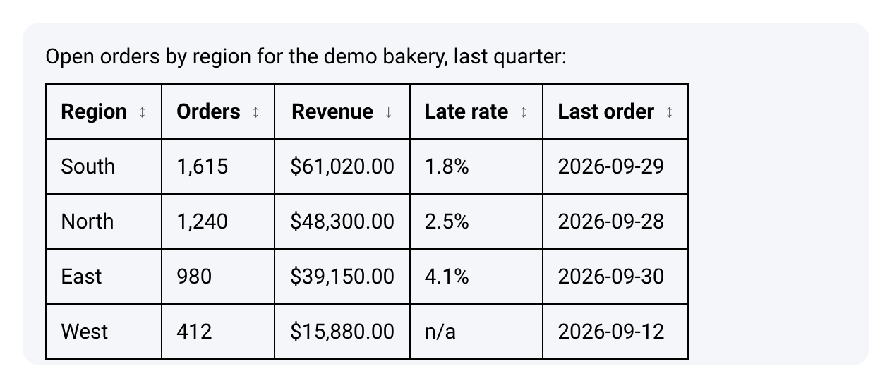

# Sort answer tables

When a chat answer contains a table, you can sort its rows by any column. Sorting happens in your browser and changes only what you see: the answer text, conversation memory and exports stay the same, and nothing is sent to the model or a database.

## Sort a table

1. Click a column header, or move to it with **Tab** and press **Enter** or **Space**. The rows sort from low to high and the header shows **↑**.
2. Click the same header again to sort from high to low. The header shows **↓**.
3. Click another header to sort by that column instead.

Headers you can sort show **↕** until you use them. Until you click a header, the rows keep the order the answer gave them.

Screen readers announce each header as a button, for example `Sort by Revenue, ascending`, and the sorted column reports its direction.

## Where it works

-   **The app chat**: the canvas chat and the chat on a chatflow.
-   **Shared links and the embedded chat widget**: once the answer has finished, so the table does not move while it is still being written. Each answer keeps its own sort. On a narrow screen, a wide table scrolls sideways.

A table can be sorted when it has one header row and every row has the same number of cells, with no merged cells. Other tables show as written. A header that is empty, or that holds a link or a button, is not sortable.

## How values sort

The same order rules apply in the app and in the widget:

| Column holds                                                                            | Sorted as                                                                               |
| --------------------------------------------------------------------------------------- | --------------------------------------------------------------------------------------- |
| Numbers, such as `1,240`, `$48,300.00`, `USD 15`, `2.5%` or `(120)`                     | Numbers. A value in parentheses counts as negative.                                     |
| Dates written one way only, such as `2026-09-28`, `12 Mar 2026` or `Mar 12, 2026`       | Dates. A date such as `03/04/2026` can be read two ways, so it sorts as text.           |
| Risk labels, such as `Low risk` or `High risk`, under a header with the word `risk`     | Level, from `No risk` up to `Critical risk`.                                            |
| IDs and codes, under a header such as `Order ID`, `Code`, `SKU`, `ZIP` or `Postal code` | Text, even when the values look like numbers.                                           |
| Anything else                                                                           | Text, ignoring case, with numbers inside the text in order (`Item 2` before `Item 10`). |

A column sorts as numbers, dates or risk levels only when every filled-in value in it fits. Empty cells and values such as `n/a`, `unknown`, `none` or `-` always stay at the bottom, in both directions. Rows with equal values keep their original order.

## Related

-   [Share and embed a chat](./share-and-embed.md#what-the-chat-shows). What else the shared chat and the widget show.
-   [Read the run card](./harnesses.md#read-the-run-card). The card above a harness answer.
