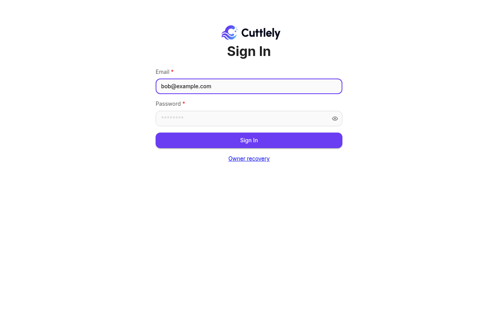

<!--
Copyright 2026 The Cuttlely Authors

Licensed under the Apache License, Version 2.0 (the "License");
you may not use this file except in compliance with the License.
-->

# Choose the sign-in method

Open **Admin** > **Auth / SSO** to see the method used for ordinary sign-in. The page is available to an owner or a role with **Authentication: Manage**.

The available methods are **Local login**, **Generic OIDC**, and **WorkOS**. The durable active method controls ordinary sign-in; the WorkOS and local settings remain available when their method is selected. SCIM user and group provisioning is configured separately on this page.

![Auth / SSO with Local login active. The Active method card says Local login, that changing the method ends every interactive session, and that API keys remain enabled. Choose a sign-in method lists Local login — local users (selected), WorkOS — not configured, and Generic OIDC — not configured, with Review Change and Sign In Again. Below it, the Generic OIDC setup card has the issuer https://idp.example.test/oauth2/default, the client id cuttlely-demo-client, and the client secret environment variable name CUTTLELY_OIDC_CLIENT_SECRET, which the card says is not set on this server.](../images/auth-sso/auth-sso-methods.png)

| Method            | Use it when                                                                                                 | Setup                                       |
| ----------------- | ----------------------------------------------------------------------------------------------------------- | ------------------------------------------- |
| Local login       | People sign in with an email and a password that Cuttlely stores.                                           | [Set up local login](#set-up-local-login)   |
| WorkOS            | You sign people in through WorkOS AuthKit.                                                                  | [Set up WorkOS](#set-up-workos)             |
| Generic OIDC      | Your identity provider supports OpenID Connect, for example Okta or Entra ID.                               | [Set up generic OIDC](#set-up-generic-oidc) |
| SCIM provisioning | The identity provider should create, update, and deactivate Cuttlely users and push groups to map to teams. | [SCIM provisioning](#scim-provisioning)     |

Whatever the method, **Owner recovery** keeps an active owner with a local password able to sign in, and API access keeps working when the method changes. If something does not work, see [Troubleshooting](#troubleshooting).

## Set up local login

1. Set `CUTTLELY_LOCAL_USERS=true` on the server and restart. In **Admin** > **Server Settings** > **Sign-in & identity**, the switch is **Local user passwords**.
2. If another method is active, change to **Local login** as described in [Change the method](#change-the-method). Changing from WorkOS also needs an active owner with a usable local password.
3. Add people in **Admin** > **Users** with **Add User**. Each person opens their one-time invite link and chooses a password.
4. People sign in at `/signin` with their email and password.

Lockouts, password changes, and the API routes are in [Users without AuthKit](./users-without-authkit.md).

## Set up WorkOS

1. Set `WORKOS_API_KEY`, `WORKOS_CLIENT_ID`, and the other values in [WorkOS AuthKit setup](../identity/workos-authkit-setup.md), then restart. The owner can also fill these in from **Admin** > **Server Settings** > **Sign-in & identity** with **Set up AuthKit**; those values apply after a restart.
2. Give an active owner a local password: run `CUTTLELY_LOCAL_ADMIN=true pnpm user --email owner@example.com` from source, or `docker compose exec -u node -it -e CUTTLELY_LOCAL_ADMIN=true cuttlely pnpm user --email owner@example.com` with Docker Compose, and enter the password at the prompt. See [In a terminal](./sign-in.md#in-a-terminal). WorkOS activation returns `409 Conflict` until owner recovery is ready.
3. Change the method to **WorkOS** as described in [Change the method](#change-the-method).
4. Invite people as described in [Invite people](./sign-in.md#invite-people).

Disabling someone only in WorkOS does not change their Cuttlely account; see [Sessions and account status](#sessions-and-account-status). More detail is in [Sign in with WorkOS](./sign-in.md#sign-in-with-workos).

## Set up generic OIDC

1. Open **Admin** > **Auth / SSO**. Enter the exact issuer URL, client id, and the environment variable name. The card starts with `CUTTLELY_OIDC_CLIENT_SECRET`. Set that variable on every server, then save the draft.
2. Register the exact **Draft callback URL** shown after the draft is saved. If a provider is already active, keep the separate **Active callback URL** registered until the new draft is activated. The two URLs differ when the draft changes the issuer or client id; after activation, the draft URL becomes the active URL. When there is no draft, the card still shows the active URL. The requested scopes are fixed to `openid email profile`.
3. The save reads provider metadata through the guarded outbound request path, without following redirects. The card shows a sanitized status and the last check time. It also attempts an `auth_config_change` audit row, including when the provider check returns an error. An audit write problem does not undo the saved draft.
4. Choose **Test sign-in** in the same administrator browser. The test expires after ten minutes, is single use, creates no application session or provider link, and does not change the active method. It passes only when the returned identity would be accepted by ordinary sign-in: an existing subject link must lead to an active user, or the assured email must match exactly one active Cuttlely user. A refused identity shows the reason and clears any earlier pass for that draft. A successful result shows the returned email and assurance basis.
5. Choose **Activate**, review the session impact, type `END SESSIONS`, and apply.

A provider denial or a failure during provider exchange, ID-token checking, or UserInfo also clears an earlier test pass for that draft. Activation and refreshed-provider apply remain unavailable until a later test passes.

Activation returns `409 Conflict` until the current configuration fingerprint has passed the identity acceptance check, owner recovery is ready, and the provider-link migration has completed. Drafts tested by an earlier release must be tested again. The callback URL comes from trusted server configuration, not request forwarding headers.

If the issuer and client id stay the same but discovery changes an endpoint, JWKS location, or signing algorithm, save and test the draft again. **Apply refreshed provider settings** then copies the tested provider snapshot into the active configuration and records `auth_config_change` with outcome `applied_to_active`. Existing sessions stay signed in, and the authentication epoch does not change. The action appears only when the tested draft differs from the active configuration; applying the same snapshot again makes no change.

Each configured provider has a distinct callback URL whose final path segment is the provider marker. The URL has no query parameters. The callback must match the sign-in transaction before Cuttlely sends the authorization code to the token endpoint. When an authorization response contains `iss`, Cuttlely requires it to match the transaction issuer. When provider metadata advertises the authorization-response issuer parameter, a response without `iss` is refused.

For token endpoint client authentication, Cuttlely uses `client_secret_basic` when provider metadata advertises it or omits the supported-method list. It uses `client_secret_post` when that is the only supported secret method. When both are advertised and the first request returns `invalid_client` with HTTP 400 or 401, Cuttlely retries once with `client_secret_post`. Other errors are not retried.

Set `APP_URL` to the public origin before testing or activating OIDC. It must use HTTPS. For local development, HTTP is accepted only for `localhost`, `127.0.0.1`, or `::1`. When the origin uses HTTPS, the OIDC browser cookie and the application session cookie are both Secure.

The shipped Compose files pass `APP_URL` and `CUTTLELY_OIDC_CLIENT_SECRET` into the server. If the setup card names a different environment variable, add that exact name to the Compose service's `environment` section as well.

Issuer and token endpoints must use HTTPS. For local testing only, HTTP is accepted when the issuer host is loopback and that exact host is in **Private issuer hosts**. Public addresses remain usable without this list. An exact listed host, including `localhost` or `ip6-localhost`, may also resolve to `10.0.0.0/8`, `100.64.0.0/10`, `127.0.0.0/8`, `172.16.0.0/12`, `192.168.0.0/16`, `::1`, or `fc00::/7`. It may not resolve to the unspecified addresses `0.0.0.0` or `::`; the link-local ranges `169.254.0.0/16` or `fe80::/10`; the multicast ranges `224.0.0.0/4` or `ff00::/8`; the reserved range `240.0.0.0/4`; or `255.255.255.255`. The specific service addresses `100.100.100.200`, `169.254.169.253`, `169.254.169.254`, `192.0.0.192`, and `fd00:ec2::254` stay refused. An `::ffff:` address follows the decision for its embedded IPv4 address. Every DNS answer is checked, the chosen address is pinned, unrelated hosts remain blocked, and `HTTP_DENY_LIST` still wins. Use the list only for an identity provider you operate.

The **Trust issuer email when the verification claim is missing** option is off by default. With it off, first linking requires `email_verified=true`. `xms_edov=true` also qualifies when the issuer uses HTTPS and its exact host is `login.microsoftonline.com`, `login.microsoftonline.us`, `login.chinacloudapi.cn`, or `login.partner.microsoftonline.cn`. With the option on, a missing verification claim may qualify; an explicit `email_verified=false` never does. Cuttlely takes the email and its assurance from one source. It uses the ID-token claims when that token contains an email and either `email_verified` or a qualifying `xms_edov=true`. Otherwise, when the provider publishes a UserInfo endpoint, it uses the UserInfo claims only after `sub` matches the ID token. It never combines an email from one response with assurance from the other. An explicit false for the selected email keeps it unverified.

OIDC authorization transactions use a purpose-specific value derived from `TOKEN_HASH_SECRET`; there is no separate OIDC transaction setting. Every sign-in start also creates a fresh ten-minute, HttpOnly, SameSite=Lax browser cookie that is limited to the callback path. The transaction stores only its digest. The callback consumes the transaction and expires the cookie, and a callback opened in another browser is refused without creating a session. Rotate `TOKEN_HASH_SECRET` on every server together. That rotation ends sign-ins already in progress, along with the other server data already tied to `TOKEN_HASH_SECRET`. Changing the value named by the setup card does not end application sessions because the configuration fingerprint uses the environment variable name, not its value. Changing the issuer, client id, environment variable name, trust option, or private-host allowlist produces a new fingerprint and requires another test and activation.

OIDC request limits are kept separately by each server process. In a 15-minute window, one process allows 600 ordinary starts, 300 reauthentication starts, 120 invitation starts, and 1,200 callbacks per client address. Ordinary, reauthentication, and invalid invitation starts share one 20-failure limit. The separate 20-failure callback limit is charged only after the transaction and browser binding match, and only for invalid authorization-response binding (a callback or issuer mismatch, or a missing code), ID-token validation failure, UserInfo subject mismatch, or a token endpoint `invalid_grant` response. Provider-returned errors, provider or token-endpoint outages, network or other upstream errors, discovery or JWKS fetch failures, unavailable or changed configuration, session creation failures, a reauthentication account mismatch, unexpected errors, and identity-link policy refusals of a validly signed-in identity, such as an unprovisioned user or a domain that is not allowed, do not count. An unknown or expired state and a browser-binding failure remain under the 1,200-callback route limit only. Admin configuration writes and test starts each have their own 10-request limit; test starts do not use the shared start-failure limit. A restart clears these process-local counts. With several replicas, each replica has its own complete set of limits, so the effective total can be multiplied by the replica count. Configure `TRUST_PROXY` so the client address is read correctly behind a proxy.

### Identity linking

Cuttlely first looks up the issuer-specific subject link. After that link exists, email is profile data and may be absent. On a first sign-in, exactly one active local user must match the normalized email, the email must meet the assurance rule above, and no provider link may conflict. A valid one-time invitation is a separate basis: its normalized email must match, and an explicit `email_verified=false` is refused. The invitation is consumed in the same transaction that creates the provider link. A plain email match never activates a pending invitation. Removing a person's final organization membership tombstones that user and removes the subject link, so a later invitation can bind the same subject to the new account.

Disabling a person only at the identity provider does not end an existing Cuttlely session. A SCIM deactivation of a provisioned person ends their sessions and disables their owned API credentials; see [SCIM provisioning](#scim-provisioning). Without SCIM, disable the person in **Admin** > **Users**, or the session ends when its idle or absolute lifetime runs out.

The Local login choice says **owner only** when `CUTTLELY_LOCAL_ADMIN=true` provides ordinary sign-in for the owner, and **local users** when `CUTTLELY_LOCAL_USERS=true` provides sign-in for active local users with passwords. Owner-only Local remains visible, but changing from another method to Local requires `CUTTLELY_LOCAL_USERS=true`. The local directory routes also require that setting and Local as the durable selected method.

On a fresh owner-only install, creating the first owner through browser setup or `pnpm user` selects Local login in the owner-creation transaction. A durable method that is already selected is left unchanged, including WorkOS.

## Change the method

1. Configure the candidate method. Local login and WorkOS use environment settings or **Admin** > **Server Settings** > **Sign-in & identity**; generic OIDC uses the draft on **Auth / SSO**, as in [Set up generic OIDC](#set-up-generic-oidc). Before changing to Local, set `CUTTLELY_LOCAL_USERS=true` and restart.
2. Complete a fresh local password sign-in, owner recovery, or qualifying OIDC reauthentication. While Local login is active, choose **Sign in again** to use the local password form. While WorkOS is active, choose **Use Owner recovery**. While generic OIDC is active, **Sign in again** requests `prompt=login` and `max_age=0`; it counts only when the ID token has an `auth_time` no earlier than 60 seconds before the request began. A missing or older `auth_time` can complete sign-in but cannot authorize the change. A fresh owner recovery session also counts while OIDC is active. A WorkOS sign-in does not count. Local password and owner recovery sessions count for 10 minutes, with future-issued timestamps refused. Both staging and applying require recent authentication, so repeat the step if more than 10 minutes pass before applying.
3. Select the method and choose **Review change**.
4. Read the impact statement, type `END SESSIONS`, and apply the change.

Applying a different method ends every interactive session, including yours. API access credentials remain enabled. The browser returns to sign-in after the database transaction completes. Applying refreshed provider settings for the active OIDC method keeps sessions and the authentication epoch unchanged. Applying the same tested snapshot again makes no change.

The staged confirmation is stored in the database with a version, ten-minute expiry, and single-use marker. It can be applied by another application process; an expired, consumed, or stale-version stage is refused. Staging and applying each allow 10 requests per client address in 15 minutes; more return 429 with `{ "type": "authentication_rate_limit" }`. These request limits are counted in each server process: with several replicas behind a load balancer, each replica keeps its own count, and a restart resets it. The durable stage record, not the request limit, is what keeps a switch single-use.

## Owner recovery

The separate `/owner-recovery` page is always available, regardless of the selected ordinary sign-in method or remote provider health. It accepts only an active owner's local password and creates the same Cuttlely database session used by every other sign-in method. `CUTTLELY_LOCAL_ADMIN` is not required for this page. The older owner route continues to follow that setting for compatibility: it is an ordinary Local sign-in while Local is active, and uses recovery treatment under another active method.

Recovery currently uses a password only; it does not add a second factor. Treat the password as an emergency credential, store it with the same care as other operator credentials, and test it periodically. To create or replace it, run `CUTTLELY_LOCAL_ADMIN=true pnpm user --email owner@example.com` from source, or `docker compose exec -u node -it -e CUTTLELY_LOCAL_ADMIN=true cuttlely pnpm user --email owner@example.com` with Docker Compose, and enter the password at the prompt.

WorkOS activation returns `409 Conflict` until at least one active owner has a usable local password. Changing from WorkOS to Local login requires both `CUTTLELY_LOCAL_USERS=true` and an active owner with a usable local password. Those requirements are checked during staging and again in the change transaction. The **Auth / SSO** page and application banner show when recovery is not ready.

Every recovery attempt creates a high-severity audit entry for success, wrong credentials, or throttling. A success also writes a structured warning and creates an administrator alert shown on **Auth / SSO** and in the application banner. When SMTP is configured, the server makes a best-effort attempt to email every active owner; an email delivery problem does not undo the recovery sign-in or alert. A user with **Authentication: Manage** must acknowledge the alert; that acknowledgment is audited.

To offboard an owner manually, open **Admin** > **Users** while signed in as another owner and either disable the account or change its role. Disabling it ends its interactive sessions and disables its owned API credentials. API credentials created before 1.4.9 have no recorded owner and are not tied to a user; the API credentials list marks them for review or rotation. Confirm that another active owner has a tested local password before removing the last recovery-ready owner. SCIM can deactivate an owner only while another active owner remains.

## Sessions and account status

Local login, generic OIDC, WorkOS, and owner recovery all create a Cuttlely database session and the `cuttlely-local-session` browser cookie. A WorkOS session also keeps its provider session id on the server. Sign-out deletes the database session first. A WorkOS session then redirects through the hosted logout URL and returns to the origin of `WORKOS_REDIRECT_URI` plus `/signin`; Local, OIDC, and recovery sessions go directly to `/signin`. If the hosted URL cannot be created, the local session is still gone and the browser goes to `/signin`. Sealed browser values are not application sessions.

The switch transaction increments the authentication epoch and ends every interactive database session while leaving API keys enabled. Each process refreshes the durable method and epoch at most two seconds after its cached read, and session issuance checks the database epoch again before completion. A request that began under an older epoch cannot finish by creating a new session on another process.

Every database-session request and every owned API credential request reads the current user status. A disabled user is refused on the next call. WorkOS or OIDC deactivation by itself does not change the Cuttlely user row; use SCIM provisioning, disable the user in Cuttlely, or wait for the session to expire. A SCIM deactivation also deletes every interactive session and disables every owned API key and personal token in the same database transaction. Enabling the user again does not restore those credentials.

When SCIM provisioning is in use, the identity provider is authoritative for a provisioned user's active state: a manual disable in Cuttlely is reversed by the next provider update that sends `active: true`, so disable or unassign the user in the identity provider instead.

## SCIM provisioning

On **Admin** > **Auth / SSO**, the **SCIM provisioning** card shows the base URL, credential status, display prefix, creator, creation time, and last-used time. Choose **Create** after a fresh sign-in, then copy the clear credential from the one-time display. Cuttlely stores only a keyed digest and never shows that clear value again.

Use **Rotate** to create a replacement. Choose no overlap or an overlap of 1, 4, or 24 hours. During overlap either value works; **End previous now** closes the overlap immediately. **Revoke** ends all SCIM access. Create, rotate, overlap end, and revoke require a fresh sign-in and are request-limited.

Configure the identity provider with the displayed base URL, ending in `/api/v1/scim/v2`, and bearer authentication. The service supports User create, read, list, replace, patch, deactivate, and delete. List filters support `eq` with `and`, `or`, and parentheses for `userName`, `externalId`, and `displayName`. A connection probe for an unknown `userName` or `externalId` returns an empty list.

Pathless User and Group PATCH Add or Replace operations merge only the attributes present in `value`; attributes omitted from `value` remain unchanged. Repeated list query parameters return `400 invalidValue`. `externalId` matching is case-sensitive on every supported database, while user and group name matching remains case-insensitive.

When User creation or an update with `active: true` matches a pending invited account in the target organization, SCIM activates the account and organization membership and closes its outstanding invitation links; `active: false` leaves it disabled. SCIM provisions, links, and reprovisions only a new account or one whose only organization membership is the target organization, matching ordinary invitation ownership rules. If an account has another organization membership, SCIM refuses to link, update, reactivate, delete, or recreate it. A link or recreation attempt returns `409 uniqueness` without exposing details about that account.

`DELETE /Users/{id}` keeps the internal account disabled for audit and ownership records, removes its provider group memberships, and removes the SCIM resource from reads and lists. While the target organization remains its only organization membership, a later create with the same `userName` restores that resource id and account, but not its previous group memberships or mapped team access. Its old sessions, API keys, and personal tokens remain disabled. Before disabling the global account, Cuttlely checks every organization it belongs to; deactivation never leaves an organization without an active owner. A refused request returns `409 Conflict` without changing the account or its credentials. See the [SCIM API](../reference/scim-api.md).

### Okta setup

1. In the application integration, enable SCIM 2.0 provisioning and paste the Cuttlely base URL as the SCIM connector base URL.
2. Select HTTP Header authentication and paste the one-time credential from Cuttlely.
3. Test the connection, then enable create, update, deactivate, and group push as needed.
4. Push a group only after its users are assigned to the application. Cuttlely accepts member add, full replacement, and `Remove` with `members[value eq "id"]`.

### Entra ID setup

1. In the enterprise application's Provisioning page, choose automatic provisioning.
2. Paste the Cuttlely base URL as the tenant URL and paste the one-time credential in the authentication field.
3. Test the connection, review the default user and group attribute mappings, choose the assigned scope, and start provisioning.
4. Cuttlely accepts capitalized patch operations, string `"False"` for `active`, member Add and Remove value arrays, and group reads with `excludedAttributes=members`.

The recorded CI fixtures follow the published request examples from both providers. They are compatibility tests, not vendor certification.

After the first provisioning cycle, provisioned people appear in **Admin** > **Users**. A person the identity provider deactivated is shown as inactive and cannot sign in.

### Groups, mappings, and deprovisioning

Groups use `displayName`, optional `externalId`, and members whose `value` is a current SCIM User id. Group names are trimmed, case-insensitively unique within the organization, and filtered without regard to letter case. Member additions and replacements require current users; removing an unknown or deleted member id succeeds as a no-op. Multiple membership operations in one PATCH run in request order. `DELETE /Groups/{id}` returns 204, removes the resource from later reads, and removes assignments owned by that group's mapping. A later create with the same name or external id restores the stable group id with the members in that create request. A create matching a current group returns `409`.

Provider groups do not change Cuttlely authorization by themselves. An owner or a role with `authentication:manage` can map one group to one team and optionally choose a permitted role. Owner and authentication-settings roles cannot be selected. A pre-existing manual team membership remains manual and the mapping does not take it over. If two mapped groups request different roles for the same person and team, reconciliation removes any mapping-owned assignment for that pair, leaves independently changed membership alone, and records a diagnostic.

While a mapping exists, Cuttlely refuses a role edit that would make its role an Owner or give it `authentication:manage`, refuses deletion of that role, and refuses deletion of the mapped team. Remove the mapping through its preview and confirmation first. A person with a current SCIM link also cannot be removed directly from the organization; delete that person in the identity provider or remove the SCIM link first. These refusals return `409`, keep the referenced records unchanged, and appear in the audit log. Direct removal after SCIM deletion discards the deleted SCIM resource, provider-group memberships, and mapping-owned assignments. A later provider create provisions a new resource id only for a new account or one already in this organization; an account that still belongs to another organization returns `409 uniqueness`. Reprovisioning does not restore previous group memberships or mapped team access.

Creating a mapping first shows the assignments to add, unchanged manual memberships, the selected role, and any conflicts. Confirming the current preview requires a fresh sign-in. Removing a mapping similarly shows its exact mapping-owned assignments before confirmation. If either preview changes before confirmation, Cuttlely returns 409 without changing the mapping and requires a new preview. Deactivation removes the effect of mapping-owned assignments; reactivation reconciles current group membership. Deletion removes provider group memberships, so a recreated user receives no mapped team access until the provider adds those memberships again. Every authorization change advances that user's permission version in the same transaction. Group and mapping changes, and refused last-owner changes, appear in the audit log. Group audit details contain only the group id, operation, and member count.

The Operations section shows credential state, request times, operation counts, the latest failure category, and up to 20 recent sanitized errors with correlation ids. Counts and request times are calculated in the database for the 30-day window; only the bounded error list is returned. Correlation and request-limit handling run first, and SCIM authentication runs before JSON parsing. After authentication, malformed JSON sent with a supported content type and bodies over 256 KB receive SCIM errors and appear here. Diagnostics older than 30 days are excluded from Operations and are deleted the next time a SCIM request is recorded or Operations is opened. Bearer values and provisioned profile attributes are not stored in diagnostics or displayed there.

Refused SCIM authentication attempts are recorded in the audit log in fixed five-minute windows per organization. The first attempt creates the row immediately, and each later attempt in that window updates its count, first and last occurrence times, and whether the credential was missing or refused. A later attempt starts a new window, so the audit count is stored after every request and does not depend on an in-memory timer.

SCIM v2 does not support bulk operations, sorting, or ETags. List pages are limited to 100 resources.

## Troubleshooting

| You see                                                                     | What to do                                                                                                                                                                                                                                                                      |
| --------------------------------------------------------------------------- | ------------------------------------------------------------------------------------------------------------------------------------------------------------------------------------------------------------------------------------------------------------------------------- |
| Generic OIDC **Activate** is unavailable or returns `409 Conflict`          | Choose **Test sign-in** again. A draft that changed since its last pass, or was tested by an earlier release, must pass again. Owner recovery must also be ready, and the provider-link migration must have completed.                                                          |
| **Test sign-in** is refused                                                 | The returned identity must lead to an active Cuttlely user through an existing provider link, or through an assured email that matches exactly one active user. Check that the provider sends a verified email; see [Identity linking](#identity-linking).                      |
| Saving the OIDC draft reports a provider error for an internal issuer       | Add the issuer's exact host to **Private issuer hosts**. HTTP is accepted only for a loopback issuer host in that list; otherwise the issuer must use HTTPS.                                                                                                                    |
| The OIDC callback is refused                                                | Finish the sign-in in the browser that started it, within ten minutes. Check that the provider has the exact callback URL shown on the card and that `APP_URL` is the public origin.                                                                                            |
| **Review change** or apply asks you to sign in again                        | Staging and applying both need a sign-in from the last 10 minutes. Choose **Sign in again**, or **Use Owner recovery** while WorkOS is active, then repeat. A WorkOS sign-in does not count.                                                                                    |
| `429` with `{ "type": "authentication_rate_limit" }` while changing methods | Each server process allows 10 staging and 10 apply requests per client address in 15 minutes. Wait, then try again.                                                                                                                                                             |
| Changing to Local login is refused                                          | Set `CUTTLELY_LOCAL_USERS=true` and restart. Changing from WorkOS also needs an active owner with a local password; set one with `CUTTLELY_LOCAL_ADMIN=true pnpm user --email owner@example.com`; see [Owner recovery](#owner-recovery) for the Docker Compose form.            |
| A banner says owner recovery is not ready                                   | Give an active owner a local password with `CUTTLELY_LOCAL_ADMIN=true pnpm user --email owner@example.com`; see [Owner recovery](#owner-recovery) for the Docker Compose form.                                                                                                  |
| The identity provider's SCIM connection test returns `401`                  | The credential is missing, revoked, or past its rotation overlap, or `TOKEN_HASH_SECRET` changed. Use **Rotate** with no overlap, or **Revoke** and then **Create**, and paste the new value at the identity provider. Check that the base URL ends in `/api/v1/scim/v2`.       |
| **Create** on the SCIM card returns `409 Conflict`                          | A SCIM credential already exists. Use **Rotate**, or **Revoke** and then **Create**.                                                                                                                                                                                            |
| The identity provider reports `409 uniqueness` for a user                   | The account belongs to another Cuttlely organization, or another account already uses that `userName`. SCIM does not move or duplicate an account.                                                                                                                              |
| Deactivating a user returns `409 mutability`                                | It would leave an organization without an active owner. Make another person an active owner first.                                                                                                                                                                              |
| Someone you disabled in Cuttlely is active again                            | For a SCIM-provisioned person, the identity provider decides who is active. Disable or unassign the person in the identity provider.                                                                                                                                            |
| A pushed group gives nobody access                                          | Groups change nothing until they are mapped. Create a mapping for the group under **Group mappings**. A manual team membership stays manual, and two mappings that ask for different roles for one person and team remove the mapping-owned assignment and record a diagnostic. |
| A group push fails with `400 invalidValue`                                  | Every member must be a current SCIM user. Assign the people to the application and let them provision before you push the group.                                                                                                                                                |
| Deleting a role or a team, or removing a person, returns `409`              | A group mapping or a current SCIM link still refers to it. Remove the mapping through its preview first, or delete the person in the identity provider.                                                                                                                         |
| Operations shows `Only eq filters on userName, externalId, and displayName` | The provider sent a filter Cuttlely does not support. Use `eq` with `and`, `or`, and parentheses on `userName`, `externalId`, or `displayName`.                                                                                                                                 |

## Upgrade behavior

These steps happen once, on the first start of 1.4.9 or later after upgrading from 1.4.8 or earlier. Upgrading from 1.4.9 or 1.4.10 to 1.5.0 repeats neither of them.

On that first start, Cuttlely records a database installation id and infers the current method once:

-   A complete WorkOS configuration remains on WorkOS.
-   A complete WorkOS configuration with `CUTTLELY_LOCAL_USERS=true` also remains on WorkOS. The page reports the mixed settings for review, but automatic email linking and invitation sign-in continue normally.
-   Local-user mode remains on Local login.
-   An owner-only installation keeps recovery access without enabling ordinary local login.

On that first start, Cuttlely also writes one database cutoff marker. Everyone whose browser still has the older sealed WorkOS session signs in again once. The old cookie is cleared and is never exchanged into a Cuttlely session. Existing local-user sessions are unchanged, and API keys continue working. Repeated starts reuse the marker and do not repeat the cutoff.

Legacy `externalId` values are WorkOS subjects. When the upgraded installation has a stable WorkOS provider identity, Cuttlely copies those subjects into durable provider links before OIDC can be activated. When no stable WorkOS provider identity can be attributed, the subjects are recorded as unmigrated and inert instead; they cannot match a generic OIDC provider and do not block OIDC activation. **Auth / SSO** reports how many inert subjects remain.

Only a saved WorkOS client identity that differs from the current client identity pauses automatic email linking, including the email linking used to accept an invitation. Existing durable WorkOS subject links can still sign in. An administrator must complete a fresh sign-in and explicitly acknowledge that warning on **Auth / SSO**. The confirmation states that the action ends every interactive session, including the administrator's session, so everyone must sign in again. The audited action advances the authentication epoch, records the time and number of sessions ended, accepts the current configuration fingerprint, and enables automatic email and invitation linking again. Other configuration warnings are informational and do not pause linking. Compatibility sign-in, callback, refresh, resolve, logout, and settings routes remain available for this minor release line.

`TOKEN_HASH_SECRET` supplies derived material for authentication epoch binding. It also binds chat-session ownership, file-download links, setup codes, flow-check cursors and their searches, email-based login lockout identifiers, and SCIM bearer tokens. Changing `TOKEN_HASH_SECRET` means existing values for each of those uses no longer match. Client-address lockout rows and database session token digests are independent of it. When `TOKEN_HASH_SECRET` is unset, Cuttlely uses its persisted instance fallback.

To rotate `TOKEN_HASH_SECRET`, set the same `TOKEN_HASH_SECRET` on the server and every worker, then restart them together. Outstanding WorkOS epoch bindings, chat ownership tokens, signed file-download URLs, setup codes, flow-check cursors and search tokens, stored email lockout identifiers, and SCIM bearer tokens made with the previous value no longer validate. SCIM provisioning then fails authentication until an administrator uses **Rotate** with no overlap and enters the replacement at the identity provider, or uses **Revoke** and then **Create** before entering the replacement. **Create** by itself returns `409 Conflict` while the old active credential row remains. Current database sign-in sessions continue because their token digests do not use `TOKEN_HASH_SECRET`. To end every interactive session, change the selected method under **Admin** > **Auth / SSO**; to end sessions for one person, use **Admin** > **Users** > **Sessions**.

Method-change and client-identity acknowledgment audit rows include the configuration fingerprint, session count, and outcome. Refused and failed apply attempts are recorded without secret values.
