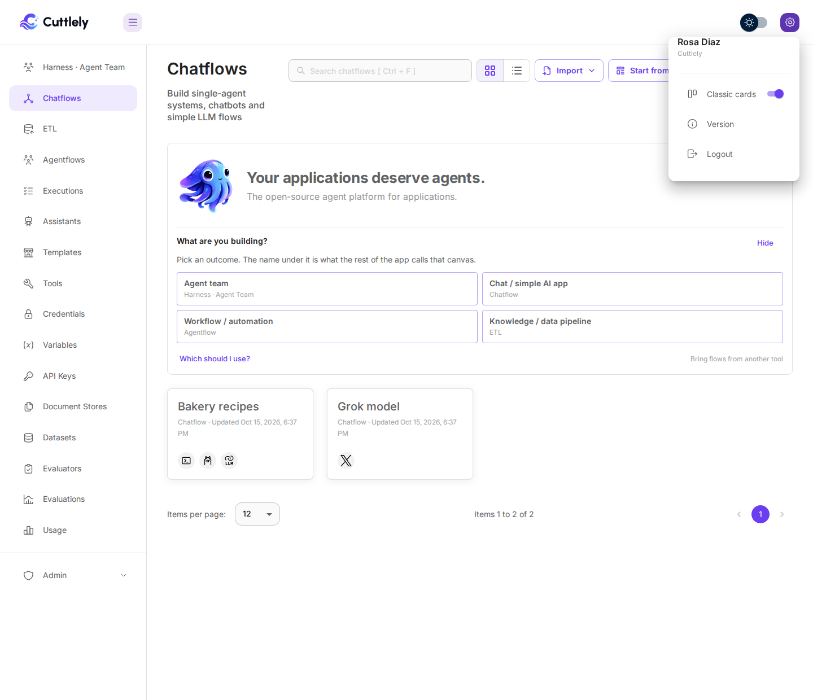
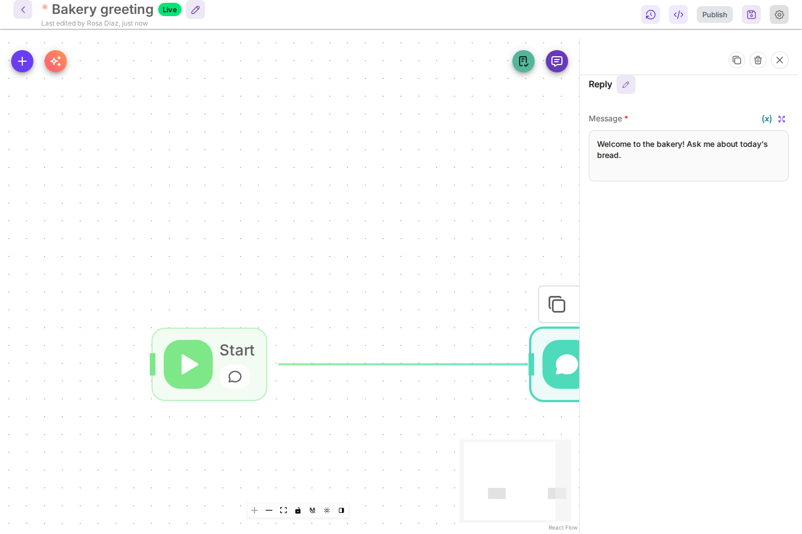
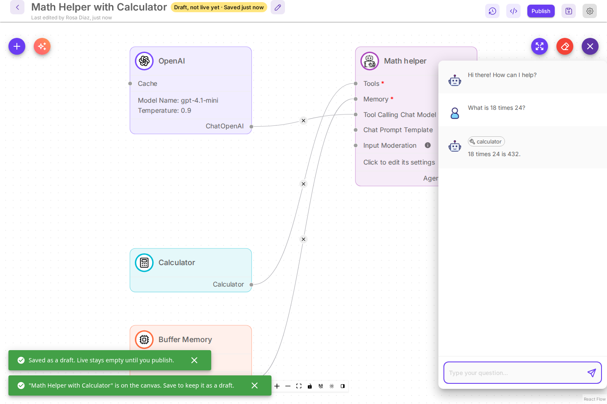

# Canvas cards

Chat flows, harnesses, ETL pipelines and workflows are built on a canvas of cards. Each card is a node, and lines between plug points connect them.

By default cards are compact: a card shows its connections and a few short values, and a click on it opens all of its settings in a side panel on the right. If you prefer every setting on the card itself, turn on **Classic cards**. Nothing about a flow changes when you switch: the same settings, the same connections, the same saved file.

Each card takes a colour from its component when the component defines one. Otherwise the colour comes from the kind of card. Chat models, chains and prompts share a violet family, document loaders and text splitters a green family, embeddings and vector stores a blue family, and tools and memory a warm family. The background is a soft tint of that colour. The border is the same colour, lighter at rest, stronger when the pointer is over the card, and solid when the card is selected. The icon sits on a ring of that colour with a white disc so the picture stays clear. Sticky notes keep their own colour. A card for a node that is not installed keeps the warning style. Compact and classic cards use the same colour.

Install first: [Docker](./docker.md), [From source](./from-source.md), or [Render](./render.md). The canvases are described in [Harnesses](./harnesses.md), [ETL](./etl.md) and [Version history](./versioning.md).

Every canvas has **Build with AI**, the sparkle button next to **+**: describe what you want and it puts a first version on the canvas. See [Build a chatflow with AI](#build-a-chatflow-with-ai), [Build a team with AI](./harnesses.md#build-a-team-with-ai) and [Build a pipeline with AI](./etl.md#build-a-pipeline-with-ai). Workflows have the same button, with the prompt **Describe your workflow**; see the end of [Build a chatflow with AI](#build-a-chatflow-with-ai).

The steps below use a small demo chat flow, **Bakery recipes**: a Prompt Template, a local Ollama model, and an LLM Chain.

## Compact cards


A compact card shows:

-   Its connection rows on the left and its outputs on the right, the same plug points a classic card has.
-   A plug point for each setting that can also take a connection.
-   Up to three short values from its settings, so you can tell cards apart without opening them. Passwords and credentials are never shown. A card with nothing short to show says **Click to edit its settings**.

## Edit a card in the side panel

1. Select a card. Its settings open in the side panel on the right.
2. Change what you need. Edits save to the canvas the same way they do on a card, and the canvas shows as unsaved until you save.
3. Close the panel with the **X**, with **Escape**, or by selecting an empty part of the canvas.


-   **Settings** lists the fields a classic card shows. **More settings** lists the ones behind **Additional Parameters**.
-   A new card you add from **+** opens in the panel right away.
-   The panel narrows the canvas instead of covering it. If the card you select would end up behind the panel, the canvas moves just enough to show it.
-   **Delete** and **Backspace** typed in the panel only edit text. They never delete the card.
-   Sticky notes are edited on the card, as before.

### Pick a model

When a chat model card has a model list, such as OpenAI, Anthropic or xAI Grok, **Model** shows that provider's current models, newest first. Hosted services that serve many models, such as OpenRouter, Together AI or Fireworks, list a short set of popular ones. On every card with a list you can also type the name of any other model your account offers and then select another field: the typed name is kept, and a flow saved with a model that has left the list keeps it. Cards for servers you run yourself, such as Ollama or LocalAI, keep a plain text field because only your server knows its models.


## Switch between compact and classic cards

Two places turn **Classic cards** on or off. They change the same setting.

-   The last button in the toolbar at the bottom of the canvas. Its tooltip reads **New card look (compact cards, settings in a side panel): on** or **off**, and its sidebar icon is filled while compact cards are on.
-   The settings menu at the top right of the app has a **Classic cards** switch.

    

The choice is kept in this browser and applies to every canvas, including tabs that are already open. Another browser, or another person, keeps their own choice.

With Classic cards on, every setting is on the card again and a click on a card does not open the panel.


## Workflows

Workflow cards look the same in both settings. Only where their settings open changes:

-   Compact cards on: select a workflow card and its settings open in the side panel instead of a dialog. **Escape**, the **X** or a click on an empty part of the canvas closes it.
-   Classic cards on: double-click a card to open the settings dialog, as before.



### Older V1 agentflows

**Add New** on **Agentflows** opens the agentflow canvas. Older V1 agentflows are hidden from the app: **Add New**, **Duplicate** and templates no longer make new ones. Existing ones still run through the API, embeds and shared links, still open from a direct link, and appear under **Legacy agentflows** when a workspace has any.

## Build a chatflow with AI

Describe your assistant in plain words and **Build with AI** puts a chatflow on the canvas: a chat model, the agent or chain that answers, memory, and the tools or your own text it needs. Every part and every connection is checked before it lands, and the flow ends on one card the chat can talk to. You need a chat model credential first, for example an OpenAI key saved on the **Credentials** page.

1. On **Chatflows**, select **Add New**. The blank canvas opens.
2. Select **Build with AI**, the sparkle button next to **+**.
3. Under **Describe your assistant**, write what it should do, or select one of the examples above the box. Name a service, such as Tavily for web search, and the builder adds that tool. To answer only from facts you give it, write the facts in the description.
4. Under **Chat model that builds**, Cuttlely starts on a model you have a key for (OpenAI starts on `gpt-4.1-mini`), with your key picked when only one fits. The list shows the models you have keys for; **Show all models** lists the rest, and **More settings** holds the advanced ones. Your choice is remembered for next time. There is no default key.
5. Select **Build**.


The chatflow lands on the canvas unsaved. The message at the bottom names it, for example `"Math Helper with Calculator" is on the canvas. Save to keep it as a draft.` Nothing is saved yet, so you can look it over, change cards, or close the tab.


6. Select **Save**. The name box starts with the built name; change it if you like. The first save keeps the flow as a **Draft**: Live stays empty, so the API, embeds and shared links serve nothing until you publish. See [Drafts and Publish](./versioning.md#drafts-and-publish).
7. Open the chat. Three starter questions are waiting, written as things people would ask this assistant. Select one. The test chat runs your draft.



8. Select **Publish**. **Check recent questions** lists what you asked in the test chat, then the starter questions, marked `(starter question)`, so a brand-new flow has something to check. Live is empty, so each question runs once, on your draft. Select **Run check** to see the answers, then **Publish** to put the flow Live. See [Check recent questions before you publish](./versioning.md#check-recent-questions-before-you-publish).

![The Publish dialog for Math Helper with Calculator. Check recent questions reads Ask questions on your draft before you publish. Live is empty until the first publish. Three ticked questions are listed, two marked starter question. The note reads Live is empty, so each question runs once, on your draft, and the check costs tokens. That is 3 runs. A check stops at 100,000 tokens or 3 minutes, whichever comes first. Below the Run Check Again button the result reads 3 of 3 answered on your draft, with Tokens: draft 760 and a typical time of 1.7 s.](../images/canvas/build-with-ai-check.png)

When a tool needs a credential you have not added, the message at the bottom names it, for example `Tavily API needs Tavily API`. Add that credential on the **Credentials** page, pick it on the card, and save. The message stays until you close it.

A chatflow only calls a harness when you already have one saved; the builder then may use the **Harness** tool with one of your saved harness names. To build a team of specialists instead, see [Build a team with AI](./harnesses.md#build-a-team-with-ai).

When the canvas already has cards, Build with AI asks first. **Start a new one** opens the chatflow on a new canvas in a new tab and leaves this one as it is. **Replace this canvas** swaps the cards here, and **Undo** in the message puts the old cards back.

Build with AI works the same with classic cards. The chatflow lands with every setting on its cards.

On a workflow (agentflow) canvas, **Build with AI** works the same way under **Describe your workflow**: the workflow lands unsaved, and the same choice appears when the canvas already has cards. Harnesses and pipelines are different: a built team or pipeline is always saved right away as a new one. See [Build a team with AI](./harnesses.md#build-a-team-with-ai) and [Build a pipeline with AI](./etl.md#build-a-pipeline-with-ai).

## Templates and version history

-   The template preview under **Templates** uses the same setting. In the new look a click on a card shows its settings in a read-only side panel.
-   Version history keeps classic cards when it shows a saved version, because it compares settings side by side.

## Set the default for everyone

People who have never chosen get compact cards. To give them classic cards instead, set this on the server and restart:

```bash
CANVAS_CARD_LOOK=classic
```

`new` (the default) gives compact cards. Anyone can still change their own browser with either switch above. The variable is listed with the other settings in [CONTRIBUTING.md](../../CONTRIBUTING.md) and in `.env.example`.

## A node that is not installed

A flow can name a node from an optional pack. If that pack is not loaded, the card is a placeholder that names the pack, and the rest of the flow still opens. Export keeps that node's data as it was saved. See [Optional node packs](./node-packs.md).
