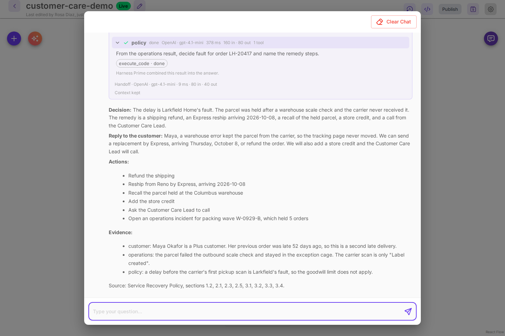

# How the customer care demo works

[Try the demo](./try-the-demo.md) opens **customer-care-demo**, a team that resolves a late-order complaint for Larkfield Home, a made-up store. This page shows how the team is put together, so you can build the same kind of team on your own systems: specialists that each own one system, a step that waits for another's finding, and amounts that come from code instead of the model.

Everything here is in the repository under `samples/demo/customer-care`, and the team is built by `packages/server/src/services/demo/plan.ts`.

## The team

| Card          | Owns                                                        | Files in its folder                    | Tools it calls                              |
| ------------- | ----------------------------------------------------------- | -------------------------------------- | ------------------------------------------- |
| Harness Prime | Routing, the decision, the reply, the actions, the evidence | none                                   | none                                        |
| `customer`    | The support desk: customers, tiers, orders, past contacts   | `support.sqlite`, `support_desk.py`    | `account_snapshot()`, `query()`             |
| `operations`  | Fulfillment: warehouse scans, carrier scans, stock, transit | `fulfillment.sqlite`, `fulfillment.py` | `investigate()`, `held_orders()`, `stock()` |
| `policy`      | The written Service Recovery Policy                         | `service-policy.md`, `policy_book.py`  | `read_policy()`, `remedy_table()`           |

Each specialist is a **Harness Specialist** card with **Code execution** on, so it answers by running Python with `execute_code`. It runs in the agent runtime with its own working directory, `workspaces/customer-care-demo--<name>` under the data directory (`CUTTLELY_DATA_DIR`). Try the demo puts each specialist's files there: every `.sql` file becomes a SQLite database of the same name, and the other files are copied. Each specialist's instructions and tools point only at its own folder, so operations has no customer tiers to go on and customer has no scans: each one reports what its own system shows.


## Give each specialist one call that does the job

A specialist's instructions name the folder, the import line and the functions, and say that only what the code prints comes back:

```text
Run Python with execute_code. Start your code with: import sys; sys.path.insert(0, '<folder>');
from fulfillment import investigate, trace_order, stock, held_orders, query.
...
investigate(order_id) prints all of that for one order in a single call: its journey, the reship dates for its
items, and the other orders held in the same packing wave. For a complaint about an order, call investigate once.
Always run code and never guess. Only what your code prints comes back to you.
```

`investigate('LH-20417')` prints the order line, every warehouse scan, the shipment, every carrier scan, a plain sentence such as `The carrier has no scan after the label was created: it never received the parcel.`, the stock and arrival date for a reship from each warehouse, and the other orders held in the same packing wave. One call that prints sentences, rather than a set of helpers the model has to combine, is what keeps each row at one or two tool calls and the run near 15 seconds. `query(sql)` is still there for questions the helpers do not cover.

## Make one step wait for another

Harness Prime's instructions say how to route a complaint:

```text
For a complaint about an order, send customer and operations at the same time, and send policy with
"after": "operations", never after customer, so it judges the case from the scans and amounts operations found.
```

The policy specialist's one-line summary, which Harness Prime reads when it routes, says the same: it always runs after operations. With `"after"`, the policy task starts when operations finishes and ends with the operations result. The run card shows the order as `Harness Prime sent work to customer, operations, then policy`. [Read the run card](./harnesses.md#read-the-run-card) explains how a waiting step gets the earlier result.

Policy does not wait for customer. It does not need the tier: it gives the remedy for every tier, and Harness Prime picks the line that matches the customer.

## Keep the amounts out of the model

The policy is a Markdown file with numbered sections, and `read_policy()` prints it. The policy specialist decides whose fault the delay is from the scans, and says which section and which scan decide it. Then it runs `remedy_table()` with that fault and the numbers operations found:

```text
Remedy for a larkfield-fault late delivery, item $279.00, shipping paid $9.95.
Every customer: refund the shipping, $9.95 (2.1); reship today at our cost by the fastest service, from the warehouse that delivers first (2.1); recall the held parcel so it is not shipped twice (2.1); if the customer asks for a refund, offer the reship or a full refund of the order and let them choose (3.2).
Every customer: the same warehouse problem held 5 orders, more than 3, so open an operations incident naming the packing wave (3.3).
Then add the one line that matches the customer (tier, and another late delivery in the 120 days before or not):
- Standard, no other late delivery in 120 days: Standard remedy: store credit $27.90 (10% of $279.00, 2.3).
- Standard, another late delivery in 120 days: Plus remedy, raised one tier by 3.1: store credit $41.85 (15% of $279.00, 2.3).
- Plus, no other late delivery in 120 days: Plus remedy: store credit $41.85 (15% of $279.00, 2.3).
- Plus, another late delivery in 120 days: Premier remedy, raised one tier by 3.1: store credit $55.80 (20% of $279.00, 2.3); a call from the Customer Care Lead (2.3) and escalate to the Customer Care Lead (3.3).
...
```

The percentages, the $75 cap, the $100 cap for a Premier repeat and the goodwill amounts are in the policy tables and in `policy_book.py`, and the demo's tests check that the two agree. The model never works out a percentage. It copies a line.

## Tell Harness Prime what a good answer looks like

Harness Prime's instructions ask for four bold parts, **Decision**, **Reply to the customer**, **Actions** and **Evidence**, and say how to use the policy result: every step for every customer, plus the one line for the customer's tier and whether the customer specialist found another late delivery in the 120 days before, with that line's amounts exactly. They also say to use only facts, dates and amounts the specialists gave.



## Build one on your own data

1. List the systems the answer depends on, and give each one a specialist. A specialist that owns one system is easier to instruct and to check than one that sees everything.
2. For each specialist, write a small Python file with one function that prints everything a typical question needs, in plain sentences, plus a `query()` for the rest. Print dates and amounts the way the answer should use them.
3. Put any rules you must follow in a file the specialist reads, with numbered sections, and compute every amount in code from the same numbers.
4. Under **Harness · Agent Team**, select **New agent team**, add a **Harness Specialist** card for each one with **Code execution** on, and write instructions in the shape above: the import line, the functions, "call X once", and what to reply with.
5. Put the files in each specialist's working directory, `workspaces/<team>--<specialist>` under the data directory. In the Docker install that is inside the data volume.
6. In Harness Prime's instructions, say which specialists a typical request needs, which one must wait for which (`"after"`), and the parts of the answer you want.
7. Ask a few real questions in the canvas chat and open the specialist rows. One or two `done` chips per specialist and `Context kept` mean the tools are doing the work.

## Next

-   [Harnesses](./harnesses.md)
-   [Give a specialist its own tables](./analyst.md)
-   [Context and tokens](./context-and-tokens.md)
-   [Call the team from your app](./harnesses.md#call-the-harness-from-a-chatflow)
