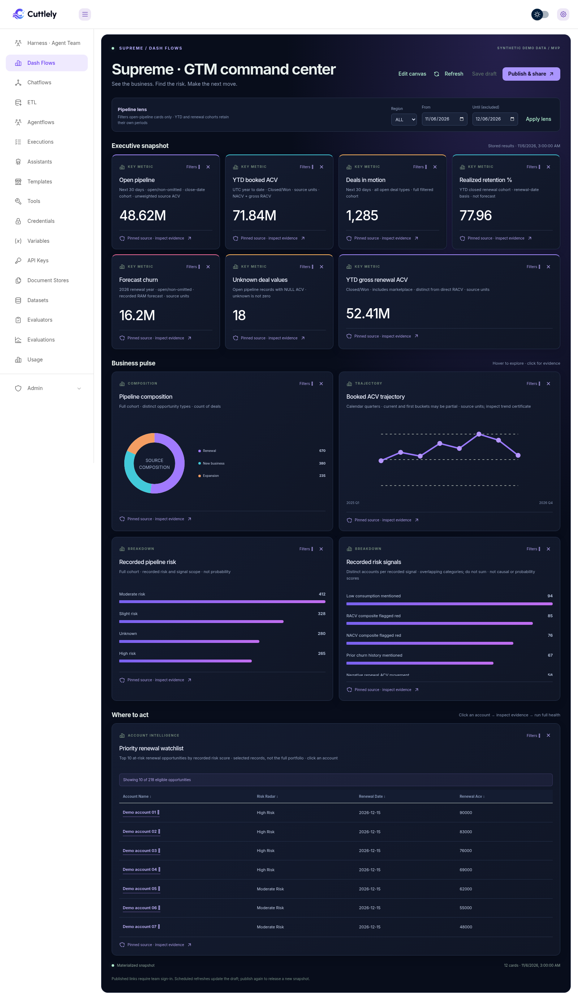

# Dashflows BETA

Dashflows BETA turns a harness's tested PostgreSQL queries into a draggable dashboard. It calls the existing PostgreSQL MCP pinned-tool execution path, stores complete typed rows in a table, and renders later reads without a model or database-source call. It does not parse numbers from an agent answer. The BETA is experimental and off by default.

In **1.6.1**, evidence inspection leads with account names and executive hover summaries, pipeline date/region presets reuse a six-hour durable cache, and **Publish & share** can create an optional public tokenized link for frozen snapshots and account-scoped health reports. Team-only publication remains the default.

## Turn on the BETA

Open **Admin** > **Server Settings** > **Experimental**, turn on **Dashflows BETA**, and save. Dashflows is not a runtime setting, so restart the server with the Experimental card on that section. The card asks for confirmation, then restarts in place when Cuttlely is supervised or shows the manual steps when it is not. The underlying setting is `CUTTLELY_DASH_FLOWS`. Only the exact values `1` and `true` turn it on; an unset or empty value and every other value leave it off.

While it is off, the sidebar item is hidden, private dashboard API requests return 403 and public links return 404, scheduled refreshes do not run, and both builder and published dashboard links show an Experimental-setting message. Published snapshots remain stored but cannot be viewed until the BETA is turned on again.

## Build a dashboard

1. Turn on Dashflows BETA and [pinned queries](./pinned-queries.md), connect the harness's PostgreSQL MCP node, test its queries and publish the harness. Pins with secure parameters are excluded from the BETA.
2. Open **Dashflows**. The default reading view is a full-width command center; **Edit canvas** opens the drag/drop builder. Choose the harness and give the dashboard a title.
3. Drag **Key metric**, **Bar chart**, **Trend line**, **Composition**, or **Evidence table** onto the canvas. Clicking a card type also works.
4. Select a tested query. Enter its exact parameter object and an explicit business scope/period label. Choose a numeric field for a metric or chart, and a label field for a chart. A metric needs one row; calculate aggregates in the tested source.
5. **Save draft**, then **Refresh**. The request is accepted immediately and the page polls the saved dashboard until the background refresh finishes. Missing credentials, changed stamps, invalid parameters, query failures, changed columns, partial pages and potentially capped results refuse the refresh. A failed refresh retains the last good snapshot for that saved definition.
6. Hover a metric or chart mark for an executive summary with readable values, scope and source freshness. Click to open **Inspect evidence**: search and sort up to 100 stored account/opportunity records, filter their recorded risk, and inspect renewal dates, ACV and account context. Names lead the display; technical IDs and exact source data remain available under source verification. Aggregate-only pins explicitly show summary data without inventing an account list.

The fingerprint identifies the executed statement, not the business meaning of a metric. Scope labels and parameter selection are author supplied. A tested pin does not independently establish the correct account, date range, population, denominator or currency. Decimal strings retain their original bytes. Null values are unavailable, not zero. The UI does not sum rows or invent derived measures.

## Refresh and publish

The refresh status panel shows the current stage, validated-card or prepared-view count, active period/region jobs, elapsed time and the last successful snapshot. Progress is stored with the refresh lease and survives page reloads; the builder automatically reconnects using a small status endpoint. A completed refresh shows the number of cached views ready to publish. Failures show affected combinations and a Retry action without replacing successful data. An expired lease is labeled interrupted. Retrying an interrupted refresh reuses still-valid, revalidated query results fetched since that refresh began, including across repeated restarts. Older cached data is not substituted into a fresh refresh. Prewarming runs one period/region query at a time to limit source and server load; completed published dropdowns remain local reads. **Cancel refresh** immediately releases the selected run; **Cancel & restart** releases it and starts a new refresh. Cancellation preserves the last good and published snapshots and blocks late progress, source starts, cache writes and results from the old run. It does not terminate an already-running database query, which may finish or time out; its result is discarded. A stale cancel request cannot stop a newer run. After a minute without progress, the panel says it is waiting for source results rather than inventing an ETA. Published viewers continue reading their frozen snapshot.

Choose **On demand** or **Every week** under **Refresh draft**. Save and run the first refresh to arm a weekly interval. The server polls once a minute, rechecks the saving author's current team update permission, and claims a durable lease before execution. Missed times produce one refresh, not a backlog. A restart retains the schedule and snapshots. Each dashboard is refreshed atomically; a partial failure never replaces some cards while leaving others from another run.

Definitions saved before the BETA that use an hourly or daily interval are not changed automatically and do not run on a schedule. The next save refuses those values and asks the builder to choose on demand or weekly.

**Publish & share** releases the saved, refreshed snapshot and copies a `/dashboards/:id` team link. A viewer must sign in, select the dashboard's team and have `chatflows:view`. Builders need `chatflows:update` for drafts, source discovery, refresh and publication. API keys and anonymous visitors cannot access private dashboard routes. The optional public audience creates a separate tokenized link and account-scoped report endpoints, described below.

Published definitions and data are frozen together. Draft edits and scheduled draft refreshes do not change a published view: explicitly publish again to release new data. **Unpublish** revokes subsequent shared reads. A person who already loaded data can still retain their copy. Published reads execute neither queries nor models. Phone-sized published views stack the cards instead of requiring canvas panning.

## Storage and operating limits

`dashflows.sqlite` lives under the harness data directory (`CUTTLELY_DATA_DIR`, otherwise the repository's `.cuttlely` directory). The `dash_flow` table stores workspace, author, revision, definition, last-good typed snapshot, frozen publication, interval due time and refresh lease. SQLite WAL, short immediate writer transactions for claims/publication, and revision-checked settlement coordinate processes on one shared local volume. The writer lock is acquired before reading state and is released before any source query; competing saves or revocations cannot cross that read/write boundary. Back up this database alongside the harness data. Distributed replicas with separate data volumes are unsupported.

Widget **Filters** opens the source parameter form: date/date-range inputs appear only when the tested source declares them; enumerated periods, numeric limits and other filters keep their source types and bounds. Applying a filter clears the displayed stale snapshot and requires Save/Refresh before republishing. Charts can keep source order or sort by value; tables sort on their headers. These display sorts preserve the original evidence-row identity. A trend follows returned observation order; a composition is for disjoint nonnegative categories, never overlapping risk drivers. Published viewers can sort stored tables, but changing source parameters remains a builder action.

The first slice allows 12 cards, 1,000 complete rows and 512 KB of row JSON per card. A query whose returned row count reaches its literal LIMIT is refused because completeness is uncertain. The explicit exception is a single-row aggregate envelope with a configured source field whose value is boolean `true` for completeness. A bounded nested row-array path can select chart rows from that envelope; the original envelope remains available in evidence. A transport truncation or cursor is still refused. Narrow its scope or aggregate at the source. Schedule times are fixed intervals after completion, not calendar-aware cron. Parameters stay fixed; a moving reporting period must be defined explicitly in the tested query. Credentials stay in the harness; neither SQL nor credentials are copied into a dashboard.

This BETA does not include dashboard deletion, card resizing, arbitrary computed fields, model-generated dashboards, public embeds, a full version-history UI, or automatic updates to published snapshots. The existing harness cron schedule is unchanged.

## First harness acceptance test

**Use Supreme command center** creates a 12-card GTM view: open pipeline, YTD booked ACV, deals in motion, realized retention, forecast churn, unknown deal values, YTD gross renewal ACV, pipeline composition, quarterly booked trajectory, pipeline risk, recorded renewal drivers and the clickable watchlist. All cards bind to source fields; no hard-coded business values are included. The pipeline lens offers Next 30/60/90 days, This quarter, Next quarter and Custom dates. Refresh prepares all five periods across ALL, AMER, EMEA and APJ (20 combinations). Selecting a prepared period or region switches the pipeline cards locally in the browser, in builder, team and public views, without an API call or source execution. Custom dates remain a builder action that saves and refreshes the draft. Other cohorts retain their own periods. Compact KPI display is rounded for readability; ACV amounts display two decimal places in metrics, tables and hovers, while source evidence retains the original bytes. No currency code or conversion is inferred.

The four reviewed single-row aggregate queries (pipeline, YTD sales, realized retention and annual forecast churn) have exact statement-fingerprint contracts in `packages/harness/dashflow-source-contracts.mjs`. SQL or parameter-definition changes invalidate the exception. Pipeline totals and risk/type summaries cover the full cohort before pagination; paged deal details are a disclosed selection and cannot independently use this exception. Aggregate completeness does not establish business semantics, freshness or currency. The quarterly trajectory includes partial buckets and is labeled accordingly; the original source comparison certificate stays in evidence. Regional booking coverage is incomplete, so regional numbers must not be presented as a reconciled global allocation. Forecast churn is distinct from realized churn and pipeline ACV.

Passive dashboard reads use the saved SQLite snapshot only. They do not execute the seven source queries or a model. Manual/scheduled refresh executes sources and prepares all 20 pipeline period/region combinations with at most four source workers. It replaces the draft only when every view validates. A failure keeps the previous generation; incomplete or legacy generations must be refreshed before publishing. Published views remain frozen until explicitly republished, including their period boundaries and source freshness. Selecting a prepared view needs no request, save, query or model call. The snapshot stores the evidence envelope once per combination, shared across its pipeline cards. Account reports can use exact account IDs from the currently published prepared views.

Custom dates cannot be exhaustively prepared: builder edits still use the workspace- and dashboard-scoped six-hour source cache and query missing results. Manual Refresh bypasses that cache. The durable query cache holds at most 32 bounded entries per dashboard, separate from the frozen prepared views; its expiry does not make published dropdowns execute queries. Pipeline periods use UTC half-open boundaries; quarter presets mean the current and next calendar quarters at snapshot preparation time. A running worker renews its lease every 15 seconds; a lost worker becomes interrupted within 90 seconds. Deploy/shutdown detection interrupts the current worker without clearing another process’s refresh.

Honeybadger Supreme's actual exported configuration was inspected: seven specialists and 168 eligible pin bindings (including repeated pins across specialists). It supports regional renewal blockers, account health and executive/QBR reports, current account ACV, renewal exposure, realized churn context, pipeline outlook, product adoption/utilization, recorded risk patterns, and technical-document retrieval/native document outputs. These measures have different grains and must not be combined indiscriminately. Account identity resolution, current account value, renewal value, forecast risk and realized churn remain distinct.

The renewal-risk source supports three cohort cards from the existing quarter account-risk source: distinct accounts at risk, renewal opportunities in scope and nine recorded driver-text categories. The query covers the current UTC quarter's open, non-omitted renewals with High, Moderate or Slight Risk and valid active account identities. It aggregates the full eligible cohort before returning one envelope. Categories overlap and cannot be added; prevalence is not a churn probability or causal finding. Missing feedback evidence does not prove absent customer engagement.

The aggregate contract uses `risk_pattern_payload.complete` and `risk_pattern_payload.patterns`; the metrics use `total_risk_accounts` and `total_risk_opportunities`. The preset takes the statement hash from the selected harness catalog. Cards with the same source and exact parameters share one execution per refresh. A fourth card uses the renewals-at-risk source for the up to 100 current-quarter risk-ranked renewal opportunities (a ten-row overview on the dashboard). This is a disclosed selection, not the whole portfolio: its returned count and total eligible count must agree with the typed selected-row envelope. Full cohort metrics are never computed from this watchlist. The table retains returned account IDs and distinguishes renewal ACV from current account value. This pin supports current/next quarter, next week and rolling next-days scopes; the cohort metric pin stays current-quarter only.

Click a returned account name for its stored evidence. **Run full health report** explicitly starts the existing harness asynchronous-run API using that exact validated 18-character account ID, then polls the recorded result. It does not guess identity from a display name or include arbitrary row text in the question. The server's existing harness run permissions apply; a view-only role sees the snapshot but cannot run a report. Closing the drawer leaves the run in harness history. The report uses current source data and is not written over the dashboard snapshot.

No SQL, customer rows, account identifiers or credentials are embedded in the preset.

A real read-only author query test against the existing Supreme pin succeeded during development (one aggregate envelope; nine pattern categories; complete source flag). The watchlist author query test also succeeded (ten selected records with account IDs and consistent count metadata). The two renewal queries plus five additional read-only query tests (pipeline, YTD sales, retention, forecast churn and quarterly ACV series) succeeded. All seven real query results passed local materialization and durable storage for the 12-card command center using seven executions. One full-health request for an exact returned account ID succeeded through the live asynchronous harness API in approximately 33 seconds. The exported configuration and business data stayed outside the repository. This validates the real query-result contract, not a deployed dashboard: Dashflows endpoints were not deployed to that server, and production Dashflows scheduling/sharing were not exercised. Synthetic tests cover storage, authorization, UI and publication behavior separately.

Local coverage:

```bash
node --test packages/harness/dashflows.test.mjs
pnpm --filter @cuttlely/server test --runInBand src/routes/dashflows/index.test.ts
pnpm --filter @cuttlely/ui test --runInBand src/views/dashflows
node scripts/live-e2e/dashflows-ui.mjs # UI dev server required; synthetic fixtures only
pnpm verify
```

The committed fixtures are synthetic contract tests; the separate live query acceptance described above used private source data. Source pin stamps are checked by the existing PostgreSQL MCP implementation at execution; the dashboard additionally checks the returned pin receipt, complete-result flags and display field shape before materialization.

## Visual showcase



The screenshot uses synthetic demonstration values and account names. It illustrates the implemented UI, not customer results.

## Public dashboard links

Publishing defaults to **Signed-in team only**. Choose **Anyone with the public link** to deliberately expose the frozen snapshot and all its stored evidence. The dialog explains that public visitors can request current full account health reports using the publishing team's harness and model usage. This is not an embed or an automatic release of draft edits.

The public URL uses an opaque token. Unpublish, or republish for the team only, revokes it; republishing after revocation creates a new token. Anonymous viewers can explore stored account evidence and explicitly request a health report only for exact account IDs in that published snapshot. They can switch prepared periods and regions, but cannot change source parameters, refresh, edit, supply arbitrary report prompts, or read unrelated harness runs. Report access rechecks the publisher's current permission and the token on every start and poll. Starts are limited to three per caller per minute and ten per dashboard token per hour; per-caller limits are per server process. Public reads are marked no-store/noindex. Disabling Dashflows also disables these routes.
