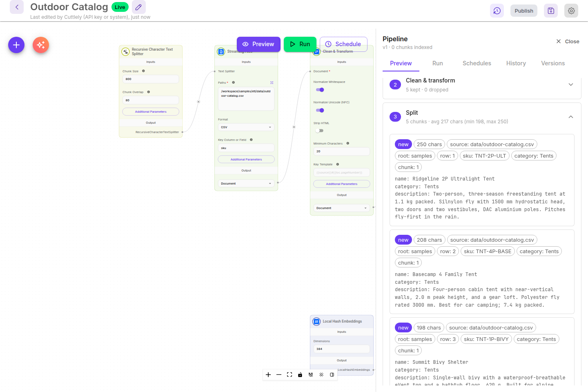
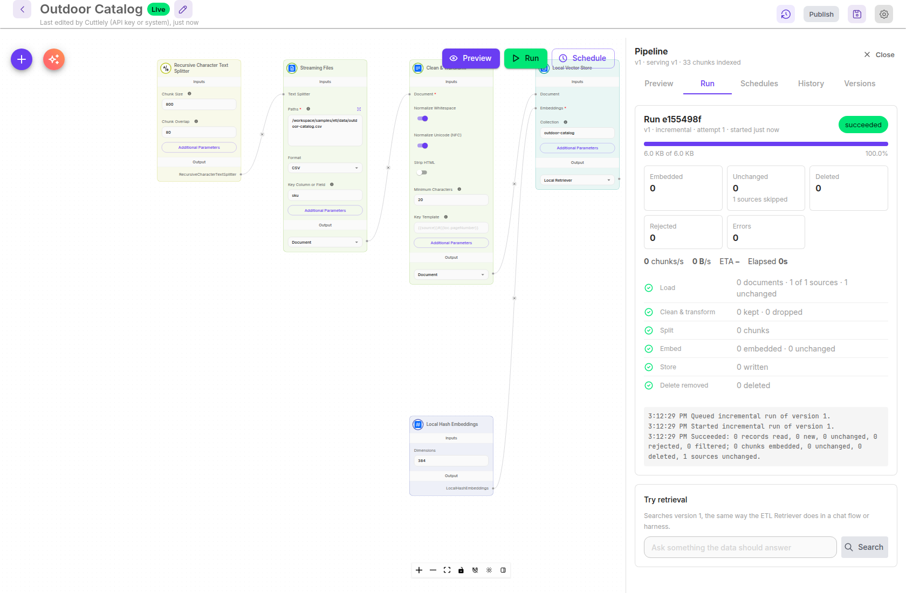
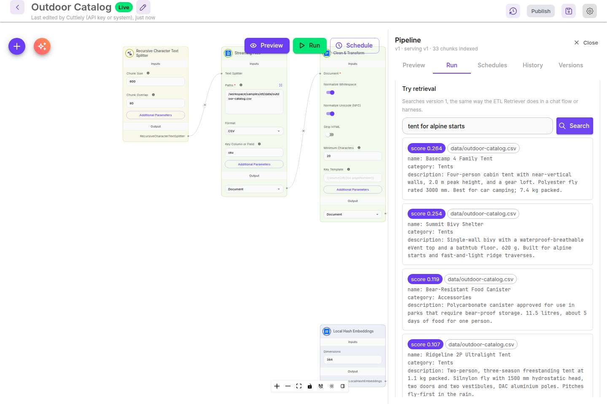
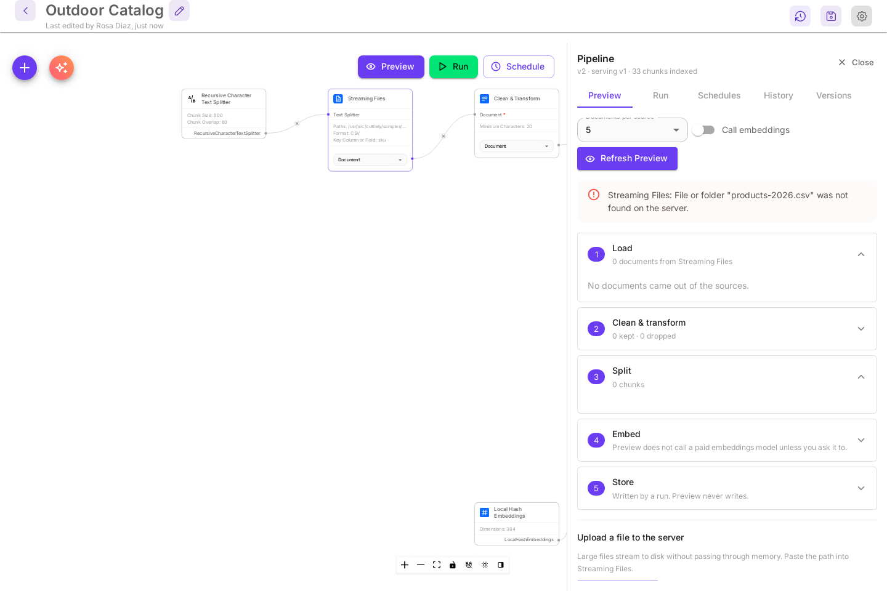
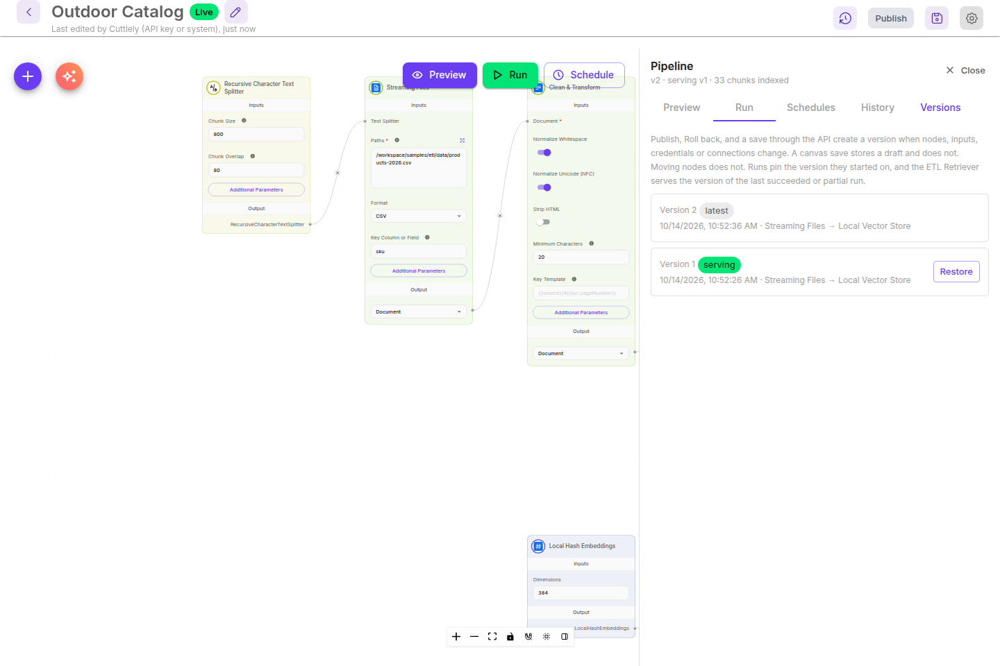
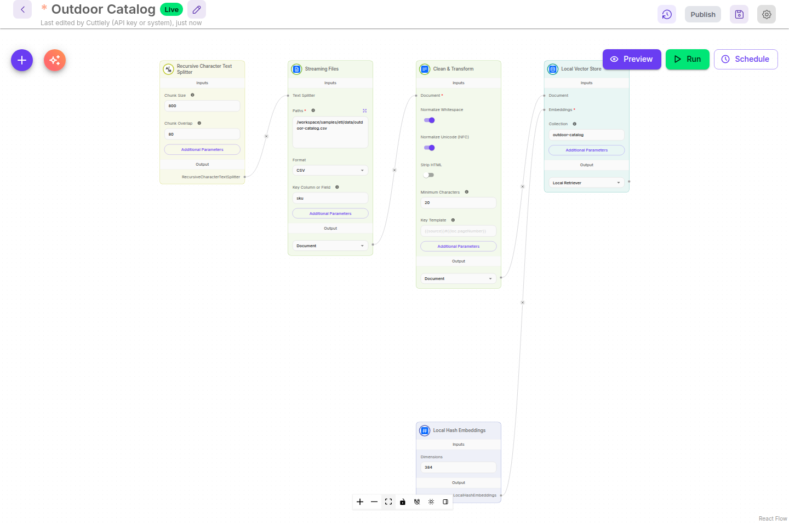
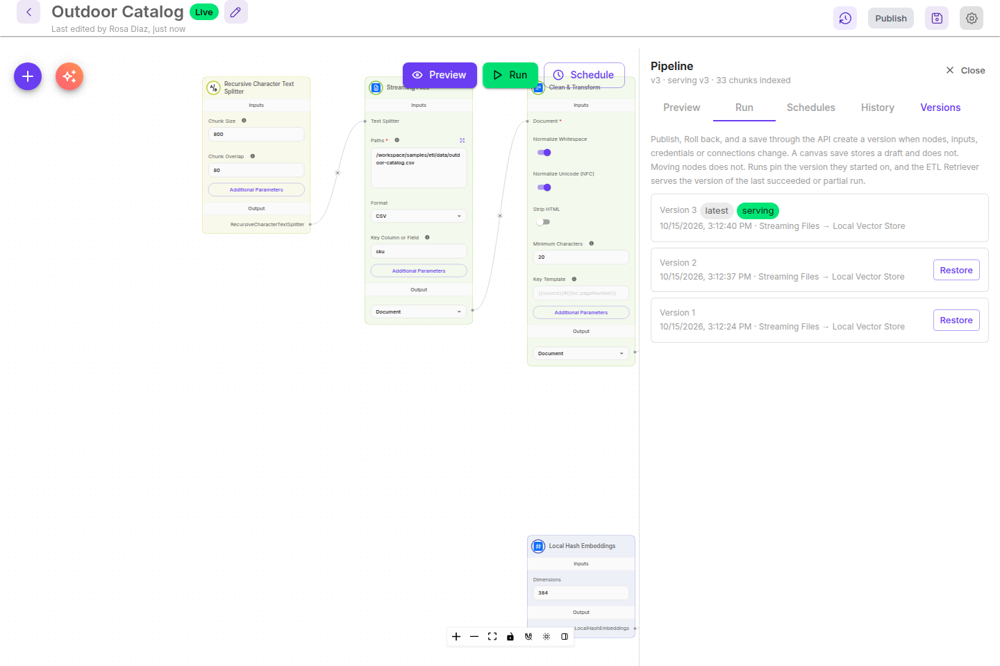
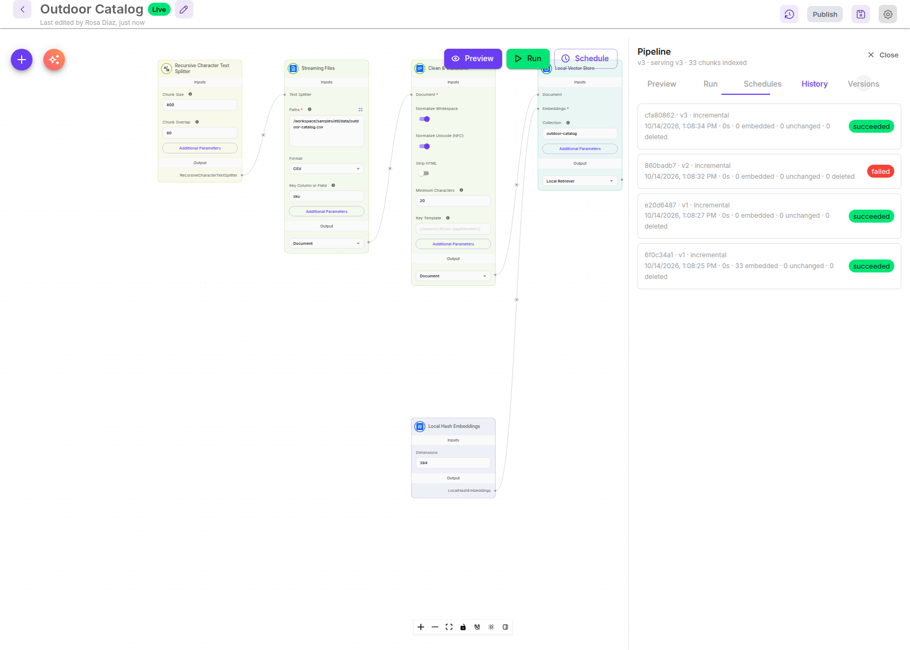
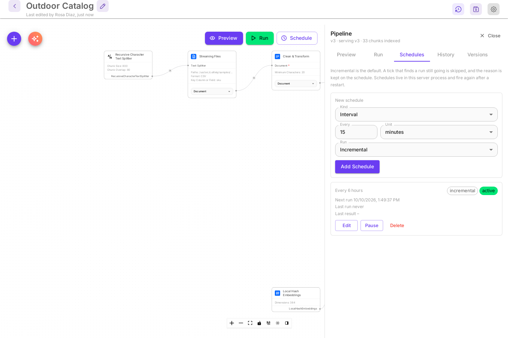
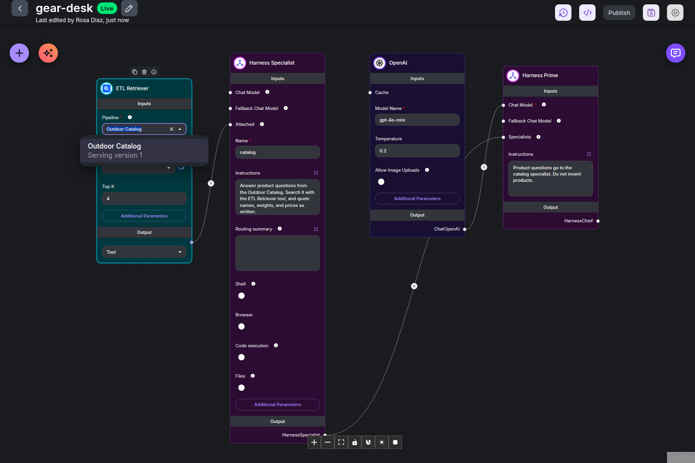

# ETL

An ETL pipeline loads files, cleans them, splits them into chunks, embeds the chunks, and writes them to a vector store. Chat flows and harnesses then search that store with the **ETL Retriever** node. **ETL** in the sidebar lists your pipelines. Each pipeline is a canvas of nodes: a source, a text splitter, a transform, an embeddings model, and a store.

Use ETL when an answer has to come from your own data, such as a product catalog, a handbook, or a code repository, and that data changes over time. A run only embeds what changed since the last run, keeps every saved version, and can run on a schedule. For a single document you paste into one chat flow, a document store is enough. To answer from the data in a chat, connect the pipeline to a [harness](./harnesses.md) or a chatflow with the **ETL Retriever**.

Install first: [Docker](./docker.md), [From source](./from-source.md), or [Render](./render.md). The account is [Sign in](./sign-in.md). A canvas save stores a draft. **Publish** is what scheduled runs read, and that publish is kept in [Version history](./versioning.md). The canvas pictures here show classic cards, with every setting on the card, except the Build with AI pictures, which show compact cards. With the default compact cards, select a card to change the same settings in its side panel. See [Canvas cards](./canvas.md).

The steps below use the **Outdoor Catalog** sample: a CSV of 33 outdoor products in `samples/etl/data/outdoor-catalog.csv`. It embeds with **Local Hash Embeddings**, which run on the server with no provider key. The last part connects the pipeline to a harness with an OpenAI model.

## Open the ETL page

Select **ETL** in the sidebar. With no pipelines yet, the page says `No pipelines yet` and offers **Import Sample** and **New Pipeline**.

-   **Import Sample** opens a menu with the two samples from `samples/etl/`.
-   **New Pipeline** opens a blank ETL canvas. Add nodes with **+** (**Add Node**), then save.
-   On a blank canvas, **Build with AI** builds a pipeline from a description of your data. See [Build a pipeline with AI](#build-a-pipeline-with-ai).

You can also open **Templates** in the sidebar and select the **ETL** chip, or select **Knowledge / data pipeline** on the **What are you building?** card.

## Import a sample

1. Select **Import Sample**.
2. Select **Outdoor Catalog**.

The sample is saved as version 1 and opens on its canvas, `/etlcanvas/<id>`. **Paths** on the Streaming Files node is already set to the sample CSV in your install.

| Node                                  | What it does                                                                                                                          |
| ------------------------------------- | ------------------------------------------------------------------------------------------------------------------------------------- |
| **Streaming Files**                   | Reads files or folders on the server, one path per line. **Format** is CSV here. Each CSV row becomes one document.                   |
| **Recursive Character Text Splitter** | Cuts long documents into chunks. Chunk Size 800 and Chunk Overlap 80. A product row fits in one chunk.                                |
| **Clean & Transform**                 | Normalizes whitespace and Unicode (NFC), can strip HTML, and drops documents shorter than **Minimum Characters** (20).                |
| **Local Hash Embeddings**             | Builds 384-dimension vectors on the server. No key and no cost. It matches words, not meaning. See [Better matches](#better-matches). |
| **Local Vector Store**                | Stores the vectors in the collection `outdoor-catalog` under `CUTTLELY_ETL_DIR`.                                                      |

The header has **Version history**, **Save Pipeline**, and **Settings** at the top right. **Preview**, **Run**, and **Schedule** open the **Pipeline** panel on the matching tab. The panel's first line reads `v1 · 0 chunks indexed` until a run has written the store.

An orange triangle on a card and an orange **Sync Nodes** button next to **+** mean a node was saved with an older version of that node than the app has now. Select **Sync Nodes**, then save. The save stores a draft. **Publish** creates a new pipeline version.

## Build a pipeline with AI

Instead of adding nodes yourself, describe your data and let **Build with AI** put the pipeline together. These pictures show the default compact cards.

1. Open a blank ETL canvas with **New Pipeline**.
2. Select **Build with AI**, the sparkle button next to **+**.
3. Under **Describe your data**, write what to load and how people will search it. Give full paths on the server, in a folder a pipeline may read (see [Which folders a pipeline can read](#which-folders-a-pipeline-can-read)), name the id column of a CSV, and say which files of a repository you want. You can also select one of the three examples and edit it.
4. Under **Chat model that builds**, Cuttlely starts on a model you have a key for on the **Credentials** page, with your key picked when only one fits; **Show all … models** lists the rest, and **Only models for your keys** returns to that shorter list. **More settings** holds the advanced ones. There is no built-in key. Your choice is remembered for next time.
5. Select **Build**.

The builder uses the bundled pipelines as examples. Unless you name others, it uses **Local Hash Embeddings** and the **Local Vector Store**, so the pipeline runs with no provider key. Before anything is saved, it checks the plan and fixes what fails:

-   Every path is a full path on the server.
-   A CSV, TSV, or JSONL source names its id column, so a second run updates rows instead of adding them again.
-   One source line ends in exactly one store, and every card reaches it.
-   Each **Include** glob on a repository source has a slash. `README.md` would match every README in every folder, so the builder writes `/README.md` for the top-level file or `**/README.md` for all of them.

The pipeline is saved right away as a new pipeline, named after its title (with a number when the name is taken), and opens on its own canvas. A message says what was built. When a node needs a credential you don't have yet, the message names it.

Select a card to check or change its settings, then [preview](#preview-the-data) and [run](#run-the-pipeline) it as below. The builder also writes three starter searches. After the first run they wait under **Try retrieval** on the **Run** tab; select one to search.

Build with AI always makes a new pipeline. When the canvas already has cards, the new pipeline opens in a new tab, so nothing on this canvas is lost. With classic cards, the same button builds the same pipeline with full-size cards. Harnesses and chatflows have the same button: see [Build a team with AI](./harnesses.md#build-a-team-with-ai) and [Build a chatflow with AI](./canvas.md#build-a-chatflow-with-ai).

## Drafts and Publish

A pipeline canvas saves to a **Draft**. Scheduled runs, **Start run**, and a full rebuild keep using the published pipeline until you **Publish**. The canvas says **Draft, not live yet** while a draft is waiting.

**Preview** is how you try the draft. It runs the canvas you are looking at, including edits you have not saved yet, and it does not write to the store. There is no separate dry run of **Start run**: that button writes to the store, and it writes the published pipeline, not the draft.

**Publish** opens a dialog that lists what changed, in the same words as version history: nodes added, nodes removed, and changed settings. A pipeline has no question check. **Discard draft** puts the published canvas back. **Roll back Live to this version** changes what runs read at once. **Open as draft** puts an older version on the canvas and leaves runs alone until you publish.

The first save of a new pipeline creates the published pipeline, so a run has something to read. The next canvas save is a draft. A pipeline that already exists stays as it is after an upgrade. The first edit after that starts a draft. `PUT /api/v1/chatflows/:id` still writes the published pipeline. A pipeline is the change-list row in [Which canvases get a check](./versioning.md#which-canvases-get-a-check). See [Drafts and Publish](./versioning.md#drafts-and-publish).

## Preview the data

Preview runs the pipeline on a few documents and shows what each step would produce. It uses the canvas, which is the draft when you have one, and it never writes to the store.

1. Select **Preview**.
2. Leave **Documents per source** at `5`, or pick `3`, `10`, or `25`.
3. Select **Refresh Preview**.

The preview has five numbered steps. Select a step to open it.

| Step                    | What it shows                                                                                           |
| ----------------------- | ------------------------------------------------------------------------------------------------------- |
| **1 Load**              | The documents read from each source, with their metadata. CSV columns other than the text become chips. |
| **2 Clean & transform** | How many documents were kept and dropped.                                                               |
| **3 Split**             | The chunks and their sizes. A `new` chip marks a chunk that is not in the store yet.                    |
| **4 Embed**             | The embeddings model, its dimensions, and the time it took.                                             |
| **5 Store**             | `Written by a run. Preview never writes.`                                                               |

**Call embeddings** is off by default. Local Hash Embeddings always run in the preview. Turn it on to also call a provider embeddings model. That call is billed to the model's credential.

A problem shows as a red message above the steps, for example a path that does not exist. See [When a run fails](#when-a-run-fails).

## Run the pipeline

A run reads every source, embeds the chunks, and writes them to the store. Save the pipeline first. A run uses the published pipeline, not the draft. While the canvas has unsaved changes, the panel says `Save your changes first. A save stores a draft. Preview uses this canvas and does not write to the store.` After that save, and until you publish, it says `This run uses the published pipeline and writes to the store. The draft is not included until you Publish. Preview uses the draft and does not write.`

1. Select **Run**.
2. Leave **Incremental** selected.
3. Select **Start Run**.

| Setting               | Meaning                                                                                                             |
| --------------------- | ------------------------------------------------------------------------------------------------------------------- |
| **Incremental**       | Skips unchanged sources and chunks, embeds what changed, and deletes what disappeared. Use it for every normal run. |
| **Full rebuild**      | Re-embeds every chunk, then deletes what disappeared. Use it after you change the embeddings provider settings.     |
| **Batch size**        | Chunks per embeddings call. Default 64.                                                                             |
| **Parallel batches**  | Embeddings calls at the same time. Default 4. Lower it if the provider returns rate-limit errors.                   |
| **Retries per batch** | How many times a failed batch is tried again before the run fails. Default 6.                                       |

A run card appears under **New run**. The sample takes about a second.

The panel's first line now reads `v1 · serving v1 · 33 chunks indexed`. **Serving** is the version the ETL Retriever searches.

### Read the run card

| Part                                              | Meaning                                                                                                                                                                                               |
| ------------------------------------------------- | ----------------------------------------------------------------------------------------------------------------------------------------------------------------------------------------------------- |
| **Run** and 8 characters                          | The start of the run id. The same id is in **History**.                                                                                                                                               |
| `v1 · incremental · attempt 1 · started just now` | The version the run uses, the mode, and how many times it has been tried. A run keeps the version it started on, even if you edit the canvas while it runs.                                           |
| Status chip                                       | `queued`, `running`, `paused`, `succeeded`, `partial`, `failed`, or `cancelled`.                                                                                                                      |
| Progress bar                                      | Bytes read of the total.                                                                                                                                                                              |
| **Embedded**                                      | Chunks embedded and written by this run.                                                                                                                                                              |
| **Unchanged**                                     | Chunks that were already in the store. `N sources skipped` counts files that did not change at all.                                                                                                   |
| **Deleted**                                       | Chunks removed because their source row or file is gone.                                                                                                                                              |
| **Rejected**                                      | Records that failed the source's rules, such as a missing required column or a value that is too long. The run finishes as `partial`.                                                                 |
| **Errors**                                        | Errors counted while the run read and wrote: a malformed or invalid record (it also counts under **Rejected**), a file that could not be read, or a record the store refused. The log names each one. |
| chunks/s, B/s, ETA, Elapsed                       | Live speed while the run is going. A run this small finishes before a speed is measured.                                                                                                              |

Below the numbers, each step has a check mark when it is done, then a line of counts. The log at the bottom lists what happened, with times.

While a run is going, **Pause** stops it after the current batch and **Cancel** stops it for good. A paused run shows **Resume**. A run that read to the end but rejected some records, or could not read a file, is `partial`. A file it could not read keeps the chunks from the last run. A `partial` run is served, the same as `succeeded`. If more than 5% of the records are rejected, after at least 100 records, the run fails instead and the served version does not change.

### Run it again

Select **Start Run** again with nothing changed. The incremental run reads the file, sees it has not changed, and embeds nothing.

Add, edit, or remove rows in the CSV and run again. Only the changed rows are embedded, and rows you removed are deleted from the store.

## Try retrieval

**Try retrieval** is under the run card once a version is serving. It searches the serving version the same way the ETL Retriever does in a chat flow or harness.

1. Type a question in **Ask something the data should answer**, for example `tent for alpine starts`.
2. Select **Search**.

Each result shows its score, its source, and the chunk text. `No matches.` means the store has nothing close to the question.

A pipeline made with [Build with AI](#build-a-pipeline-with-ai) also lists its starter searches under the search box. Select one to search with it.

### Better matches

Local Hash Embeddings match words, not meaning. In the example, the Summit Bivy Shelter is the one built for alpine starts, but the family tent scores slightly higher because it shares more words with the question. To match on meaning, replace **Local Hash Embeddings** with a provider embeddings node, such as **OpenAI Embeddings**, select its credential, **Publish**, and run a **Full rebuild**. A canvas save alone leaves the rebuild on the published pipeline.

## When a run fails

To see a failure, change **Paths** on the Streaming Files node to a file that does not exist, such as `products-2026.csv` in the same folder, and save. The save stores a draft. **Preview** shows the missing file, and it does not write to the store. A run still uses the published pipeline until you **Publish**. Publish creates the next pipeline version.

**Preview** shows the problem before you run.

After you publish, a run of that version fails with the same message.

This run failed before it wrote anything, so the served data is as it was. The panel still reads `serving v1`, and **Try retrieval** still searches version 1. A run can also fail partway, for example when the embeddings provider stops answering. The batches it wrote before it stopped are already in the store, and search can return them. Retry the run, or start a new one, so the store matches a finished run again.

-   **Retry From Checkpoint** starts the same run again from where it stopped, on the same version, as attempt 2. Use it when the cause was outside the pipeline, such as a provider outage or a rate limit.
-   When the pipeline itself is wrong, fix the node, **Publish**, and select **Start Run**. A retry would run the old version again, and a canvas save alone does not change it.
-   **Cancel** ends the failed run. It stays in **History** as `cancelled`.

### Which folders a pipeline can read

A source path must be an absolute path on the server, without `..`. A pipeline can read:

-   the folders in `CUTTLELY_ETL_ROOTS`, when it is set;
-   this workspace's uploads (see [Upload a file](#upload-a-file-to-the-server));
-   `samples/etl` in the install.

A **Code Repository** source can also read the Cuttlely checkout itself while `CUTTLELY_ETL_ROOTS` is not set. Any other path is refused with `Path "..." is outside the folders pipelines may read (...). Set CUTTLELY_ETL_ROOTS on the server to the folders pipelines may read (comma-separated, each path or label=path) and restart it.`

## Restore an earlier version

**Publish**, **Roll back**, and a save through the API create a version when nodes, inputs, credentials, or connections change. A canvas save stores a draft and does not. Moving nodes does not. **Versions** lists the published versions, newest first.

1. Select **Versions** in the panel.
2. Select **Restore** on the version you want.

The canvas loads that version. Nothing is saved yet: an asterisk appears before the name, and **Paths** is back to `outdoor-catalog.csv`.

3. Select **Save Pipeline**. The canvas stores a draft. Select **Publish**. The published pipeline is a new version, version 3. Versions 1 and 2 stay in the list.
4. Run the pipeline. When the run succeeds, version 3 is serving.

The ETL Retriever serves the version of the last `succeeded` or `partial` run, not the last save. A version without a run is never served. A row marked `incomplete` is a version with a problem in its graph, such as a missing source, store, or embeddings connection. Fix the canvas, save the draft, and **Publish**. **Version history** at the top right is the same history for the whole canvas. See [Version history](./versioning.md).

## Look at earlier runs

**History** lists every run of the pipeline, newest first. Each row has the run id, the version, the mode, the start time, how long it took, the counts, and the status.

Select a row to open that run's card in **Run**. With no runs, the tab says `No runs yet. Start one from the Run tab.`

## Run it on a schedule

A schedule starts a run at a fixed interval or on a cron expression.

1. Select **Schedule**, or **Schedules** in the panel.
2. Under **New schedule**, leave **Kind** at **Interval**. Set **Every** to `6` and **Unit** to **hours**.
3. Leave **Run** at **Incremental**.
4. Select **Add Schedule**.

The schedule appears below the form.

-   **Kind** **Cron** takes five fields, `minute hour day month weekday`, in UTC. `0 2 * * *` runs at 02:00 UTC every day.
-   **Edit** changes the schedule, **Pause** stops it until you select **Resume**, and **Delete** removes it.
-   If a run is still going when the schedule fires, that tick is skipped, and the card says why under **Last result**.
-   Schedules run inside the Cuttlely server. They do not fire while it is stopped, and they continue after a restart.

## Upload a file to the server

A source reads files on the server, not on your computer. To use a file from your computer, upload it from the **Preview** tab.

1. Select **Preview** and scroll to **Upload a file to the server**.
2. Select **Choose File** and pick the file.
3. Select the copy icon (**Copy path**) next to the path that appears.
4. Paste the path as a new line in **Paths** on the Streaming Files node, save, and run.

Uploads go to `CUTTLELY_ETL_DIR/uploads/`, in a folder for your workspace. A pipeline in one workspace cannot read another workspace's uploads.

## See all pipelines

Once a pipeline is saved, the ETL page lists it. **Search pipelines** filters the list by name. **Upcoming runs** shows the next scheduled run of each pipeline.

| Column   | Meaning                                               |
| -------- | ----------------------------------------------------- |
| Pipeline | The pipeline name. Select the row to open its canvas. |
| Sources  | The source nodes.                                     |
| Target   | The store node, with the embeddings node under it.    |
| Chunks   | Chunks indexed in the store.                          |
| Version  | The latest version, and the version that is serving.  |
| Last run | The status of the last run and when it ran.           |
| Next run | The next scheduled run and its schedule.              |

Deleting a pipeline also deletes the vectors it wrote to its store, and to any store it used before you changed it. A run that is still going is cancelled first, and no run can start or be retried while the delete is going on. Other pipelines that use the same collection or namespace keep their vectors. If the store cannot be reached, for example because its credential was deleted, the pipeline is still deleted, and the server log names the store that kept its vectors. Two cases cannot be fully cleaned up. A store that makes up its own vector ids (SingleStore, Zep) and that the pipeline used before you moved it to another store keeps its vectors, and the server log names it. An earlier store also keeps chunks whose text or embeddings model changed after the move, because their ids are no longer known.

## Use the pipeline in a harness

The **ETL Retriever** node searches a pipeline by name. Attach it to a Harness Specialist, and the specialist can look things up in your data. The example below is a harness named `gear-desk` with one specialist, `catalog`.

1. Open **Harness · Agent Team** and select **New agent team**. Add **Harness Prime**, one **Harness Specialist**, and an **OpenAI** chat model connected to **Chat Model** on Harness Prime, as in [Harnesses](./harnesses.md#connect-a-chat-model-to-harness-prime).
2. Select **+** (**Add Node**), type `ETL Retriever`, and drag **ETL Retriever** from **Tools** onto the canvas.
3. Drag from the ETL Retriever output dot to the **Attached** dot on the Harness Specialist.
4. Under **Pipeline**, select `Outdoor Catalog`. Each pipeline in the list shows the version it serves. A pipeline with no successful run says `No successful run yet`.

    

5. Name the specialist `catalog`. Give it instructions such as `Answer product questions from the Outdoor Catalog. Search it with the ETL Retriever tool, and quote names, weights, and prices as written.`
6. Give Harness Prime instructions such as `Product questions go to the catalog specialist. Do not invent products.`
7. Save the harness as `gear-desk`.

| ETL Retriever field                                 | Meaning                                                                                                                        |
| --------------------------------------------------- | ------------------------------------------------------------------------------------------------------------------------------ |
| **Pipeline**                                        | The pipeline, by name. If you rename the pipeline, select it here again and save.                                              |
| **Namespace**                                       | Shown after you pick a pipeline, and only when it has written a named namespace. Leave it empty to search the serving version. |
| **Top K**                                           | How many chunks a search returns. Default 4.                                                                                   |
| **Tool Name** (Additional Parameters)               | The tool name the model sees. Defaults to `search_` and the pipeline name.                                                     |
| **Tool Description** (Additional Parameters)        | Tells the model when to search this data. Defaults to a sentence that names the pipeline.                                      |
| **Return Source Documents** (Additional Parameters) | Also returns the chunks as source documents.                                                                                   |
| **Output**                                          | **Tool** for a specialist or an agent. **Retriever** for a chain that takes a retriever.                                       |

Search uses the embeddings model and the store of the version it searches, so the retriever needs no embeddings node of its own. With **Namespace** empty, that is the serving version. With a namespace selected, it is the newest succeeded or partial version that wrote that namespace.

### Ask it

Select the chat button and ask: `Which shelter is built for alpine starts, and what does it weigh and cost?`

![The gear-desk canvas chat. The visible answer is the retrieval result itself: [1] (data/outdoor-catalog.csv) name Summit Bivy Shelter, category Tents; then Storm Shell 3L Rain Jacket; Returns and exchanges; and Lifetime warranty.](../images/etl/harness-etl-chat.png)

The Run card says `Direct to catalog`. When a harness has exactly one specialist and that specialist has exactly one tool and nothing else, Harness Prime skips routing and the handoff. The model only fills in the search query, and the search results are the answer. Each result starts with its number and source, then the chunk.

For a written answer, give the harness a second specialist or give the specialist a second tool. Harness Prime then routes the question and writes the answer from the specialist's results.

### Use it in a chatflow

Set **Output** to **Tool** and connect the ETL Retriever to an agent's tools, or set it to **Retriever** and connect it where a chain takes a retriever. The search is the same.

## Troubleshooting

| You see                                                                                                                                                 | What to do                                                                                                                                                                  |
| ------------------------------------------------------------------------------------------------------------------------------------------------------- | --------------------------------------------------------------------------------------------------------------------------------------------------------------------------- |
| `File or folder "..." was not found on the server.`                                                                                                     | The path is wrong, or the file is on your computer instead of the server. Fix **Paths**, or [upload the file](#upload-a-file-to-the-server), then save and start a new run. |
| `Path "..." is outside the folders pipelines may read (...)`                                                                                            | Upload the file, or add its folder to `CUTTLELY_ETL_ROOTS` and restart the server. See [Which folders a pipeline can read](#which-folders-a-pipeline-can-read).             |
| `Path "..." is not absolute. Give an absolute path on the server.`                                                                                      | Give the full path, starting with `/`.                                                                                                                                      |
| `Save the pipeline to create its first version, then run it.`                                                                                           | A new pipeline has no version yet. Select **Save Pipeline**.                                                                                                                |
| `Save your changes first. A save stores a draft. Preview uses this canvas and does not write to the store.`                                             | The canvas has edits that are not saved. Save, then start the run. That run still uses the published pipeline until you **Publish**.                                        |
| `This run uses the published pipeline and writes to the store. The draft is not included until you Publish. Preview uses the draft and does not write.` | A draft is waiting. **Start run** writes the published pipeline. **Preview** tries the draft and does not write.                                                            |
| **Retry From Checkpoint** fails with the same error                                                                                                     | The retry runs the same version. Fix the node, save, and select **Start Run**.                                                                                              |
| The run is `partial`                                                                                                                                    | Some records were rejected, or a file could not be read and kept its old chunks. The log says which and why. Fix the source and run again. A `partial` run is still served. |
| `reject_ratio_exceeded: ...`                                                                                                                            | More than 5% of the records were rejected. Nothing was deleted and the served version is the same. Fix the source data and run again.                                       |
| Search results match words but miss the meaning                                                                                                         | Local Hash Embeddings match words. Use a provider embeddings node and run a **Full rebuild**. See [Better matches](#better-matches).                                        |
| `ETL pipeline "..." has no successful run yet. Run it from the ETL menu first.`                                                                         | The ETL Retriever needs a served version. Run the pipeline until a run succeeds.                                                                                            |
| `No ETL pipeline is named "...".`                                                                                                                       | The pipeline was renamed or deleted, or is in another workspace. Select it again under **Pipeline** on the ETL Retriever and save.                                          |
| `Pick an ETL pipeline on the ETL Retriever node.`                                                                                                       | **Pipeline** is empty. Select one and save.                                                                                                                                 |
| The schedule did not run                                                                                                                                | Check **Last result** on the schedule card. A tick is skipped while a run is still going, and schedules do not fire while the server is stopped.                            |
| Orange triangle on a card, **Sync Nodes** button                                                                                                        | The node was saved with an older node version. Select **Sync Nodes**, then save.                                                                                            |

## Settings

These are environment variables on the server.

| Variable                   | Default                                                                  | Meaning                                                                               |
| -------------------------- | ------------------------------------------------------------------------ | ------------------------------------------------------------------------------------- |
| `CUTTLELY_ETL_DIR`         | `etl` under the data folder; `/var/cuttlely/etl` in Docker and on Render | Where a pipeline's own files live: its run records, local vector stores, and uploads. |
| `CUTTLELY_ETL_ROOTS`       | not set                                                                  | Folders pipelines may read, comma-separated. Each entry is a path or `label=path`.    |
| `CUTTLELY_ETL_CONCURRENCY` | `1`                                                                      | How many runs can go at the same time on this server. Others wait as `queued`.        |
| `CUTTLELY_ETL_SCHEDULE_MS` | `15000`                                                                  | How often, in milliseconds, the server checks whether a schedule is due.              |

The app database for a local install is still SQLite. ETL keeps its own records under `CUTTLELY_ETL_DIR`. On Docker and Render, keep that folder on a persistent disk so versions, runs, and vectors survive a restart. See [Docker](./docker.md) and [Render](./render.md).
