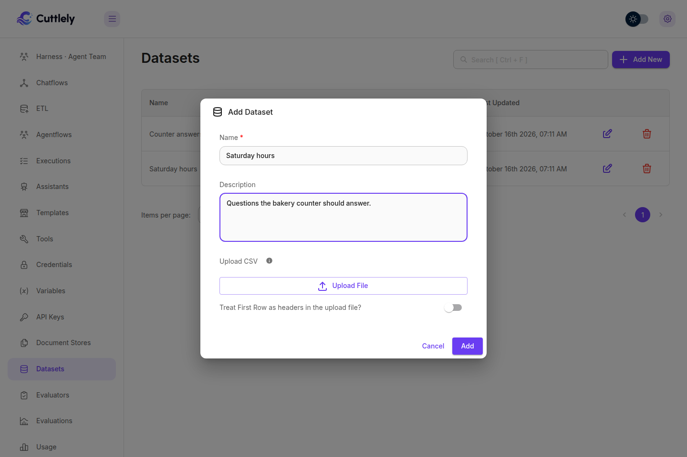
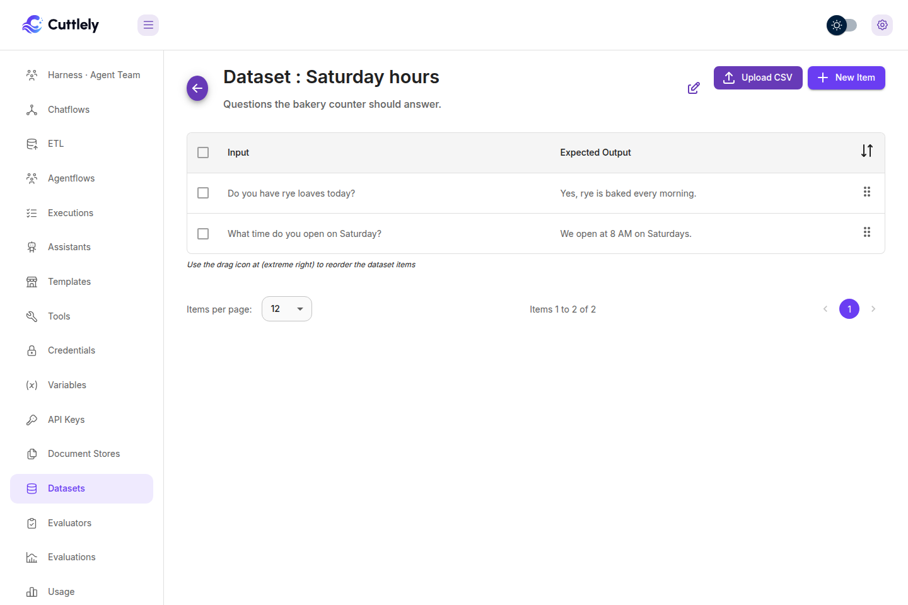
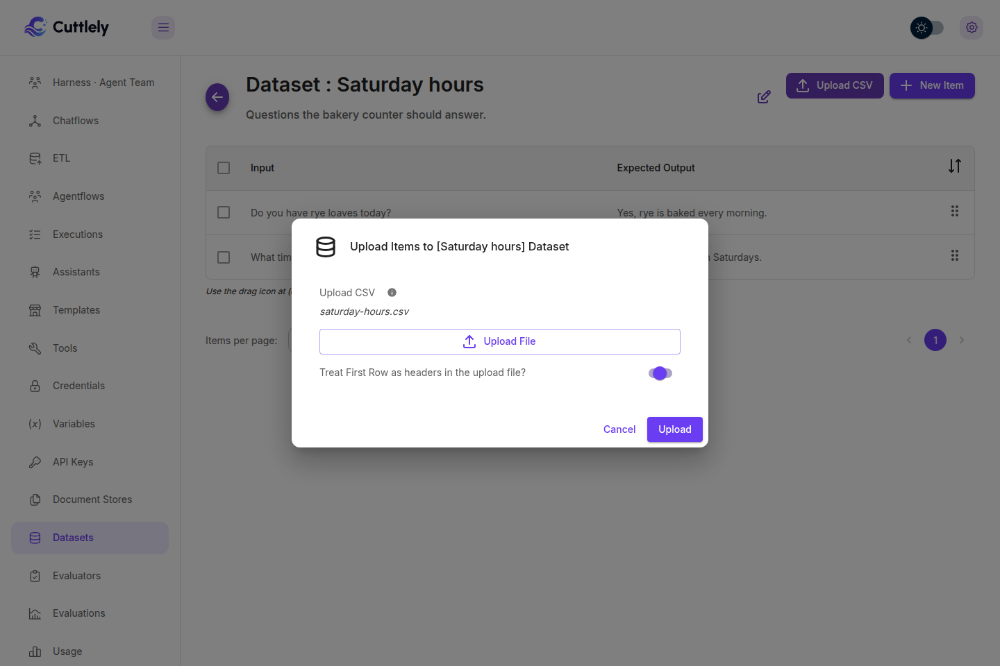
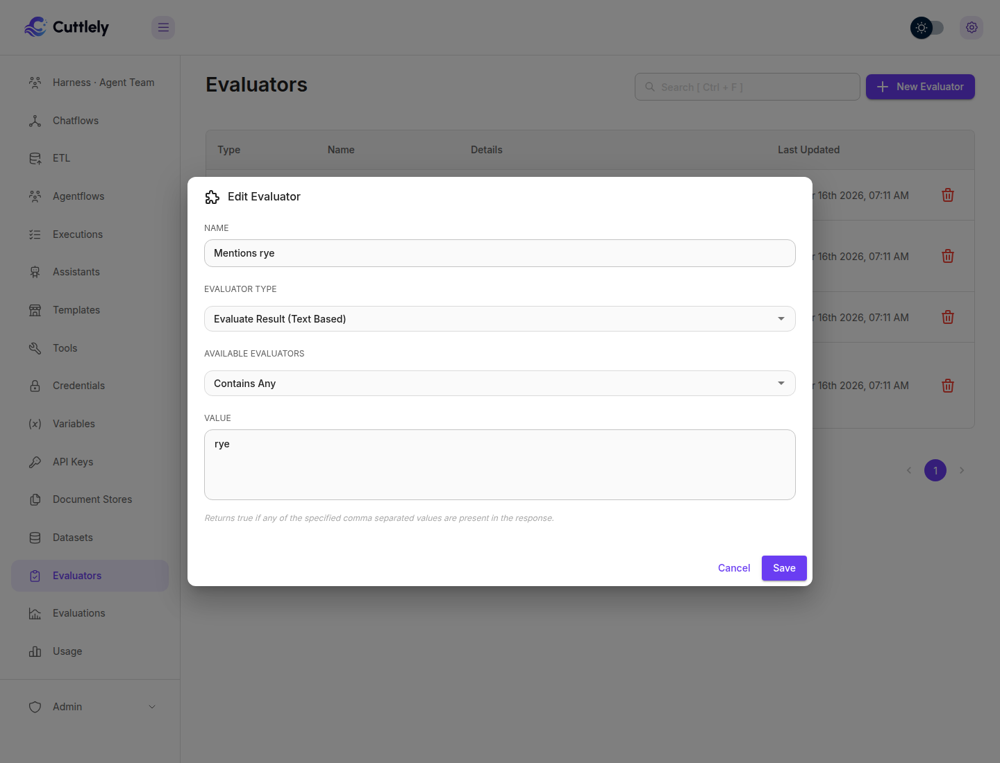
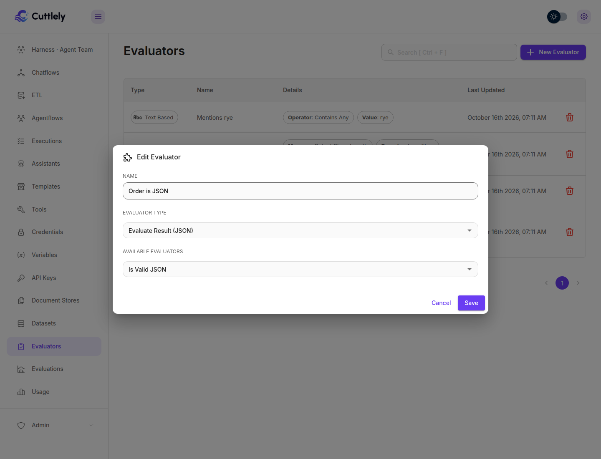
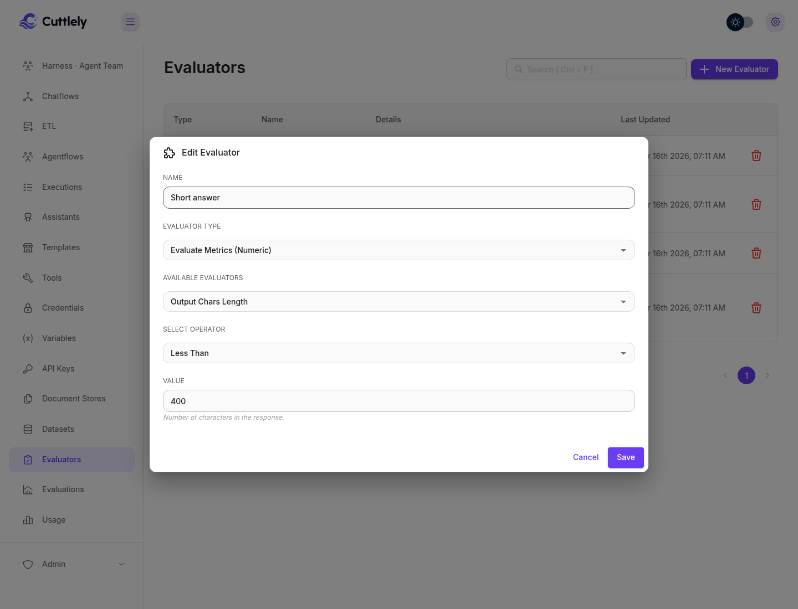
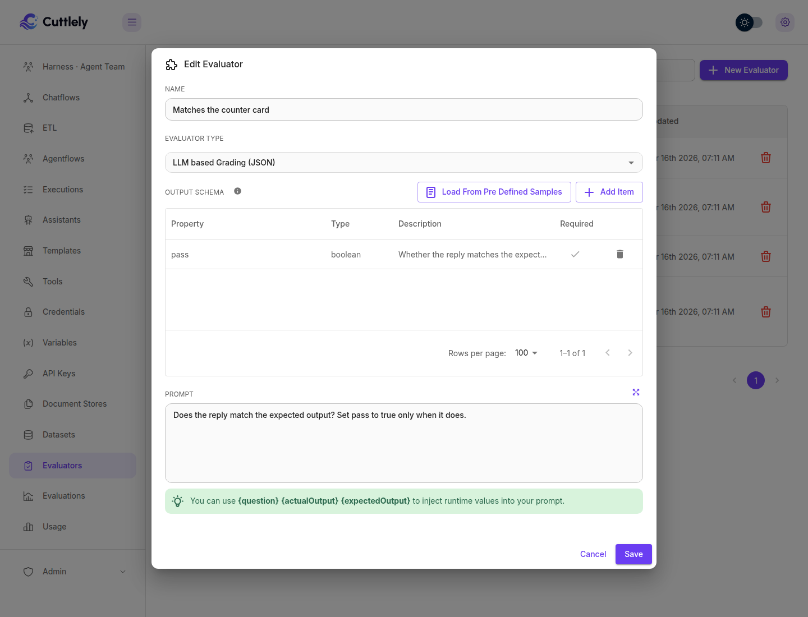
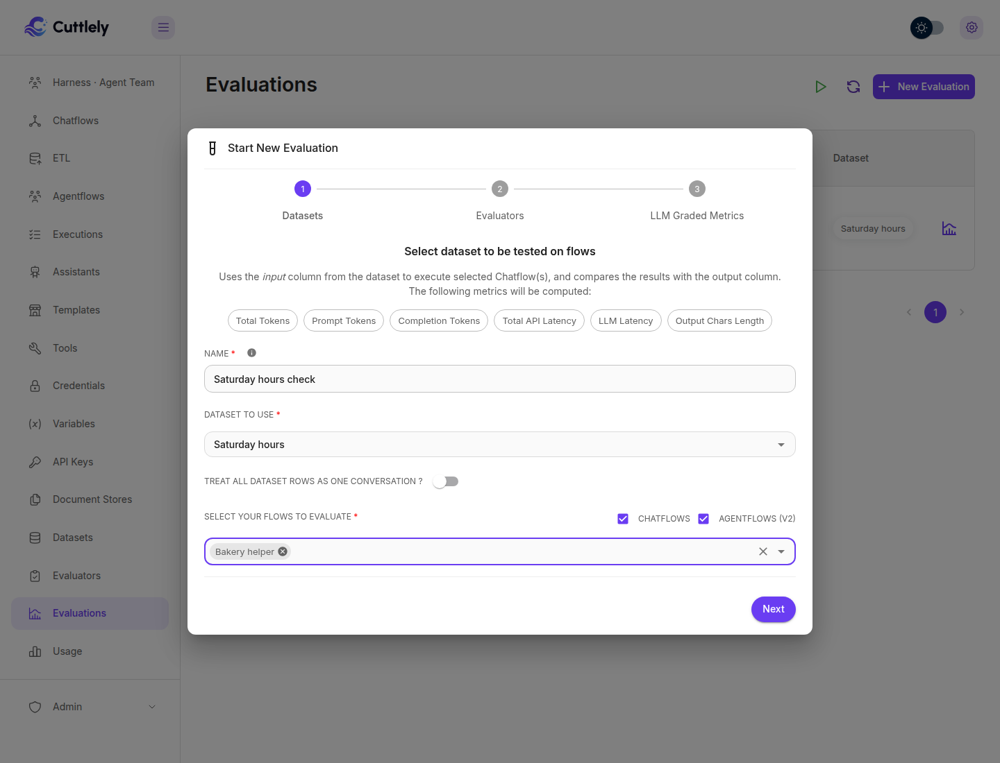
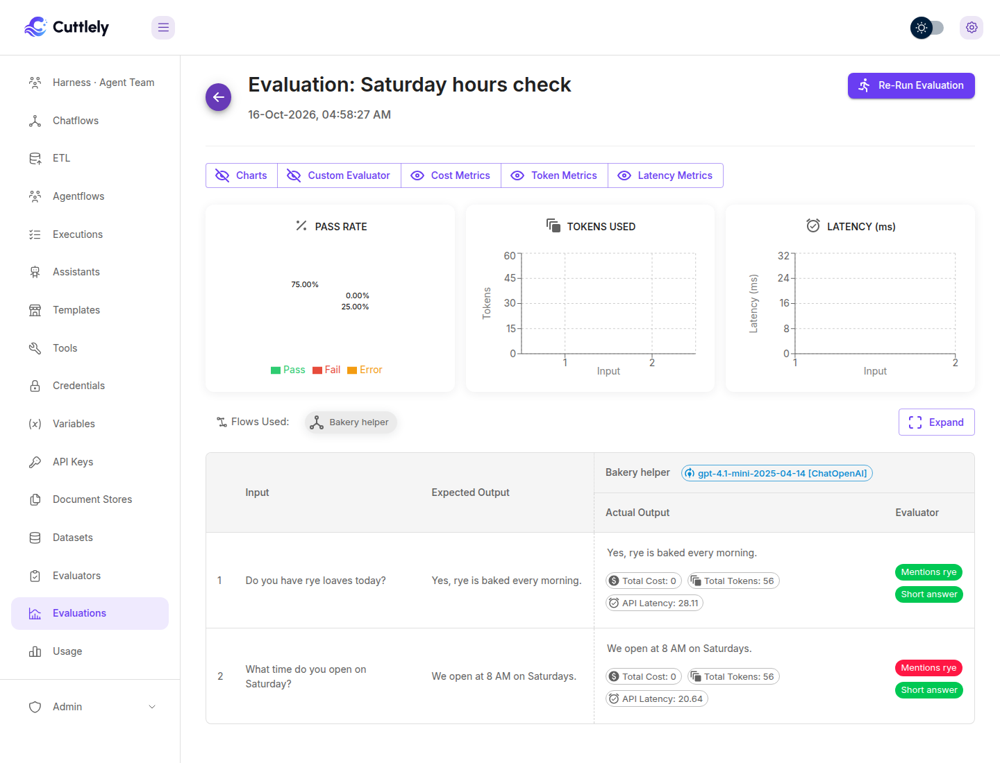

# Evaluations

Test with up to 100 question-and-answer pairs, with more on the roadmap. That is the default question cap, `CUTTLELY_CHECK_COUNT_MAX`. This is the path from a saved test set to a Publish that waits for it. You create a dataset, add the checks that score an answer, run those examples against a chatflow or an agentflow, then use the same dataset in the Publish dialog and, if you want, refuse Publish until that check passes. To start from a rated answer in the message viewer, follow [Turn real answers into tests](./tests-from-answers.md).

Open **Datasets**, **Evaluators**, and **Evaluations** from the sidebar. Publishing a flow and running an evaluation are separate. The evaluation pages do not start the check in the Publish dialog. A saved dataset can, and the evaluators you tick there score both answers.

The rest of the Publish dialog, including recent questions and recorded form, webhook, and schedule runs, is in [Check recent questions before you publish](./versioning.md#check-recent-questions-before-you-publish). The request fields are in [Start a check](../reference/drafts-api.md#start-a-check).

## Who can do what

The organization owner can do every row. Anyone else needs the key on their role. The full route list is in [Roles and permissions](./roles-and-permissions.md).

| Action                                        | Permission                                                                                                                                                                                                                               |
| --------------------------------------------- | ---------------------------------------------------------------------------------------------------------------------------------------------------------------------------------------------------------------------------------------- |
| Open Datasets, and read a dataset             | `datasets:view`                                                                                                                                                                                                                          |
| Add a dataset                                 | `datasets:create`                                                                                                                                                                                                                        |
| Add a row, or upload a CSV                    | `datasets:create` only. The dataset page still shows **New Item** and **Upload CSV** for `datasets:update`, and those saves are refused.                                                                                                 |
| Edit the dataset, edit a row, or reorder rows | `datasets:create` or `datasets:update`. The dataset page shows the edit control for either key.                                                                                                                                          |
| Delete a dataset or a row                     | `datasets:delete`                                                                                                                                                                                                                        |
| Save a chat answer as a row                   | **Add to test set** needs `datasets:create`, or `datasets:update` together with `datasets:view`. It also needs the view key for that flow.                                                                                               |
| Save picked questions as a dataset            | **Save as dataset** in Choose questions needs `datasets:create` and the view key for that flow. `datasets:update` is not enough.                                                                                                         |
| Add rated answers for a flow                  | **Add rated answers to test set** uses the same permission as **Add to test set**. The existing-dataset list needs `datasets:view` in both dialogs, and without that key the list is hidden.                                             |
| Open Evaluators                               | `evaluators:view`                                                                                                                                                                                                                        |
| Add an evaluator                              | `evaluators:create`. That key also updates one.                                                                                                                                                                                          |
| Edit an evaluator                             | `evaluators:update`                                                                                                                                                                                                                      |
| Delete an evaluator                           | `evaluators:delete`                                                                                                                                                                                                                      |
| Open Evaluations and a result                 | `evaluations:view`                                                                                                                                                                                                                       |
| Start an evaluation                           | `evaluations:create`                                                                                                                                                                                                                     |
| **Re-run Evaluation** on a result             | `evaluations:run`. Creating one, and `POST /api/v1/evaluations/run-again/:id`, also accept `evaluations:create`.                                                                                                                         |
| Delete an evaluation                          | `evaluations:delete`                                                                                                                                                                                                                     |
| Read the Publish check                        | `chatflows:view` on a chatflow, a harness, or a pipeline. `agentflows:view` on an agentflow.                                                                                                                                             |
| Start or stop the Publish check               | `chatflows:update` or `agentflows:update`, the same split as the read. Sending `datasetId` also needs `datasets:view`. Sending any evaluator id also needs `evaluators:view`. Without that view key the route is 403 and nothing starts. |
| Turn on **Passing test set**                  | Permission to update the flow, plus `datasets:view` and `evaluators:view`. Turning it off needs only the update permission. Without a view key, turning it on is 403 and nothing is stored.                                              |
| Publish                                       | `chatflows:update` or `agentflows:update`.                                                                                                                                                                                               |

`evaluations:update` is offered in the role dialog. No page and no API route check it, so granting it changes nothing.

A role that can view the flow but not datasets does not see **Questions from** in the Publish dialog, and a read of a dataset check returns an empty question and no expected output. A role that cannot view evaluators does not see the evaluator list, and a read of the check returns each score as `{ "result" }` with no id and no name. Pass, Fail, Error, and the pass rate stay.

## Create a dataset

A dataset is a named list of rows. Each row is an input and the output you expect. The Publish check asks the row input as the question and shows the row output as the expected answer.

### By hand

1. Select **Datasets**, then **Add New**.
2. In **Add Dataset**, type a name and a description. Select **Add**.
3. Open the dataset. Select **New Item**. **Input** and **Anticipated Output** are both required. Select **Add**.

The table headers are **Input** and **Expected Output**. Drag the handle at the right of a row to change the order. The check asks rows in that order. Adding a row and **Upload CSV** need `datasets:create`. The page still shows **New Item** and **Upload CSV** for a role that can only update, and those saves are refused. Editing the dataset, editing a row, and reordering accept `datasets:create` or `datasets:update`. The trash icon needs `datasets:delete`.

A made-up bakery set looks like this:

| Input                              | Expected output                  |
| ---------------------------------- | -------------------------------- |
| Do you have rye loaves today?      | Yes, rye is baked every morning. |
| What time do you open on Saturday? | We open at 8 AM on Saturdays.    |





A row with an empty input, or an input longer than 2,000 characters, is skipped by the Publish check. At most 100 rows are asked. Creating a dataset with no name is 400 `Dataset name is required`.

### From picked questions

In the Publish dialog, select **Choose questions**, tick the stored questions, type a dataset name, and select **Save as dataset**. The button is shown when the role has `datasets:create`. A harness does not offer Choose questions, so it does not offer this button. The route is [`POST /api/v1/datasets/from-questions`](../reference/datasets-api.md). The dialog warns that a real message can contain personal data.

Each row is the question the check would ask, including the same redaction of a secret in the text. The expected answer is empty, and the row is marked needs expected answer. Text, JSON, and numeric evaluators can score that blank answer, and that result can clear the passing test set. A model evaluator scores Error until the expected answer is filled in. Anyone with `datasets:view` can read those saved questions. A question sent with a file, or one longer than 2,000 characters, cannot be saved. Typed questions in **Add your own question** are not included. They are not stored questions. The name can be at most 200 characters.

A hand-picked check never unblocks Publish. Running the questions you ticked compares Live and the draft, and it does not record a pass. Only a dataset can be the passing test set. Choose **A dataset** and turn on **Passing test set**. A blank expected answer does not block that gate for a text, JSON, or numeric evaluator.

### From a CSV

CSV upload uses the first two columns only. Column one is the input and column two is the expected output. Further columns are ignored. A value that contains a comma must be in double quotes, or the comma starts another column.

You can attach the file on **Add Dataset**, or open a dataset and select **Upload CSV**. Turn on **Treat First Row as headers in the upload file?** when the first row is `Input,Output` or any other header. Leave it off when the first row is a real example. Select **Add** or **Upload**.

```csv
Input,Output
Do you have rye loaves today?,"Yes, rye is baked every morning."
What time do you open on Saturday?,We open at 8 AM on Saturdays.
```



## Create evaluators

An evaluator is one check. Select **Evaluators**, then **New Evaluator**. **Name** and **Evaluator Type** are required. Select **Add**.

Use text when you know words that must or must not appear. Use JSON when the answer has to be JSON, or must not be. Use numeric when you care about length, tokens, or time. Use a model when the expected answer is a judgment, not an exact string. An evaluation can run with no evaluators. The Publish gate cannot: it needs at least one.

### Text

**Evaluator Type** is **Evaluate Result (Text Based)**. **Available Evaluators** is the operator. **Value** is the text, or a comma-separated list for the contain operators. Capitals and surrounding spaces are ignored.

| Label                     | Passes when                                              |
| ------------------------- | -------------------------------------------------------- |
| **Contains Any**          | Any of the comma-separated values appears in the answer. |
| **Contains All**          | Every value appears.                                     |
| **Does Not Contains Any** | None of the values appear.                               |
| **Does Not Contains All** | At least one value is missing.                           |
| **Starts With**           | The answer starts with the value.                        |
| **Does Not Start With**   | The answer does not start with the value.                |

A bakery text check named `Mentions rye` uses **Contains Any** and the value `rye`.



### JSON

**Evaluator Type** is **Evaluate Result (JSON)**. There is no value to type.

| Label                   | Passes when                                                                                                                     |
| ----------------------- | ------------------------------------------------------------------------------------------------------------------------------- |
| **Is Valid JSON**       | The answer parses as JSON after it is lowercased and trimmed. `True`, `False`, and `Null` pass. Surrounding spaces are ignored. |
| **Is Not a Valid JSON** | The answer does not parse as JSON after that same lowercasing and trim.                                                         |

Use this when the flow is supposed to return an object, such as `{"loaf":"rye","count":2}`. A prose sentence fails **Is Valid JSON**.



### Numeric

**Evaluator Type** is **Evaluate Metrics (Numeric)**. Pick the measure, an operator, and a number.

| Label                   | What it measures                                                                                    |
| ----------------------- | --------------------------------------------------------------------------------------------------- |
| **Total Tokens**        | Prompt tokens plus completion tokens, when the run recorded a total.                                |
| **Prompt Tokens**       | Tokens in the prompt. The Publish check does not record this split, so the score is Error.          |
| **Completion Tokens**   | Tokens the model generated. The Publish check does not record this split, so the score is Error.    |
| **Total API Latency**   | Time for the prediction, in milliseconds.                                                           |
| **LLM Latency**         | Model time, in milliseconds. On the Publish check this is the same duration as the API time.        |
| **Chatflow Latency**    | Time spent in the flow, in milliseconds. On the Publish check this is that same duration.           |
| **Output Chars Length** | Characters in the answer after it is lowercased and trimmed, so surrounding spaces are not counted. |

Operators are **Equals**, **Not Equals**, **Greater Than**, **Less Than**, **Greater Than or Equals**, and **Less Than or Equals**.

A missing number is Error, not Fail. On the Publish check, **Prompt Tokens**, **Completion Tokens**, and a **Total Tokens** measure the run did not report are Error. That Error counts in the pass rate. **Output Chars Length** uses the answer, so it still Passes or Fails.

A bakery length check named `Short answer` uses **Output Chars Length**, **Less Than**, and `400`.



### Model

**Evaluator Type** is **LLM based Grading (JSON)**. You write a **Prompt** and an **Output Schema** (property, type `string`, `number`, or `boolean`, description, and required). **Load from Pre defined Samples** fills Correctness or Hallucination. The prompt can use `{question}`, `{actualOutput}`, and `{expectedOutput}`.

On the evaluation page, the last step of **Start New Evaluation** picks the grading model and a credential saved in this team. On the Publish check, the grader uses the model credential saved on the flow, and only a credential this workspace can use. If that model cannot be started, text, JSON, and numeric scores stay, and each model score is Error with `The grading model could not be started.`

The Publish check uses these fields as the score:

-   A field named `result` whose value is `Pass`, `Fail`, or `Error`. `Error` stays Error.
-   A boolean field named `pass`, `passed`, or `correct`. True is Pass and false is Fail.
-   Exactly one boolean anywhere in the grade. True is Pass and false is Fail.

A grade that is only a number stays Error. The Correctness sample asks for a numeric score, so it does not Pass or Fail the Publish check. For the gate, use a schema with one boolean, for example a property `pass` of type `boolean`, and a prompt that answers whether the reply matches `{expectedOutput}`.



## Run an evaluation

An evaluation runs one dataset against one or more chatflows or agentflows and stores what came back.

1. Select **Evaluations**, then **New Evaluation**. The dialog title is **Start New Evaluation**.
2. **Datasets.** Name the run, choose the dataset, and choose the flows. **Chatflows** and **Agentflows (v2)** are the lists. Custom assistants are not listed. Turn on **Treat all dataset rows as one conversation ?** only when later rows should continue the same chat.
3. **Evaluators.** Tick the text, JSON, and numeric evaluators. You can leave this empty.
4. **LLM Graded Metrics.** Leave **No Grading** unless a model evaluator should run. Grading needs a model and a credential this team owns.
5. Select **Start New Evaluation**.

The list shows the run as pending, then completed or error. Once the run has a pass rate, the chip reads `Pass Rate: N%` with two decimals, including `Pass Rate: 0.00%` when nothing passed and `Pass Rate: 100.00%` when every score passed. Open the row for the counts and each example: the input, the expected output, the answer, and Pass, Fail, or Error for every evaluator. The result page shows that same percentage, including `0.00%`.

**Re-run Evaluation** on the result asks you to confirm **Run Again**. It stores another version under the same name. It uses the same checks as a new run: a deleted flow, a flow from another team, or a flow this role cannot view is rejected and no new version is saved. Delete removes a run, or every version of that name.





A run calls each selected flow on this server, the same way a prediction does. You do not set a separate address. An unknown flow, a flow from another team, a custom assistant, or a run with no chatflow or agentflow is rejected and no evaluation is saved. A missing name is not the rejection: the create requires a dataset and at least one flow. `chatflowId` must be a list of flow ids. A flow that requires an API key cannot be replayed from this page, because the key is stored as a hash and the run cannot recover it. A flow with no key can be run. A chatflow or agentflow can use a model credential this team owns or one shared into the team.

## Add a real answer to a test set

On an answer in the message viewer, **Add to test set** saves that question and answer as one row.

1. Open the message viewer for the flow.
2. On an answer, select **Add to test set**. The button is shown when the role can create a dataset, or when it can update a dataset and view datasets. A role that can only update datasets does not see it, because the list of datasets needs `datasets:view`.
3. Read the question. It is the message immediately before that answer in the same chat session. A question from another session, or another memory in that session, is not used. A second answer in a row has no question, and saving it is refused. The expected answer starts as the real answer. Edit it when the check should expect something else.
4. Choose a dataset when the role can view datasets, or select **New dataset**, name it, and create it. Creating a dataset needs `datasets:create`. A role that can create a dataset but cannot view datasets still gets **New dataset**, and does not get the existing list. If the list cannot be loaded, the dialog shows the error.
5. The dialog warns that a real message can contain personal data. Check the question and the expected answer, then save.

The row records where it came from: source `chat_message`, the message id, the flow id, and the date of the answer. Saving that same answer into the same dataset again returns the row already stored and does not add a second one. The flow and the dataset both have to belong to the current team. A flow or a dataset from another team is not found. The role also needs permission to view that kind of flow: `chatflows:view` for a chatflow, a harness, or a pipeline, `agentflows:view` for an agentflow, and `assistants:view` for an assistant.

That dataset can be the one the Publish dialog checks. See [Run the Publish check on a dataset](#run-the-publish-check-on-a-dataset). Rated answers for a whole flow are in [Turn ratings into tests](#turn-ratings-into-tests).

## Turn ratings into tests

A rating on an answer can become a row without saving each one by hand. In the message viewer, set **Feedback** to **Positive** or **Negative** only. **Add rated answers to test set** is hidden when both are selected, or when neither is.

1. Select **Add rated answers to test set**. The button uses the same permission as **Add to test set**: create, or update together with view.
2. Choose how many days to look back, from 1 to 90, and a dataset. The limit defaults to 500 and cannot add more than 500 new rows in one call. The existing-dataset list needs `datasets:view`. Create without that view still offers **New dataset**.
3. Select **See how many**. That is a dry run: it shows how many rows would be added, how many are already in the dataset, and a short preview. It does not write.
4. If the scan stopped early, select **Scan older ratings**. That continues from the oldest rating the last scan read, and does not read those ratings again.
5. Select **Add Rated Answers**. That writes the ratings from the preview, not a new scan. A write that does not send those rating ids is rejected, and it cannot send more ids than the limit. A cursor sent with those ids is still checked, and a bad one is rejected. A good one does not choose the rows. A rating that arrives after **See how many** is left for the next time. The dialog stays open while that add, the count, or a new dataset is still running.

The window is the rating's date, not the date of the answer. Newest ratings are taken first. The question is the message immediately before that answer in the same chat session, the same rule as **Add to test set**. A null session or memory matches only a null session or memory. An answer with no question of its own is left out. A message already stored in that dataset, including one saved with **Add to test set**, is skipped and counted. A row that another save stores while this one is writing is skipped too, and the other new rows are still saved. The scan reads at most 1,000 ratings, and it also stops when the limit is full. The cursor is the last rating that scan actually read, so a limit that stops partway through a page does not skip the rest of that page. If that rating is removed before the next page is read, or the cursor rating is removed after it is checked and before the first page, the scan continues from the stored time, including fractions of a millisecond. If a rating in the window is older than that one, the result says so. **Scan older ratings** sends the cursor, and the next run starts strictly older than the stored time of that rating, including other ratings in the same millisecond. A window of exactly 1,000 ratings, with nothing older left, is not reported as stopped early. The cursor is that rating's stored time as text and its id. The next request uses that text whether or not the rating is still there. A cursor is rejected when the id is not a uuid, or when the time is not the stored form the server returns: `YYYY-MM-DD HH:MM:SS` with an optional fraction of up to 6 digits. A time such as `1`, or one with a `T` between the date and the clock, is rejected. So is a day the month does not have, including 29 February when the year is not a leap year. A rating that is already gone is not.

A thumbs-up row uses the answer as the expected output. A thumbs-down row does not: the question is stored, the expected answer stays empty, and the row is marked **needs expected answer**. The rejected answer and any feedback text stay on the row, with the feedback id, the rating, the message, the flow, and the date of the rating. Open the row on the dataset and type the expected answer. Saving a non-empty expected answer clears the marker.

The flow and the dataset both have to belong to the current team. A flow or a dataset from another team is not found. The role also needs permission to view that kind of flow.

That dataset can drive the Publish check. A row that still needs an expected answer is asked like any other row. Text, JSON, and numeric evaluators score the answer. A model evaluator scores Error and the grading model is not called, because it compares the answer with the expected one. Fill in the expected answer and run the check again. See [Run the Publish check on a dataset](#run-the-publish-check-on-a-dataset).

## Run the Publish check on a dataset

On a chatflow, an agentflow that starts with **Chat Input**, or a harness, the Publish dialog can ask a dataset instead of recent questions. [Watch the testing run (56 seconds, sound on)](https://cuttlely.com/media/products/testing.mp4) shows a chatflow draft scored on a test set and published after that set passes.

1. Save a draft, then select **Publish**.
2. Under **Check recent questions**, set **Questions from** to **A dataset** and choose the dataset. **Questions from** is hidden when your role cannot view datasets.
3. Tick the evaluators. That list is hidden when your role cannot view evaluators.
4. Select **Run check**.

When **Passing test set** is on, select **Run the test set** in the notice under the box to record the gate result ([Require a passing test set before you publish](./versioning.md#require-a-passing-test-set-before-you-publish)).

Each row runs in the saved order, once on Live and once on the draft. The expected answer is shown under the question. A row with no expected answer still runs. Text, JSON, and numeric evaluators score that answer. A model evaluator needs the expected answer, so it scores Error and the grading model is not called. Each side shows Pass, Fail, or Error for every evaluator, and a pass rate: passed divided by passed, failed, and errored, from 0 to 100 with one decimal. An answer that failed to run scores Error. A check with no evaluators still shows the expected answer and compares the two answers, and a dataset check's verdict is failed because nothing was scored.

The finished dataset check also reports passed or failed for the draft against a pass mark. The mark is 100 unless the request sends `threshold`, a whole number from 0 to 100. Errored scores count as not passed. The verdict uses those counts, not the rounded pass rate, so one failed or errored score does not pass a mark of 100 even when the displayed rate rounds to 100.0. A check that is not using a dataset has no verdict. That line does not block Publish unless the flow requires a passing test set.


A flow that starts with a form, a webhook, or a schedule cannot use a dataset. The box is titled **Check recent runs**. The recent choice is labeled **Recent runs**. The list still offers **A dataset**, and that request is 400:

```json
{
    "statusCode": 400,
    "success": false,
    "message": "A dataset check asks each row as a chat message. This flow starts with a form, so it cannot use a dataset.",
    "stack": {}
}
```

A webhook start says `a webhook`. A schedule start says `a schedule`. The same refusal is in [Which canvases get a check](./versioning.md#which-canvases-get-a-check).

The answers stay in memory for 30 minutes and are not written down. When the flow requires a passing test set and this check used that dataset, those evaluators, and that pass mark, the server stores the verdict (pass rate, counts, and time) and a hash of the rows it asked and of each evaluator's type and settings. That hash includes the full expected answer, including characters past the 4,000 the check shows. It does not store the rows or the answers. If that write fails, the check ends `failed` with `The test set result could not be saved.` The stored result is cleared, and Publish is refused. If that clear also fails, the older pass stays stored and Publish is refused with `Publish needs a passing test set at <threshold>%. The test set result could not be saved.` That refusal lasts for this server process. A check that does not match this dataset, these evaluators, and this pass mark does not replace a stored pass.

## Set the pass mark and turn on the gate

A chatflow, or an agentflow that starts with a chat message, can refuse Publish until the current draft passes a saved dataset. The setting is off until you turn it on. It is **Passing test set** in the flow's configuration, next to **Publish instantly**.

1. Open the flow's configuration and select **Passing test set**.
2. Choose the dataset, tick the evaluators, and set **Pass at** to a whole number from 0 to 100. 100 is the default, so every score must pass. An errored score counts as not passed. A blank or invalid mark stays at the previous value and is not saved as 0.
3. Turn on **Require a passing test set before Publish**. The page says `Publish waits for a passing test set.` An evaluator that was removed from the workspace stays listed as **Deleted evaluator** until it is unticked. Unticking it saves the setting without that id.

You need permission to update the flow, and to view datasets and evaluators. Turning it on is refused when drafts are off for the server (`Drafts are off on this server.`), when **Publish instantly** is on (`Turn off Publish instantly before requiring a passing test set.`), when the dataset or an evaluator is missing or belongs to another workspace (404, and nothing is stored), or when the dataset has no question the check can ask (`This dataset has no questions the check can ask.`). Turning **Publish instantly** on while this is on is refused with `Turn off the passing test set before turning on Publish instantly.`

A harness uses the same Publish button. The setting is not offered there, and a harness check does not store a pass. A pipeline uses the same Publish button. Its dialog lists what changed and does not run the question check, and the setting is not offered there. A legacy multi-agent canvas is refused the same way.


In the Publish dialog the verdict is shown, and **Publish** stays disabled, with the reason, until the latest result passed for this draft, these settings, the same rows, and the same answer post-processing. **Run the test set** starts that check. The same rule is enforced by the API. With the setting off, Publish is unchanged.

Editing the draft, or changing the dataset, the evaluators, or the pass mark, makes an earlier pass out of date. So does editing a row the check asked, adding a row it would ask, changing an evaluator's check, deleting the dataset or an evaluator, or editing the flow's answer post-processing. A failing result, or no result yet, also blocks Publish. Save, discard, and the settings update return that same reason on `publishGate.block`.

The gate covers Publish of the current draft only. Roll back, Promote, and `PUT /api/v1/chatflows/:id` can still change Live. Opening a version as a draft, and restore straight to Live, are in the same table: [Require a passing test set before you publish](./versioning.md#require-a-passing-test-set-before-you-publish).

### A form, webhook, or schedule start

**Passing test set** is hidden while it is off when the agentflow starts with **Form Input**, **Webhook Trigger**, or **Schedule Input**, so it cannot be turned on there. Turning it on is 400, and nothing is stored. The message is the same one a dataset check returns:

```json
{
    "statusCode": 400,
    "success": false,
    "message": "A dataset check asks each row as a chat message. This flow starts with a form, so it cannot use a dataset.",
    "stack": {}
}
```

A webhook start says `a webhook`. A schedule start says `a schedule`.

If the setting was already on and the start is later a form, a webhook, or a schedule, the gate can no longer be met. **Passing test set** stays in the configuration so it can be turned off. It shows that same sentence and then `Turn off the passing test set before you publish.` The checkbox can be cleared. The Publish dialog names the start and says to turn the setting off. It does not offer a run that cannot clear the block, and **Publish** stays disabled. Turning the setting off (`"enabled": false`) needs permission to update the flow and does not need `datasets:view` or `evaluators:view`. Publish then works as it does with the setting off. A chat-message start can turn the setting on again.

## What a 409 from Publish looks like

`POST /api/v1/flow-drafts/<flow id>/publish` returns 409 when the setting is on and the latest stored result is missing, failing, or out of date. The body is the usual error shape. `stack` is `{}` outside development.

No result yet:

```json
{
    "statusCode": 409,
    "success": false,
    "message": "Publish needs a passing test set at 100%. There is no result for this draft yet.",
    "stack": {}
}
```

The last run failed. The percentage is the pass rate, and the mark is **Pass at**:

```json
{
    "statusCode": 409,
    "success": false,
    "message": "Publish needs a passing test set at 100%. The last result was 75% and failed.",
    "stack": {}
}
```

The draft, the settings, the rows, or the post-processing changed after a pass. The message still names the mark and the last result, then one of these endings:

-   `The test set settings have changed since that check.` The dataset, the evaluators, or **Pass at** changed.
-   `The draft has changed since that check.`
-   `The test set has changed since that check.` A row the check asked changed, a row it would ask was added, an evaluator's type or settings changed, or the dataset or an evaluator is gone.
-   `The answer post-processing has changed since that check.`

If the start is later a form, a webhook, or a schedule, Publish is 409 with the dataset refusal and then `Turn off the passing test set before you publish.` For a form:

```json
{
    "statusCode": 409,
    "success": false,
    "message": "A dataset check asks each row as a chat message. This flow starts with a form, so it cannot use a dataset. Turn off the passing test set before you publish.",
    "stack": {}
}
```

A pass for this draft, these settings, the same rows, and the same post-processing returns 200 and the draft goes Live. With the setting off, this 409 is not used.
