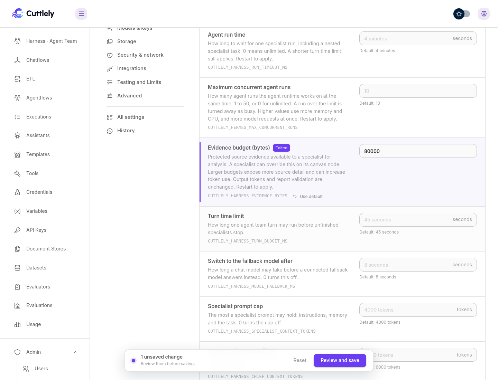

# Set the evidence budget

The evidence budget is how much protected source detail, in bytes, a Harness Specialist gets for analysis. A larger budget can save extra calls for long descriptions, and it uses more input tokens. The default is **40000** bytes.

## Set it for the server

1. Open **Admin** > **Server settings** and choose **Agent runtime**.
2. Under **Limits**, enter a value in **Evidence budget (bytes)**. The range is **4096** to **262144**.
3. Review and save, then restart Cuttlely to apply.

When the host sets `CUTTLELY_HARNESS_EVIDENCE_BYTES`, the field is locked and shows that it is set by the host.

## Set it for one specialist

1. Open the harness canvas and select the Harness Specialist.
2. In its additional parameters, enter **Evidence budget (bytes)**. Leave it blank to use the server value.
3. Save the canvas.

The value is kept when you export and import the canvas.

## What does not change

-   Output-token limits and report validation stay the same.
-   A model with a small context still gets a smaller cap.
-   Source reports are the same; only the detail available for analysis changes.

See [Server settings](./server-settings.md#protected-source-evidence) and [Evidence budget](../reference/trusted-outputs.md#evidence-budget).
