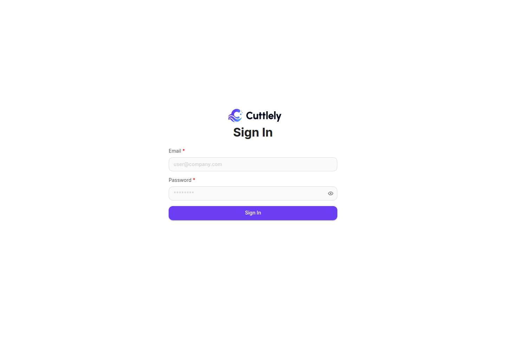

# Build from source and run the dev server

Use this guide to build Cuttlely from its source code, run it, and change it with a dev server that reloads as you edit. It's the way to work on Cuttlely itself, or to run it on a machine without Docker. For a ready-made install, use [Docker](./docker.md). For a hosted install, use [Render](./render.md).

When you finish the install, Cuttlely runs at [http://localhost:43117](http://localhost:43117), with the agent runtime beside it for harness specialists. While you change the code, the dev server runs the same app at [http://localhost:8080](http://localhost:8080). The app database is SQLite, and you have one local account to sign in with. A database you already run can replace SQLite. See [Use Postgres](#use-postgres).

The steps, in order:

1. [Before you start](#before-you-start): Node 24, pnpm through Corepack, uv and Git.
2. [Get the code and build it](#get-the-code-and-build-it): clone, install, build, and set up the agent runtime.
3. [Start Cuttlely](#start-cuttlely) and [create your account](#create-your-account).
4. [Run the dev server](#run-the-dev-server) while you change code.
5. [Run the tests](#run-the-tests) and [check your change](#check-your-change-before-a-pull-request) before a pull request.

On an 8-core machine, install, the build and the runtime setup took about a minute, and the server was listening a few seconds after the start command. A slow network makes the install longer, while pnpm downloads the packages.

## Before you start

| Tool    | Version                                                                         | Check           |
| ------- | ------------------------------------------------------------------------------- | --------------- |
| Node.js | 24 (`engines.node` is `^24`, and `.nvmrc` is `v24.15.0`)                        | `node -v`       |
| pnpm    | 10.33.4, pinned by `packageManager` in `package.json`. Corepack runs it for you | `pnpm -v`       |
| uv      | any recent version, from [docs.astral.sh/uv](https://docs.astral.sh/uv/)        | `uv --version`  |
| Git     | any. The server also needs `git` for [Version history](./versioning.md)         | `git --version` |

Turn on Corepack once. It comes with Node and runs the pnpm version that Cuttlely pins, so you don't install pnpm yourself:

```bash
corepack enable
```

If that fails with `EACCES`, Node was installed for every user on the machine. Run `sudo corepack enable`, or install Node with a version manager such as [nvm](https://github.com/nvm-sh/nvm) or [fnm](https://github.com/Schniz/fnm). uv downloads the Python that the agent runtime needs, so you don't install Python yourself.

## Get the code and build it

1. Get the code:

    ```bash
    git clone https://github.com/cuttlely/cuttlely.git
    cd cuttlely
    ```

2. Check pnpm from inside the `cuttlely` folder:

    ```bash
    pnpm -v
    ```

    The first time, Corepack prints `! Corepack is about to download https://registry.npmjs.org/pnpm/-/pnpm-10.33.4.tgz` and asks `Do you want to continue? [Y/n]`. Press Enter. It prints `10.33.4`.

3. Install the dependencies:

    ```bash
    pnpm install
    ```

    It ends with `Done in ... using pnpm v10.33.4`. Two notices along the way are expected:

    - `Update available! 10.33.4 → ...` with a `corepack use` command. Don't run it. It changes the pinned version in `package.json`.
    - `Ignored build scripts: ...` with a `pnpm approve-builds` hint. Don't run it either. The build and the server don't need those scripts.

4. Build every package:

    ```bash
    pnpm build
    ```

    It ends with `Tasks: 7 successful, 7 total`. On an 8-core machine a first build took about 40 seconds.

5. Set up the agent runtime, the Python process that runs harness specialists:

    ```bash
    bash scripts/setup-hermes.sh
    ```

    It creates `hermes/.venv` with Python 3.14, downloaded by uv if it's missing, and ends with `Hermes Python ready: .../hermes/.venv/bin/python (Python 3.14, mcp extra)`. It took about 6 seconds with Python already downloaded. To use Python 3.11 to 3.13 instead, pass the version: `bash scripts/setup-hermes.sh 3.12`.

## Start Cuttlely

```bash
bash scripts/start-cuttlely.sh
```

On a source install without WorkOS, the script turns on the local account and its password form for you (`CUTTLELY_LOCAL_ADMIN=true`). Leave the terminal open. The server runs in the foreground, and Ctrl+C stops the server and the agent runtime together.

The script starts the server, waits for the harness gateway, and then starts the agent runtime. A good start looks like this:

```text
Cuttlely node: .../bin/node (v24.15.0)
Hermes Python: .../hermes/.venv/bin/python
Cuttlely boot, step 1 of 2: starting the server on port 43117. A browser opened now shows a 'Cuttlely is starting' page.
Waiting for the harness gateway on 127.0.0.1:43118.
[INFO]: Starting Cuttlely...
[INFO]: 📦 [server]: Data Source initialized successfully
[INFO]: 🔄 [server]: Database migrations completed successfully
...
[INFO]: 🎉 [server]: All initialization steps completed successfully!
[INFO]: ⚡️ [server]: Cuttlely Server is listening at :43117
[INFO]: ✅ Cuttlely is ready. Open http://localhost:43117
Harness gateway is answering on 127.0.0.1:43118.
Cuttlely boot, step 2 of 2: starting the agent runtime (Hermes) in the background.
Harness queue: inline
```

Server lines start with the time, then `[INFO]:`. The gateway line follows the ready line. On an 8-core machine the server was listening a few seconds after the start command, and the agent runtime was up a few seconds after that. To check it from another terminal:

```bash
curl -fsS http://127.0.0.1:43117/api/v1/ping
```

It prints `pong`. The `X-Cuttlely-Hermes` response header is `up` once the agent runtime is running. See [Agent runtime health](./harnesses.md#agent-runtime-health).

| Port    | What listens                             | Change it with                  |
| ------- | ---------------------------------------- | ------------------------------- |
| `43117` | The app and its API                      | `PORT`                          |
| `43118` | The harness gateway, on `127.0.0.1` only | `CUTTLELY_HARNESS_GATEWAY_PORT` |
| `8642`  | Agent runtime, on `127.0.0.1` only       | `HERMES_API_PORT`               |

To run a second copy on the same machine, give it its own data as well as its own ports: set `PORT`, `CUTTLELY_HARNESS_GATEWAY_PORT`, and `HERMES_API_PORT` to free ports, and `DATABASE_PATH`, `SECRETKEY_PATH`, `BLOB_STORAGE_PATH`, and `CUTTLELY_DATA_DIR` to new folders. Two servers on the same data would both run its schedules.

## Create your account

A new install has no users. With `CUTTLELY_LOCAL_ADMIN=true`, there are two ways to create the first account. Both make the same account, the owner (**Super User**).

### In the browser

1. Open [http://localhost:43117](http://localhost:43117) on the machine where Cuttlely runs. The app opens **Setup Account**.
2. Fill in **Administrator Name**, **Administrator Email**, **Password**, and **Confirm Password**. The password needs 8 to 128 characters, with a lowercase letter, an uppercase letter, a digit, and a special character.
3. Select **Sign Up**.


You are signed in, and the app opens **Chatflows**.

**Setup Account** works only from the machine where Cuttlely runs, and only while there are no users. From anywhere else, or once the account exists, **Sign Up** fails with `Error in registering account: Not Found`.

### In a terminal

From the repository root, in a second terminal:

```bash
CUTTLELY_LOCAL_ADMIN=true pnpm user --email you@example.com
```

Type the password at the `Password:` prompt. It isn't shown. The command ends with:

```text
[INFO]: Super User created for you@example.com.
```

Several `npm warn` lines come first, including `Unknown cli config "--email"`. They are harmless. The account exists when you see `Super User created`.

Then open [http://localhost:43117](http://localhost:43117). The app opens **Sign In**. Type the email and password and select **Sign in**.



More about the account, a lost password, and WorkOS for a team: [Sign in](./sign-in.md).

## The first page

After sign-in the app opens **Chatflows**. The sidebar lists everything else, from **Harness · Agent Team** to **Document Stores**, then **Datasets**, **Evaluators**, **Evaluations** and **Usage**, plus the **Admin** menu: **Users**, **Teams**, **Roles**, **Server Settings**, **Logs**, **Audit log**, and **Version History**, in that order. Each entry shows only to someone who can open it. Server Settings and Version History are for the organization owner. Your name and **Logout** are under the gear at the top right.


Next steps: save a model key under **Credentials**, then build an [agent team](./harnesses.md) or an [ETL pipeline](./etl.md).

## Run the dev server

The dev server is for changing Cuttlely's code. It runs the app from the source folders, and the page in your browser updates as you save. Stop `scripts/start-cuttlely.sh` first (Ctrl+C) if it's running.

From the repository root:

```bash
CUTTLELY_LOCAL_ADMIN=true pnpm dev
```

Then open [http://localhost:8080](http://localhost:8080). Use `localhost`, not `127.0.0.1`: the UI dev server listens on `localhost` only, which on some machines doesn't answer on `127.0.0.1`.

`pnpm dev` doesn't go through the start script, so it doesn't turn on the local account by itself. That's why the command sets `CUTTLELY_LOCAL_ADMIN=true`. Without it, **Sign In** says `Sign-in is not configured.`

### What starts

| Address                 | What it is                                                   | Package folder    |
| ----------------------- | ------------------------------------------------------------ | ----------------- |
| `http://localhost:8080` | The app in your browser. Open this one                       | `packages/ui`     |
| `http://localhost:3000` | The server and its API. Restarts when you save a server file | `packages/server` |
| `127.0.0.1:43118`       | The harness gateway, started by the server                   | `packages/server` |

The page at `8080` sends every `/api` request on to the server at `3000`. Both were up within a few seconds. `pnpm dev` does not start the agent runtime, so `X-Cuttlely-Hermes` on that ping is `unknown` until you [run the runtime beside the UI](#harness-specialists-while-you-work-on-the-ui).

Each package prints its name in front of its lines. The two you care about look like this:

```text
@cuttlely/ui:dev:   Local:   http://localhost:8080/
@cuttlely/server:dev: Cuttlely Server is listening at :3000
```

The server's lines also include `npm warn Unknown env config`. Those warnings are harmless. The server is up when you see `Cuttlely Server is listening at :3000`.

### Sign in

The dev server uses the same database as `scripts/start-cuttlely.sh` (`~/.cuttlely`), so the account you created earlier works on `8080` too. On a new install with no account yet, `8080` opens **Setup Account**, the same as in [Create your account](#create-your-account).

### What updates when you save

| You change                                   | What happens                                                                   | What you do                                                                                                                                                                         |
| -------------------------------------------- | ------------------------------------------------------------------------------ | ----------------------------------------------------------------------------------------------------------------------------------------------------------------------------------- |
| The UI, `packages/ui/src`                    | The page updates in place within a second. No reload, and you stay signed in   | Nothing                                                                                                                                                                             |
| The server, `packages/server/src`            | The server restarts, but it runs the last build, so your change isn't live yet | Run `pnpm --filter @cuttlely/server build` in a second terminal (about 10 seconds), then save your server file once more. The server restarts on the new build within a few seconds |
| Nodes and credentials, `packages/components` | Nothing                                                                        | Run `pnpm --filter @cuttlely/components build`, then stop `pnpm dev` with Ctrl+C and start it again                                                                                 |

The package names in those commands are the names in each folder's `package.json`: `@cuttlely/server` is the server and `@cuttlely/components` is the nodes package.

### Harness specialists while you work on the UI

`pnpm dev` doesn't start the agent runtime, so harness specialists don't answer there. To work on the UI with the whole product behind it, run the built server with the start script on port `3000`, and only the UI dev server beside it:

```bash
PORT=3000 bash scripts/start-cuttlely.sh
```

and in a second terminal:

```bash
pnpm --filter @cuttlely/ui dev
```

Open [http://localhost:8080](http://localhost:8080). UI changes update in place, and `curl -sI http://localhost:8080/api/v1/ping` shows `X-Cuttlely-Hermes: up` once the runtime is running. Server changes need `pnpm build` and a restart of the start script.

### Change the dev server ports

-   The server reads `PORT` from `packages/server/.env`. The UI dev server reads the same file to find the server, so it follows when you change `PORT` there. Without the file, both use `3000`.
-   The UI port is `VITE_PORT` in `packages/ui/.env` (copy `packages/ui/.env.example`). It defaults to `8080`.

### Stop it

Press Ctrl+C in the `pnpm dev` terminal. Everything it started stops within a second.

## Run the tests

Tests sit next to the code they test: a test for `Foo.ts` is `Foo.test.ts` in the same folder. Run one file while you work:

```bash
pnpm --filter @cuttlely/server test -- src/controllers/ping
pnpm --filter @cuttlely/components test -- src/headerValidation.test.ts
```

The first took about 5 seconds and the second about 10. Drop the file path to run a whole package, and `pnpm test` runs every package. On a small machine, run one package at a time. [CONTRIBUTING.md](../../CONTRIBUTING.md#testing) has more.

## Check your change before a pull request

```bash
pnpm verify
```

`pnpm verify` is the check every pull request passes. It lints, typechecks, builds, runs the unit tests, starts a real server for a smoke test, checks an upgrade from older data, and more. It ends with `pnpm verify passed (full)`, and `.verify/verify-summary.md` lists each step with its time. On an 8-core machine it takes about 5 minutes.

A change that only touches docs or markdown can use the short run, which takes about 2 to 3 minutes:

```bash
pnpm --filter @cuttlely/components build
pnpm verify --fast
```

The short run doesn't build, so a fresh checkout needs that components build (or a `pnpm build`) first. [Verify before a pull request](../../CONTRIBUTING.md#verify-before-a-pull-request) has the rule for which run a change needs.

## Where your data lives

| What                                                            | Where                           | Set with            |
| --------------------------------------------------------------- | ------------------------------- | ------------------- |
| App database, `database.sqlite`                                 | `~/.cuttlely`                   | `DATABASE_PATH`     |
| `encryption.key` and the sign-in secrets                        | `~/.cuttlely`                   | `SECRETKEY_PATH`    |
| Uploaded files                                                  | `~/.cuttlely/storage`           | `BLOB_STORAGE_PATH` |
| Harness records, agent runtime home, ETL files, version history | `<checkout>/.cuttlely`          | `CUTTLELY_DATA_DIR` |
| Version history, a Git repository                               | `<checkout>/.cuttlely/versions` | `CUTTLELY_DATA_DIR` |
| ETL runs, local vector stores, and uploads                      | `<checkout>/.cuttlely/etl`      | `CUTTLELY_ETL_DIR`  |

`scripts/start-cuttlely.sh` sets `CUTTLELY_DATA_DIR` to `<checkout>/.cuttlely` unless you set it. The app database and the key stay in `~/.cuttlely` unless you set `DATABASE_PATH` and `SECRETKEY_PATH`. Docker and Render put all of it under `/var/cuttlely`.

Keep `encryption.key` with the database. Stored credentials can't be read without it.

`CUTTLELY_VERSIONS=off` turns version history off. `CUTTLELY_DRAFTS=off` turns drafts off, so the canvas saves straight to Live. See [Version history](./versioning.md) and [History settings](../reference/versioning-settings.md).

## Keep your settings in a file

Copy `packages/server/.env.example` to `packages/server/.env` and set values there. The server and `pnpm user` both read that file, and a value in it wins over the same variable in your shell. `.env` is gitignored.

The example file starts with an active `PORT=3000`. Delete that line, or the app listens on `3000` instead of `43117` and the script still waits for `43117`. `scripts/start-cuttlely.sh` reads `PORT`, `CUTTLELY_DATA_DIR`, `CUTTLELY_HARNESS_GATEWAY_PORT`, and `HERMES_API_PORT` from the shell before the server reads the file. Keep those four out of the file and set them in the shell, so the script and the server agree. For the [dev server](#run-the-dev-server), `PORT=3000` in the file is what you want: the server and the UI dev server both read it.

## Use Postgres

SQLite is the default. Use Postgres when you already run a Postgres server. Cuttlely does not read `DATABASE_URL`. Set these:

```bash
DATABASE_TYPE=postgres
DATABASE_HOST=127.0.0.1
DATABASE_PORT=5432
DATABASE_NAME=Cuttlely
DATABASE_USER=your-user
DATABASE_PASSWORD=your-password
```

`DATABASE_PORT` defaults to `5432` when it's unset. Set `DATABASE_SSL=true` when the server requires TLS. Docker Compose does not start Postgres and stays on SQLite. See [Docker](./docker.md). The Render Blueprint fills these variables for you. See [Render](./render.md).

### The analyst database

`CUTTLELY_ANALYST=auto` gives the harness analyst its own database:

-   On SQLite, Cuttlely creates `analyst-<tag>.db` next to `database.sqlite` for each workspace, and the analyst tool opens only that workspace's file. `<tag>` comes from the workspace id.
-   On Postgres, Cuttlely creates a schema and a login for each workspace (`analyst_<tag>` and `analyst_reader_<tag>`). The login can use that schema and can't read the app's tables. The app's login must be allowed to create roles. If it isn't, analyst mode stops and tells you to set a separate database. It doesn't fall back to the app's login.
-   A store made before each workspace had its own (`analyst.db`, or schema `analyst`) stays with the first workspace whose analyst runs. See [Workspaces](./analyst.md#workspaces).

`CUTTLELY_POSTGRES_URL` is a different setting, only for the PostgreSQL MCP tool. Leave it unset unless that tool should query a database other than the one in `DATABASE_*`. The tool refuses a URL that points at the app database. A Postgres URL credential selected on the node wins over both the variable and `CUTTLELY_ANALYST`. The canvas steps and the errors are in [Analyst mode](./analyst.md).

## Update to a newer version

Stop the server with Ctrl+C, then get the newest code, install, build and start again:

```bash
git pull
pnpm install
pnpm build
bash scripts/start-cuttlely.sh
```

Run `bash scripts/setup-hermes.sh` again when `hermes/` changed. Database migrations run on start, and your data stays where it was.

## Troubleshooting

| You see                                                                                    | What to do                                                                                                                                  |
| ------------------------------------------------------------------------------------------ | ------------------------------------------------------------------------------------------------------------------------------------------- |
| `pnpm -v` prints a version other than `10.33.4`, or `pnpm: command not found`              | Run `corepack enable`, then `pnpm -v` again from inside the `cuttlely` folder.                                                              |
| `EACCES` from `corepack enable`                                                            | Run `sudo corepack enable`, or install Node with a version manager such as nvm or fnm.                                                      |
| `EACCES` or `EROFS` under a `corepack` folder when `pnpm` runs                             | Corepack can't write its download folder. Set `COREPACK_HOME` to a folder you own, for example `$HOME/.cache/node/corepack`.                |
| `Unsupported engine` or `node:sqlite` errors                                               | Use Node 24. `node -v` should print `v24.`.                                                                                                 |
| [http://127.0.0.1:8080](http://127.0.0.1:8080) doesn't load while `pnpm dev` runs          | Open [http://localhost:8080](http://localhost:8080). To use another address, set `VITE_HOST` in `packages/ui/.env`.                         |
| `Port 5173 is in use, trying another one...` while `pnpm dev` starts                       | Expected. The two preview servers both want `5173`, and one takes the next free port. Ignore both.                                          |
| Many `npm warn Unknown env config` or `Unknown cli config "--email"` lines                 | Harmless. Wait for `Cuttlely Server is listening` or `Super User created`.                                                                  |
| A server change doesn't show up under `pnpm dev`                                           | Run `pnpm --filter @cuttlely/server build`, then save the server file again. See [What updates when you save](#what-updates-when-you-save). |
| `listen EADDRINUSE` on `3000` or `8080` when `pnpm dev` starts                             | Another server holds the port. Stop it, or change the ports. See [Change the dev server ports](#change-the-dev-server-ports).               |
| `pnpm verify --fast` fails on a fresh checkout with missing `dist` files                   | Run `pnpm --filter @cuttlely/components build` (or `pnpm build`) first.                                                                     |
| `pnpm verify` fails only with Jest timeouts or killed workers                              | The machine was busy. Close other heavy jobs and run it again before you debug.                                                             |
| `Cuttlely is not ready to start. Missing:` and a list                                      | Run `pnpm install && pnpm build` from the repository root, then start again.                                                                |
| `Hermes Python not found` or `Hermes Python ... cannot import the vendored Hermes runtime` | Run `bash scripts/setup-hermes.sh`, or set `HERMES_PYTHON` to a Python that can import Hermes.                                              |
| `Hermes needs Python 3.11 to 3.14`                                                         | Pass a supported version: `bash scripts/setup-hermes.sh 3.12`.                                                                              |
| `uv is required.`                                                                          | Install uv, then run `setup-hermes.sh` again.                                                                                               |
| `listen EADDRINUSE` on `43117` when the server starts                                      | Another server holds the port. Stop it, or set `PORT`, `CUTTLELY_HARNESS_GATEWAY_PORT`, and `HERMES_API_PORT` to free ports.                |
| `Harness gateway on 127.0.0.1:43118 did not answer within 180s. Hermes will not start.`    | The app is up without the agent runtime. Check the log above it for the server error, fix it, and start again.                              |
| **Sign In** says `Sign-in is not configured.`                                              | `CUTTLELY_LOCAL_ADMIN` isn't `true`. Stop the server and start it with `CUTTLELY_LOCAL_ADMIN=true`.                                         |
| `Refusing to create a user while the local admin flag is off.`                             | Run `pnpm user` with `CUTTLELY_LOCAL_ADMIN=true`.                                                                                           |
| Stored credentials stop working                                                            | The server is using a different `encryption.key`. Point `SECRETKEY_PATH` at the folder that holds the original key.                         |
