# Harnesses

A harness is an agent team, the part of Cuttlely that does the work for your app. **Harness Prime** reads each message, splits it among the specialists that should handle it, and writes the final answer. Your app reaches the team through a chatflow's prediction API, and people reach it through that chatflow's chat, share link or website embed. Each **Harness Specialist** has a name, its own instructions, and its own tools, such as a document store or a database. In the app the sidebar calls this **Harness · Agent Team**. The canvas node id stays `harnessChief`, so a saved flow still loads.

Use a harness when one chat has to do several different jobs and each job needs its own tools. A support desk that looks things up in documents and also answers questions from a database is one example. For a single chat model with one prompt, a chatflow is enough. For a fixed series of steps, use an agentflow. For loading documents into a store, use [ETL](./etl.md).

Install first: [Docker](./docker.md), [From source](./from-source.md), or [Render](./render.md). The account is [Sign in](./sign-in.md). The database specialist in this guide is [Analyst mode](./analyst.md). Every save is kept in [Version history](./versioning.md). Most canvas pictures here show classic cards, with every setting on the card. With the default compact cards, select a card to change the same settings in its side panel. The [Build a team with AI](#build-a-team-with-ai) pictures show the compact cards. See [Canvas cards](./canvas.md).

The steps below build the **Chief of Staff Harness** template with an OpenAI model. The server runs with `CUTTLELY_ANALYST=auto`, so the analyst specialist gets its own database. Without that setting the harness still saves and the researcher still works. The analyst then needs a Postgres URL. See [Analyst mode](./analyst.md).

## Open the agent team page

Select **Harness · Agent Team** in the sidebar. The page lists the saved harnesses in the active team. A harness and its runs belong to that team. Opening a harness from another team looks the same as a missing harness. A saved harness that is not in a team yet cannot be taken over by saving that name, and that save does not keep the canvas. A chat, share link, embed, webhook, or schedule does not run it until the server has assigned its team. A run from another team is refused the same way, including when harness jobs run in this process or in a separate worker, and that refusal does not store the question on the other team's runs. A chatflow that names that harness is not saved. With none saved, it says `No agent teams yet` and offers **Start from template** and **New agent team**.


The **What are you building?** card names the four kinds of canvas, with **Agent team** first. **Agent team** is this page. **Hide** closes the card.

-   **Start from template** opens **Templates** with the harness samples.
-   **New agent team** opens a blank harness canvas. The empty canvas says what to add: a Harness Prime, at least one Harness Specialist, and a chat model connected to Harness Prime.
-   On the blank canvas, **Build with AI** builds the team from a description. See [Build a team with AI](#build-a-team-with-ai).

## Start from a template

1. Select **Start from template**. You can also open **Templates** in the sidebar and select the **Harness** chip.
2. Select **Chief of Staff Harness**.
3. Select **Use Template**.


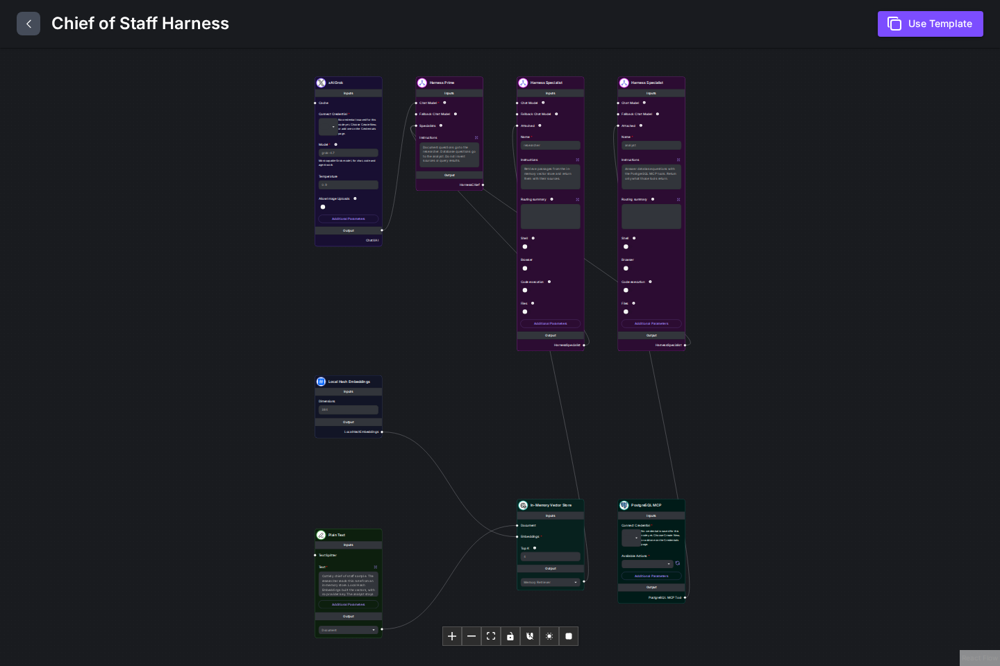

The template opens as a new canvas named `untitled-harness`. Nothing is saved yet.

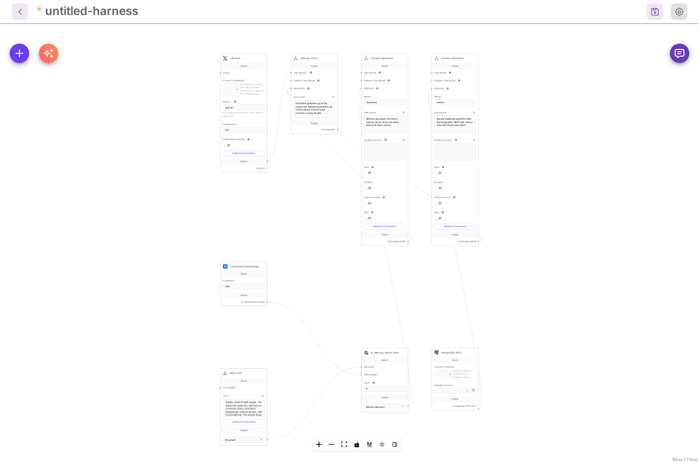

What the template contains:

| Node                                | What it does                                                                                                           |
| ----------------------------------- | ---------------------------------------------------------------------------------------------------------------------- |
| **Harness Prime**                   | Routes each message. Its instructions send document questions to the researcher and database questions to the analyst. |
| **Harness Specialist** `researcher` | Answers from the note. Its tool is the In-Memory Vector Store.                                                         |
| **Harness Specialist** `analyst`    | Answers database questions. Its tool is PostgreSQL MCP.                                                                |
| **xAI Grok**                        | The sample chat model for Harness Prime. It has no credential. You replace it below.                                   |
| **In-Memory Vector Store**          | Holds the note. **Local Hash Embeddings** builds the vectors on the server, with no provider key.                      |
| **Plain Text**                      | The demo note the researcher reads.                                                                                    |
| **PostgreSQL MCP**                  | The analyst's database tool.                                                                                           |

A specialist with nothing connected to its own **Chat Model** uses Harness Prime's model and credential.

Harness Prime chooses specialists from a short line about each one. Fill in **Routing summary** on a Harness Specialist to write that line yourself, up to 300 characters. When it is empty, Harness Prime reads the start of the specialist's **Instructions**, cut at a sentence near 300 characters. The specialist still gets all of its instructions. A summary keeps long instructions out of every routing prompt.

## Save an OpenAI key as a credential

Model keys live under **Credentials**, never on the canvas. Skip this if you already have one.

1. Open **Credentials** and select **Add Credential**.
2. Type `OpenAI` in the search box and select **OpenAI API**.
3. Give it a name, such as `OpenAI main`, and paste your key into **OpenAI Api Key**.
4. Select **Add**.

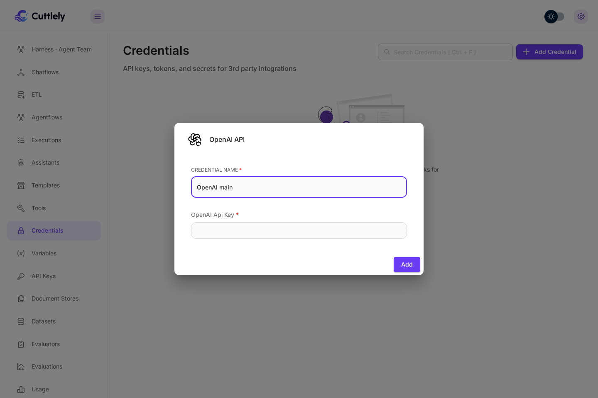

The list shows the new credential and the message `New Credential added`. The key is stored encrypted.

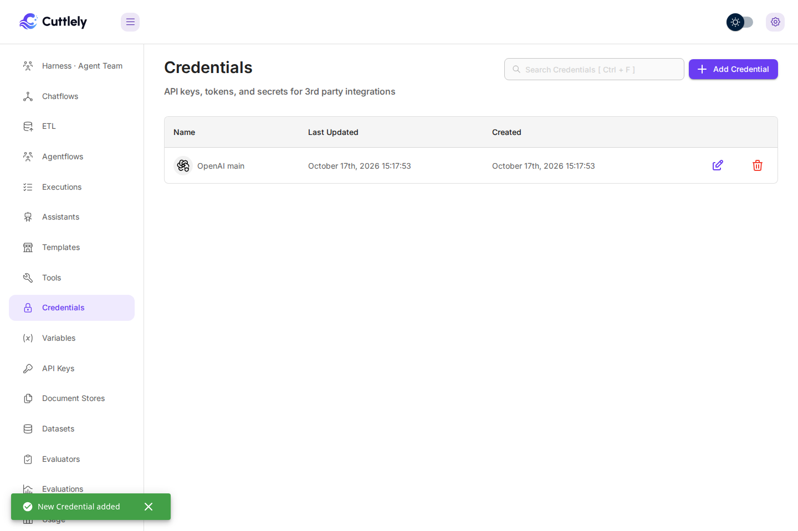

## Connect a chat model to Harness Prime

If you saved a chat model key before opening the template, the template already uses it. With an OpenAI key and no xAI key, the **xAI Grok** card becomes **ChatOpenAI** (`gpt-4.1-mini`) in the same place, joined to Harness Prime, and a message says so: `This template now uses ChatOpenAI (gpt-4.1-mini) instead of xAI Grok, with your key. Save to keep it.` With an xAI key, the card stays and your key is filled in. Your key is picked only when exactly one fits; with several, pick one on the card. Any model card does the same: with no key picked and exactly one saved key that fits, it picks that key.

With no key saved yet, the template's xAI Grok node has no credential, so a save is refused with `The xAI Grok chat model on Harness Prime needs a credential. Select one on that node and save the harness.` Replace it with OpenAI. If you have an xAI key, you can instead select an xAI credential on that node and keep it.

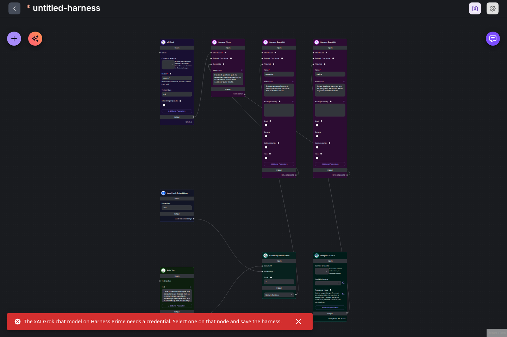

1. Hold the pointer over the **xAI Grok** node and select the trash icon in the small toolbar beside it. The node is removed.
2. Select **+** (**Add Node**) at the top left. Type `ChatOpenAI` in **Search nodes**.
3. Drag **OpenAI** from **Chat Models** onto the canvas.

    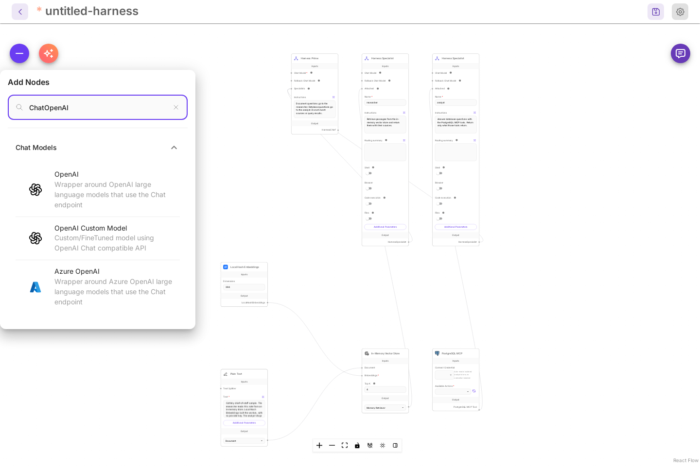

4. Drag from the output dot at the bottom right of the OpenAI node to the **Chat Model** dot on Harness Prime. A line joins them.

    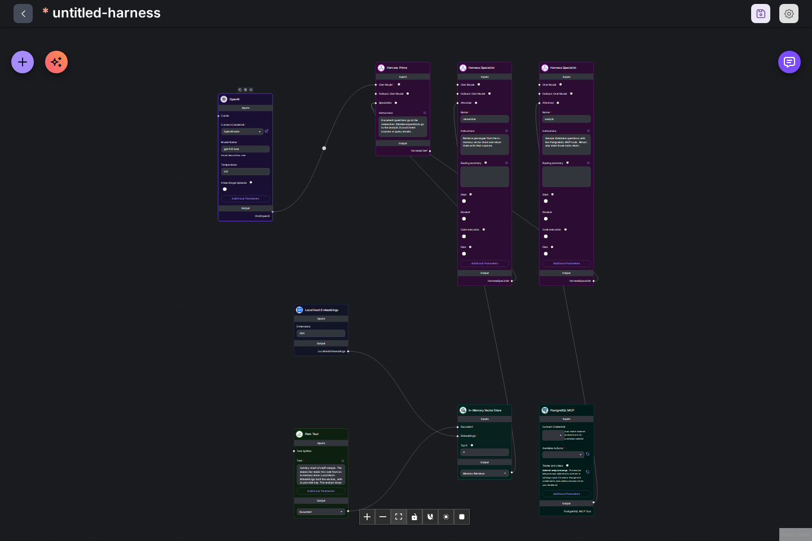

5. On the OpenAI node, open **Connect Credential** and select your credential. **Model Name** starts at `gpt-4o-mini (latest)`. Choose another model there if you want one.

    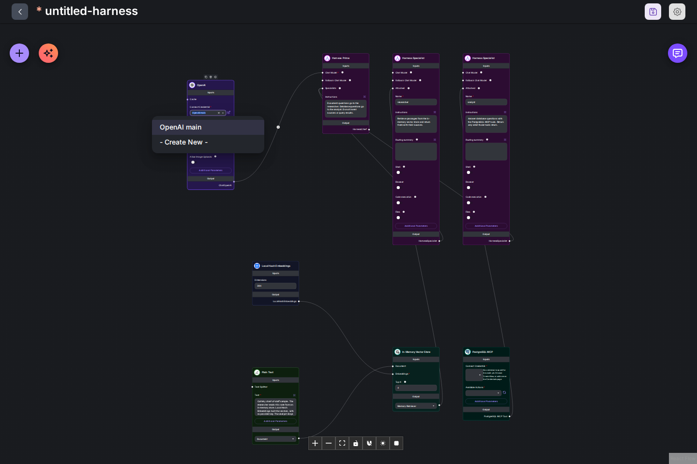

## Turn on the analyst's database tool

The template stores no action on PostgreSQL MCP. Until you pick one, the analyst has no database tool.

1. On **PostgreSQL MCP**, open **Available Actions**.
2. Select **QUERY**.

With `CUTTLELY_ANALYST=auto` the description under the field starts with `Run one SQL statement in the isolated analyst store`, and **Connect Credential** reads `Auto mode: isolated analyst store, no credential needed`. Other cases are in [Analyst mode](./analyst.md).


## Give a specialist playbooks

A specialist with long rules can keep most of them out of every prompt. Open **Additional Parameters** on a Harness Specialist and add **Playbooks**. Each playbook has a **Name**, a **When to use** line, and the **Content**.

The specialist always sees each name and its when-to-use line: its instructions list them (the first 30, each line cut at 200 characters), and so does its skills list. It loads the content only when a question needs it, then follows it. Keep the rules every question needs in **Instructions**, and move the rest into playbooks, one topic each.

| Limit       | Value                                                            |
| ----------- | ---------------------------------------------------------------- |
| Playbooks   | 40 per specialist                                                |
| Name        | 64 characters. Letters and numbers; other characters become `-`. |
| When to use | 300 characters. Empty uses the first line of the content.        |
| Content     | 60,000 characters                                                |

A specialist with playbooks runs in the agent runtime. It can list and read its playbooks. It cannot change them, and it cannot write new ones. Save the harness after you edit a playbook.

A playbook can ask for a closing line, such as `Source: sales warehouse`. When the specialist's answer ends with a line that starts with `Source:`, `Sources:`, `Citation:` or `References:`, Harness Prime keeps that line at the end of its own answer. If its rewrite drops the line, Cuttlely puts it back.

## Save the harness

1. Select the save icon at the top right (**Save Harness**).
2. Type a name and select **Save**.

The name is the harness id. Chatflows and the API call the harness by it. It is a letter, then letters, numbers, `_`, or `-`, up to 64 characters. `chief-of-staff` is valid. `Chief of Staff Harness` is refused with `Harness name "Chief of Staff Harness" is not valid. Use a letter followed by letters, numbers, "_" or "-".` A name that is `try` followed by 8 to 32 hex characters is reserved for a draft try. A name that is `tryx` followed by 16 hex characters is reserved for a fitted specialist profile. Saving or importing either is refused, and the save dialog shows the reserved-name message.

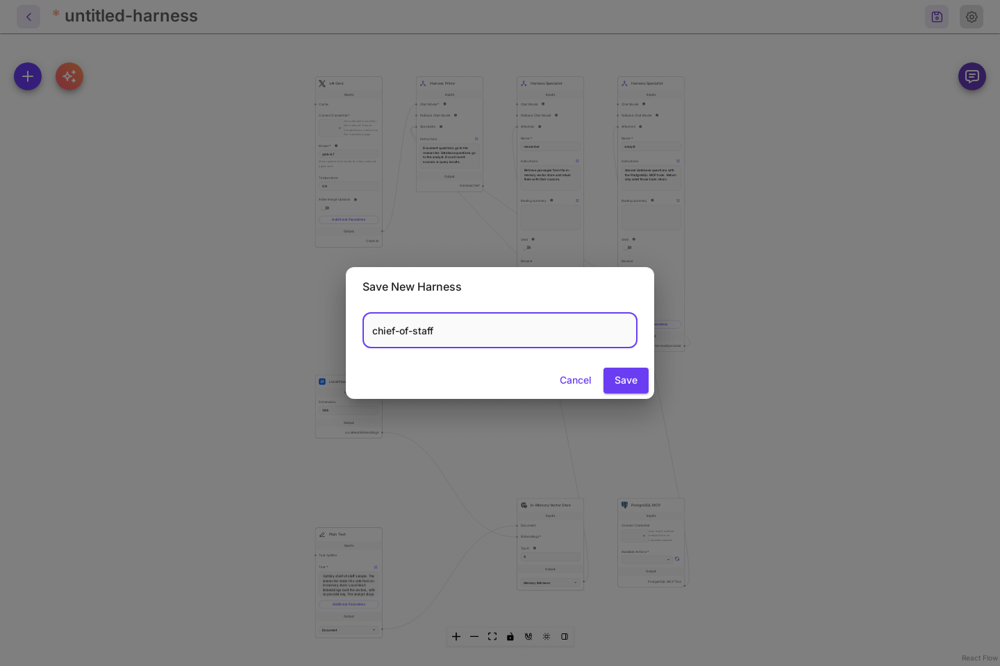

## Drafts and Publish

The first save of a new harness is Live, so a chatflow and the API can call it. After that, **Save Harness** writes a **Draft**. The header says **Draft, not live yet**, or **Live** when nothing is waiting. **Publish** puts the draft Live. **Discard draft**, in the Publish dialog, throws the draft away. The canvas chat and **Try it** run the draft when one exists, and Live otherwise. That try uses the draft roster: its specialists, tools, and models. `POST /api/v1/harnesses/:name/runs` stays on Live until you publish.

**Publish** lists what changed and can replay recent questions on Live and on the draft before you publish. Those questions are the full prompts from saved chats, not the short line on **Runs**. That replay uses the canvas team, and a harness saved for another team is not replayed. The same steps for every canvas, including which kinds get a replay and which get a change list only, are in [Drafts and Publish](./versioning.md#drafts-and-publish) and [Which canvases get a check](./versioning.md#which-canvases-get-a-check). **Roll back Live** is there too. See [Check recent questions before you publish](./versioning.md#check-recent-questions-before-you-publish).

A harness that was saved before drafts is already Live. The next edit on the canvas starts a draft. The saved canvas and the roster runs serve do not change until you publish.

The message `Draft saved` appears for an edit. The first save says `Harness saved`. The header shows the name and `Last edited by` with your display name. The buttons at the top right are now **Version history**, **API Endpoint**, **Save Harness**, and **Settings**, and **Publish** when a draft is waiting.


An orange triangle on a card means that node was saved with an older version of the node than the app has now. A harness made from the template today shows none. One saved from an older template or an older Cuttlely shows them. Select **Sync Nodes**, the orange button next to **+**, then save. The triangles and the button go away, and your settings stay.

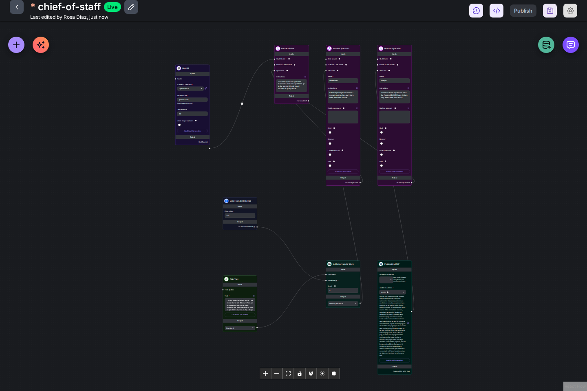

## Test it in the canvas chat

The chat button at the top right of a saved harness canvas runs the draft when one exists, and Live otherwise. Save the draft before you chat. Unsaved changes are not used. `POST /api/v1/harnesses/<name>/runs` is the external route and stays on Live until you **Publish**.

1. Select the chat button (**Chat**).
2. Ask a document question, for example: `What does the sample note say the researcher reads, and how were its vectors built?`

The reply starts with a **Run** card, then the answer.


3. Ask a database question, for example: `Use the analyst database. Create a tasks table with id, title, and status. Insert three tasks: draft agenda (open), book room (done), send invites (open). Show the open tasks.`


The model writes its own wording, so your answer will differ. What should match is the route: the document question goes to `researcher` and the database question goes to `analyst`.

## Read the run card

The same card shows in the canvas chat, in a chatflow chat, and on the harness page.

| Part                                      | Meaning                                                                                                                                                                                                        |
| ----------------------------------------- | -------------------------------------------------------------------------------------------------------------------------------------------------------------------------------------------------------------- |
| **Run**, harness name, `Finished`         | The run is over. `Running` while it works, `Stopped` when it failed, `Finished with a failed specialist` for a partial run.                                                                                    |
| Time, then `in · out`                     | Wall time, and the input and output tokens for the whole run. `in (N cached)` is the part of the input the model provider served from its prompt cache, which costs less. `Tokens not reported` while it runs. |
| `Harness Prime sent work to analyst`      | Which specialists Harness Prime chose.                                                                                                                                                                         |
| `Route · Specialists · Handoff · Profile` | Time spent choosing, in the specialists, writing the final answer, and preparing the specialists to run in the agent runtime.                                                                                  |
| Specialist row                            | Name, `done`, `running`, or `failed`, then the model, time, tokens, and the number of tool calls. A specialist that runs in the agent runtime reports the tokens of its whole run.                             |
| `Handoff · OpenAI · gpt-4o-mini`          | The model call where Harness Prime wrote the answer from the specialists' results.                                                                                                                             |
| `Context kept`                            | Nothing was shortened. `Context cut in N places` means some text was shortened. Select it to see where.                                                                                                        |

Harness Prime reads up to 4,000 characters of each specialist's answer before it writes the reply. To change that for one specialist, set **Handoff limit** under **Additional Parameters** on its Harness Specialist, from 160 to 20,000 characters, or `-1` for no limit. Empty or `0` means the default of 4,000; a decimal is rounded down first. A long knowledge answer may need more. With `-1`, Harness Prime reads the whole answer, unless its context is full. When Harness Prime's context is full, these limits shrink first, and the card says `Context cut`.

Turn on **Answer direct** under a Harness Specialist's **Additional Parameters** to return its eligible single-step answer directly. It defaults to off. Harness Prime's instructions, persona and Handoff limit do not apply to that reply.

**Pin first** is another optional setting under **Additional Parameters**. It defaults to off. Set `pinFirstRules` to an array of author rules with a unique `id`, a stamped `pq_` pin name, case-insensitive `when` patterns, named `params`, and an `answer` template. Exactly one rule must match the original user question. It runs only for a single step without a dependency, paging, or images, while the turn has budget left.

A matching pin-first success is shown as written using the rule's heading, columns and closing lines. The harness renders the returned rows, up to 16 columns and 100 rows (or the node's row cap if lower), including count questions and empty results, and skips the specialist model and Harness Prime. When a page has more rows than that, the answer says how many it shows. An empty result shows the rule's `emptyText` when set; otherwise it shows the heading and the configured `columns` with no rows, or no table when `columns` is not set. Harness Prime's persona and Handoff limit do not apply to that reply. The run card names the pin and rule. A miss follows the usual specialist path. An execution error runs the pin once, skips the specialist model and passes the failure to the usual answer decision and Harness Prime.

Rules select a server-held pin and supply parameter values through `fixed`, `default`, or the first capture of an `extract` pattern. The rule contains no SQL or binds. Arguments use the existing pin validator, and SQL still runs through the same pinned guard and read-only node invoke. Patterns are limited to eight per rule, eight rules per specialist, and 200 characters per pattern; malformed patterns are refused on save. Conflicting rule matches or different extracted values cause a miss. `show more` continues the same pin through the existing cursor path.

A specialist that runs in the agent runtime always gets the whole task Harness Prime wrote for it. When its context is full, the session memory is shortened first, and the card says so. Its instructions are already part of its agent runtime profile, so they are not sent again with each task. Each turn starts a new agent runtime session. The specialist does not replay every earlier message of the chat. It gets the last turns of the chat with its task, each message cut at 1,500 characters, and Harness Prime writes a follow-up such as `and in April?` into a whole request. `show more` still pages through the last result, because the page belongs to the chat, not to the turn. How the pieces fit together: [Context and tokens](./context-and-tokens.md).

The specialists Harness Prime picks start together. When one needs another's result, for example a writer turning the analyst's numbers into a note, Harness Prime makes it wait. It starts when that specialist is done, and its task ends with that result, up to 6,000 characters. If the earlier specialist failed, the task says so, so the writer does not make up a number. The specialist row shows the task as Harness Prime wrote it, without the earlier result.

Select a specialist row to open it. It shows the task Harness Prime gave that specialist, one chip per tool call, any sources, and a last line such as `Harness Prime combined this result into the answer.`

Those same steps can be sent as an OpenTelemetry trace: the run, the route, each specialist, each tool call, and the handoff. See [Harness runs](./observability.md#harness-runs).

Each chip is the tool name and `done`, `retried`, or `failed`. A specialist's tools are offered to it directly, so the first chip is the tool itself, such as `mcp__analyst__query`, not a `tool_search` and `tool_call` lookup first. A failed chip is red. Hold the pointer over a `retried` chip for the reason. An analyst query chip that returned rows also says how many, such as `mcp__analyst__query · done · 100 rows`. Select it to open a short preview of those rows, never more than the configured row cap (at most 1000). The table starts closed. It shows the first few rows and columns, with long values cut short. When the preview is shorter than a finished page with no page line, the caption says the answer can show fewer rows than the query returned. When the result has a page line and the question asks for the rows, the caption says the rest of these rows are in the answer in this chat. A count or a total does not. It says to say `show more` only when another page exists. Select the chip again to close it. The preview is saved with the run trace. It is only rows that query already returned. Harness Prime gets a short handoff, and the answer can show only the top rows. A database result that stopped at the row cap ends with a page line such as `rows 1-100 of 150 (page 1 of 2, say "show more" for the next page)`. The cap is 100 rows unless you change it, and never more than 1000. Say `show more` for the next page. See [Query preview on the run card](./analyst.md#query-preview-on-the-run-card).

### How long a turn should take

A turn where Harness Prime sends work to more than one specialist aims for these times on fast models, measured as the run card's wall time:

| Measure      | Target               |
| ------------ | -------------------- |
| p50 (median) | at most 15 seconds   |
| p95          | at most 30 seconds   |
| Turn budget  | 45 seconds, enforced |

The p50 and p95 figures are targets, not limits, and they are still provisional. A slow provider can go over them. The turn budget is a hard limit unless you turn it off: a specialist still running when the budget runs out fails, and the turn returns the finished specialists' answers as they are, without a Harness Prime handoff. If none finished, the answer says the turn ran out of time. If the budget runs out while Harness Prime is still routing, before any specialist starts, the turn fails instead: the run API answers 422 with `Harness "<name>" exceeded the <ms>ms turn budget.` and there is no partial answer. A one-tool roster whose tool is still running at the budget fails the same way, with the specialist's name in the message. `CUTTLELY_HARNESS_TURN_BUDGET_MS` changes the budget from its 45-second default, and `0` turns the budget off. To watch these figures on real traffic, use the **Harness run duration p95 by harness** and **Run duration p50 / p95** panels in the [Grafana dashboard](./observability.md#panels). Those panels count every harness run, not only turns with more than one specialist, and they have data only with [turn traces on](./observability.md#turn-traces-on).

## Build a team with AI

Describe the team in plain words and **Build with AI** puts it on a new harness: Harness Prime, one specialist for each role, and the tools each specialist needs. Every part and every connection is checked before the team lands. You need a chat model credential first. See [Save an OpenAI key as a credential](#save-an-openai-key-as-a-credential).

1. Select **New agent team**. The blank harness canvas opens.
2. Select **Build with AI**, the button with the sparkles next to **+**.
3. Under **Describe your team**, write what the team does and who is on it, or select one of the examples above the box. Name a service, such as Tavily for web search, and the builder adds that tool.
4. Under **Chat model that builds**, Cuttlely starts on a model you have a key for (OpenAI starts on `gpt-4.1-mini`), with your key picked when only one fits. The list shows the models you have keys for; **Show all … models** lists the rest, and **Only models for your keys** returns to that shorter list. **More settings** holds the advanced ones. Your choice is remembered for next time. There is no default key.
5. Select **Build**.


The team is saved right away as a new harness, named after its title, and opens on its own canvas. A built team never replaces a harness you already have. When you started from a canvas that already has cards, the new harness opens in a new tab.


6. Open the chat. Three starter questions are waiting, written as things you would ask the team. Select one. The run card shows which specialists Harness Prime sent work to. See [Read the run card](#read-the-run-card).


When a tool needs a credential you have not added, the message at the bottom names it, for example `Tavily API needs Tavily API`. Add that credential on the **Credentials** page, pick it on the card, and save the harness. The message stays until you close it.


Build with AI works the same with classic cards. The team lands with each card at full size.

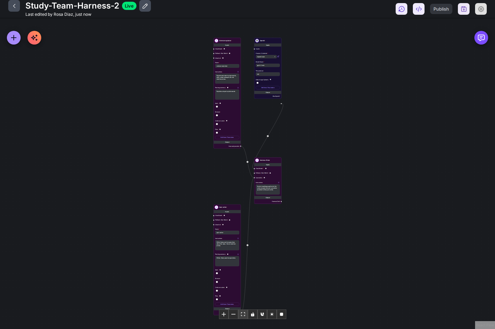

Change anything you like afterwards, the same as a harness you built by hand. The first save is Live. Later saves are a draft until you publish, and Publish records that version in [Version history](./versioning.md). Pipelines and chatflows have the same button: see [Build a pipeline with AI](./etl.md#build-a-pipeline-with-ai) and [Build a chatflow with AI](./canvas.md#build-a-chatflow-with-ai). A chatflow built that way uses the **Harness** tool only when you name one of your saved harnesses.

## Run it from the harness page

Back on **Harness · Agent Team**, the harness has a card with its name, `Updated` time, and number of specialists.

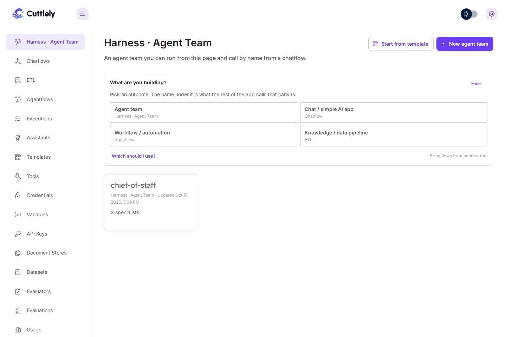

Select the card. The harness page is `/harnesses/chief-of-staff`. **Open Canvas** at the top right goes back to the canvas.

1. Type a prompt under **Try it**, for example `Use the analyst database. How many tasks are open, and what are their titles?`
2. Select **Run**.

While it runs, the button reads **Running** and **Stop** cancels the run. The run card fills in as each step starts, and the answer box says `Waiting for the first token.` until text arrives.

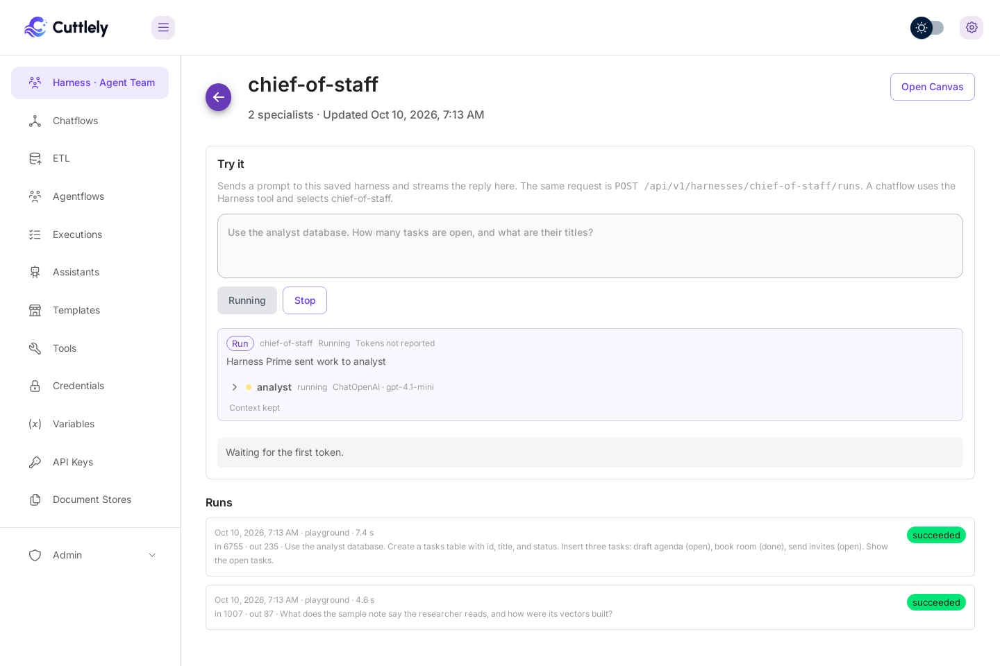

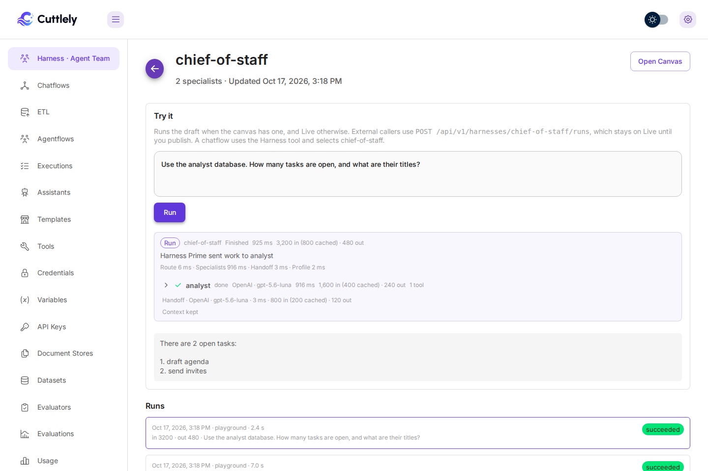

**Try it** uses your signed-in session. It runs the draft when the canvas has one, and Live otherwise, including the draft's specialists, tools, and models. `POST /api/v1/harnesses/chief-of-staff/runs` is what an external caller uses, and that route stays on Live until you publish. [Run it from your app with an API key](#run-it-from-your-app-with-an-api-key) covers the API key setup and the background run.

## Look at earlier runs

**Runs** on the harness page lists recent runs, newest first. Each row has the start time, where the run came from, the time it took, the tokens, the start of the prompt, and a status: `succeeded`, `completed with errors`, `failed`, `cancelled`, `running`, or `queued`. Runs from **Try it** and the canvas chat are listed as `playground`, runs started through the API as `api`, and runs from a schedule as `schedule`.

Select a row to open its run card under the list. Select a specialist row in the card to see its task and tool chips.


With no runs yet, the list says `No runs yet. Send a prompt above, or call this harness from a chatflow.` A failed run shows its error code and message in red under the card.

## Run it from your app with an API key

An app can start a run with an API key, get a run id back at once, and fetch the answer when the team is done. This example uses a made-up harness, `bakery-team`, and a made-up key name.

1. Open **API Keys** and select **Create Key** (or edit a key).
2. Name it, for example `Bakery back office`.
3. Under **Permissions**, tick **Create** under **CHATFLOWS**. **View** is ticked with it.
4. Under **Harnesses this key may run**, tick `bakery-team`. Nothing is ticked on a new key, and a key with nothing ticked runs no harness.
5. Select **Add** and copy the key.

Start a run from your server:

```bash
curl -s "$CUTTLELY_URL/api/v1/harnesses/bakery-team/runs/async" \
  -H "Authorization: Bearer $CUTTLELY_API_KEY" \
  -H 'Content-Type: application/json' \
  -d '{"question":"Which cakes are booked for pickup on Friday?"}'
```

```json
{
    "runId": "run_0b9e6d2c-1a3f-4e5d-8c7b-6a5f4e3d2c1b",
    "harness": "bakery-team",
    "status": "queued",
    "resultUrl": "/api/v1/harnesses/bakery-team/runs/run_0b9e6d2c-1a3f-4e5d-8c7b-6a5f4e3d2c1b/result"
}
```

Then read the `resultUrl` every few seconds until `finished` is `true`:

```json
{
    "status": "succeeded",
    "finished": true,
    "result": { "text": "Two cakes are booked for Friday: a lemon drizzle at 10:00 and a chocolate layer cake at 15:30." }
}
```

The run shows under **Runs** on the harness page with its run card and tokens, listed as `api`. It runs Live, not the draft. A harness that is not ticked on the key answers `403` `This API key may not run harness "payroll".`, whether or not that harness exists, and that refusal is an **Admin** > **Audit log** row. Each key may start 60 runs and read 600 times a minute, counted in each server process. The key sees only the runs it started. The full request and response, and every error, are in [Run a harness in the background](../api.md#run-a-harness-in-the-background).

## Run it on a schedule

A harness can run by itself on a cron schedule, for example a morning summary on weekdays. This example uses a made-up harness, `bakery-team`.

1. Open the harness page, `/harnesses/bakery-team`.
2. Under **Schedule**, set **Cron** to `0 7 * * 1-5` (07:00, Monday to Friday). The fields are minute, hour, day of the month, month, and day of the week.
3. Pick a **Time zone**, for example `Europe/Paris`. The page starts with your browser's time zone, and the list always includes it.
4. Type the **Question for each run**, for example `Summarise yesterday's orders and flag any cake booked for today.`
5. Select **Add schedule**. The note beside the button says that saving makes you the owner.

The card then says who the schedule runs as, when the next run is, and how the last one went. A few more rules:

-   **Owner.** A schedule runs with the permissions of the person who last saved or resumed it, in the harness team. At each due time Cuttlely checks that this person can still start a harness run there (organization owner, or `chatflows:create`, `chatflows:update`, or `agentflows:create`). If they cannot, for example after a role change or when the user is disabled, that time is skipped as `refused`, with an **Admin** > **Audit log** row. Save or resume the schedule as someone who can run it. An API key cannot set a schedule. Every run a schedule starts is an audit row with its run id.
-   **Delete.** **Delete schedule** asks before it deletes. The runs it already made stay under **Runs**.
-   **Pause.** The switch at the top right of the card pauses and resumes. A paused schedule shows no next run. Resuming counts the next run from now, so the times missed while paused are not run, and makes the person who resumes it the owner.
-   **No overlap.** A due time while the previous scheduled run is still going is skipped as `skipped`. The next due time tries again.
-   **Run history.** Scheduled runs show under **Runs**, listed as `schedule`, with the same run card, tokens, usage totals and traces as any other run. **Refresh** next to **Runs** loads new ones. A scheduled run uses Live, not the draft.
-   **Restarts.** Schedules are kept in the harness database in the data folder, so they continue after a restart. While the server restarts or shuts down it starts no scheduled run, including the rest of a tick that was already going; a due time it did not reach stays due. A due time still `starting` after a minute is shown as `failed`, because the server stopped before it started the run. **Restart** in Server settings stops starting scheduled runs as soon as you press it, even when nothing is running. A shutdown, and a Restart that lets runs finish, wait for a scheduled run already going, up to their usual wait, and a run cut off by the restart is marked failed with `interrupted` at a later start. A due time that passed while the server was down runs once when it is back, and the next run is counted from then.
-   **Several servers.** Servers that share the data folder each check schedules, and each due time is claimed by one of them, so it starts one run.
-   **Days.** The day-of-month and day-of-week fields follow Vixie cron. A field that starts with `*` (such as `*` or `*/2`) is unrestricted. When one of the two starts with `*`, a day has to match the other one. When both are restricted, a day that matches either one runs: `0 9 1 * 1` runs on the 1st and on every Monday. When the day-of-week field starts with `*`, a day of the month that no chosen month has, such as `0 9 30 2 *` (30 February), is refused when you save. With a restricted day of the week, the same schedule is accepted and runs on those weekdays in February.
-   **Time zone.** Use a place name such as `Europe/Paris`, or `UTC`. An offset such as `+02:00` or `Etc/GMT-2`, and an abbreviation such as `CET`, are refused, because they do not follow the place's clock changes. The zone is saved in the server's canonical spelling.
-   **Time changes.** In a zone with daylight saving time, when the clocks spring forward over a time a fixed-time schedule names, it runs once at the first minute after the change, as Vixie cron does: `30 2 * * *` in `Europe/Paris` runs at 03:00 on the day the clocks go from 02:00 to 03:00. A fixed-time schedule is one whose minute and hour fields do not start with `*`. A schedule whose minute or hour field starts with `*`, such as `*/15 2 * * *`, keeps to the new clock, so the skipped minutes do not run. If the time right after the change is also on the schedule, it runs once. When the clocks fall back and an hour repeats, each wall time in it runs once, on its first pass, including `*/15`; this is stricter than Vixie cron, which runs a `*` minute or hour schedule again in the repeated hour. A tick that runs late never runs the same wall time twice.
-   **Cron syntax.** Five fields, separated by spaces: minute (0 to 59), hour (0 to 23), day of the month (1 to 31), month (1 to 12, or `jan` to `dec`), and day of the week (0 to 7, where 0 and 7 are both Sunday, or `sun` to `sat`). Names ignore letter case. Each field is `*`, a number, a range `a-b`, or a comma list of those, and any of them can take a step: `*/15` is every 15, `8-18/2` is every second hour from 8 to 18, and `5/20` is 5, 25 and 45 (a number with a step runs to the end of the field). A range needs exactly two ends, and the first cannot be after the second: `1-2-59` and `fri-mon` are refused, so write `fri,sat,sun,mon` or `0,1,5,6`. A step must be a whole number of 1 or more. There is no seconds field, and `?`, `L`, `W`, `#` and shortcuts such as `@daily` are refused. A refused cron is `400` with a message that says what is wrong.
-   **Startup.** Schedules start checking only after the server has started cleanly. When startup fails, for example because the database cannot be reached, no scheduled run starts, the server log says so, and every due time stays due, so it runs once the server starts cleanly. The web server checks every 15 seconds. A queue worker started with `CUTTLELY_HARNESS_QUEUE=external` does not check schedules; it runs the jobs the web server queues.

Deleting the harness deletes its schedule. The API calls are in [Schedule a harness](../api.md#schedule-a-harness).

## Call the harness from a chatflow

A chatflow runs a harness with the **Harness** node. A chatflow whose only node is **Harness** sends every message to that harness.

1. Open **Chatflows** and select **Add New**.
2. Select **+** (**Add Node**), type `Harness`, and drag **Harness** onto the canvas.
3. Under **Harness**, select `chief-of-staff`.
4. Save the chatflow under any name, then open its chat.


When an app calls this chatflow with an API key bound to it, that key also needs `chief-of-staff` under **Harnesses this key may run**; otherwise the call answers `403`. An API key cannot save a chatflow whose **Harness** card names a harness off its own list.

**Return Direct** is on by default and sends the harness reply to the chat as it is. To use the team as one tool of a chatflow agent, connect the **Harness** node to the agent's tools instead. The agent calls it when its system message routes a task to `tool:harness`. Turn **Return Direct** off only when the agent has to rework the reply. Each pass is another model call.

Each agent names its Harness cards independently of other agents. A lone Harness card on an agent keeps `harness`, so existing flows that call `tool:harness` still run. When an agent has two or more Harness cards, each name is the card title, or the saved harness name when the title is still Harness, then `__` and a token from that card's own id. A card titled Payroll with the id `harness_10` is `payroll__harness_10`. The name uses only lowercase letters, digits, and underscores, and it is at most 64 characters. A long title is cut so the `__` and the id token still fit. A title that starts with a digit is prefixed with `h_`. The id token comes only from that card's id, so removing another card does not change it, except that a card left alone on an agent goes back to `harness`. On an agentflow the id is the one stored on the tool row, or its node id. If that name is already used on the same agent, a short hash of the title and id is added. If two tools on the agent still share a name, the agent build fails before the model is called, and the error names that tool.

When an agent calls the harness as a tool, Harness Prime routes the message the person sent, as a direct run does. To route the task the agent wrote instead, set **Tool Input** under **Additional Parameters** on the Harness node to **Agent task**. With **User message** (the default), the agent task is used only when the message is empty. After a reload, the chat keeps the run header and token totals of a harness run as a tool.

If Harness Prime's routing reply is not JSON, Cuttlely reads a fenced or embedded JSON plan, asks once more for JSON only, and otherwise runs one default specialist. Set that specialist in **Default Specialist** under **Additional Parameters** on Harness Prime; empty means the first specialist on the roster. A plan that is empty, or names only unknown specialists, also runs exactly one step on the default specialist. The trace records only the reply's length, a short hash and the parse result, never the reply text.

A specialist that can write files (Python, file tools or the terminal) can also return images and files, such as a chart from Python or a PDF report. Each run gets its own folder under `chat-images/` in the specialist's working directory, and the task tells the specialist where it is. A PNG or JPEG saved there shows in the chat under the answer. A PDF, DOCX, XLSX, PPTX or CSV file saved there shows as a download card with its name and type. Both also work when the harness is an agent's tool. Limits per turn: up to 4 images, 5 MB each, and up to 4 files, 10 MB each, with 20 MB for images and files together; a file that would go over the 20 MB total is left out. Each file is checked by its bytes as well as its extension: a PDF must start with `%PDF-`, a DOCX, XLSX or PPTX must be a ZIP with the Word, Excel or PowerPoint part, a CSV must be UTF-8 text, and PNG and JPEG must carry their image signature. A file that does not match, other file types, files saved anywhere else, hidden folders and linked files are not sent, so two chats that use the same specialist at once never see each other's files. The images and files are saved in the chat's file storage and the folder is removed after the run. The answer names each file by its name only: paths inside any specialist's working directory are left out, including in a failed specialist's error, and the files are attached once as downloads. A token that is only `/`, `\` or `~` is left as written, so a fraction, a date or a slash between words stays. A path is still hidden, including a path that continues after that slash. A short JSON answer is returned unchanged, so a path inside it is not hidden. In a longer JSON answer the path is replaced, which can leave the JSON invalid. A publish check saves none. A call to the harness runs API that does not stream gets the same items in `artifacts`, each with its bytes in `base64`.

### Make files with the assets preset

Under **Additional Parameters** on a Harness Specialist, set **Preset** to **Assets** for a specialist that makes polished PDF, DOCX, XLSX, CSV and PNG files. With **Name** left empty it is saved as `assets`. The preset:

-   turns on **Code execution** and **Files**, so the publish check lists it with those abilities,
-   puts its own instructions before the specialist's **Instructions**, and uses its own routing summary when **Routing summary** is empty,
-   copies the style kit `cuttlely_assets.py` into the specialist's working directory each time the profile is written.

The style kit gives every file one look: a palette (`PALETTE`, `SERIES`), fonts (`FONTS`: Inter, then Noto Sans, then DejaVu Sans), a chart theme for matplotlib and seaborn (`CHART_THEME`, `apply_chart_theme()`), and a table theme (`TABLE_THEME`) used by `pdf_report()`, `docx_report()` and `xlsx_table()`. `bar_chart()`, `line_chart()` and `save_png()` make PNG charts, and `csv_table()` writes UTF-8 CSV with text that starts like a spreadsheet formula (`=`, `+`, `-`, `@`) kept as text. `xlsx_table()` also keeps text that starts with `=` as text, never as a formula. The kit needs the image and file libraries in the agent runtime; see [Image and file libraries in the agent runtime](../reference/hermes-assets.md). `use_dir()` creates the output folder. `fetch_asset(url, path)` downloads a logo, image, PDF or font with a browser-like user agent, follows redirects, checks the content type and prints `saved <name>: <n> bytes` (a content type outside a fixed list of common types is shown only as `other image`, `other text` and so on, never as the server sent it); it is a thin wrapper over `fetch(url, max_bytes=..., timeout_ms=..., accept=...)` in `cuttlely_fetch.py`, which returns `status`, `contentType`, `bytes`, `finalUrl` and `shownUrl`. Errors and the saved line name the URL as `shownUrl` gives it: no user name, password or query, and after a redirect only the original URL and the redirect count, since everything in a redirect target comes from the server. A declared `Content-Length` is checked against the cap but never printed. Every hop, redirects included, must resolve to public addresses only (no private, loopback, link-local or metadata addresses, IPv4 or IPv6). An IPv4-mapped address is judged by the IPv4 address it contains, and so is a 6to4 or NAT64 address. The body is capped at 10 MB by default (50 MB at most) and the whole fetch at 20 seconds (60 at most). The older module name `asset_kit` still imports the same kit. Its tests run with `hermes/.venv/bin/python packages/harness/presets/assets/test_cuttlely_assets.py`. The fetch tests use only the standard library: `python3 packages/harness/presets/assets/test_cuttlely_fetch.py`.

To let people attach images, turn on **Allow Image Uploads** on the Harness node (a chat whose only node is the harness). Harness Prime sees the images when it routes the turn and when it writes the answer, so pick a Harness Prime model that reads images. Specialists do not see them: when a task depends on an image, Harness Prime writes what it shows into that specialist's task. This holds with one specialist too: a turn with images always gets a routing call. Up to 4 images per message, 5 MB each (PNG, JPEG, GIF or WebP). Images are not kept for later turns. A Harness node attached as a tool leaves images to the agent's own model.

Sample chatflows that run a harness by name are in `samples/chatflows/`. The harness samples are in `samples/harnesses/`.

## Delete a harness

Deleting a harness, from its card or by deleting its canvas, also removes its agent runtime profile, the profiles of its specialists and their workspaces. Their gateway tokens are revoked first. If that fails, nothing is deleted and the delete asks you to try again. Only profiles that belong to that exact harness name are removed: deleting `bakery` leaves `bakery-harness` and `Bakery` alone.

At startup Cuttlely looks for profiles whose harness no longer exists, for example ones left by a delete made before this cleanup existed. By default it only logs them (`orphan profile sweep (dry run): would remove profiles/<name> of harness "<id>"`). Set `CUTTLELY_HARNESS_ORPHAN_SWEEP=delete` to remove them at the next start. The sweep never removes a profile of a saved harness (in any letter case), a canvas try, or anything changed in the last 10 minutes, and it never follows a symbolic link or leaves the profiles directory.

## Troubleshooting

| You see                                                                                                      | What to do                                                                                                                                                                            |
| ------------------------------------------------------------------------------------------------------------ | ------------------------------------------------------------------------------------------------------------------------------------------------------------------------------------- |
| `The xAI Grok chat model on Harness Prime needs a credential. Select one on that node and save the harness.` | Select a credential on that node, or delete it and connect another chat model. See [Connect a chat model](#connect-a-chat-model-to-harness-prime).                                    |
| `Harness name "..." is not valid. Use a letter followed by letters, numbers, "_" or "-".`                    | Save under an id such as `chief-of-staff`. Spaces are not allowed.                                                                                                                    |
| `Save this harness before chatting.`                                                                         | The canvas chat runs the saved harness. Save first. The rest of the message says what else is missing.                                                                                |
| `Connect a chat model to the Harness Prime. A chat model is required. ...`                                   | Nothing is connected to **Chat Model** on Harness Prime. Connect one and save.                                                                                                        |
| `The chat model on the Harness Prime needs a credential. ...`                                                | Select a credential on the chat model node and save. A key in the server environment does not fill in a missing credential.                                                           |
| Orange triangle on a card, **Sync Nodes** button                                                             | The node was saved with an older node version. Select **Sync Nodes**, then save.                                                                                                      |
| The analyst says its tool is unavailable, or **Available Actions** shows `Analyst tool unavailable`          | The agent runtime has not registered the query tool yet. Wait a few seconds and refresh **Available Actions**, or restart Cuttlely. See [Analyst mode](./analyst.md#troubleshooting). |
| The analyst answers without querying                                                                         | **QUERY** is not selected on PostgreSQL MCP. Select it and save.                                                                                                                      |
| The wrong specialist answers                                                                                 | Make the Harness Prime **Instructions** say which kind of question goes to which specialist, by name. Give each specialist a **Routing summary** that says what it handles. Save.     |

## Prediction API

`POST /api/v1/prediction/:id` on a chatflow that runs a harness returns `text`, `harness`, `agents`, `sources`, and `artifacts`. Streaming (`true` or `"true"`) sends harness events on that response. The event names are `route`, `specialist`, `tool`, `partial`, `handoff`, and `final`.

The harness page uses a signed-in session. **Try it** runs the draft when one exists. An API key goes through a chatflow bound to that key, or calls `POST /api/v1/harnesses/:name/runs` and `POST /api/v1/harnesses/:name/runs/async` when the harness is on that key's list. Both stay on Live.

Chat uploads on `POST /api/v1/prediction/:id` use multipart field `files` with `question`. Turn on file uploads for that chatflow first (**Configuration**, **File Upload**, **Enable Full File Upload**); with them off the file is refused with 403 and not stored. A file over 25 MB is refused. A large file is a path the harness can read. The sample roster is `samples/harnesses/upload.canvas.json`.

## Profiles at startup

Harness Prime's profile does not start a specialist's bridge. Each specialist profile starts its own bridge, with its own gateway token.

At startup, each saved harness whose profile on disk was compiled by an older version, or has no compiler version, is compiled again before the agent runtime starts. A profile that already matches the current compiler is left as it is. A harness that has never been compiled is not compiled at startup. A profile compiled before the bridge change above is one this pass compiles again.

While that pass runs, the harness gateway's `GET /health` (loopback, port `43118` unless `CUTTLELY_HARNESS_GATEWAY_PORT` is set) returns 503 with `{"ok":false,"starting":true}`. `GET /api/v1/ping` answers 503 (`boot recompile`) for the same wait. The start script reads the gateway 503 as still compiling and waits up to `CUTTLELY_GATEWAY_STARTING_WAIT_SECONDS` (default 180 seconds, capped at 300) for 200 before it starts the agent runtime. If the compile is still going at that cap, the wait stops: ping may answer 200, and chat and prediction stay 503 until the compile finishes.

## Agent runtime health

Specialists run in the agent runtime, which `scripts/start-cuttlely.sh` starts after the harness gateway answers. `GET /api/v1/ping` answers `503` with the body `boot recompile` until the boot profile compile finishes. After that it stays `pong` while `X-Cuttlely-Hermes` is `up`, `degraded`, or `restarting`. `down` is HTTP 503 and the body `hermes down`. If the compile runs past the start-script cap (180 seconds by default, 300 at most), ping can answer `pong` while chat and prediction still answer `503` with `Retry-After`.

Missed health checks in the first 60 seconds after a start (`CUTTLELY_HERMES_HEALTH_GRACE`) do not count. After that, one miss is `degraded`. A restart needs about 15 seconds of continuous misses (`CUTTLELY_HERMES_HEALTH_WINDOW`) and `CUTTLELY_HERMES_HEALTH_FAILS` misses (default 3). Each check waits about 2 seconds. A run that is still streaming from the agent runtime is not killed for those misses.

`X-Cuttlely-Analyst` is `ready` when the analyst tool is registered, `missing` when the bridge recorded 0 tools, and `unknown` before that file exists.
