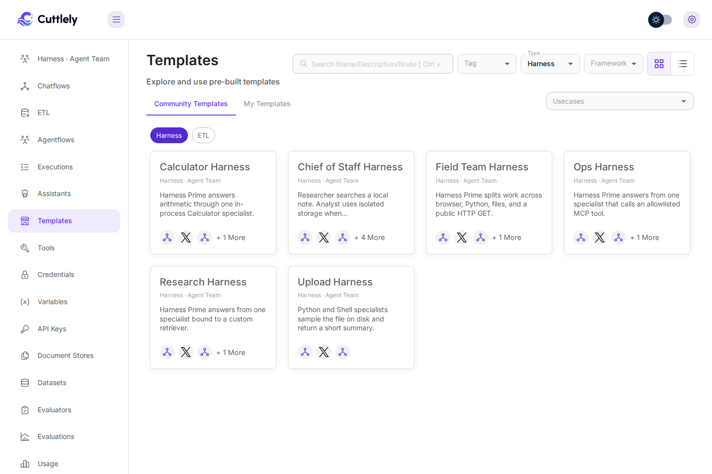
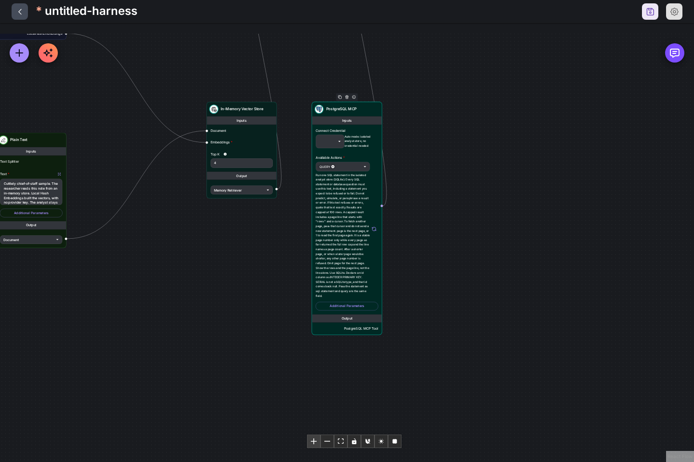
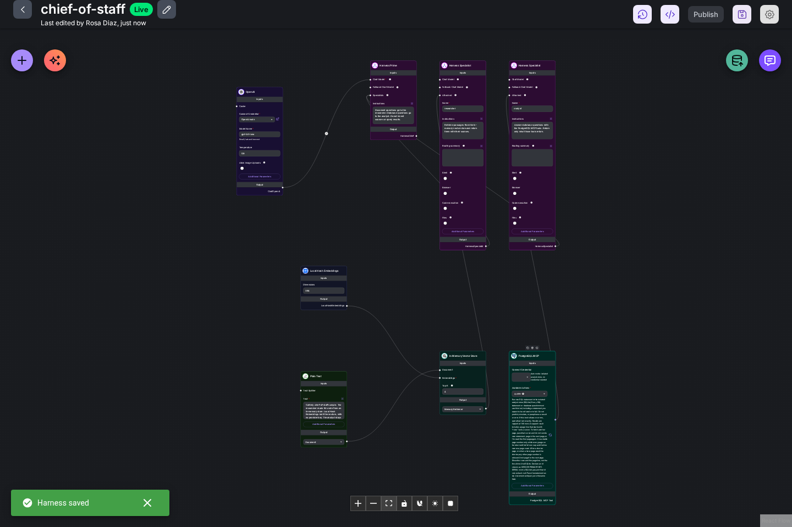
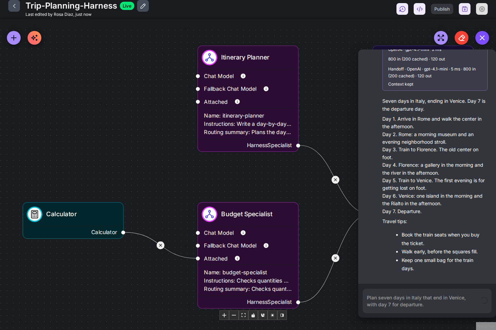
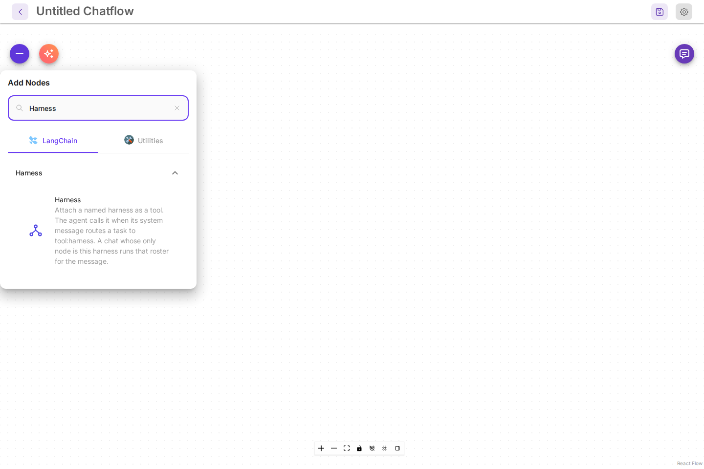
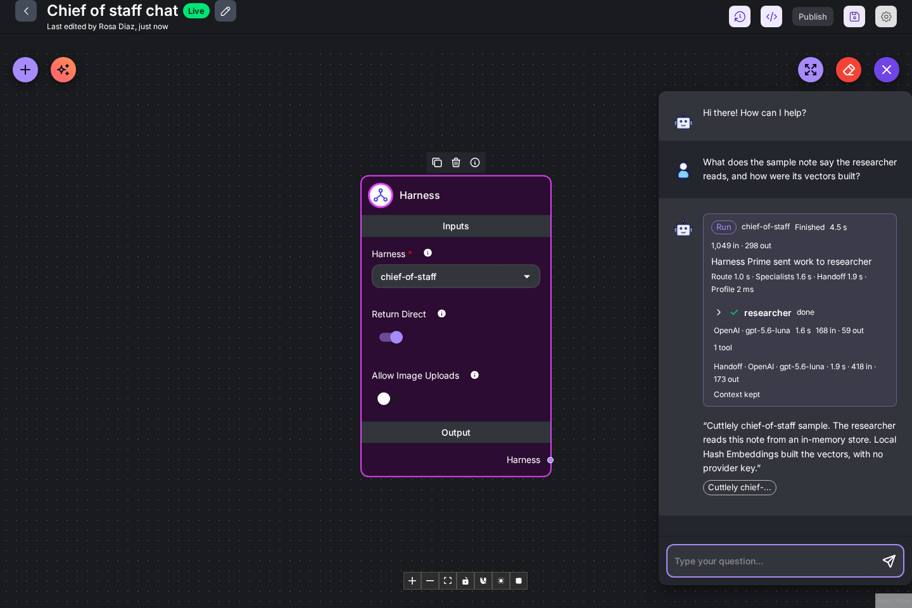

# Harnesses

A harness is an agent team, the part of Cuttlely that does the work for your app. **Harness Prime** reads each message, splits it among the specialists that should handle it, and writes the final answer. Your app reaches the team through a chatflow's prediction API, and people reach it through that chatflow's chat, share link or website embed. Each **Harness Specialist** has a name, its own instructions, and its own tools, such as a document store or a database. In the app the sidebar calls this **Harness · Agent Team**. The canvas node id stays `harnessChief`, so a saved flow still loads.

Use a harness when one chat has to do several different jobs and each job needs its own tools. A support desk that looks things up in documents and also answers questions from a database is one example. For a single chat model with one prompt, a chatflow is enough. For a fixed series of steps, use an agentflow. For loading documents into a store, use [ETL](./etl.md).

Install first: [Docker](./docker.md), [From source](./from-source.md), or [Render](./render.md). The account is [Sign in](./sign-in.md). The database specialist in this guide is [Analyst mode](./analyst.md). Every save is kept in [Version history](./versioning.md). Most canvas pictures here show classic cards, with every setting on the card. With the default compact cards, select a card to change the same settings in its side panel. The [Build a team with AI](#build-a-team-with-ai) pictures show the compact cards. See [Canvas cards](./canvas.md).

The steps below build the **Chief of Staff Harness** template with an OpenAI model. The server runs with `CUTTLELY_ANALYST=auto`, so the analyst specialist gets its own database. Without that setting the harness still saves and the researcher still works. The analyst then needs a Postgres URL. See [Analyst mode](./analyst.md).

## Open the agent team page

Select **Harness · Agent Team** in the sidebar. The page lists the saved harnesses in the active team. A harness and its runs belong to that team. Opening a harness from another team looks the same as a missing harness. A saved harness that is not in a team yet cannot be taken over by saving that name, and that save does not keep the canvas. A chat, share link, embed, webhook, or schedule does not run it until the server has assigned its team. A run from another team is refused the same way, including when harness jobs run in a separate worker. With none saved, it says `No agent teams yet` and offers **Start from template** and **New agent team**.

The **What are you building?** card names the four kinds of canvas, with **Agent team** first. **Agent team** is this page. **Hide** closes the card.

-   **Start from template** opens **Templates** with the harness samples.
-   **New agent team** opens a blank harness canvas. The empty canvas says what to add: a Harness Prime, at least one Harness Specialist, and a chat model connected to Harness Prime.
-   On the blank canvas, **Build with AI** builds the team from a description. See [Build a team with AI](#build-a-team-with-ai).

## Start from a template

1. Select **Start from template**. You can also open **Templates** in the sidebar and select the **Harness** chip.
2. Select **Chief of Staff Harness**.
3. Select **Use Template**.

The template opens as a new canvas named `untitled-harness`. Nothing is saved yet.

What the template contains:

| Node                                | What it does                                                                                                           |
| ----------------------------------- | ---------------------------------------------------------------------------------------------------------------------- |
| **Harness Prime**                   | Routes each message. Its instructions send document questions to the researcher and database questions to the analyst. |
| **Harness Specialist** `researcher` | Answers from the note. Its tool is the In-Memory Vector Store.                                                         |
| **Harness Specialist** `analyst`    | Answers database questions. Its tool is PostgreSQL MCP.                                                                |
| **xAI Grok**                        | The sample chat model for Harness Prime. It has no credential. You replace it below.                                   |
| **In-Memory Vector Store**          | Holds the note. **Local Hash Embeddings** builds the vectors on the server, with no provider key.                      |
| **Plain Text**                      | The demo note the researcher reads.                                                                                    |
| **PostgreSQL MCP**                  | The analyst's database tool.                                                                                           |

A specialist with nothing connected to its own **Chat Model** uses Harness Prime's model and credential.

Harness Prime chooses specialists from a short line about each one. Fill in **Routing summary** on a Harness Specialist to write that line yourself, up to 300 characters. When it is empty, Harness Prime reads the start of the specialist's **Instructions**, cut at a sentence near 300 characters. The specialist still gets all of its instructions. A summary keeps long instructions out of every routing prompt.

## Save an OpenAI key as a credential

Model keys live under **Credentials**, never on the canvas. Skip this if you already have one.

1. Open **Credentials** and select **Add Credential**.
2. Type `OpenAI` in the search box and select **OpenAI API**.
3. Give it a name, such as `OpenAI main`, and paste your key into **OpenAI Api Key**.
4. Select **Add**.

The list shows the new credential and the message `New Credential added`. The key is stored encrypted.

## Connect a chat model to Harness Prime

If you saved a chat model key before opening the template, the template already uses it. With an OpenAI key and no xAI key, the **xAI Grok** card becomes **ChatOpenAI** (`gpt-4.1-mini`) in the same place, joined to Harness Prime, and a message says so: `This template now uses ChatOpenAI (gpt-4.1-mini) instead of xAI Grok, with your key. Save to keep it.` With an xAI key, the card stays and your key is filled in. Your key is picked only when exactly one fits; with several, pick one on the card. Any model card does the same: with no key picked and exactly one saved key that fits, it picks that key.

With no key saved yet, the template's xAI Grok node has no credential, so a save is refused with `The xAI Grok chat model on Harness Prime needs a credential. Select one on that node and save the harness.` Replace it with OpenAI. If you have an xAI key, you can instead select an xAI credential on that node and keep it.

1. Hold the pointer over the **xAI Grok** node and select the trash icon in the small toolbar beside it. The node is removed.
2. Select **+** (**Add Node**) at the top left. Type `ChatOpenAI` in **Search nodes**.
3. Drag **OpenAI** from **Chat Models** onto the canvas.

    

4. Drag from the output dot at the bottom right of the OpenAI node to the **Chat Model** dot on Harness Prime. A line joins them.

    

5. On the OpenAI node, open **Connect Credential** and select your credential. **Model Name** starts at `gpt-4o-mini (latest)`. Choose another model there if you want one.

    

## Turn on the analyst's database tool

The template stores no action on PostgreSQL MCP. Until you pick one, the analyst has no database tool.

1. On **PostgreSQL MCP**, open **Available Actions**.
2. Select **QUERY**.

With `CUTTLELY_ANALYST=auto` the description under the field starts with `Run one SQL statement in the isolated analyst store`, and **Connect Credential** reads `Auto mode: isolated analyst store, no credential needed`. Other cases are in [Analyst mode](./analyst.md).

## Give a specialist playbooks

A specialist with long rules can keep most of them out of every prompt. Open **Additional Parameters** on a Harness Specialist and add **Playbooks**. Each playbook has a **Name**, a **When to use** line, and the **Content**.

The specialist always sees each name and its when-to-use line: its instructions list them (the first 30, each line cut at 200 characters), and so does its skills list. It loads the content only when a question needs it, then follows it. Keep the rules every question needs in **Instructions**, and move the rest into playbooks, one topic each.

| Limit       | Value                                                            |
| ----------- | ---------------------------------------------------------------- |
| Playbooks   | 40 per specialist                                                |
| Name        | 64 characters. Letters and numbers; other characters become `-`. |
| When to use | 300 characters. Empty uses the first line of the content.        |
| Content     | 60,000 characters                                                |

A specialist with playbooks runs in the agent runtime. It can list and read its playbooks. It cannot change them, and it cannot write new ones. Save the harness after you edit a playbook.

A playbook can ask for a closing line, such as `Source: sales warehouse`. When the specialist's answer ends with a line that starts with `Source:`, `Sources:`, `Citation:` or `References:`, Harness Prime keeps that line at the end of its own answer. If its rewrite drops the line, Cuttlely puts it back.

## Save the harness

1. Select the save icon at the top right (**Save Harness**).
2. Type a name and select **Save**.

The name is the harness id. Chatflows and the API call the harness by it. It is a letter, then letters, numbers, `_`, or `-`, up to 64 characters. `chief-of-staff` is valid. `Chief of Staff Harness` is refused with `Harness name "Chief of Staff Harness" is not valid. Use a letter followed by letters, numbers, "_" or "-".` A name that is `try` followed by 8 to 32 hex characters is reserved for a draft try. A name that is `tryx` followed by 16 hex characters is reserved for a fitted specialist profile. Saving or importing either is refused, and the save dialog shows the reserved-name message.

The first save of a new harness is Live, so a chatflow and the API can call it. After that, **Save Harness** writes a **Draft**. The header says **Draft, not live yet**, or **Live** when nothing is waiting. **Publish** puts the draft Live. **Discard draft**, in the Publish dialog, throws the draft away. The canvas chat and **Try it** run the draft when one exists, and Live otherwise. That try uses the draft roster: its specialists, tools, and models. `POST /api/v1/harnesses/:name/runs` stays on Live until you publish. [Drafts and Publish](./versioning.md#drafts-and-publish) is the same flow chatflows use, including **Roll back Live**. **Publish** can replay recent runs on Live and on the draft before you publish. That replay uses the canvas team, and a harness saved for another team is not replayed. See [Check recent questions before you publish](./versioning.md#check-recent-questions-before-you-publish).

A harness that was saved before drafts is already Live. The next edit on the canvas starts a draft. The saved canvas and the roster runs serve do not change until you publish.

The message `Draft saved` appears for an edit. The first save says `Harness saved`. The header shows the name and `Last edited by` with your display name. The buttons at the top right are now **Version history**, **API Endpoint**, **Save Harness**, and **Settings**, and **Publish** when a draft is waiting.

An orange triangle on a card means that node was saved with an older version of the node than the app has now. A harness made from the template today shows none. One saved from an older template or an older Cuttlely shows them. Select **Sync Nodes**, the orange button next to **+**, then save. The triangles and the button go away, and your settings stay.

## Test it in the canvas chat

The chat button at the top right of a saved harness canvas runs the draft when one exists, and Live otherwise. Save the draft before you chat. Unsaved changes are not used. `POST /api/v1/harnesses/<name>/runs` is the external route and stays on Live until you **Publish**.

1. Select the chat button (**Chat**).
2. Ask a document question, for example: `What does the sample note say the researcher reads, and how were its vectors built?`

The reply starts with a **Run** card, then the answer.

3. Ask a database question, for example: `Use the analyst database. Create a tasks table with id, title, and status. Insert three tasks: draft agenda (open), book room (done), send invites (open). Show the open tasks.`

The model writes its own wording, so your answer will differ. What should match is the route: the document question goes to `researcher` and the database question goes to `analyst`.

## Read the run card

The same card shows in the canvas chat, in a chatflow chat, and on the harness page.

| Part                                      | Meaning                                                                                                                                                                                                        |
| ----------------------------------------- | -------------------------------------------------------------------------------------------------------------------------------------------------------------------------------------------------------------- |
| **Run**, harness name, `Finished`         | The run is over. `Running` while it works, `Stopped` when it failed, `Finished with a failed specialist` for a partial run.                                                                                    |
| Time, then `in · out`                     | Wall time, and the input and output tokens for the whole run. `in (N cached)` is the part of the input the model provider served from its prompt cache, which costs less. `Tokens not reported` while it runs. |
| `Harness Prime sent work to analyst`      | Which specialists Harness Prime chose.                                                                                                                                                                         |
| `Route · Specialists · Handoff · Profile` | Time spent choosing, in the specialists, writing the final answer, and preparing the specialists to run in the agent runtime.                                                                                  |
| Specialist row                            | Name, `done`, `running`, or `failed`, then the model, time, tokens, and the number of tool calls. A specialist that runs in the agent runtime reports the tokens of its whole run.                             |
| `Handoff · OpenAI · gpt-4o-mini`          | The model call where Harness Prime wrote the answer from the specialists' results.                                                                                                                             |
| `Context kept`                            | Nothing was shortened. `Context cut in N places` means some text was shortened. Select it to see where.                                                                                                        |

Harness Prime reads up to 4,000 characters of each specialist's answer before it writes the reply. To change that for one specialist, set **Handoff limit** under **Additional Parameters** on its Harness Specialist, from 160 to 20,000 characters. A long knowledge answer may need more. When Harness Prime's context is full, these limits shrink first, and the card says `Context cut`.

A specialist that runs in the agent runtime always gets the whole task Harness Prime wrote for it. When its context is full, the session memory is shortened first, and the card says so. Its instructions are already part of its agent runtime profile, so they are not sent again with each task. Each turn starts a new agent runtime session. The specialist does not replay every earlier message of the chat. It gets the last turns of the chat with its task, each message cut at 1,500 characters, and Harness Prime writes a follow-up such as `and in April?` into a whole request. `show more` still pages through the last result, because the page belongs to the chat, not to the turn. How the pieces fit together: [Context and tokens](./context-and-tokens.md).

The specialists Harness Prime picks start together. When one needs another's result, for example a writer turning the analyst's numbers into a note, Harness Prime makes it wait. It starts when that specialist is done, and its task ends with that result, up to 6,000 characters. If the earlier specialist failed, the task says so, so the writer does not make up a number. The specialist row shows the task as Harness Prime wrote it, without the earlier result.

Select a specialist row to open it. It shows the task Harness Prime gave that specialist, one chip per tool call, any sources, and a last line such as `Harness Prime combined this result into the answer.`

Each chip is the tool name and `done`, `retried`, or `failed`. A specialist's tools are offered to it directly, so the first chip is the tool itself, such as `mcp__analyst__query`, not a `tool_search` and `tool_call` lookup first. A failed chip is red. Hold the pointer over a `retried` chip for the reason. An analyst query chip that returned rows also says how many, such as `mcp__analyst__query · done · 100 rows`. Select it to see the rows that page returned, up to the configured row cap (at most 1000), with its page line. Select it again to close the list. Harness Prime gets a short handoff, and the answer can show only the top rows. The full list stays on the run card, in **Try it**, in the canvas chat, and in a saved chat. A database result that stopped at the 100-row cap ends with a page line such as `rows 1-100 of 150 (page 1 of 2, say "show more" for the next page)`. Say `show more` for the next page. See [Paging through large results](./analyst.md#paging-through-large-results).

## Build a team with AI

Describe the team in plain words and **Build with AI** puts it on a new harness: Harness Prime, one specialist for each role, and the tools each specialist needs. Every part and every connection is checked before the team lands. You need a chat model credential first. See [Save an OpenAI key as a credential](#save-an-openai-key-as-a-credential).

1. Select **New agent team**. The blank harness canvas opens.
2. Select **Build with AI**, the button with the sparkles next to **+**.
3. Under **Describe your team**, write what the team does and who is on it, or select one of the examples above the box. Name a service, such as Tavily for web search, and the builder adds that tool.
4. Under **Chat model that builds**, Cuttlely starts on a model you have a key for (OpenAI starts on `gpt-4.1-mini`), with your key picked when only one fits. The list shows the models you have keys for; **Show all models** lists the rest, and **More settings** holds the advanced ones. Your choice is remembered for next time. There is no default key.
5. Select **Build**.

The team is saved right away as a new harness, named after its title, and opens on its own canvas. A built team never replaces a harness you already have. When you started from a canvas that already has cards, the new harness opens in a new tab.

6. Open the chat. Three starter questions are waiting, written as things you would ask the team. Select one. The run card shows which specialists Harness Prime sent work to. See [Read the run card](#read-the-run-card).

When a tool needs a credential you have not added, the message at the bottom names it, for example `Tavily API needs Tavily API`. Add that credential on the **Credentials** page, pick it on the card, and save the harness. The message stays until you close it.

Build with AI works the same with classic cards. The team lands with each card at full size.

Change anything you like afterwards, the same as a harness you built by hand. The first save is Live. Later saves are a draft until you publish, and Publish records that version in [Version history](./versioning.md). Pipelines and chatflows have the same button: see [Build a pipeline with AI](./etl.md#build-a-pipeline-with-ai) and [Build a chatflow with AI](./canvas.md#build-a-chatflow-with-ai). A chatflow built that way uses the **Harness** tool only when you name one of your saved harnesses.

## Run it from the harness page

Back on **Harness · Agent Team**, the harness has a card with its name, `Updated` time, and number of specialists.

Select the card. The harness page is `/harnesses/chief-of-staff`. **Open Canvas** at the top right goes back to the canvas.

1. Type a prompt under **Try it**, for example `Use the analyst database. How many tasks are open, and what are their titles?`
2. Select **Run**.

While it runs, the button reads **Running** and **Stop** cancels the run. The run card fills in as each step starts, and the answer box says `Waiting for the first token.` until text arrives.

**Try it** uses your signed-in session. It runs the draft when the canvas has one, and Live otherwise, including the draft's specialists, tools, and models. `POST /api/v1/harnesses/chief-of-staff/runs` is what an external caller uses, and that route stays on Live until you publish.

## Look at earlier runs

**Runs** on the harness page lists recent runs, newest first. Each row has the start time, where the run came from, the time it took, the tokens, the start of the prompt, and a status: `succeeded`, `completed with errors`, `failed`, `cancelled`, or `running`. Runs from **Try it** and the canvas chat are listed as `playground`.

Select a row to open its run card under the list. Select a specialist row in the card to see its task and tool chips.

With no runs yet, the list says `No runs yet. Send a prompt above, or call this harness from a chatflow.` A failed run shows its error code and message in red under the card.

## Call the harness from a chatflow

A chatflow runs a harness with the **Harness** node. A chatflow whose only node is **Harness** sends every message to that harness.

1. Open **Chatflows** and select **Add New**.
2. Select **+** (**Add Node**), type `Harness`, and drag **Harness** onto the canvas.
3. Under **Harness**, select `chief-of-staff`.
4. Save the chatflow under any name, then open its chat.

**Return Direct** is on by default and sends the harness reply to the chat as it is. To use the team as one tool of a chatflow agent, connect the **Harness** node to the agent's tools instead. The agent calls it when its system message routes a task to `tool:harness`. Turn **Return Direct** off only when the agent has to rework the reply. Each pass is another model call.

A specialist that can write files (Python, file tools or the terminal) can also return images, such as a chart from Python. Each run gets its own image folder under `chat-images/` in the specialist's working directory, and the task tells the specialist where it is. A PNG or JPEG saved there shows in the chat under the answer, also when the harness is an agent's tool. Up to 4 images per turn, 5 MB each. Images saved anywhere else, hidden folders and linked files are not sent, so two chats that use the same specialist at once never see each other's images. The images are saved in the chat's file storage and the folder is removed after the run. A publish check saves none.

To let people attach images, turn on **Allow Image Uploads** on the Harness node (a chat whose only node is the harness). Harness Prime sees the images when it routes the turn and when it writes the answer, so pick a Harness Prime model that reads images. Specialists do not see them: when a task depends on an image, Harness Prime writes what it shows into that specialist's task. This holds with one specialist too: a turn with images always gets a routing call. Up to 4 images per message, 5 MB each (PNG, JPEG, GIF or WebP). Images are not kept for later turns. A Harness node attached as a tool leaves images to the agent's own model.

Sample chatflows that run a harness by name are in `samples/chatflows/`. The harness samples are in `samples/harnesses/`.

## Troubleshooting

| You see                                                                                                      | What to do                                                                                                                                                                            |
| ------------------------------------------------------------------------------------------------------------ | ------------------------------------------------------------------------------------------------------------------------------------------------------------------------------------- |
| `The xAI Grok chat model on Harness Prime needs a credential. Select one on that node and save the harness.` | Select a credential on that node, or delete it and connect another chat model. See [Connect a chat model](#connect-a-chat-model-to-harness-prime).                                    |
| `Harness name "..." is not valid. Use a letter followed by letters, numbers, "_" or "-".`                    | Save under an id such as `chief-of-staff`. Spaces are not allowed.                                                                                                                    |
| `Save this harness before chatting.`                                                                         | The canvas chat runs the saved harness. Save first. The rest of the message says what else is missing.                                                                                |
| `Connect a chat model to the Harness Prime. A chat model is required. ...`                                   | Nothing is connected to **Chat Model** on Harness Prime. Connect one and save.                                                                                                        |
| `The chat model on the Harness Prime needs a credential. ...`                                                | Select a credential on the chat model node and save. A key in the server environment does not fill in a missing credential.                                                           |
| Orange triangle on a card, **Sync Nodes** button                                                             | The node was saved with an older node version. Select **Sync Nodes**, then save.                                                                                                      |
| The analyst says its tool is unavailable, or **Available Actions** shows `Analyst tool unavailable`          | The agent runtime has not registered the query tool yet. Wait a few seconds and refresh **Available Actions**, or restart Cuttlely. See [Analyst mode](./analyst.md#troubleshooting). |
| The analyst answers without querying                                                                         | **QUERY** is not selected on PostgreSQL MCP. Select it and save.                                                                                                                      |
| The wrong specialist answers                                                                                 | Make the Harness Prime **Instructions** say which kind of question goes to which specialist, by name. Give each specialist a **Routing summary** that says what it handles. Save.     |

## Prediction API

`POST /api/v1/prediction/:id` on a chatflow that runs a harness returns `text`, `harness`, `agents`, `sources`, and `artifacts`. Streaming (`true` or `"true"`) sends harness events on that response. The event names are `route`, `specialist`, `tool`, `partial`, `handoff`, and `final`.

The harness page uses a signed-in session. **Try it** runs the draft when one exists. An API key still goes through a chatflow, and `POST /api/v1/harnesses/:name/runs` stays on Live.

Chat uploads on `POST /api/v1/prediction/:id` use multipart field `files` with `question`. Turn on file uploads for that chatflow first (**Configuration**, **File Upload**, **Enable Full File Upload**); with them off the file is refused with 403 and not stored. A file over 25 MB is refused. A large file is a path the harness can read. The sample roster is `samples/harnesses/upload.canvas.json`.

## Agent runtime health

Specialists run in the agent runtime, which `scripts/start-cuttlely.sh` starts after the harness gateway answers. `GET /api/v1/ping` stays `pong` while `X-Cuttlely-Hermes` is `up`, `degraded`, or `restarting`. `down` is HTTP 503 and the body `hermes down`.

Missed health checks in the first 60 seconds after a start (`CUTTLELY_HERMES_HEALTH_GRACE`) do not count. After that, one miss is `degraded`. A restart needs about 15 seconds of continuous misses (`CUTTLELY_HERMES_HEALTH_WINDOW`) and `CUTTLELY_HERMES_HEALTH_FAILS` misses (default 3). Each check waits about 2 seconds. A run that is still streaming from the agent runtime is not killed for those misses.

`X-Cuttlely-Analyst` is `ready` when the analyst tool is registered, `missing` when the bridge recorded 0 tools, and `unknown` before that file exists.
