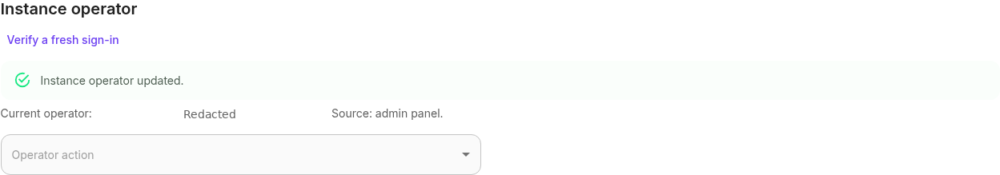
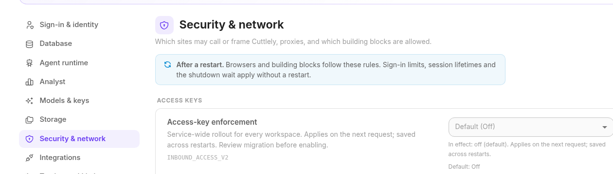

# Designate the instance operator

Use **Admin > Server settings > Instance operator** for first claim and routine operator management. The first claim requires an active, signed-in organization owner plus independent hosting-log proof. Ownership, password sign-in, a bootstrap email, account age and upgrading never designate an operator automatically.

**Automatically eligible:** an active owner with an actual valid host CLI binding written by a build that supports operator binding (planned 1.7.0 onward). Existing private version-1 host bindings remain accepted. **Legacy or unknown accounts:** even a former CLI-password owner needs the one-time panel claim if no binding exists. There is no historical credential-provenance heuristic. The resulting private binding persists across upgrades.

## Onboard an operator

1. Back up the application database, installation encryption key and settings directory. Configure sign-in on the host for a fresh installation. Browser account setup creates an account only; its setup code cannot configure the service or designate an operator.
2. Sign in as the intended active owner and open **Admin > Server settings**. In **Instance operator**, type **CLAIM** and choose **Request host-log code**. Authentication must be within ten minutes. AuthKit owners can choose **Verify a fresh AuthKit sign-in**, which requests active provider authentication and checks the provider's `auth_time`; token refresh alone does not qualify ([WorkOS reauthentication](https://workos.com/docs/authkit/reauthentication)). Local/recovery owners sign in again; Generic OIDC owners use its reauthentication flow. Reauthentication changes the session, so request a new code afterward.
3. Read the code in the deployment's host log (for example the hosting dashboard or `docker compose logs cuttlely`). If you cannot read it, ask the hosting operator for deliberate assistance. The code never appears in the panel, API responses, browser Logs, history or audit. It is printed once and lasts five minutes. Keep it private and do not paste it into reports.
4. Enter the code in the same requesting browser session and confirm the claim. This explicitly designates that account; nothing is inferred from being an owner. Only the bound account inherits service authority. Other owners retain their tenant permissions and cannot see sensitive service configuration/history or operator management controls.



Captured on product 1.6.1 at feature head `5c08b125`, before the 1.7.0 version bump. The operator identity is redacted; access-key enforcement remained Off.

Only one proof is active per installation. Requests have a five-minute cooldown, a limit of four per hour globally and two per hour per user. Wrong attempts are limited globally and per user. Wrong guesses never rotate or consume another requester's valid proof; its correct redemption remains possible after the wrong-attempt cap. A new session must wait for the active proof to expire before requesting another. Codes are bound to purpose, installation, authority generation, authentication epoch, user, session and running database connection. They work once.

## Transfer, disable and rebind in the panel

The current operator can transfer to another active owner in the same organization, or revoke service authority. Each action needs recent authentication and typed **TRANSFER** or **REVOKE** confirmation. Transfer takes effect immediately and the previous account loses service authority. An env-controlled designation is read-only. No operator grant extends access to another organization's resources.

| Managed state                                               | Panel action                                                                                                |
| ----------------------------------------------------------- | ----------------------------------------------------------------------------------------------------------- |
| Unclaimed: no authority file                                | Explicit **CLAIM** with host-log proof                                                                      |
| Active: valid binding, current connection and active owner  | Operator-only transfer or revoke                                                                            |
| Disabled: durable revocation tombstone                      | Separate **RECOVER** confirmation with fresh host-log proof; ordinary claim stays closed                    |
| RecoveryRequired: safe corrupt file or inactive bound owner | Separate **RECOVER** confirmation and fresh host-log proof before replacing authority                       |
| RecoveryRequired: changed database connection               | The previously bound active owner uses **REBIND** with fresh host-log proof after verifying the destination |
| Unsafe/inaccessible file or nobody can sign in              | Host recovery                                                                                               |

A database/path, host, port, database username/password or TLS change invalidates the connection fingerprint. After a database switch/restart, the previous operator signs in to the verified destination and requests **REBIND**. A code from before the change cannot rebind it. Another owner's matching database identity grants nothing. If the previous owner is absent or cannot sign in, use host recovery. Changing the account's sign-in password alone does not change the connection fingerprint.

Revocation writes a tombstone; it never deletes the file or returns the install to ordinary bootstrap. Disabled or corrupt state cannot be erased without explicit recovery proof or deliberate host recovery. Safe recovery replacement is audited. Unsafe files are never replaced from the browser.

## Host file, overrides and revocation

Authority is outside the application DB and generic settings at `settings/instance-operator.json` under `CUTTLELY_DATA_DIR` (or the usual checkout data fallback). Version 2 stores Active/Disabled state, a fresh generation and non-secret correlated audit evidence with the binding. It requires a regular file, no symlink, mode `0600` and the server's effective OS UID on POSIX. A shared host lock and compare-and-swap serialize panel and CLI writers. Missing-file claims use exclusive atomic creation; audit projection failure restores the exact previous authority. An interrupted publication retains its embedded audit evidence. Proof state contains only a verifier/context, never the code.

| `CUTTLELY_INSTANCE_OPERATOR`              | Effective browser authority                                                                     |
| ----------------------------------------- | ----------------------------------------------------------------------------------------------- |
| Entirely unset                            | Valid private managed binding, subject to active owner and database checks                      |
| `none`                                    | Nobody; proof issuance/redemption and every panel lifecycle mutation are disabled               |
| JSON with exactly `userId` and `database` | That explicitly designated active owner, if the connection matches; panel lifecycle is disabled |
| Empty or invalid                          | Nobody; no file fallback, claim or recovery                                                     |

Removing an override reveals the existing managed state, including a prior Active binding. Removing an override is not revocation. Host changes require restart/recreation. All shipped root, directory, queue and worker Compose services preserve present values, including an explicit empty value, and omit an unset override. Recreate using the same Compose file/options with `docker compose up -d --force-recreate`; plain restart keeps the old container environment. Queue workers receive the same policy for configuration parity; this is not a claim of worker HTTP exposure.

For a host JSON recovery override, explicitly select and verify an active owner's exact `user.id`, then run `pnpm settings operator-fingerprint` in the same installation/environment. It prints only the effective connection hash. Set `{"userId":"<existing-user-id>","database":"<64-lowercase-hex-fingerprint>"}` in host configuration with real values. Do not put it in `server.json`, screenshots or shared reports. The npm launcher accepts host configuration through `cuttlely start --env-file <path>`.

## Provisioning failures and recovery

The CLI is emergency recovery when nobody can sign in or the host files are unsafe. Run inside the installed application with the same data mounts, effective database connection and **OS user as the running app**:

```bash
docker compose exec -u node cuttlely pnpm user --email you@example.com --bind-operator
```

For a host shell that runs as root while the data directory belongs to `node`, use:

```bash
setpriv --reuid=node --regid=node --init-groups -- pnpm user --email you@example.com --bind-operator
```

The CLI refuses root before credential changes when the data directory belongs to another user. This addresses the source-confirmed entrypoint/independent-shell UID mismatch; no live hosting-shell UID was measured for this change. Do not relax UID or `0600` checks. If an old root-owned file exists, repair/remove it deliberately on the host as part of recovery. Keep `none` set during repairs if all browser authority must remain closed, then remove that override deliberately when ready.

Bind-only does not change the password. It requires an explicit unambiguous account accepted by the existing CLI rules: active owner, and with local-admin mode off, the selected Super User. If password recovery is needed, omit `--bind-operator`; the password is prompted or read from stdin, never an argument. Successful first-owner creation or active-owner reset also records a host binding. Failed credentials never publish authority. A binding/history failure returns nonzero and explains whether credentials already changed; repair ownership/history/free space and retry bind-only. Host recovery advances authority generation and invalidates older proofs.

Host/database administrators remain trusted. The fingerprint binds connection configuration, not contents: replacing SQLite at the same canonical path, restoring a database at the same connection or changing DNS is not detected. Invalidate sessions and review active accounts/memberships after a trusted restore. Back up authority/tombstones and installation proof identity separately from database/settings backups; deliberately restoring host authority is trusted host administration. Generic settings restore, retry and safe boot never restore or infer an operator or remove a tombstone.

Host settings recovery remains available through `pnpm settings list`, `pnpm settings unset NAME`, `pnpm settings restore` and `CUTTLELY_IGNORE_ADMIN_SETTINGS=1`. These do not write operator authority.

## Scope

The operator boundary covers service database/storage settings, tests, restart, sensitive history, retry/discard/restore, guided AuthKit setup, global sign-in/OIDC and version-history host configuration. API keys and bearer-only requests cannot qualify. Every request checks the current session, active ownership, designation and effective connection. Operator authority grants no cross-organization data access. Tenant roles and organization-scoped SCIM remain separate.

Changing access-key enforcement also requires recent authentication. Access-key enforcement remains default **off**; claiming an operator does not activate it. Host `INBOUND_ACCESS_V2=off` overrides a saved mode. Rehearse the separate [access-key rollout](../reference/access-keys.md#rollout-and-migration) before explicit activation.



This figure is from the same pre-bump capture; operator enrollment did not enable enforcement.
