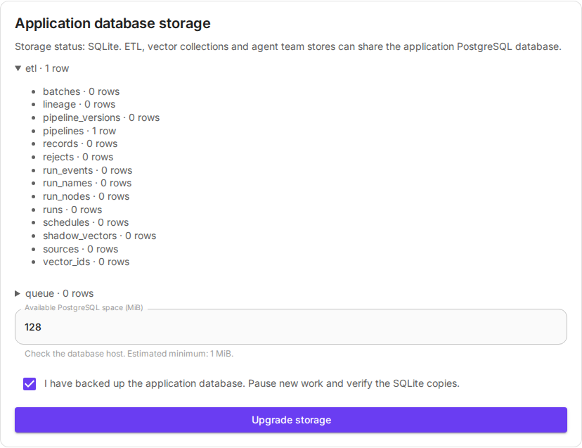

# Move side stores into the application PostgreSQL database

The Instance Operator can move ETL pipelines, incremental state, local vector collections, published and draft agent team conversations, the turn queue, schedules, run history and Dashflows into the configured application PostgreSQL database. Open **Server Settings → Database → Application database storage** to see the source tables and counts. Switching the primary application database offers the same upgrade. The operator starts the copy explicitly.

## Choose a storage mode

| Mode                                   | Durable data                                                                                                                                                              | After loss of the application disk                                                                                                                               |
| -------------------------------------- | ------------------------------------------------------------------------------------------------------------------------------------------------------------------------- | ---------------------------------------------------------------------------------------------------------------------------------------------------------------- |
| SQLite                                 | The volume holds the application database and local files.                                                                                                                | Reattach a persistent volume or restore a complete off-host backup and the original key. An empty replacement cannot recover the installation from SQLite alone. |
| PostgreSQL                             | With application database storage active, PostgreSQL holds accounts, settings, credentials, teams, current and older flow versions, managed files and ETL uploads.        | Supply the same database, installation key and boot settings. The web server and workers rebuild their working directories.                                      |
| Hybrid (PostgreSQL and object storage) | PostgreSQL holds the installation and ETL uploads. A private S3-compatible bucket holds application attachments and generated files managed by the file-storage provider. | Supply the same PostgreSQL settings and key, plus the same bucket, endpoint, region and access. A new instance reads the existing objects.                       |

An older installation using PostgreSQL for application tables and local SQLite or Git files for other features still needs the side-store upgrade. Pointing an existing SQLite installation at S3 preserves only the files already uploaded to the bucket.

ETL source uploads from before migration can be uploaded again. Cuttlely copies verified files whose workspace and pipeline it can identify. If an original source is missing, upload it again in the affected pipeline and rerun that pipeline. PostgreSQL stores new ETL uploads after cutover.

### Analyst workspaces

When moving from SQLite, the first new Analyst SQL query creates an empty, isolated PostgreSQL workspace. Rerun the chatflow or analysis that loaded the source data to rebuild its working tables. Keep the original inputs available for that rerun. PostgreSQL provisioning requires the application login to have `CREATEROLE` and the host to supply the installation encryption key. Existing PostgreSQL Analyst tables remain available across application disk replacement when the same database and key are supplied.

## New PostgreSQL install on a host with ephemeral disks

1. Provision a dedicated, durable PostgreSQL database. Keep its backups outside the application host. Choose PostgreSQL-only unless you need an object bucket for application uploads. Create and configure that bucket before first boot if using hybrid mode.
2. Set the following on the **host** for the web service and each worker. Resolve secrets through the deployment's secret manager. When the database provider requires TLS, supply its CA and verification settings. A connection previously saved in the settings panel cannot bootstrap an empty host.
3. Start one web instance on the empty database. With application database storage enabled and no local legacy data, the first startup activates PostgreSQL storage. Open **Server Settings → Database → Application database storage** as the Instance Operator and verify the PostgreSQL state. Complete first-owner onboarding if this is a new local-password installation.
4. Start workers with the same settings and run the replacement test below before sending production traffic. Workers still need writable temporary directories.

| Required host setting                             | Value or source                                                                                      |
| ------------------------------------------------- | ---------------------------------------------------------------------------------------------------- |
| `DATABASE_TYPE`                                   | `postgres`                                                                                           |
| `DATABASE_HOST`, `DATABASE_PORT`, `DATABASE_NAME` | The dedicated application database endpoint, port and database                                       |
| `DATABASE_USER`, `DATABASE_PASSWORD`              | The installation's database login                                                                    |
| `CUTTLELY_APP_DATABASE_STORES`                    | `1`                                                                                                  |
| `CUTTLELY_SECRETKEY_OVERWRITE`                    | A stable secret, independently backed up. Use the exact original value for an existing installation. |

An existing separate server-settings database still needs its original `CUTTLELY_SERVER_SETTINGS_POSTGRES_URL` and a matching backup. Retain any active rotation configuration, queue service, external runtime settings and identity-provider credentials. [Operator authority and settings](./instance-operator.md#keep-authority-and-settings-when-a-container-is-replaced) · [First owner](./sign-in.md#from-host-configuration).

## Update an existing installation

**Staying on SQLite.** Stop writers, take a consistent off-host backup of the database, key and application directories, update the image or launcher, and reattach the same volume and host settings. Check readiness, sign in with an existing account, open a saved flow and run it. Keep the volume on subsequent upgrades.

**Already using PostgreSQL with local side stores.** Back up the complete database and old volume before changing the host environment. Upgrade the application on that volume. An existing Dashflows PostgreSQL pilot or an application database showing PostgreSQL alone does not establish that team records, files and versions have moved. Follow **Before the upgrade**, resolve each finding, then run **Upgrade storage** with one web instance. After verification, test fresh web and worker directories.

**Already verified on PostgreSQL or hybrid.** Keep the existing host secrets, storage selection, database and bucket bindings through the version update. Back up each durable store and exercise the replacement test. A different bucket or a missing storage flag can prevent the instance from starting. Restore the verified configuration before retrying.

## Move an existing SQLite application before its host is replaced

Run the copy on the original instance while its files are still accessible. On an application service, deploying a new image or changing a host setting may replace that filesystem. Arrange a maintenance window, stop writes and workers, and take an off-instance backup of the original SQLite database, local application files and installation key. Keep the original writers stopped through the cutover.

1. Create an empty PostgreSQL database dedicated to this installation. Supply its connection through `DATABASE_HOST`, `DATABASE_PORT`, `DATABASE_NAME`, `DATABASE_USER`, `DATABASE_PASSWORD` and the existing database TLS options **in the migration process**. These values can be supplied by the host secret manager.
2. From the built checkout on the original instance, run `pnpm storage:copy-application /absolute/path/to/database.sqlite`. The copy keeps the SQLite source intact and commits the PostgreSQL schema and verified application rows together. The source must be current. A populated target, unrecognized table, custom view or trigger, or an unresolved workflow path stops the copy. Resolve each reported dependency in its named live canvas or draft before retrying.
3. Retain the exact existing installation encryption key in the host secret manager. A new random key cannot decrypt old credentials. Configure the application to use the verified target and supply the existing key through `CUTTLELY_SECRETKEY_OVERWRITE`. Follow the host-proof procedure to rebind the instance operator to the new database fingerprint.
4. Start Cuttlely with the original application files available and finish **Application database storage**. Verify that the original account can sign in, team membership and grants are correct, an existing credential decrypts, and the expected flows, conversations and uploaded files can be opened.

**If the original disk disappears during the move**, restore the original files and installation key from the off-instance backup and resume the side-store upgrade. The primary copy alone transfers application tables. Keep the backup through the replacement-instance check.

**After verified cutover**, the recovery check starts a replacement with empty application directories, the same PostgreSQL connection, the host storage settings and the installation key. Exercise the migrated workflows and read their data on that instance before retiring the original disk.

## Optional object storage for uploads

PostgreSQL can hold both the application data and its managed files. Deployments can also use PostgreSQL for accounts, settings, workflows and version history and a private S3-compatible bucket for uploaded files and generated artifacts. ETL panel uploads continue to use the PostgreSQL ETL file store. Configure the same target and installation key on each web and worker host.

In **Server Settings → Storage → File storage**, choose **Amazon S3 or compatible (including IBM Cloud Object Storage)**. Use the bucket's region and name. For IBM COS, enter the HTTPS endpoint for that bucket's location, enable path-style addressing, and supply the HMAC access key and secret through the host secret manager. For AWS, use its regional endpoint or leave the custom endpoint empty, and use the deployment role or scoped credentials. The corresponding host settings are `STORAGE_TYPE=s3`, `S3_STORAGE_BUCKET_NAME`, `S3_STORAGE_REGION`, `S3_ENDPOINT_URL`, `S3_FORCE_PATH_STYLE`, `S3_STORAGE_ACCESS_KEY_ID` and `S3_STORAGE_SECRET_ACCESS_KEY`. Create the private bucket first and use the storage connection test. [IBM S3 API operations](https://cloud.ibm.com/docs/cloud-object-storage?topic=cloud-object-storage-compatibility-api) · [IBM HMAC credentials](https://cloud.ibm.com/docs/cloud-object-storage?topic=cloud-object-storage-uhc-hmac-credentials-main)

For an existing local store, pause writers and copy the durable files to the bucket before cutover. Each current blob uses its organization-relative key, such as `ORG/FLOW/CHAT/FILENAME`. For older layouts, the upgrade resolves the owning organization from the application database and reports the required key. The upgrade reads each destination object and compares its SHA-256 digest against the source. A missing or different object stops the upgrade and names the key. Keep the original files until the empty-disk test passes. Each replacement checks that its bucket, endpoint and region match the recorded target. For files that already lived exclusively in a bucket, retain a bucket inventory or backup and sample existing application attachments before and after replacement. Comparing local source files cannot verify remote-only objects.

## Operator-supplied files

In 1.7.15 the yellow disk-dependency warning can list stock runtime skills and disable **Upgrade storage**. Keep the original disk attached. With the bundled-skill preflight fix, reopen **Application database storage** to refresh the inventory. Files matching the installed bundle are counted under **Temporary data Cuttlely can rebuild**. The skill sync manifest is regenerated. Curator run history and its pause setting reset. Modified files, custom skills, and links still require review. For source installations, run the runtime setup for the updated checkout to generate the reference catalog.

A workflow or runtime plugin can open a local path directly. Move mutable data to a supported durable backend, retire the dependency, or supply immutable files at their expected paths on every instance. For example, ship a custom skill with the image or fetch a pinned object from a private bucket **before starting the web server and worker**. Supply secrets from the host secret manager.

Set `CUTTLELY_HOST_FILE_MANIFEST` on each host to the path of a deployment-managed JSON array. Each entry has a `path` and the lowercase SHA-256 of the file in `sha256`. Use an absolute path for workflow inputs or `runtime/skills/my-skill/SKILL.md` for a file relative to the runtime home. Use regular files. Generate digests from the trusted delivery artifact and retain the manifest independently of application disk. Migration records the required paths in PostgreSQL. Each replacement checks the supplied files before serving work. For a planned content or certificate rotation, redeploy the new file and its updated manifest together. External paths also need the normal workflow access permissions and ETL root configuration.

A workflow using custom code can compute its own paths. An unresolved plugin, mutable file database, browser login profile or local index requires operator review. Keep the old volume or its recoverable backup while moving that dependency. In-flight chats, working memory, caches and the Analyst's current working area can restart empty.

## Before the upgrade

1. Back up the application database and the persistent volume. Check that both backups can be restored. Keep the installation encryption key and operator recovery material with the deployment's protected backups.
2. Enable `CUTTLELY_APP_DATABASE_STORES=1` and restart with the original volume connected. Apply the same database settings to external workers and replicas. On Docker, set the variable on the Compose service. On Render, set it on the service across a deploy with its disk attached. On bare metal, update the service environment and restart the service manager.
3. Leave one application instance running. Stop external workers, other replicas and older binaries or scripts that can write directly to the files. Finish queued runs, active chats and refreshes. Schedules retain their due times during the pause.
4. Inspect the inventory in Server Settings. Verify free space in the PostgreSQL host dashboard or filesystem and enter it in MiB. The estimate reserves twice the source size. PostgreSQL SQL sessions cannot report the hosting volume's available space. The application checks SQLite backup disk space, SQLite versions, active work and the database login's schema privileges.

## Resolve a file-backed dependency

Stop at the inventory while the old instance and its backup are available. Use the workspace, live or draft canvas, node and input in each finding to identify its owner.

| Finding                                                 | Operator action                                                                                                                                                                                                 | Verification                                                                                           |
| ------------------------------------------------------- | --------------------------------------------------------------------------------------------------------------------------------------------------------------------------------------------------------------- | ------------------------------------------------------------------------------------------------------ |
| Application-owned durable state                         | Use the matching migration to copy the data, its identity and its ownership. A missing migration blocks a diskless release.                                                                                     | Read the original object through Cuttlely on a clean instance and verify its content and access rules. |
| Required workflow or plugin file                        | Move the contents to a backend the integration supports and update the binding. A read-only asset can be delivered by the image or host secret manager when the same version is available on every replacement. | Run the workflow from an empty instance using an existing input, checkpoint or conversation.           |
| Unused dependency                                       | The owner can retire the node, draft or plugin after preserving any required data.                                                                                                                              | Rerun preflight across live and draft configurations.                                                  |
| Cache or temporary output                               | Verify that the authoritative input is durable and that the application can regenerate the file.                                                                                                                | Remove the cache in the disposable test instance and exercise the feature.                             |
| Conflicting copies, unknown ownership or missing source | Retain both copies and use a backup, verified checksum and ownership evidence to identify the correct source. Restore a backup if the sole source was lost.                                                     | Repeat the verified copy and recovery test before switching.                                           |

### What a restart rebuilds

The storage screen lists temporary data separately so the operator can continue the migration. A missing node manifest is rebuilt at startup from the installed node packages. A migrated Dashflows query cache starts empty and fills on the next refresh using the configured data source. The first startup or refresh can take longer.

Buffer Memory and Buffer Window Memory read saved chat messages for the same flow and session from the application database on demand. Preserve and verify the message rows during migration. Text still streaming when the process stops can only be recovered up to its last durable write. A SQLite Agent Memory checkpoint can be the only copy of a conversation’s execution state and blocks cutover until resolved. A filename containing `cache`, `buffer` or `.tmp` alone never establishes that its contents can be regenerated.

### Chat sessions after disk loss

The agent runtime keeps its own session database (`state.db`) on the host. When a replacement starts with an empty disk, the runtime creates a fresh database and clients can start a new conversation at the same endpoint. Runtime-only conversation history, in-progress turns and undelivered replies or delegated task results can be lost. An ordinary restart can reuse the database if the disk is still present. The storage inventory lists this database for information and allows cutover. Chat messages already saved to the application PostgreSQL database survive.

## Run and verify

Select **Upgrade storage**. API callers receive HTTP 503 and `Retry-After: 30` during the pause. The server makes private SQLite backups under `side-store-backups/` in the data directory, including committed WAL content. Each logical store copies in a transaction and verifies before cutover. Local vectors keep their binary embeddings. Dashflows uses its existing pilot verifier and rebuilds its disposable query cache. A pilot already serving PostgreSQL continues there.

The report shows per-store results. Ordinary SQLite, MySQL and MariaDB installations keep their existing storage paths. On PostgreSQL, restart the workers and other application instances after verification. Check a known chat, a saved schedule and vector search. Run an unchanged incremental pipeline and check its embedded count is zero. Read-only `*.migrated` files remain beside the original locations. Server Settings reminds the operator after 30 days. The operator backup directory also retains a verified read-only original for each published profile, so deleting a team cannot erase the operator’s retained transcript. Rollback checks profile ownership before it restores a conversation. Remove the retained files explicitly when the rollback window ends.

If a copy stops, restart against the same database and disk. Select **Resume storage upgrade**. An interrupted upgrade stays paused. Cuttlely rechecks the backups, the source contents and any previous copy before finishing. A missing file, unexpected schema, changed source or occupied target requires investigation. The report contains counts and digests. Keep the backups private because they contain the original records.

### Recover earlier flow versions

The upgrade copies the entire local `main` history into the application PostgreSQL database, including the original commit IDs, authors, timestamps, renames and deletions. New versions are stored there as you save. After replacement, Cuttlely rebuilds its local Git checkout from PostgreSQL. Open **Versions**, compare two revisions and restore an older one. Restoring records another version and retains the intervening revisions.

PostgreSQL also stores named Git refs, GitHub sync receipts, the environment selection, and the saved connection's credential reference. A replacement reconstructs them before sync starts. The secret remains in the application credential store. Temporary branch-preview refs are regenerated. Back up the entire PostgreSQL database and keep an independent copy of the installation key.

## Prove that a replacement can serve traffic

Run this rehearsal against an isolated restore before retiring the original volume. Give the test service its own restored database, bucket copy where applicable, and synthetic external endpoints. Keep the originals available. Avoid running schedules or sending notifications to real clients from the rehearsal.

1. Before replacing the test instance, record a known user's team, a flow ID and older revision, an attachment checksum, and the expected result of a read-only tool or pipeline. Confirm that the operator can see the storage upgrade completed. Record the app version.
2. Stop that test instance and its workers. Start a replacement web instance on empty writable application directories using the same test database, original encryption key and verified file settings. Start a separate worker on its own empty directories.
3. Wait for strict readiness at `GET /api/v1/ping`. Sign in as the existing user. Verify team membership, open the saved flow and an older revision, and use a saved credential in a read-only operation. Send a new conversation to the same endpoint.
4. Open the attachment and compare its contents. Exercise a worker job that needs a saved credential and file. With hybrid storage, test reading an existing bucket object and uploading a new one. Rerun a representative ETL pipeline and re-upload any missing legacy source it identifies.
5. Check the settings and operator binding. Record pass/fail for each item. Keep the pre-cutover backups through your rollback window. A successful ping alone cannot verify accounts, encryption keys, history, files or worker access.

## When migration or startup stops

| Symptom                                                                       | Operator action                                                                                                                                                                                                                                                                                        |
| ----------------------------------------------------------------------------- | ------------------------------------------------------------------------------------------------------------------------------------------------------------------------------------------------------------------------------------------------------------------------------------------------------ |
| Source or target schema differs, target is occupied, or counts/digests differ | Keep the original. Verify the destination and available space, review the named tables or objects and retry against a dedicated empty destination for a primary copy.                                                                                                                                  |
| Upgrade is paused or another writer is present                                | Stop other instances and workers. Restore the same source disk and database, then select **Resume storage upgrade**.                                                                                                                                                                                   |
| Replacement asks for the file provider, key, or host manifest                 | Restore the original host settings, key and declared files on both processes. For S3, verify the endpoint, region, bucket and access.                                                                                                                                                                  |
| New service offers first-owner setup for an existing installation             | Stop before creating accounts or saving data. Check the database name, host configuration and backup. Connect to the verified installation.                                                                                                                                                            |
| A legacy web service returns 503 while the primary database is unreachable    | Restore the original database endpoint and check strict readiness. If startup reports that durable settings could not be verified, restart with the same host configuration. A replacement with explicitly configured PostgreSQL settings requires that store and the installation key before startup. |
| Replacement lost the old disk mid-migration                                   | Restore the off-host source backup, including the key. Finish both copies, then repeat the replacement test. A destination holding only the application tables still needs the original side stores.                                                                                                   |
| Operator access requires rebind                                               | Sign in as the previously bound operator on the verified destination and use fresh host proof. [Operator recovery](./instance-operator.md).                                                                                                                                                            |

## Roll back

Finish current work and stop the other instances. On the original volume, confirm the warning and select **Restore retained SQLite files**. The storage rollback is separate from an application version downgrade or switching the primary PostgreSQL database back to SQLite. For a full downgrade, stop writers, preserve post-cutover changes and restore the coordinated pre-upgrade database, original directories, key and prior application image. Storage rollback requires all retained files, their original owner scopes and matching checksums. It restores the pre-upgrade conversations, ETL state and schedules. Writes since the upgrade stay in PostgreSQL archive schemas named `cuttlely_retired_<oid>`. Keep a database backup before separately removing any archive. After rolling back, another upgrade copies the current SQLite contents into fresh targets.

## What still needs the volume

The upgrade copies saved agent teams and verifies their upload storage. Generated runtime profiles and staging files need writable scratch space on each host. Supply operator-authored files as described above. Credentials for external services, remote runtime connectivity and separately hosted databases must remain available after a host replacement. [Disk and settings inventory](../reference/disk-storage-inventory.md)
