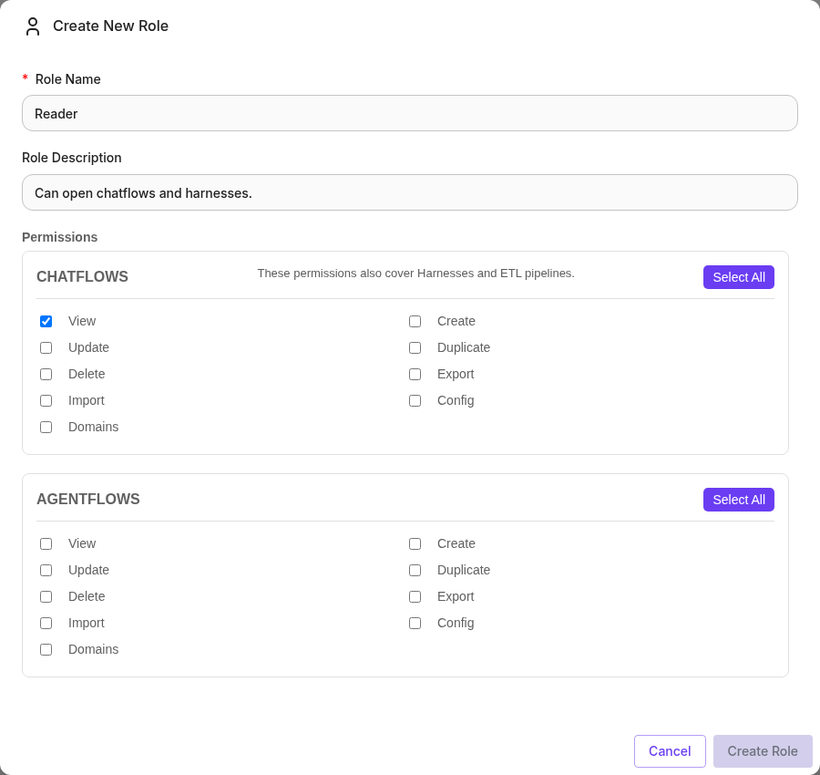
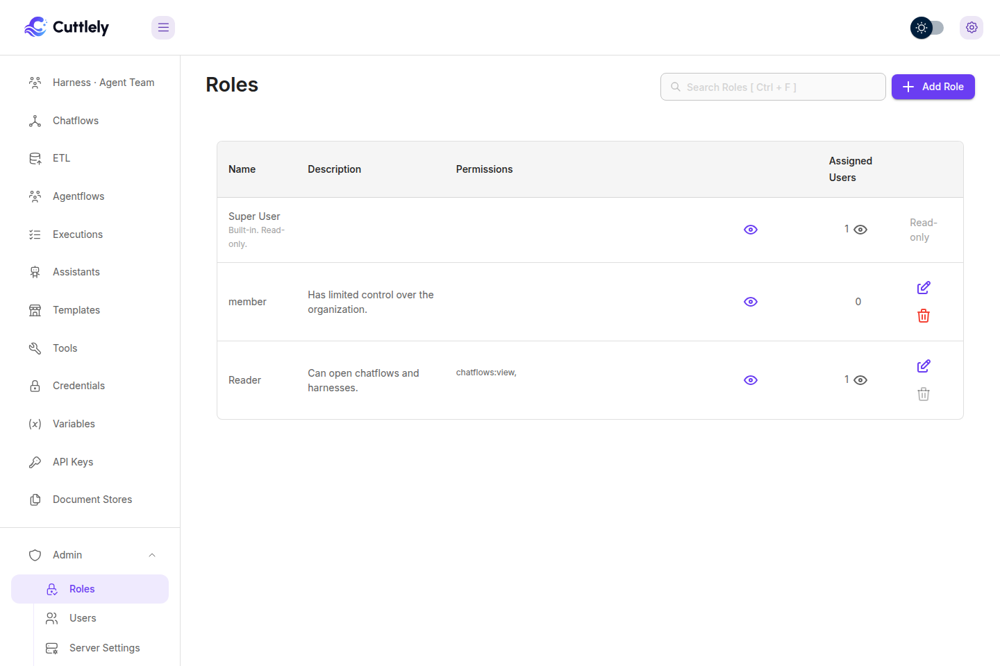
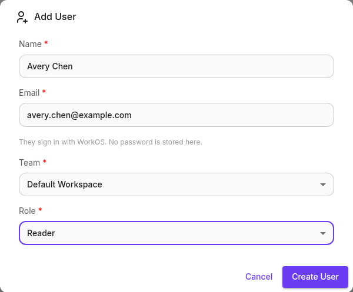
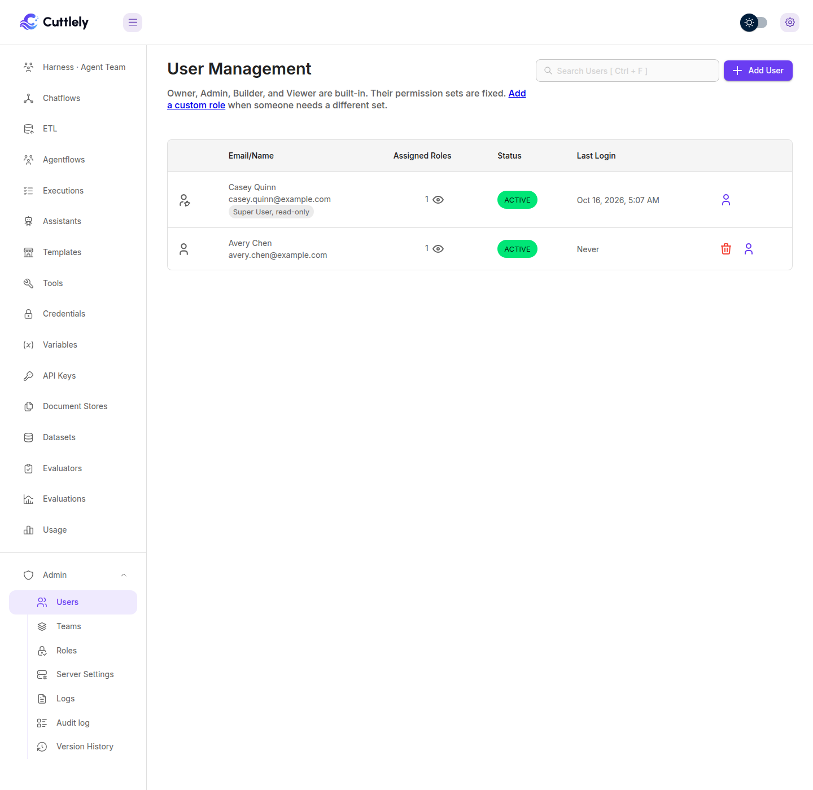

# Roles and permissions

A role is a named list of permission keys. A workspace is a team: chatflows, harnesses, pipelines, credentials, and the other records belong to one team, and the person works in the team that is active. A harness and its runs belong to that one team. The harness routes answer 404 for a harness in another team, the same as a missing harness. Saving a name that another team already uses, or a saved harness that is not in a team yet, answers 409 and does not save that canvas. A chat, webhook, schedule, or embed does not run a harness from another team, or a harness that is not in a team yet. The first account is the organization owner. Everyone else gets a role on a team, and that role is what they can open.

Sign in first. [Sign in](./sign-in.md) creates the owner account.

## Teams

The menu label is **Teams**. The page is `/workspaces`.

The first account creates a team named **Default Workspace**. Records you add stay in the active team. Switch teams from the team control when you belong to more than one.

**Personal Workspace** is a reserved name. The Teams page hides it, and Add User will not place someone there.

To add a team, open **Admin**, then **Teams**, and select **Add Team**. The name cannot be Default Workspace or Personal Workspace. Adding a team uses `workspace:create`. Editing it uses `workspace:update`. Deleting it uses `workspace:delete`. The members page is `/workspace-users/:id`.

## Built-in roles

Three roles are stored with no organization, so every install has them. The Roles page lists two of them.

| Role               | What you see              | What it grants                                                                                                                                                                                                                                                                                              |
| ------------------ | ------------------------- | ----------------------------------------------------------------------------------------------------------------------------------------------------------------------------------------------------------------------------------------------------------------------------------------------------------- |
| owner              | **Super User**, read-only | The organization owner. The Roles page marks it **Built-in. Read-only.** The row created with the first account stores an empty permission list. The account still passes every check, including pages marked `server:owner`, because the role name is owner. You cannot assign Super User to someone else. |
| member             | member                    | The description is "Has limited control over the organization." The permission list is empty. You can assign it. A person with only this role has no key, so the gated pages stay closed.                                                                                                                   |
| personal workspace | Hidden                    | The long permission list stored for that role, including keys the role dialog leaves out. The Roles page does not list it, and you cannot assign it.                                                                                                                                                        |

The owner's own role row, the one tied to the organization, stores an empty permission list. The role name `owner` is what makes the account the organization owner. A second owner row, with no organization, stores the tokens `organization` and `workspace`. Those tokens are not keys in the table below. The Roles page shows the organization's Super User.

## Create a role

Open **Admin**, then **Roles**, or go to `/roles`. You need `roles:manage`. The organization owner has it.

1. Select **Add Role**.
2. Enter a name and a description. The name cannot contain spaces, and it cannot be `owner`, `member`, or `personal workspace`.
3. Check the permissions. The chatflows group also covers harnesses and ETL pipelines. Checking any action in a group also checks that group's View key. Checking a template action other than Marketplace or Custom also checks those two.
4. Select **Create Role**.

The dialog loads its checkboxes from `GET /api/v1/auth/permissions/ROLE`. A key the dialog leaves out cannot be saved on a new role. The eye icon on a row opens that role's permissions. The other eye opens the people assigned to it. **Edit** and the trash icon change or delete a role you created. Super User stays read-only. A role that still has people assigned cannot be deleted.

## Assign a user

Open **Admin**, then **Users**, or go to `/users`. You need `users:manage`.

1. Select **Add User**.
2. Enter a name and an email, then choose a team and a role. Super User is not in the role list. Personal Workspace is not in the team list.
3. Select **Create User**.

Cuttlely stores the person as active, does not send mail, and does not set a password. They sign in with WorkOS using that email. See [Sign in with WorkOS](./sign-in.md#sign-in-with-workos).

The eye on a row lists each team and the role on that team. The trash icon removes the person. You cannot delete the organization owner or your own row.

To change the role on a team, open **Teams**, open the team, and pick another role. That uses `workspace:update`. `workspace:add-user` creates a new user on a team. An email that already has an account is refused. Removing someone from a team uses `workspace:unlink-user`.

## How a check works

The organization owner passes every check. For everyone else, the active team's role supplies the keys.

A page opens when the role holds any key in that page's list. A button on the page uses the same rule. An API route written with one key requires that key. A route written with several keys allows the call when the role holds any one of them.

An API key can carry prediction keys, including dataset, evaluator, and evaluation keys. The API key dialog does not offer workspace, users, roles, or logs keys. Creating or updating a key with a `workspace:` permission or with `logs:view` returns 400. An API key has no user id, so `GET /api/v1/logs` refuses it, and it never passes an owner check.

After sign-in, someone who is not the organization owner opens the first page in this order: Chatflows (`chatflows:view`), Agentflows (`agentflows:view`), Executions (`executions:view`), Assistants (`assistants:view`), Templates (`templates:marketplace` or `templates:custom`), Tools (`tools:view`), Credentials (`credentials:view`), Variables (`variables:view`), API Keys (`apikeys:view`), Document Stores (`documentStores:view`), Datasets (`datasets:view`), Evaluators (`evaluators:view`), Evaluations (`evaluations:view`), Roles (`roles:manage`), Users (`users:manage`), then Teams (`workspace:view`). Chatflows is first. Harnesses and ETL are not separate landing targets. Roles, Users, and Teams stay available on this install when the login snapshot has no feature flags. Logs is not a landing target. Usage is not a landing target. A role whose only matching key is `datasets:view`, `evaluators:view`, or `evaluations:view` opens that page, because the pages before it need other keys.

The table lists every permission key defined in the server and the UI. `scripts/permission-keys.mjs` is that list. `scripts/permission-keys.test.mjs` fails when this table and that list differ, including a key added or removed on only one side, and when a route named here does not check that key.

## Permission keys

The role dialog offers dataset, evaluator, evaluation, and `logs:view` keys. It leaves out `credentials:share`, `templates:custom-share`, `workspace:export`, `workspace:import`, `sso:manage`, `executions:update`, and `server:owner`.

| Key                              | Allows                                                                                                                                                                                                                                                                                                                                | Pages                                                                                                                                                                                                                                                                                                                                                                                                                                              | API routes                                                                                                                                                                                                                                                                                                                                                                                                                                                                                                                                                                                                                                                                                                                                                                                  |
| -------------------------------- | ------------------------------------------------------------------------------------------------------------------------------------------------------------------------------------------------------------------------------------------------------------------------------------------------------------------------------------- | -------------------------------------------------------------------------------------------------------------------------------------------------------------------------------------------------------------------------------------------------------------------------------------------------------------------------------------------------------------------------------------------------------------------------------------------------- | ------------------------------------------------------------------------------------------------------------------------------------------------------------------------------------------------------------------------------------------------------------------------------------------------------------------------------------------------------------------------------------------------------------------------------------------------------------------------------------------------------------------------------------------------------------------------------------------------------------------------------------------------------------------------------------------------------------------------------------------------------------------------------------------- |
| `agentflows:config`              | Open Configuration on an agentflow, including its MCP server settings, and load text-to-speech voices.                                                                                                                                                                                                                                | Agentflow menu                                                                                                                                                                                                                                                                                                                                                                                                                                     | `GET`, `POST`, `PUT`, `DELETE /api/v1/mcp-server/:id`, `POST /api/v1/mcp-server/:id/refresh`, `GET /api/v1/text-to-speech/voices`                                                                                                                                                                                                                                                                                                                                                                                                                                                                                                                                                                                                                                                           |
| `agentflows:create`              | Create an agentflow. Also one of the keys that can save a harness, register a webhook listener, run a custom function, or abort a chat message.                                                                                                                                                                                       | Add on `/agentflows`, and the build menu. The first save of a new agentflow checks `agentflows:create`. Edit Name checks `agentflows:create,agentflows:update`. Use Template on an agentflow template needs `templates:marketplace` or `templates:custom` to open the template, and `agentflows:create` for the button                                                                                                                             | `POST /api/v1/chatflows`, `POST /api/v1/harnesses`, `POST /api/v1/harnesses/:name/runs`, `POST /api/v1/webhook-listener/:id/register`, `GET /api/v1/webhook-listener/:id/stream/:listenerId`, `DELETE /api/v1/webhook-listener/:id/listener/:listenerId`, `POST /api/v1/node-custom-function`, `PUT /api/v1/chatmessage/abort`, `POST /api/v1/node-load-method`                                                                                                                                                                                                                                                                                                                                                                                                                             |
| `agentflows:delete`              | Delete an agentflow, a harness, or the chat messages on one.                                                                                                                                                                                                                                                                          | Delete on the agentflow menu                                                                                                                                                                                                                                                                                                                                                                                                                       | `DELETE /api/v1/chatflows/:id`, `GET /api/v1/chatflows/:id`, `DELETE /api/v1/harnesses/:name`, `DELETE /api/v1/chatmessage`, `POST /api/v1/node-load-method`                                                                                                                                                                                                                                                                                                                                                                                                                                                                                                                                                                                                                                |
| `agentflows:domains`             | Open the allowed-domains action on an agentflow.                                                                                                                                                                                                                                                                                      | Agentflow menu                                                                                                                                                                                                                                                                                                                                                                                                                                     | No API route checks this key.                                                                                                                                                                                                                                                                                                                                                                                                                                                                                                                                                                                                                                                                                                                                                               |
| `agentflows:duplicate`           | Duplicate an agentflow from its menu.                                                                                                                                                                                                                                                                                                 | Agentflow menu                                                                                                                                                                                                                                                                                                                                                                                                                                     | No API route checks this key.                                                                                                                                                                                                                                                                                                                                                                                                                                                                                                                                                                                                                                                                                                                                                               |
| `agentflows:export`              | Export an agentflow from its menu.                                                                                                                                                                                                                                                                                                    | Agentflow menu                                                                                                                                                                                                                                                                                                                                                                                                                                     | No API route checks this key.                                                                                                                                                                                                                                                                                                                                                                                                                                                                                                                                                                                                                                                                                                                                                               |
| `agentflows:import`              | Import an agentflow from its menu.                                                                                                                                                                                                                                                                                                    | Agentflow menu                                                                                                                                                                                                                                                                                                                                                                                                                                     | No API route checks this key.                                                                                                                                                                                                                                                                                                                                                                                                                                                                                                                                                                                                                                                                                                                                                               |
| `agentflows:update`              | Save, publish, roll back, and restore an agentflow, and edit its webhook secret and schedule. A draft of an assistant flow checks `assistants:update` after this gate.                                                                                                                                                                | Publish, draft Save, Review, and Discard draft on the agentflow canvas check `agentflows:update`. Edit Name checks `agentflows:create,agentflows:update`                                                                                                                                                                                                                                                                                           | `PUT /api/v1/chatflows/:id`, `GET /api/v1/chatflows`, webhook secret and schedule routes on `/api/v1/chatflows/:id`, `PUT /api/v1/flow-drafts/:chatflowId`, `DELETE /api/v1/flow-drafts/:chatflowId`, `POST /api/v1/flow-drafts/:chatflowId/publish`, `POST /api/v1/flow-drafts/:chatflowId/rollback`, `POST /api/v1/flow-drafts/:chatflowId/check`, `DELETE /api/v1/flow-drafts/:chatflowId/check/:checkId`, `PUT /api/v1/flow-drafts/:chatflowId/settings`, `POST /api/v1/flow-versions/:chatflowId/:sha/restore`, `POST /api/v1/webhook-listener/:id/register`, `GET /api/v1/webhook-listener/:id/stream/:listenerId`, `DELETE /api/v1/webhook-listener/:id/listener/:listenerId`, `POST /api/v1/node-custom-function`, `PUT /api/v1/chatmessage/abort`, `POST /api/v1/node-load-method` |
| `agentflows:view`                | Open agentflows, their canvases, drafts, messages, and version history. Older V1 agentflows use the same key. A draft of an assistant flow checks `assistants:view` after this gate. Either this key or `chatflows:view` opens Usage. Add to test set, and Add rated answers to test set, on an agentflow answer also check this key. | `/agentflows`, `/agentcanvas`, `/agentcanvas/:id`, `/v2/agentcanvas`, `/v2/agentcanvas/:id`, `/versions/:chatflowId/:sha`, `/usage`                                                                                                                                                                                                                                                                                                                | `GET /api/v1/chatflows`, `GET /api/v1/harnesses`, `GET /api/v1/harnesses/:name`, `GET /api/v1/harnesses/:name/runs`, `GET /api/v1/flow-drafts/:chatflowId`, `GET /api/v1/flow-versions/status`, `GET /api/v1/flow-versions/:chatflowId`, `GET /api/v1/chatmessage`, `GET /api/v1/internal-chatmessage`, `POST /api/v1/node-load-method`, `GET /api/v1/stats/usage`, `POST /api/v1/datasets/rows/from-message`, `POST /api/v1/datasets/rows/from-ratings`                                                                                                                                                                                                                                                                                                                                    |
| `apikeys:create`                 | Create an API key, and update one.                                                                                                                                                                                                                                                                                                    | Add on `/apikey`                                                                                                                                                                                                                                                                                                                                                                                                                                   | `POST /api/v1/apikey`, `PUT /api/v1/apikey/:id`, `GET /api/v1/auth/permissions/API_KEY`                                                                                                                                                                                                                                                                                                                                                                                                                                                                                                                                                                                                                                                                                                     |
| `apikeys:delete`                 | Delete an API key.                                                                                                                                                                                                                                                                                                                    | Trash icon on `/apikey`                                                                                                                                                                                                                                                                                                                                                                                                                            | `DELETE /api/v1/apikey/:id`                                                                                                                                                                                                                                                                                                                                                                                                                                                                                                                                                                                                                                                                                                                                                                 |
| `apikeys:update`                 | Update an API key.                                                                                                                                                                                                                                                                                                                    | Edit on `/apikey`                                                                                                                                                                                                                                                                                                                                                                                                                                  | `PUT /api/v1/apikey/:id`                                                                                                                                                                                                                                                                                                                                                                                                                                                                                                                                                                                                                                                                                                                                                                    |
| `apikeys:view`                   | Open the API key list.                                                                                                                                                                                                                                                                                                                | `/apikey`                                                                                                                                                                                                                                                                                                                                                                                                                                          | `GET /api/v1/apikey`, `GET /api/v1/auth/permissions/API_KEY`                                                                                                                                                                                                                                                                                                                                                                                                                                                                                                                                                                                                                                                                                                                                |
| `assistants:create`              | Create an assistant, an assistant vector store, or upload assistant files.                                                                                                                                                                                                                                                            | Add on `/assistants`, `/assistants/custom`, `/assistants/openai`                                                                                                                                                                                                                                                                                                                                                                                   | `POST /api/v1/assistants`, `PUT /api/v1/assistants/:id`, `POST /api/v1/openai-assistants-vector-store`, `PUT /api/v1/openai-assistants-vector-store/:id`, `POST /api/v1/openai-assistants-file/upload`                                                                                                                                                                                                                                                                                                                                                                                                                                                                                                                                                                                      |
| `assistants:delete`              | Delete an assistant, an assistant vector store, or the chat messages on an assistant flow.                                                                                                                                                                                                                                            | Delete on the assistant pages                                                                                                                                                                                                                                                                                                                                                                                                                      | `DELETE /api/v1/assistants/:id`, `DELETE /api/v1/openai-assistants-vector-store/:id`, `DELETE /api/v1/chatflows/:id`, `DELETE /api/v1/chatmessage`                                                                                                                                                                                                                                                                                                                                                                                                                                                                                                                                                                                                                                          |
| `assistants:update`              | Edit an assistant or its vector store and files. Also the key a draft save checks when the flow type is an assistant.                                                                                                                                                                                                                 | Edit on the assistant pages                                                                                                                                                                                                                                                                                                                                                                                                                        | `PUT /api/v1/assistants/:id`, `PUT /api/v1/openai-assistants-vector-store/:id`, `POST /api/v1/openai-assistants-file/upload`, and the draft save path in the flow-drafts controller                                                                                                                                                                                                                                                                                                                                                                                                                                                                                                                                                                                                         |
| `assistants:view`                | Open assistants and read an assistant vector store. Also the key a draft read checks when the flow type is an assistant. Add to test set, and Add rated answers to test set, on an assistant answer also check this key.                                                                                                              | `/assistants`, `/assistants/custom`, `/assistants/custom/:id`, `/assistants/openai`                                                                                                                                                                                                                                                                                                                                                                | `GET /api/v1/assistants`, `GET /api/v1/assistants/:id`, `GET /api/v1/openai-assistants`, `GET /api/v1/openai-assistants-vector-store`, and the draft read path in the flow-drafts controller, `POST /api/v1/datasets/rows/from-message`, `POST /api/v1/datasets/rows/from-ratings`                                                                                                                                                                                                                                                                                                                                                                                                                                                                                                          |
| `chatflows:config`               | Open Configuration on a chatflow, including its MCP server settings, and load text-to-speech voices. Harnesses and ETL pipelines use the chatflow keys.                                                                                                                                                                               | Chatflow menu                                                                                                                                                                                                                                                                                                                                                                                                                                      | `GET`, `POST`, `PUT`, `DELETE /api/v1/mcp-server/:id`, `POST /api/v1/mcp-server/:id/refresh`, `GET /api/v1/text-to-speech/voices`                                                                                                                                                                                                                                                                                                                                                                                                                                                                                                                                                                                                                                                           |
| `chatflows:create`               | Create a chatflow, harness, or ETL pipeline, run Try the demo, and start an ETL run, upload, or schedule.                                                                                                                                                                                                                             | Add on `/chatflows`, `/harnesses`, and `/etl`, Try the demo, and the build menu. The first save of a new chatflow, harness, or ETL pipeline checks `chatflows:create`. Edit Name on `/canvas`, `/harnesscanvas`, and `/etlcanvas` checks `chatflows:create,chatflows:update`. Use Template on a chatflow, harness, or ETL template needs `templates:marketplace` or `templates:custom` to open the template, and `chatflows:create` for the button | `POST /api/v1/chatflows`, `POST /api/v1/harnesses`, `POST /api/v1/harnesses/:name/runs`, `POST /api/v1/demo`, `GET /api/v1/demo`, write routes under `/api/v1/etl`, `POST /api/v1/webhook-listener/:id/register`, `POST /api/v1/node-custom-function`, `PUT /api/v1/chatmessage/abort`, `POST /api/v1/node-load-method`, `GET` and `POST /api/v1/openai-realtime`                                                                                                                                                                                                                                                                                                                                                                                                                           |
| `chatflows:delete`               | Delete a chatflow or a harness, and delete chat messages.                                                                                                                                                                                                                                                                             | Delete on the chatflow menu                                                                                                                                                                                                                                                                                                                                                                                                                        | `DELETE /api/v1/chatflows/:id`, `GET /api/v1/chatflows/:id`, `DELETE /api/v1/harnesses/:name`, `DELETE /api/v1/chatmessage`, `POST /api/v1/node-load-method`, `GET` and `POST /api/v1/openai-realtime`                                                                                                                                                                                                                                                                                                                                                                                                                                                                                                                                                                                      |
| `chatflows:domains`              | Open the allowed-domains action on a chatflow.                                                                                                                                                                                                                                                                                        | Chatflow menu                                                                                                                                                                                                                                                                                                                                                                                                                                      | No API route checks this key.                                                                                                                                                                                                                                                                                                                                                                                                                                                                                                                                                                                                                                                                                                                                                               |
| `chatflows:duplicate`            | Duplicate a chatflow from its menu.                                                                                                                                                                                                                                                                                                   | Chatflow menu                                                                                                                                                                                                                                                                                                                                                                                                                                      | No API route checks this key.                                                                                                                                                                                                                                                                                                                                                                                                                                                                                                                                                                                                                                                                                                                                                               |
| `chatflows:export`               | Export a chatflow from its menu.                                                                                                                                                                                                                                                                                                      | Chatflow menu                                                                                                                                                                                                                                                                                                                                                                                                                                      | No API route checks this key.                                                                                                                                                                                                                                                                                                                                                                                                                                                                                                                                                                                                                                                                                                                                                               |
| `chatflows:import`               | Import a chatflow from its menu.                                                                                                                                                                                                                                                                                                      | Import on `/chatflows`                                                                                                                                                                                                                                                                                                                                                                                                                             | No API route checks this key.                                                                                                                                                                                                                                                                                                                                                                                                                                                                                                                                                                                                                                                                                                                                                               |
| `chatflows:update`               | Save, publish, roll back, and restore a chatflow, edit a harness, and change ETL runs and schedules.                                                                                                                                                                                                                                  | Publish, draft Save, Review, and Discard draft on `/canvas`, `/harnesscanvas`, and `/etlcanvas` check `chatflows:update`. Edit Name checks `chatflows:create,chatflows:update`                                                                                                                                                                                                                                                                     | `PUT /api/v1/chatflows/:id`, `GET /api/v1/chatflows`, webhook secret and schedule routes on `/api/v1/chatflows/:id`, the flow-drafts write routes, `POST /api/v1/flow-versions/:chatflowId/:sha/restore`, harness save and run, ETL write routes, webhook-listener routes, `POST /api/v1/node-custom-function`, `PUT /api/v1/chatmessage/abort`, `GET /api/v1/chatmessage`, `PATCH /api/v1/upsert-history`, `POST /api/v1/node-load-method`, `GET` and `POST /api/v1/openai-realtime`                                                                                                                                                                                                                                                                                                       |
| `chatflows:view`                 | Open chatflows, harnesses, and ETL pipelines, including canvases, messages, drafts, runs, and version history. Either this key or `agentflows:view` opens Usage. Add to test set, and Add rated answers to test set, on a chatflow, harness, or pipeline answer also check this key.                                                  | `/chatflows`, `/harnesses`, `/harnesses/:name`, `/etl`, `/canvas`, `/canvas/:id`, `/harnesscanvas`, `/harnesscanvas/:id`, `/etlcanvas`, `/etlcanvas/:id`, `/versions/:chatflowId/:sha`, `/usage`                                                                                                                                                                                                                                                   | `GET /api/v1/chatflows`, `GET /api/v1/harnesses`, `GET /api/v1/etl/pipelines`, `GET /api/v1/demo`, `GET /api/v1/flow-drafts/:chatflowId`, `GET /api/v1/flow-versions/status`, `GET /api/v1/flow-versions/:chatflowId`, `GET /api/v1/chatmessage`, `GET /api/v1/internal-chatmessage`, `GET /api/v1/upsert-history`, `POST /api/v1/node-load-method`, `GET` and `POST /api/v1/openai-realtime`, `GET /api/v1/stats/usage`, `POST /api/v1/datasets/rows/from-message`, `POST /api/v1/datasets/rows/from-ratings`                                                                                                                                                                                                                                                                              |
| `credentials:create`             | Create a credential, open one credential, reveal it, update it, and refresh its OAuth token.                                                                                                                                                                                                                                          | Add on `/credentials`                                                                                                                                                                                                                                                                                                                                                                                                                              | `POST /api/v1/credentials`, `GET /api/v1/credentials/:id`, `GET /api/v1/credentials/:id/reveal`, `PUT /api/v1/credentials/:id`, `POST /api/v1/oauth2-credential/refresh/:credentialId`                                                                                                                                                                                                                                                                                                                                                                                                                                                                                                                                                                                                      |
| `credentials:delete`             | Delete a credential.                                                                                                                                                                                                                                                                                                                  | Trash icon on `/credentials`                                                                                                                                                                                                                                                                                                                                                                                                                       | `DELETE /api/v1/credentials/:id`                                                                                                                                                                                                                                                                                                                                                                                                                                                                                                                                                                                                                                                                                                                                                            |
| `credentials:share`              | The share control on a credential. The role dialog leaves this key out.                                                                                                                                                                                                                                                               | Share on `/credentials`                                                                                                                                                                                                                                                                                                                                                                                                                            | No API route checks this key. The API-key feature map names it under sharing.                                                                                                                                                                                                                                                                                                                                                                                                                                                                                                                                                                                                                                                                                                               |
| `credentials:update`             | Open one credential, reveal it, update it, and refresh its OAuth token.                                                                                                                                                                                                                                                               | Edit on `/credentials`                                                                                                                                                                                                                                                                                                                                                                                                                             | `GET /api/v1/credentials/:id`, `GET /api/v1/credentials/:id/reveal`, `PUT /api/v1/credentials/:id`, `POST /api/v1/oauth2-credential/refresh/:credentialId`                                                                                                                                                                                                                                                                                                                                                                                                                                                                                                                                                                                                                                  |
| `credentials:view`               | Open the credential list. Reading one credential by id uses create or update.                                                                                                                                                                                                                                                         | `/credentials`                                                                                                                                                                                                                                                                                                                                                                                                                                     | `GET /api/v1/credentials`                                                                                                                                                                                                                                                                                                                                                                                                                                                                                                                                                                                                                                                                                                                                                                   |
| `datasets:create`                | Create a dataset or a row, including saving a chat answer, or the rated answers for a flow, into a dataset from the message viewer.                                                                                                                                                                                                   | Add on `/datasets` and on `/dataset_rows/:id`. Add to test set and Add rated answers to test set are shown, and New dataset does not need `datasets:view`                                                                                                                                                                                                                                                                                          | `POST /api/v1/datasets/set`, `PUT /api/v1/datasets/set/:id`, `POST /api/v1/datasets/rows`, `PUT /api/v1/datasets/rows/:id`, `POST /api/v1/datasets/reorder`, `POST /api/v1/datasets/rows/from-message`, `POST /api/v1/datasets/rows/from-ratings`                                                                                                                                                                                                                                                                                                                                                                                                                                                                                                                                           |
| `datasets:delete`                | Delete a dataset or a row.                                                                                                                                                                                                                                                                                                            | Trash icon on `/datasets` and on `/dataset_rows/:id`                                                                                                                                                                                                                                                                                                                                                                                               | `DELETE /api/v1/datasets/set/:id`, `DELETE /api/v1/datasets/rows/:id`, `PATCH /api/v1/datasets/rows`                                                                                                                                                                                                                                                                                                                                                                                                                                                                                                                                                                                                                                                                                        |
| `datasets:update`                | Update a dataset or a row, including saving a chat answer, or the rated answers for a flow, into a dataset from the message viewer.                                                                                                                                                                                                   | Edit on `/datasets` and on `/dataset_rows/:id`. Add to test set and Add rated answers to test set are shown only together with `datasets:view`                                                                                                                                                                                                                                                                                                     | `PUT /api/v1/datasets/set/:id`, `PUT /api/v1/datasets/rows/:id`, `POST /api/v1/datasets/reorder`, `POST /api/v1/datasets/rows/from-message`, `POST /api/v1/datasets/rows/from-ratings`                                                                                                                                                                                                                                                                                                                                                                                                                                                                                                                                                                                                      |
| `datasets:view`                  | Open Datasets, and load the existing-dataset list in Add to test set. A role with only this view key lands here after sign-in.                                                                                                                                                                                                        | `/datasets`, `/dataset_rows/:id`                                                                                                                                                                                                                                                                                                                                                                                                                   | `GET /api/v1/datasets`, `GET /api/v1/datasets/set/:id`                                                                                                                                                                                                                                                                                                                                                                                                                                                                                                                                                                                                                                                                                                                                      |
| `documentStores:add-loader`      | List document loaders and add one.                                                                                                                                                                                                                                                                                                    | Add loader on a document store                                                                                                                                                                                                                                                                                                                                                                                                                     | `GET /api/v1/document-store/components/loaders`, `POST /api/v1/node-load-method`                                                                                                                                                                                                                                                                                                                                                                                                                                                                                                                                                                                                                                                                                                            |
| `documentStores:create`          | Create a document store, and update one.                                                                                                                                                                                                                                                                                              | Add on `/document-stores`                                                                                                                                                                                                                                                                                                                                                                                                                          | `POST /api/v1/document-store/store`, `PUT /api/v1/document-store/store/:id`, `POST /api/v1/node-load-method`                                                                                                                                                                                                                                                                                                                                                                                                                                                                                                                                                                                                                                                                                |
| `documentStores:delete`          | Delete a document store, and delete a chunk.                                                                                                                                                                                                                                                                                          | Trash icon on `/document-stores`                                                                                                                                                                                                                                                                                                                                                                                                                   | `DELETE /api/v1/document-store/store/:id`, `GET /api/v1/document-store/store/:id`, `DELETE /api/v1/document-store/chunks/:storeId/:loaderId/:chunkId`                                                                                                                                                                                                                                                                                                                                                                                                                                                                                                                                                                                                                                       |
| `documentStores:delete-loader`   | Remove a loader from a document store.                                                                                                                                                                                                                                                                                                | Loader actions on a document store                                                                                                                                                                                                                                                                                                                                                                                                                 | `DELETE /api/v1/document-store/loader/:id/:loaderId`                                                                                                                                                                                                                                                                                                                                                                                                                                                                                                                                                                                                                                                                                                                                        |
| `documentStores:preview-process` | Preview, save, and process chunks.                                                                                                                                                                                                                                                                                                    | Chunk preview on a document store                                                                                                                                                                                                                                                                                                                                                                                                                  | `POST /api/v1/document-store/loader/preview`, `POST /api/v1/document-store/loader/save`, `POST /api/v1/document-store/loader/process/:loaderId`                                                                                                                                                                                                                                                                                                                                                                                                                                                                                                                                                                                                                                             |
| `documentStores:update`          | Update a document store and edit a chunk.                                                                                                                                                                                                                                                                                             | Edit on a document store. Edit Chunk and its Save button check `documentStores:update`                                                                                                                                                                                                                                                                                                                                                             | `PUT /api/v1/document-store/store/:id`, `GET /api/v1/document-store/store/:id`, `PUT /api/v1/document-store/chunks/:storeId/:loaderId/:chunkId`, `DELETE /api/v1/document-store/chunks/:storeId/:loaderId/:chunkId`, `POST /api/v1/node-load-method`                                                                                                                                                                                                                                                                                                                                                                                                                                                                                                                                        |
| `documentStores:upsert-config`   | Upsert a document store, configure its vector store, and clear upsert history.                                                                                                                                                                                                                                                        | Upsert and vector store pages under `/document-stores`                                                                                                                                                                                                                                                                                                                                                                                             | `POST /api/v1/document-store/upsert/:id`, vector-store routes under `/api/v1/document-store/vectorstore`, `GET /api/v1/document-store/components/embeddings`, `GET /api/v1/document-store/components/vectorstore`, `GET /api/v1/document-store/components/recordmanager`, `PATCH /api/v1/upsert-history`                                                                                                                                                                                                                                                                                                                                                                                                                                                                                    |
| `documentStores:view`            | Open document stores, read chunks, and query the vector store.                                                                                                                                                                                                                                                                        | `/document-stores` and the store, chunk, vector, and query pages under it                                                                                                                                                                                                                                                                                                                                                                          | `GET /api/v1/document-store/store`, `GET /api/v1/document-store/store/:id`, `GET /api/v1/document-store/chunks/:storeId/:fileId/:pageNo`, `POST /api/v1/document-store/vectorstore/query`, `POST /api/v1/document-store/generate-tool-desc/:id`, `GET /api/v1/upsert-history`, `POST /api/v1/node-load-method`                                                                                                                                                                                                                                                                                                                                                                                                                                                                              |
| `evaluations:create`             | Create an evaluation or run one again.                                                                                                                                                                                                                                                                                                | Add on `/evaluations`                                                                                                                                                                                                                                                                                                                                                                                                                              | `POST /api/v1/evaluations`, `POST /api/v1/evaluations/run-again/:id`                                                                                                                                                                                                                                                                                                                                                                                                                                                                                                                                                                                                                                                                                                                        |
| `evaluations:delete`             | Delete an evaluation.                                                                                                                                                                                                                                                                                                                 | Trash icon on `/evaluations`                                                                                                                                                                                                                                                                                                                                                                                                                       | `DELETE /api/v1/evaluations/:id`, `PATCH /api/v1/evaluations`                                                                                                                                                                                                                                                                                                                                                                                                                                                                                                                                                                                                                                                                                                                               |
| `evaluations:run`                | Run an evaluation again.                                                                                                                                                                                                                                                                                                              | Run again on `/evaluation_results/:id`                                                                                                                                                                                                                                                                                                                                                                                                             | `POST /api/v1/evaluations/run-again/:id`                                                                                                                                                                                                                                                                                                                                                                                                                                                                                                                                                                                                                                                                                                                                                    |
| `evaluations:update`             | The role dialog offers this key. No page or API route checks it.                                                                                                                                                                                                                                                                      | No page checks this key.                                                                                                                                                                                                                                                                                                                                                                                                                           | No API route checks this key.                                                                                                                                                                                                                                                                                                                                                                                                                                                                                                                                                                                                                                                                                                                                                               |
| `evaluations:view`               | Open Evaluations. A role with only this view key lands here after sign-in, when no earlier page matches.                                                                                                                                                                                                                              | `/evaluations`, `/evaluation_results/:id`                                                                                                                                                                                                                                                                                                                                                                                                          | `GET /api/v1/evaluations`, `GET /api/v1/evaluations/:id`, `GET /api/v1/evaluations/versions/:id`, `GET /api/v1/evaluations/is-outdated/:id`                                                                                                                                                                                                                                                                                                                                                                                                                                                                                                                                                                                                                                                 |
| `evaluators:create`              | Create an evaluator, and update one.                                                                                                                                                                                                                                                                                                  | Add on `/evaluators`                                                                                                                                                                                                                                                                                                                                                                                                                               | `POST /api/v1/evaluators/:id`, `PUT /api/v1/evaluators/:id`                                                                                                                                                                                                                                                                                                                                                                                                                                                                                                                                                                                                                                                                                                                                 |
| `evaluators:delete`              | Delete an evaluator.                                                                                                                                                                                                                                                                                                                  | Trash icon on `/evaluators`                                                                                                                                                                                                                                                                                                                                                                                                                        | `DELETE /api/v1/evaluators/:id`                                                                                                                                                                                                                                                                                                                                                                                                                                                                                                                                                                                                                                                                                                                                                             |
| `evaluators:update`              | Update an evaluator.                                                                                                                                                                                                                                                                                                                  | Edit on `/evaluators`                                                                                                                                                                                                                                                                                                                                                                                                                              | `PUT /api/v1/evaluators/:id`                                                                                                                                                                                                                                                                                                                                                                                                                                                                                                                                                                                                                                                                                                                                                                |
| `evaluators:view`                | Open Evaluators. A role with only this view key lands here after sign-in.                                                                                                                                                                                                                                                             | `/evaluators`                                                                                                                                                                                                                                                                                                                                                                                                                                      | `GET /api/v1/evaluators`, `GET /api/v1/evaluators/:id`                                                                                                                                                                                                                                                                                                                                                                                                                                                                                                                                                                                                                                                                                                                                      |
| `executions:delete`              | Delete executions, and delete schedule trigger logs.                                                                                                                                                                                                                                                                                  | Trash icon on `/executions`                                                                                                                                                                                                                                                                                                                                                                                                                        | `DELETE /api/v1/executions`, `DELETE /api/v1/executions/:id`, `DELETE /api/v1/chatflows/:id/schedule/trigger-logs`                                                                                                                                                                                                                                                                                                                                                                                                                                                                                                                                                                                                                                                                          |
| `executions:update`              | Edit an execution. The role dialog leaves this key out, so a new role cannot grant it. The organization owner passes the check.                                                                                                                                                                                                       | Share and edit on an execution                                                                                                                                                                                                                                                                                                                                                                                                                     | `PUT /api/v1/executions/:id`                                                                                                                                                                                                                                                                                                                                                                                                                                                                                                                                                                                                                                                                                                                                                                |
| `executions:view`                | Open executions.                                                                                                                                                                                                                                                                                                                      | `/executions`                                                                                                                                                                                                                                                                                                                                                                                                                                      | `GET /api/v1/executions`, `GET /api/v1/executions/:id`                                                                                                                                                                                                                                                                                                                                                                                                                                                                                                                                                                                                                                                                                                                                      |
| `logs:view`                      | Open Admin > Logs and read recent server log files. A role can hold this key. Creating or updating an API key with it returns 400. The organization owner can open Logs without this grant.                                                                                                                                           | `/logs`                                                                                                                                                                                                                                                                                                                                                                                                                                            | `GET /api/v1/logs`                                                                                                                                                                                                                                                                                                                                                                                                                                                                                                                                                                                                                                                                                                                                                                          |
| `roles:manage`                   | Open Roles, create, edit, and delete roles, and see who is assigned to a role.                                                                                                                                                                                                                                                        | `/roles`                                                                                                                                                                                                                                                                                                                                                                                                                                           | `GET`, `POST`, `PUT`, `DELETE /api/v1/role`, `GET /api/v1/auth/permissions/ROLE`, `GET /api/v1/workspaceuser` when the query asks for a role                                                                                                                                                                                                                                                                                                                                                                                                                                                                                                                                                                                                                                                |
| `server:owner`                   | Server-wide pages. No role stores this key. The organization owner passes every UI check, and these API routes use that same owner check. The price editor on `/usage` is shown only to the organization owner.                                                                                                                       | `/server-settings`, `/version-history`, `/promote`, `/promote/:id`                                                                                                                                                                                                                                                                                                                                                                                 | `GET /api/v1/server-settings`, `PUT /api/v1/server-settings`, `GET /api/v1/flow-versions/github`, `PUT /api/v1/flow-versions/github`, `DELETE /api/v1/flow-versions/github`, `POST /api/v1/flow-versions/github/push`, `PUT /api/v1/flow-versions/environment`, `GET /api/v1/flow-versions/incoming`, `POST /api/v1/flow-versions/incoming/:chatflowId/promote`, `GET /api/v1/model-prices`, `PUT /api/v1/model-prices`, `DELETE /api/v1/model-prices`                                                                                                                                                                                                                                                                                                                                      |
| `sso:manage`                     | Test and save buttons on the SSO configuration view. That view is not a routed page. The role dialog leaves this key out. A migration removes it from roles that still have it.                                                                                                                                                       | SSO configuration view, not in the menu                                                                                                                                                                                                                                                                                                                                                                                                            | No API route checks this key.                                                                                                                                                                                                                                                                                                                                                                                                                                                                                                                                                                                                                                                                                                                                                               |
| `templates:custom`               | Open My Templates. Either this key or `templates:marketplace` opens the templates page. Use Template on that page also checks `agentflows:create` for an agentflow template, or `chatflows:create` for a chatflow, harness, or ETL template.                                                                                          | `/marketplaces`, `/marketplace/:id`, `/v2/marketplace/:id`                                                                                                                                                                                                                                                                                                                                                                                         | `GET /api/v1/marketplaces/custom`                                                                                                                                                                                                                                                                                                                                                                                                                                                                                                                                                                                                                                                                                                                                                           |
| `templates:custom-delete`        | Delete a custom template.                                                                                                                                                                                                                                                                                                             | Delete on My Templates                                                                                                                                                                                                                                                                                                                                                                                                                             | `DELETE /api/v1/marketplaces/custom/:id`                                                                                                                                                                                                                                                                                                                                                                                                                                                                                                                                                                                                                                                                                                                                                    |
| `templates:custom-share`         | Share a custom template. The role dialog leaves this key out.                                                                                                                                                                                                                                                                         | Share on a custom template                                                                                                                                                                                                                                                                                                                                                                                                                         | No API route checks this key. The API-key feature map names it under sharing.                                                                                                                                                                                                                                                                                                                                                                                                                                                                                                                                                                                                                                                                                                               |
| `templates:flowexport`           | Save a chatflow or agentflow as a template.                                                                                                                                                                                                                                                                                           | Save As Template on the flow menus                                                                                                                                                                                                                                                                                                                                                                                                                 | `POST /api/v1/marketplaces/custom`                                                                                                                                                                                                                                                                                                                                                                                                                                                                                                                                                                                                                                                                                                                                                          |
| `templates:marketplace`          | Open community templates. Either this key or `templates:custom` opens the templates page. Use Template on that page also checks `agentflows:create` for an agentflow template, or `chatflows:create` for a chatflow, harness, or ETL template.                                                                                        | `/marketplaces`, `/marketplace/:id`, `/v2/marketplace/:id`                                                                                                                                                                                                                                                                                                                                                                                         | `GET /api/v1/marketplaces/templates`                                                                                                                                                                                                                                                                                                                                                                                                                                                                                                                                                                                                                                                                                                                                                        |
| `templates:toolexport`           | Save a tool as a template.                                                                                                                                                                                                                                                                                                            | Save as template on a tool                                                                                                                                                                                                                                                                                                                                                                                                                         | `POST /api/v1/marketplaces/custom`                                                                                                                                                                                                                                                                                                                                                                                                                                                                                                                                                                                                                                                                                                                                                          |
| `tools:create`                   | Create a tool or a custom MCP server, and update one.                                                                                                                                                                                                                                                                                 | Add on `/tools`                                                                                                                                                                                                                                                                                                                                                                                                                                    | `POST /api/v1/tools`, `PUT /api/v1/tools/:id`, `POST /api/v1/custom-mcp-servers`, `PUT /api/v1/custom-mcp-servers/:id`, `POST /api/v1/custom-mcp-servers/:id/authorize`                                                                                                                                                                                                                                                                                                                                                                                                                                                                                                                                                                                                                     |
| `tools:delete`                   | Delete a tool or a custom MCP server.                                                                                                                                                                                                                                                                                                 | Trash icon on `/tools`                                                                                                                                                                                                                                                                                                                                                                                                                             | `DELETE /api/v1/tools/:id`, `DELETE /api/v1/custom-mcp-servers/:id`                                                                                                                                                                                                                                                                                                                                                                                                                                                                                                                                                                                                                                                                                                                         |
| `tools:export`                   | Export a tool from its dialog.                                                                                                                                                                                                                                                                                                        | Export on a tool                                                                                                                                                                                                                                                                                                                                                                                                                                   | No API route checks this key.                                                                                                                                                                                                                                                                                                                                                                                                                                                                                                                                                                                                                                                                                                                                                               |
| `tools:update`                   | Update a tool or a custom MCP server.                                                                                                                                                                                                                                                                                                 | Edit on `/tools`                                                                                                                                                                                                                                                                                                                                                                                                                                   | `PUT /api/v1/tools/:id`, `PUT /api/v1/custom-mcp-servers/:id`, `POST /api/v1/custom-mcp-servers/:id/authorize`                                                                                                                                                                                                                                                                                                                                                                                                                                                                                                                                                                                                                                                                              |
| `tools:view`                     | Open tools and custom MCP servers.                                                                                                                                                                                                                                                                                                    | `/tools`                                                                                                                                                                                                                                                                                                                                                                                                                                           | `GET /api/v1/tools`, `GET /api/v1/tools/:id`, `GET /api/v1/custom-mcp-servers`, `GET /api/v1/custom-mcp-servers/:id`                                                                                                                                                                                                                                                                                                                                                                                                                                                                                                                                                                                                                                                                        |
| `users:manage`                   | Open Users, add a person, edit them, and remove them.                                                                                                                                                                                                                                                                                 | `/users`                                                                                                                                                                                                                                                                                                                                                                                                                                           | `GET`, `PUT /api/v1/organizationuser`, `DELETE /api/v1/organizationuser`, `POST /api/v1/account/invite`, `DELETE /api/v1/workspaceuser`, `GET /api/v1/workspaceuser` when the query is not limited to one team or one role                                                                                                                                                                                                                                                                                                                                                                                                                                                                                                                                                                  |
| `variables:create`               | Create a variable, and update one.                                                                                                                                                                                                                                                                                                    | Add on `/variables`                                                                                                                                                                                                                                                                                                                                                                                                                                | `POST /api/v1/variables`, `PUT /api/v1/variables/:id`                                                                                                                                                                                                                                                                                                                                                                                                                                                                                                                                                                                                                                                                                                                                       |
| `variables:delete`               | Delete a variable.                                                                                                                                                                                                                                                                                                                    | Trash icon on `/variables`                                                                                                                                                                                                                                                                                                                                                                                                                         | `DELETE /api/v1/variables/:id`                                                                                                                                                                                                                                                                                                                                                                                                                                                                                                                                                                                                                                                                                                                                                              |
| `variables:update`               | Update a variable.                                                                                                                                                                                                                                                                                                                    | Edit on `/variables`                                                                                                                                                                                                                                                                                                                                                                                                                               | `PUT /api/v1/variables/:id`                                                                                                                                                                                                                                                                                                                                                                                                                                                                                                                                                                                                                                                                                                                                                                 |
| `variables:view`                 | Open variables.                                                                                                                                                                                                                                                                                                                       | `/variables`                                                                                                                                                                                                                                                                                                                                                                                                                                       | `GET /api/v1/variables`                                                                                                                                                                                                                                                                                                                                                                                                                                                                                                                                                                                                                                                                                                                                                                     |
| `workspace:add-user`             | Create a new user on a team. An email that already has an account is refused.                                                                                                                                                                                                                                                         | **Add User** on `/users`, and add on a team                                                                                                                                                                                                                                                                                                                                                                                                        | `POST /api/v1/account/invite`                                                                                                                                                                                                                                                                                                                                                                                                                                                                                                                                                                                                                                                                                                                                                               |
| `workspace:create`               | Add a team.                                                                                                                                                                                                                                                                                                                           | Add on `/workspaces`                                                                                                                                                                                                                                                                                                                                                                                                                               | `POST /api/v1/workspace`                                                                                                                                                                                                                                                                                                                                                                                                                                                                                                                                                                                                                                                                                                                                                                    |
| `workspace:delete`               | Delete a team.                                                                                                                                                                                                                                                                                                                        | Trash icon on `/workspaces`                                                                                                                                                                                                                                                                                                                                                                                                                        | `DELETE /api/v1/workspace/:id`                                                                                                                                                                                                                                                                                                                                                                                                                                                                                                                                                                                                                                                                                                                                                              |
| `workspace:export`               | Export control in the account menu. The role dialog leaves this key out. The menu item also asks for the export feature, which is off on this install, so the item stays hidden.                                                                                                                                                      | Account menu                                                                                                                                                                                                                                                                                                                                                                                                                                       | No API route checks this key.                                                                                                                                                                                                                                                                                                                                                                                                                                                                                                                                                                                                                                                                                                                                                               |
| `workspace:import`               | Import control in the account menu. The role dialog leaves this key out. The menu item also asks for the import feature, which is off on this install, so the item stays hidden.                                                                                                                                                      | Account menu                                                                                                                                                                                                                                                                                                                                                                                                                                       | No API route checks this key.                                                                                                                                                                                                                                                                                                                                                                                                                                                                                                                                                                                                                                                                                                                                                               |
| `workspace:unlink-user`          | Remove a person from a team, and the delete control on Users.                                                                                                                                                                                                                                                                         | Trash icon on `/users` and on a team's members                                                                                                                                                                                                                                                                                                                                                                                                     | `DELETE /api/v1/organizationuser`, `DELETE /api/v1/workspaceuser`                                                                                                                                                                                                                                                                                                                                                                                                                                                                                                                                                                                                                                                                                                                           |
| `workspace:update`               | Edit a team and change a member's role.                                                                                                                                                                                                                                                                                               | Edit on `/workspaces` and on `/workspace-users/:id`                                                                                                                                                                                                                                                                                                                                                                                                | `PUT /api/v1/workspace`, `PUT /api/v1/workspaceuser`                                                                                                                                                                                                                                                                                                                                                                                                                                                                                                                                                                                                                                                                                                                                        |
| `workspace:view`                 | Open Teams and a team's members.                                                                                                                                                                                                                                                                                                      | `/workspaces`, `/workspace-users/:id`                                                                                                                                                                                                                                                                                                                                                                                                              | `GET /api/v1/workspace`, `GET /api/v1/workspaceuser` when the query names a team                                                                                                                                                                                                                                                                                                                                                                                                                                                                                                                                                                                                                                                                                                            |
