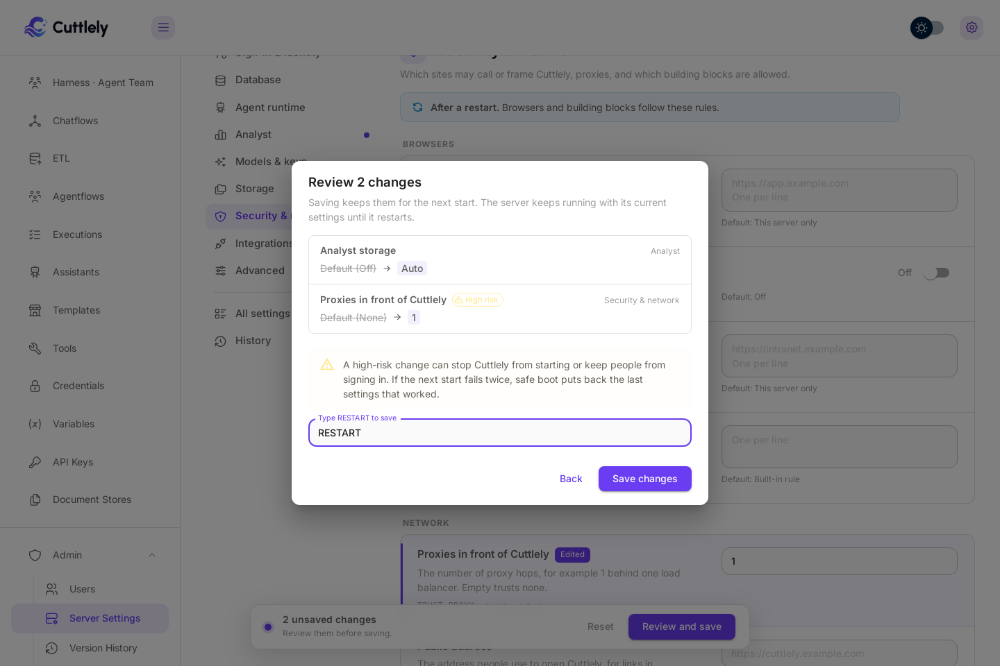
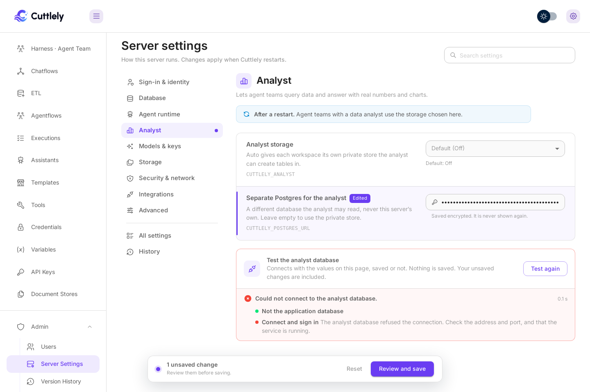
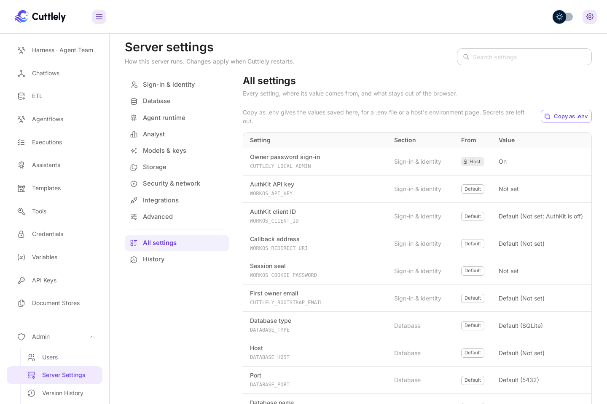
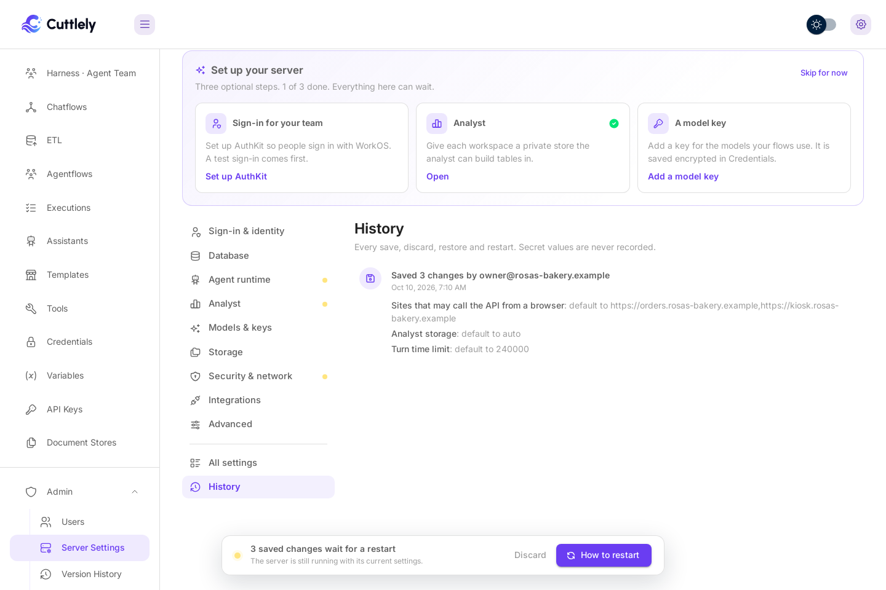

# Server settings

**Admin** > **Server settings** is where the owner changes how this server runs: sign-in, the database, the agent runtime, the analyst, models, file storage, security, integrations and advanced options. You change values on the page, review them, and restart Cuttlely to apply them. Nothing here needs a terminal or a host's environment page.

## Who can open it

Only the owner, the first account (shown as **Super User**), signed in in a browser. Other people don't see the menu item, and the server refuses everyone else, including API keys. Before any account exists the page is closed; see [Sign in](./sign-in.md#create-the-first-account), or [When nobody can sign in yet](./sign-in.md#when-nobody-can-sign-in-yet) for a server with no sign-in method.

## Set up your server

A fresh server shows three optional first steps at the top: **Sign-in for your team** (AuthKit), **Analyst**, and **A model key** (Credentials). Each opens the same section of the page. **Skip for now** hides them; nothing waits on them.

## Change a setting

1. Pick a section on the left, or search. Search matches labels, help text and the variable name.
2. Change the value. Each setting says in plain words what it does, and shows its variable name in small type for reference.
3. The bar at the bottom counts your edits. Select **Review and save**.
4. Review lists each change from old to new. Secrets show only as set, replaced or removed. A change marked **High risk** (it could stop Cuttlely from starting, or keep people from signing in) needs `RESTART` typed before **Save changes** works.
5. Saved changes wait for a restart. Select **Restart now** in the bar.

Every change applies at the next restart. Until then the server keeps running with what it started with, and **Discard** puts the saved file back the way it was at start.

## Where a value comes from

| Order | Source                                                                                                                                                          | On the page                                    |
| ----- | --------------------------------------------------------------------------------------------------------------------------------------------------------------- | ---------------------------------------------- |
| 1     | The host: Docker's `.env` and compose file, Render's **Environment** page or Blueprint, the shell that starts Cuttlely, and `packages/server/.env` from source. | **Locked**, with where to change it            |
| 2     | Server settings, saved in `settings/server.json` in Cuttlely's data folder                                                                                      | Editable                                       |
| 3     | The built-in default                                                                                                                                            | Editable; the default is named under the field |

A blank value counts as not set. A value set by the host always wins, so the page never overrides it.

## Secrets

API keys, passwords and the session seal are write-only. After saving, the field says that a value is saved and never shows it again; type a new one to replace it, or clear it to remove it. They are encrypted with the same key that protects Credentials. They never appear in an answer from the server, the review, History, the log, or **Copy as .env**.

If the encryption key changes, a saved secret shows **Saved, but this server cannot read it**; enter it again. It counts as not set. Starting never fails over it.

## Test connection

**Analyst**, **Storage** and **Models & keys** have a **Test connection** card that tries the values on the page before you save:

-   Analyst: signs in to the separate Postgres and says whether its user is read-only (safer for analyst work).
-   Storage: S3, Google Cloud or Azure find the bucket, write a small test file and remove it again. Without an access key, the S3 test uses the server's own AWS sign-in (for example an instance role), exactly as Cuttlely will.
-   Models: fetches your model list and checks its shape.

Errors come back in plain words, never with a secret in them. Model keys themselves live in **Credentials**; the Models section links there.

## Set up AuthKit

In **Sign-in & identity**, **Set up AuthKit** walks through four steps:

1. **Keys**: the API key and Client ID from WorkOS. Staging or Production is read from the key.
2. **Addresses**: the redirect address, filled in from the address you opened Cuttlely at, plus the sign-out, homepage and sign-in addresses to paste into WorkOS, each with a copy button.
3. **Session seal**: **Generate seal** makes one. Also the first owner email.
4. **Test sign-in**: Cuttlely checks the values (including one read-only call to WorkOS), then opens AuthKit with them. Sign in as yourself and you come straight back. Nothing is saved until the test passes and you select **Save AuthKit settings**.

The password sign-in stays on by default as a backup. It can't be turned off until a test sign-in with these exact AuthKit values has passed.

## Switch database

**Database** shows the database Cuttlely runs on. **Switch database** goes to SQLite or Postgres:

1. Choose SQLite or Postgres, and fill in the connection for Postgres.
2. The test always runs: sign-in, whether Cuttlely can create tables, and whether the database is empty, already holds Cuttlely data, or holds other tables (refused).
3. The dialog says how the owner gets back in afterwards. An empty database is a fresh start, so it needs the password sign-in on or AuthKit with a first owner email.
4. Type `RESTART` to switch. Cuttlely restarts on the new database.

Nothing is copied. Flows, credentials and accounts stay in the old database, and **Switch back** returns to it. A database that already holds Cuttlely data from another server needs that server's encryption key, or its saved credentials won't open; the dialog warns. With Analyst storage on Auto, the analyst's private stores follow the new database.

## Restart

| Install                                                       | What Restart does                                                                                                             |
| ------------------------------------------------------------- | ----------------------------------------------------------------------------------------------------------------------------- |
| Docker, and from source with `bash scripts/start-cuttlely.sh` | Restarts Cuttlely and the agent runtime in place, in the same container or terminal.                                          |
| Render                                                        | Restarts in place inside the running service, with no new deploy. Without the start script, the page shows the steps instead. |
| From source without the start script (for example `pnpm dev`) | The button says **How to restart** and shows the steps: stop Cuttlely and start it again.                                     |
| Queue mode with separate workers                              | Restarts this server; the page reminds you to restart each worker too, so it uses the new settings.                           |

When Cuttlely restarts in place, a full-screen view follows it: the settings it saved, any runs it lets finish, stopping, each start-up step as Cuttlely works through it, and back. **Continue** reloads the page with the new settings. If it takes more than three minutes, the view says so and points you to the server log.

If chats or agent team runs are still answering when you select **Restart now**, Cuttlely asks first. **Let them finish** waits for them, for up to the turn time limit (45 seconds unless `CUTTLELY_HARNESS_TURN_BUDGET_MS` says otherwise), and new runs get a short "restarting" answer meanwhile. **Restart now** stops them.

When Cuttlely cannot restart itself, **How to restart** opens the steps with **Copy steps**, so you can paste them where you keep notes.

## When a setting stops Cuttlely from starting

If two starts in a row don't finish after a change, safe boot puts back the last settings that started and shows a banner. A start that can't open the database with changed settings stops right away instead of running half-started, and the start script tries again, so this takes a few seconds, not a page that never loads. Settings that didn't start never count as the last settings that worked. If you were on the restart screen, it says **The new settings did not start** and **See what changed** opens History. **Try it again** puts the set-aside settings back for the next restart.

From a terminal (in Docker, prefix with `docker compose exec -u node Cuttlely`):

| Command                    | What it does                                                  |
| -------------------------- | ------------------------------------------------------------- |
| `pnpm settings list`       | What is set, and whether it comes from the host or the file   |
| `pnpm settings unset NAME` | Removes one saved setting, for example `CUTTLELY_LOCAL_ADMIN` |
| `pnpm settings restore`    | Goes back to the last settings that started                   |

`CUTTLELY_IGNORE_ADMIN_SETTINGS=1` on the host starts Cuttlely with the saved settings ignored.

## All settings and History

**All settings** lists every setting, where its value comes from and its value (secrets as set or not set), plus the settings that stay out of the browser and why: the encryption key and sign-in secrets, paths and ports, code execution and safety checks, queue workers, start script plumbing, and test-only values. **Copy as .env** copies the values saved here for a `.env` file or a host's environment page; secrets are left out and listed as comments.

**History** keeps every save, discard, restore, test sign-in, rollback and restart: when, who, and which settings, never a secret value.

