# Server settings

**Admin** > **Server Settings** is where the owner changes how this server runs: sign-in, the database, the agent runtime, the analyst, models, file storage, security, integrations, testing and limits, and advanced options. You change values on the page and review them. Runtime limits apply on the next use. The other settings wait for a restart. Nothing here needs a terminal or a host's environment page.

## Who can open it

Only the owner, the first account (shown as **Super User**), signed in in a browser. Other people don't see the menu item, and the server refuses everyone else, including API keys. Before any account exists the page is closed; see [Sign in](./sign-in.md#create-the-first-account), or [When nobody can sign in yet](./sign-in.md#when-nobody-can-sign-in-yet) for a server with no sign-in method.

## Set up your server

A fresh server shows three optional first steps at the top: **Sign-in for your team** (AuthKit), **Analyst**, and **A model key** (Credentials). Each opens the same section of the page. **Skip for now** hides them; nothing waits on them.

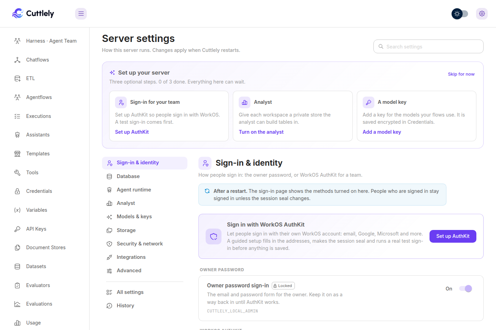

## Change a setting

1. Pick a section on the left, or search. Search matches labels, help text and the variable name.

    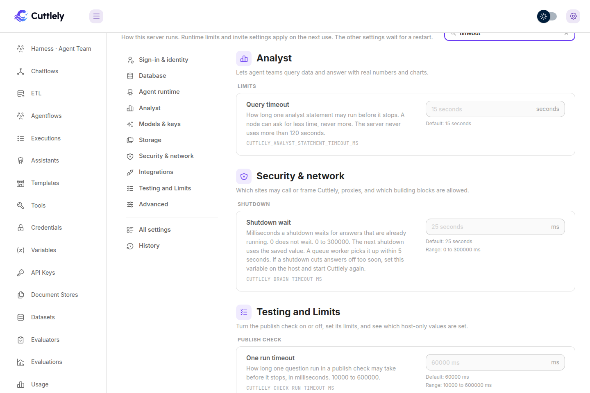

2. Change the value. Each setting says in plain words what it does, and shows its variable name in small type for reference.
3. The bar at the bottom counts your edits. Select **Review and save**.
4. Review lists each change from old to new. Secrets show only as set, replaced or removed. A change marked **High risk** (it could stop Cuttlely from starting, or keep people from signing in) needs `RESTART` typed before **Save changes** works.
5. A runtime limit applies on the next use. Every other saved change waits for a restart. Select **Restart now** in the bar when one still needs it. When this server cannot restart itself, the button says **How to restart**.

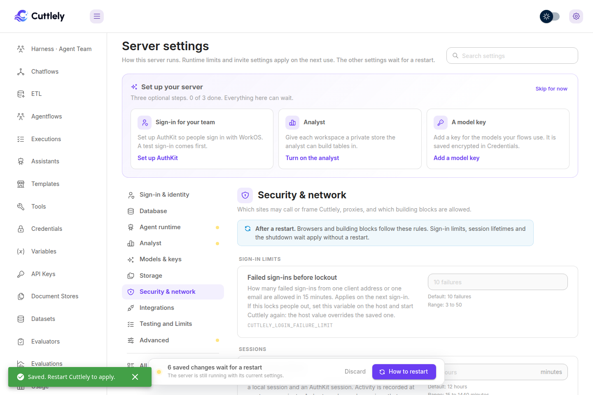

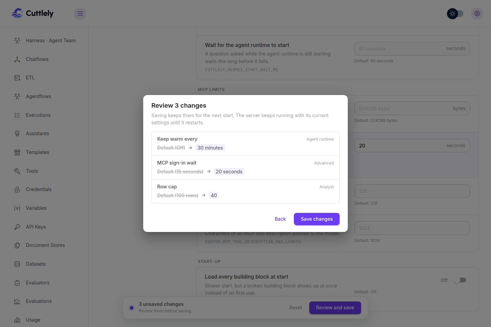

Runtime limits apply on the next use. The other settings apply at the next restart, and until then the server keeps running with what it started with. **Discard** puts the saved file back the way it was at start.

Failed sign-ins before lockout, the idle session lifetime, the absolute session lifetime, and the shutdown wait are runtime limits. A shorter session lifetime ends sessions that are already signed in, on the next request, including an AuthKit session. When AuthKit does not send a session id, those limits use this server's record for that account and a warning is logged. The shutdown wait is 0 to 300000 milliseconds. 0 does not wait. An active session records activity at most once a minute, so using Cuttlely keeps the idle clock moving. A queue worker picks up a saved value within 5 seconds. If one of these locks people out, set the same variable on the host and start Cuttlely again. The host value overrides the saved one. How many settings changes to keep is the exception: on **Security & network**, under **History**, **Settings changes to keep** (`CUTTLELY_HISTORY_KEEP`, 1000, from 100 to 10000) is saved on this page, and that saved value wins over the environment variable. The field shows the number in effect and whether it came from the panel, the environment, or the default. A number outside 100 to 10000 is refused. The field stays editable when the environment sets the variable. [Server settings API](../reference/server-settings-api.md).

## Where a value comes from

| Order | Source                                                                                                                                                          | On the page                                    |
| ----- | --------------------------------------------------------------------------------------------------------------------------------------------------------------- | ---------------------------------------------- |
| 1     | The host: Docker's `.env` and compose file, Render's **Environment** page or Blueprint, the shell that starts Cuttlely, and `packages/server/.env` from source. | **Locked**, with where to change it            |
| 2     | Server settings, saved in `settings/server.json` in Cuttlely's data folder                                                                                      | Editable                                       |
| 3     | The built-in default                                                                                                                                            | Editable; the default is named under the field |

A blank value counts as not set. A value set by the host always wins, so the page never overrides it. A runtime limit is the exception when the host value is outside the range or is not a whole number: that value is ignored and is not clamped. The saved value is used when it is in range, and otherwise the default. The field stays **Locked** until the variable is removed from the host. Invite and mail settings are the other exception: a value saved here overrides the host, the field stays editable, and the change applies to the next invite or message. The mail password is not one of those: it stays in the environment, and the page only shows whether it is set.

`CUTTLELY_FILE_SIZE_LIMIT` is the same limit as the existing upload size variable, and `DISABLE_CUTTLELY_TELEMETRY` is the usage-event switch. When both names of one of those settings are set, the `CUTTLELY_` name is used. The encryption key is not on this page. `CUTTLELY_SECRETKEY_OVERWRITE` is that key's compatibility alias. If it and the existing overwrite variable are both set to different values, Cuttlely refuses to start. `METRICS_PREFIX`, under Metrics, is optional. Empty keeps the metric names this server already publishes.

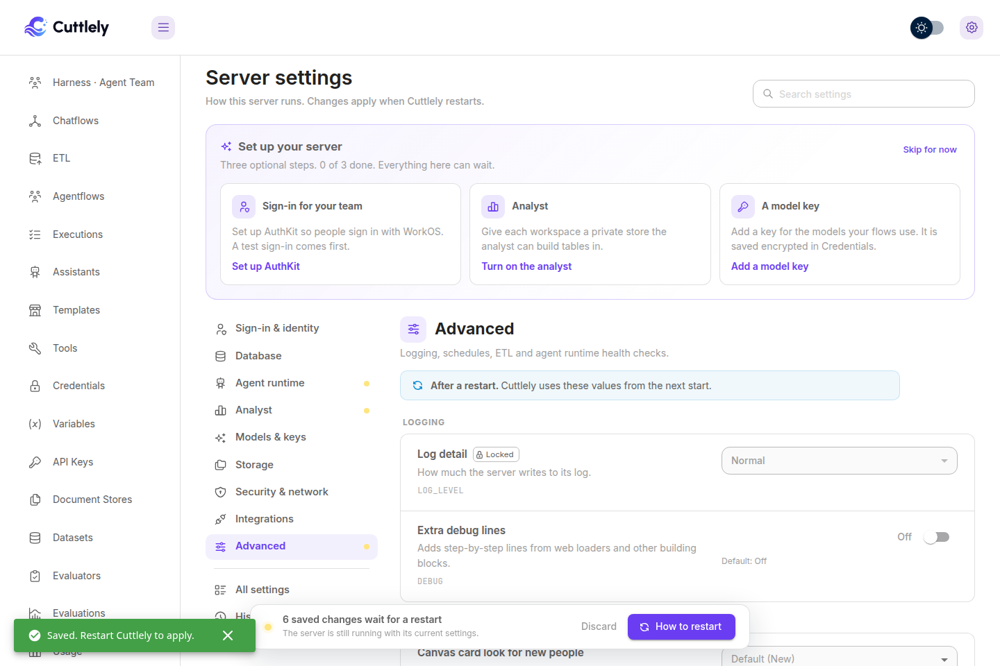

## Secrets

API keys, passwords and the session seal are write-only. After saving, the field says that a value is saved and never shows it again; type a new one to replace it, or clear it to remove it. They are encrypted with the same key that protects Credentials. They never appear in an answer from the server, the review, History, the log, or **Copy as .env**.

If the encryption key changes, a saved secret shows **Saved, but this server cannot read it**; enter it again. It counts as not set. Starting never fails over it.

## Test connection

**Analyst**, **Storage** and **Models & keys** have a **Test connection** card that tries the values on the page before you save:

-   Analyst: signs in to the separate Postgres and says whether its user is read-only (safer for analyst work). **Query previews in the run trace** is on by default. Each analyst query step stores a short table with the run, the same rows that query already returned. Turn it off to leave those values out of new traces. The row count can still show. Restart to apply.
-   Storage: S3, Google Cloud or Azure find the bucket, write a small test file and remove it again. Without an access key, the S3 test uses the server's own AWS sign-in (for example an instance role), exactly as Cuttlely will.
-   Models: fetches your model list and checks its shape.

Errors come back in plain words, never with a secret in them. Model keys themselves live in **Credentials**; the Models section links there.

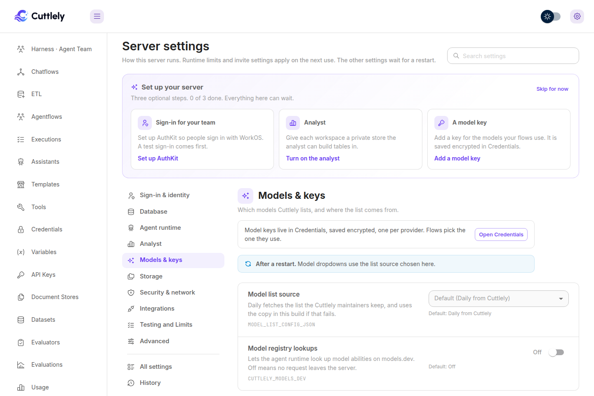

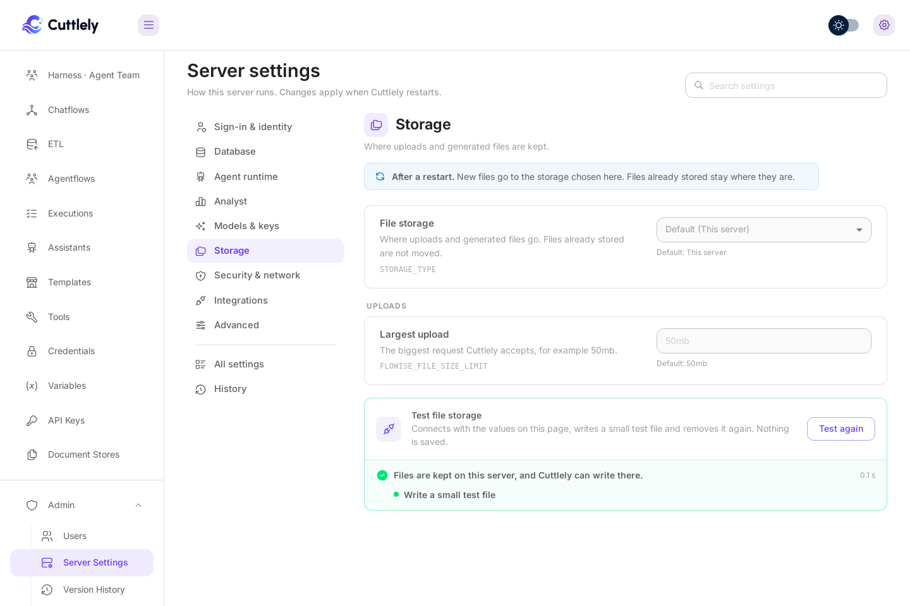

## Analyst limits

**Analyst** also sets how much one query may return and how long it may run. Both apply the next time the server starts. A host value above the maximum is treated as the maximum. A query timeout below 1 second is raised to 1 second. Zero, a negative number, or text that is not a number counts as unset, so the default applies, and the server logs that once.

| Setting           | Variable                                | Default    | Range            |
| ----------------- | --------------------------------------- | ---------- | ---------------- |
| **Row cap**       | `CUTTLELY_ANALYST_ROW_CAP`              | 100 rows   | 1 to 1000 rows   |
| **Query timeout** | `CUTTLELY_ANALYST_STATEMENT_TIMEOUT_MS` | 15 seconds | 1 to 120 seconds |

The row cap is the page size. A lower cap puts fewer rows into the specialist's prompt and into the handoff Harness Prime reads, so the turn uses less context. Say `show more` for the next page. The rows stay in the database.

The query timeout stops a statement that runs too long, on the private store and on a Postgres URL. A PostgreSQL MCP node can set a lower **Row cap** or a shorter **Query timeout (seconds)** under **Additional Parameters**. Those fields cannot go above the values here. Leave them empty to use these settings. [Analyst mode](./analyst.md#safety).

## Testing and Limits

**Testing and Limits** holds the publish check, its limits, and the rated-answer caps. **Publish check** is on unless you turn it off. The switch is `CUTTLELY_PUBLISH_CHECK`. A number shows its unit and its range. When the host set the variable, the field shows a lock and **Set by the host**, and this page cannot change it. Below those fields, **Set by the host** lists the values that stay on the host. Each row is **Set** or **Not set**. The value is not shown.

The picture is from a local demo install. The account is a made-up owner. It shows no chat text, no token, and no host name.

The full list of startup options, with the default, the range, where each one can be set, and whether a restart is needed, is [Startup options](../reference/startup-options.md). Secret values and host-only values are named and marked not shown.

## Limits that apply immediately

These limits are read on each use. A saved change applies to the next check, import, or page load. A restart is not required. The host value wins when it is a whole number inside the range. A host value outside the range, or that is not a whole number, is ignored. It is not clamped. The saved value is used when it is in range, and otherwise the default. The field stays locked until that variable is removed from the host. On **Testing and Limits** the chip says **Set by the host**. Other sections say **Locked**. A value outside the range is refused when you save it on this page. An in-range host value on a pair is kept and is not loosened so the other side can fit. That other setting falls back through its saved value, then its default. If none of those fit, it is bounded by the host value. A host question cap of 1 makes the question default 1. A host rating scan of 300 makes the rated-answer import cap 300. When both sides are host values and they conflict, the host cap is kept and the other side uses the first saved or default candidate that fits. `bounded` applies only when no candidate fits. The page marks that setting **Limited by** the host variable, for example Limited by `CUTTLELY_CHECK_COUNT_MAX`. It is not Locked unless that same variable is also set on the host, so it can still be edited here. `pnpm settings list` prints source `bounded` and that same line. The review step says these limits apply on the next use when every change is one of them. When the review also changes a setting that waits for a restart, it says the limits apply now and the rest apply at restart.

The question count default cannot be above the question cap. The rating scan must be at least the rated-answer import cap. Saving a pair that breaks either rule is refused.

| Setting                      | Variable                         | Default       | Range                                      |
| ---------------------------- | -------------------------------- | ------------- | ------------------------------------------ |
| **Publish check**            | `CUTTLELY_PUBLISH_CHECK`         | On            | on or off                                  |
| **Publish check token cap**  | `CUTTLELY_CHECK_MAX_TOKENS`      | 100000 tokens | 1000 to 2000000 tokens                     |
| **Publish check time limit** | `CUTTLELY_CHECK_MAX_SECONDS`     | 180 seconds   | 10 to 1800 seconds                         |
| **Questions at once**        | `CUTTLELY_CHECK_CONCURRENCY`     | 2             | 1 to 8                                     |
| **One run timeout**          | `CUTTLELY_CHECK_RUN_TIMEOUT_MS`  | 60000 ms      | 10000 to 600000 ms                         |
| **Keep a finished check**    | `CUTTLELY_CHECK_KEEP_MINUTES`    | 30 minutes    | 5 to 1440 minutes                          |
| **Question cap**             | `CUTTLELY_CHECK_COUNT_MAX`       | 100           | 1 to 500                                   |
| **Questions by default**     | `CUTTLELY_CHECK_COUNT_DEFAULT`   | 4             | 1 to the question cap                      |
| **Messages scanned**         | `CUTTLELY_CHECK_SCAN_CAP`        | 2000          | 500 to 20000                               |
| **Harness turns scanned**    | `CUTTLELY_HARNESS_TURN_SCAN_CAP` | 2000          | 500 to 5000                                |
| **Rated answers added**      | `CUTTLELY_RATING_IMPORT_CAP`     | 500           | 50 to 5000                                 |
| **Ratings scanned**          | `CUTTLELY_RATING_SCAN_CAP`       | 1000          | at least the import cap, and at most 20000 |
| **Page loads a minute**      | `CUTTLELY_UI_PAGE_LIMIT_MAX`     | 3000          | 100 to 50000                               |

**Page loads a minute** is also the per-client budget for sign-in, API-key check, OAuth, MCP server, and icon requests. Each of those routes keeps its own count, so loading the canvas icons does not use up sign-in.

The routes are in the [Server settings API](../reference/server-settings-api.md). Publish check behaviour is in [History settings](../reference/versioning-settings.md#publish-check-limits).

## Invite and reset

**Sign-in & identity** sets invite and reset links and the mail used to send them. A saved value overrides the environment. The next invite, reset, or message uses it. A restart is not required. The field stays editable when the environment also sets it.

A lifetime outside the range is refused on this page. An environment value below the minimum is raised to the minimum, and one above the maximum is lowered to the maximum. A blank, zero, negative, or non-integer environment value is ignored. The saved value is used when it is usable, and otherwise the default.

| Setting                  | Variable                              | Default            | Range or values                                  |
| ------------------------ | ------------------------------------- | ------------------ | ------------------------------------------------ |
| **Invite link lifetime** | `INVITE_TOKEN_EXPIRY_IN_HOURS`        | 72 hours           | 1 to 168 hours                                   |
| **Reset link lifetime**  | `PASSWORD_RESET_TOKEN_EXPIRY_IN_MINS` | 60 minutes         | 5 to 1440 minutes                                |
| **Invite delivery**      | `INVITE_DELIVERY`                     | Follow the request | Follow the request, Copy link, or Email          |
| **Mail server**          | `SMTP_HOST`                           | Not set            | The SMTP host                                    |
| **Mail port**            | `SMTP_PORT`                           | 587                | 1 to 65535                                       |
| **Mail TLS**             | `SMTP_SECURE`                         | Off                | On opens TLS immediately. Port 465 does that too |
| **Mail user**            | `SMTP_USER`                           | Not set            | The SMTP account name                            |
| **Sender address**       | `SENDER_EMAIL`                        | Not set            | One email address                                |

**Invite delivery** applies when `POST /api/v1/account/invite` omits `link`. Follow the request keeps the previous response, an id only. Copy link returns the one-time URL. Email sends it and does not return it. A request that sets `link` still wins. Reset links are unchanged: omitting `link` returns the URL.

**Mail password** (`SMTP_PASSWORD`) stays in the environment. The invite field shows **Set** or **Not set** and does not accept a value. The same key is on the read-only status list as `env` when it is set and `unset` when it is not. That row does not include the password. `SMTP_STARTTLS` stays in the environment too. Mail is configured when the mail server and the sender address are both set. The sign-in page still has no Forgot password form.

`pnpm settings list` prints the effective value and whether it came from the panel, the host, or the default. The password is `(set, hidden)` or `(not set)`.

## Set up AuthKit

In **Sign-in & identity**, **Set up AuthKit** walks through four steps:

1. **Keys**: the API key and Client ID from WorkOS. Staging or Production is read from the key.
2. **Addresses**: the redirect address, filled in from the address you opened Cuttlely at, plus the sign-out, homepage and sign-in addresses to paste into WorkOS, each with a copy button.
3. **Session seal**: **Generate seal** makes one. Also the first owner email.
4. **Test sign-in**: Cuttlely checks the values (including one read-only call to WorkOS), then opens AuthKit with them. Sign in as yourself and you come straight back. Nothing is saved until the test passes and you select **Save AuthKit settings**.

The password sign-in stays on by default as a backup. It can't be turned off until a test sign-in with these exact AuthKit values has passed.

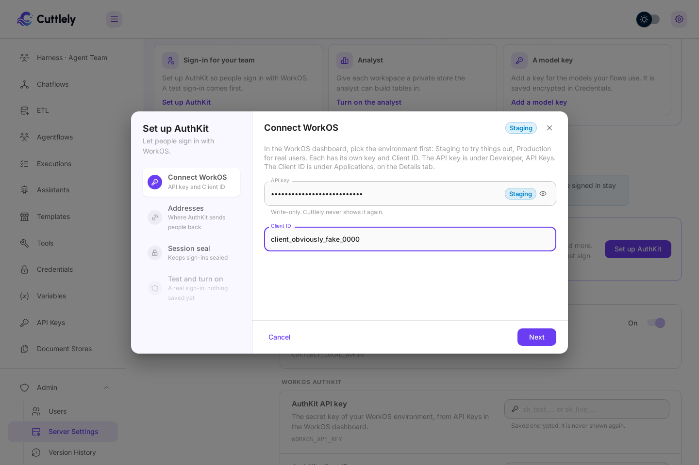

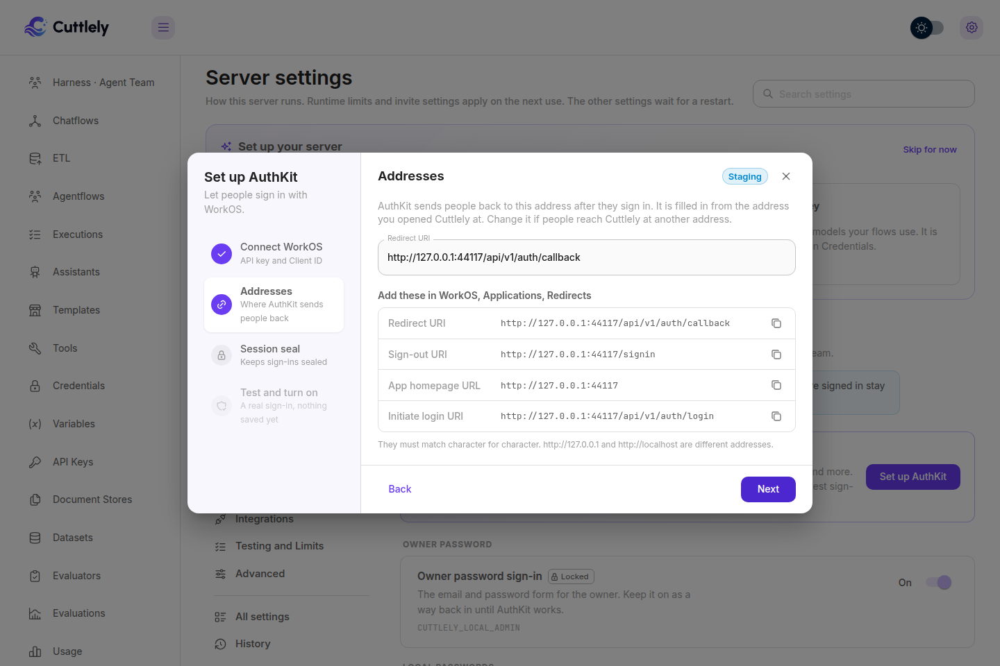

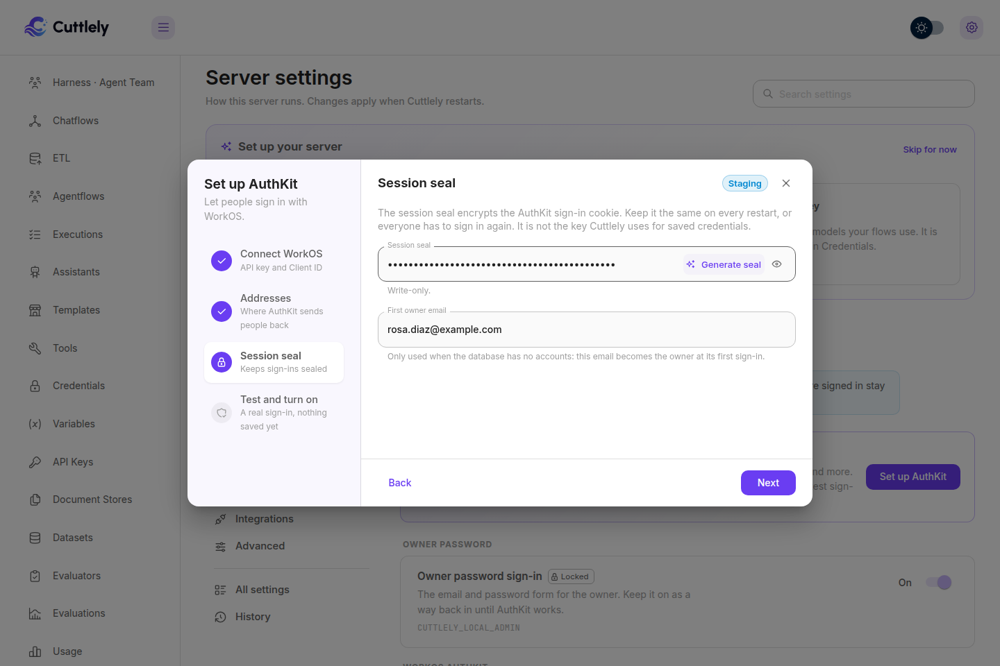

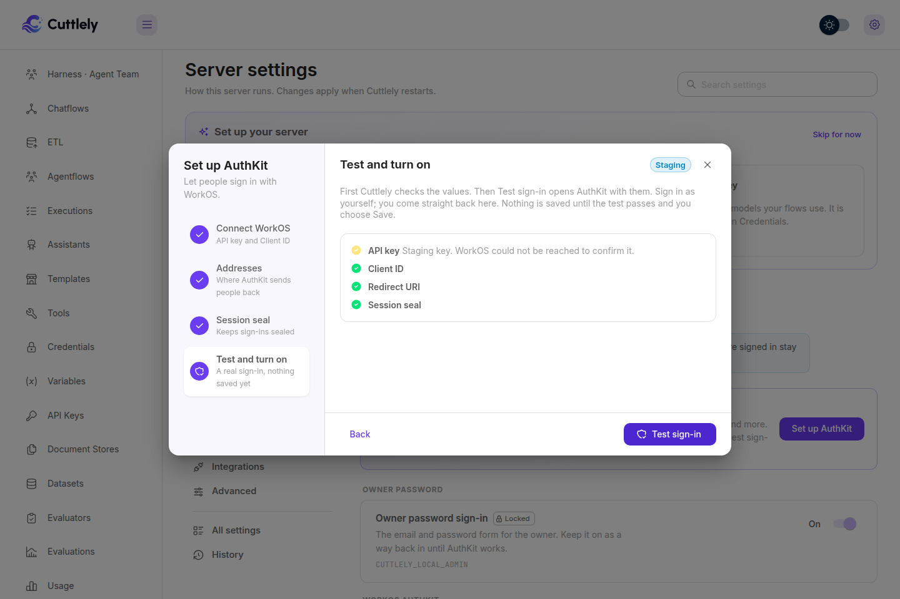

## Switch database

**Database** shows the database Cuttlely runs on. **Switch database** goes to SQLite or Postgres:

1. Choose SQLite or Postgres, and fill in the connection for Postgres.
2. The test always runs: sign-in, whether Cuttlely can create tables, and whether the database is empty, already holds Cuttlely data, or holds other tables (refused).
3. The dialog says how the owner gets back in afterwards. An empty database is a fresh start, so it needs the password sign-in on or AuthKit with a first owner email.
4. Type `RESTART` to switch. Cuttlely restarts on the new database.

Nothing is copied. Flows, credentials and accounts stay in the old database, and **Switch back** returns to it. A database that already holds Cuttlely data from another server needs that server's encryption key, or its saved credentials won't open; the dialog warns. With Analyst storage on Auto, the analyst's private stores follow the new database.

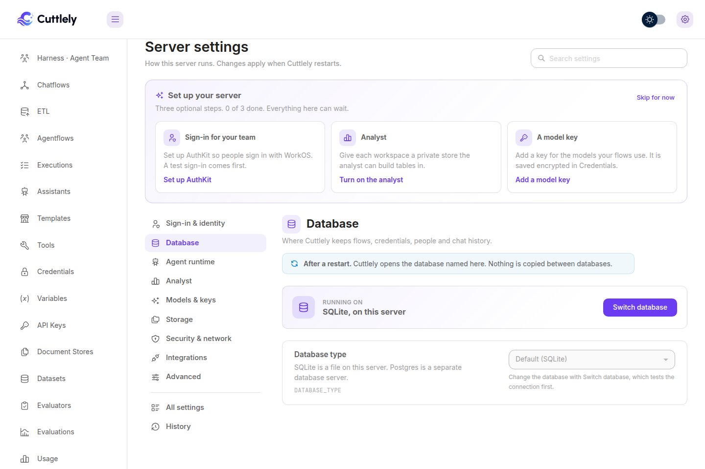

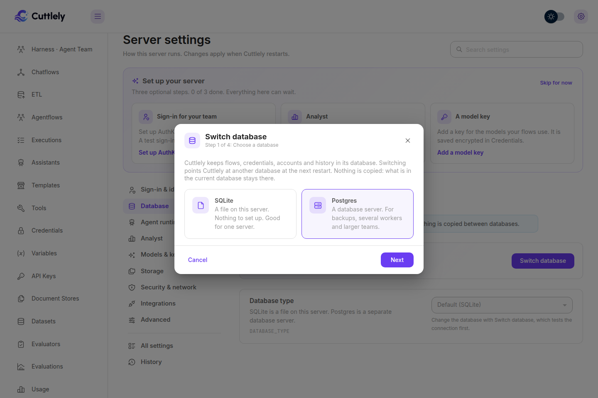

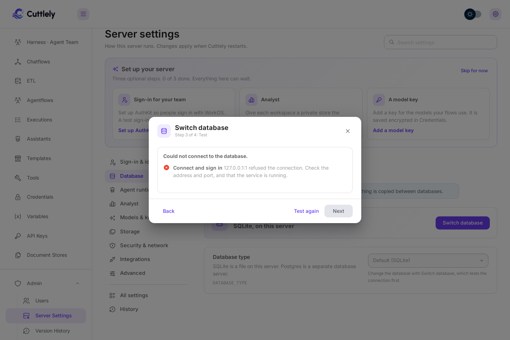

## Restart

| Install                                                       | What Restart does                                                                                                             |
| ------------------------------------------------------------- | ----------------------------------------------------------------------------------------------------------------------------- |
| Docker, and from source with `bash scripts/start-cuttlely.sh` | Restarts Cuttlely and the agent runtime in place, in the same container or terminal.                                          |
| Render                                                        | Restarts in place inside the running service, with no new deploy. Without the start script, the page shows the steps instead. |
| From source without the start script (for example `pnpm dev`) | The button says **How to restart** and shows the steps: stop Cuttlely and start it again.                                     |
| Queue mode with separate workers                              | Restarts this server; the page reminds you to restart each worker too, so it uses the new settings.                           |

When Cuttlely restarts in place, a full-screen view follows it: the settings it saved, any runs it lets finish, stopping, each start-up step as Cuttlely works through it, and back. **Continue** reloads the page with the new settings. If it takes more than three minutes, the view says so and points you to the server log.

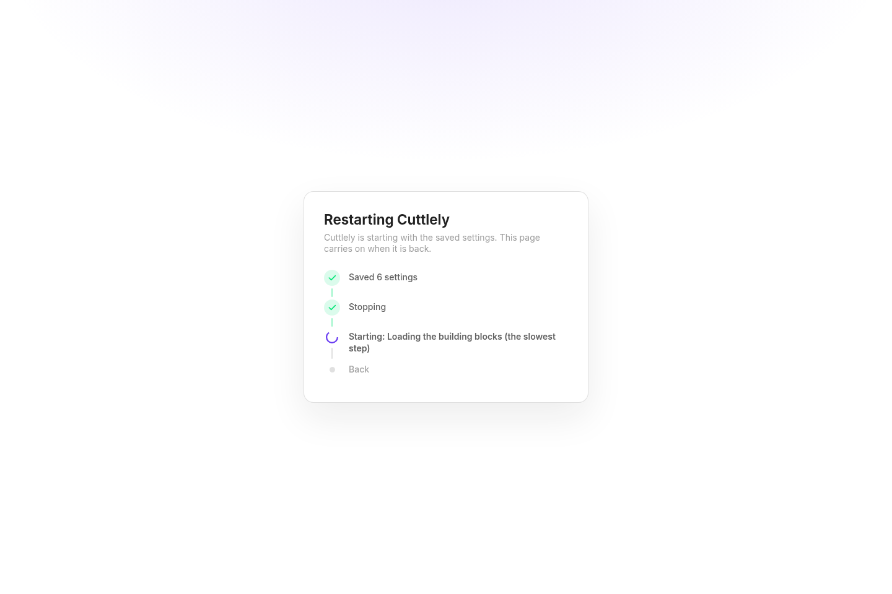

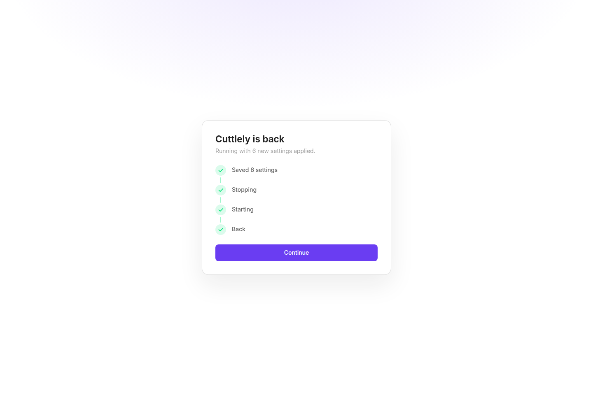

If chats or agent team runs are still answering when you select **Restart now**, Cuttlely asks first. **Let them finish** waits for them, for up to the turn time limit (45 seconds unless `CUTTLELY_HARNESS_TURN_BUDGET_MS` says otherwise), and new runs get a short "restarting" answer meanwhile. **Restart now** stops them.

When Cuttlely cannot restart itself, **How to restart** opens the steps with **Copy steps**, so you can paste them where you keep notes.

## When a setting stops Cuttlely from starting

If two starts in a row don't finish after a change, safe boot puts back the last settings that started and shows a banner. A start that can't open the database with changed settings stops right away instead of running half-started, and the start script tries again, so this takes a few seconds, not a page that never loads. Settings that didn't start never count as the last settings that worked. If you were on the restart screen, it says **The new settings did not start** and **See what changed** opens History. **Try it again** puts the set-aside settings back for the next restart.

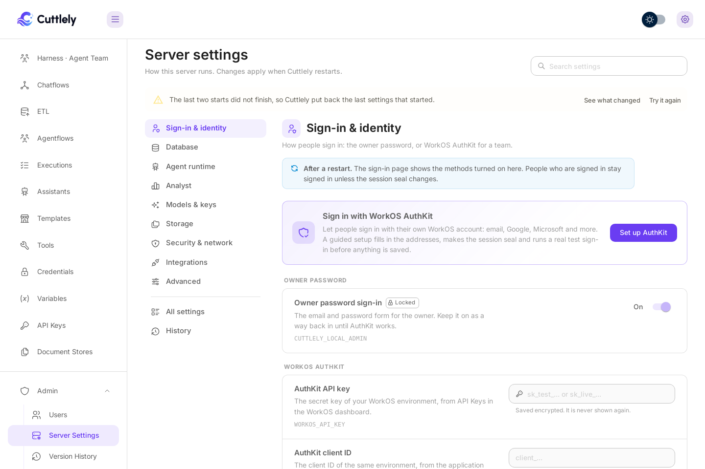

From a terminal (in Docker, prefix with `docker compose exec -u node cuttlely`):

| Command                    | What it does                                                  |
| -------------------------- | ------------------------------------------------------------- |
| `pnpm settings list`       | What is set, and whether it comes from the host or the file   |
| `pnpm settings unset NAME` | Removes one saved setting, for example `CUTTLELY_LOCAL_ADMIN` |
| `pnpm settings restore`    | Goes back to the last settings that started                   |

`CUTTLELY_IGNORE_ADMIN_SETTINGS=1` on the host starts Cuttlely with the saved settings ignored.

## All settings and History

**All settings** lists every setting, where its value comes from and its value (secrets as set or not set), plus the settings that stay out of the browser and why: the encryption key and sign-in secrets, paths and ports, code execution and safety checks, queue workers, start script plumbing, and test-only values. The organization owner can also ask the API whether an env-only value is set. That answer is `set` and `source` only. The value, its length, and any hash stay off the response. [Server settings API](../reference/server-settings-api.md). **Copy as .env** copies the values saved here for a `.env` file or a host's environment page; secrets are left out and listed as comments.

**History** keeps every save, discard, restore, test sign-in, rollback and restart: when, who, and which settings, never a secret value. A secret is recorded only as changed. The same list is `GET /api/v1/server-settings/history`. It is paged, newest first, and only the organization owner can read it. The newest 1000 changes are kept (`CUTTLELY_HISTORY_KEEP`, 100 to 10000). A value saved on this page wins over the environment variable. Older ones are removed when a new change is saved. Those same changes also appear on the [audit log](./audit-log.md). **Audit log retention** (`CUTTLELY_AUDIT_RETENTION_DAYS`, 90, from 1 to 3650) is how many days that log keeps. A valid host value wins over the saved value. It does not delete this history.

