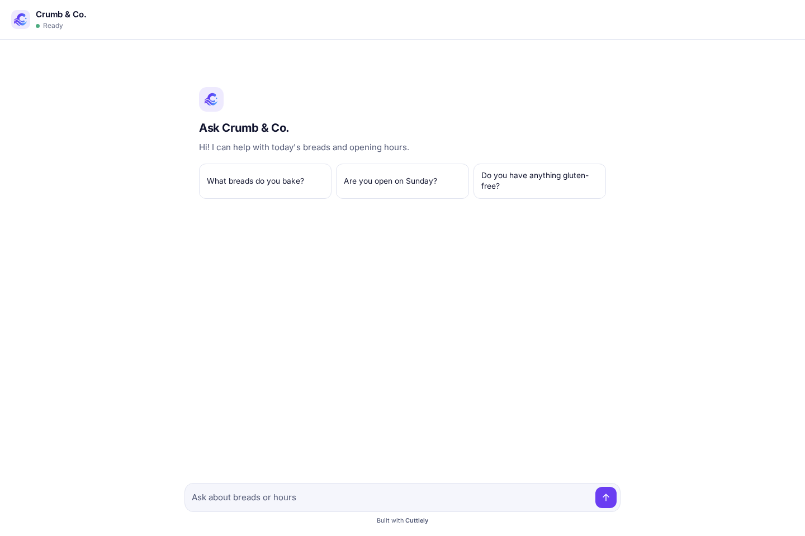
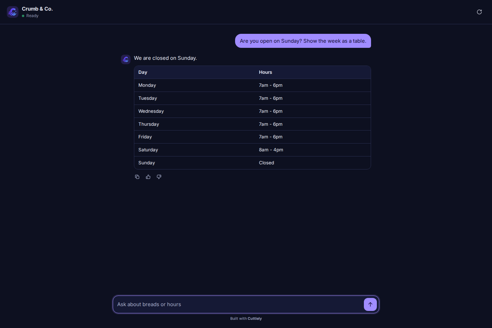
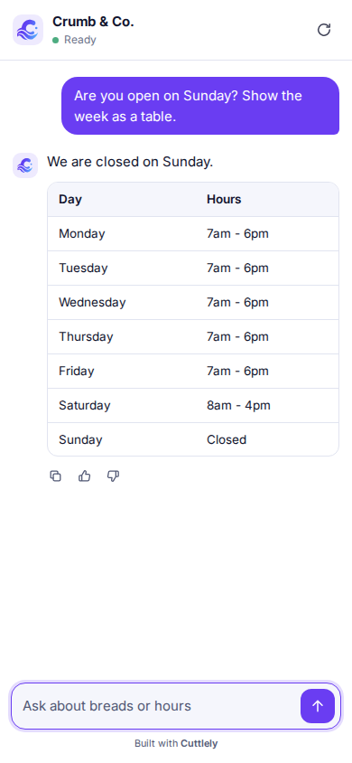
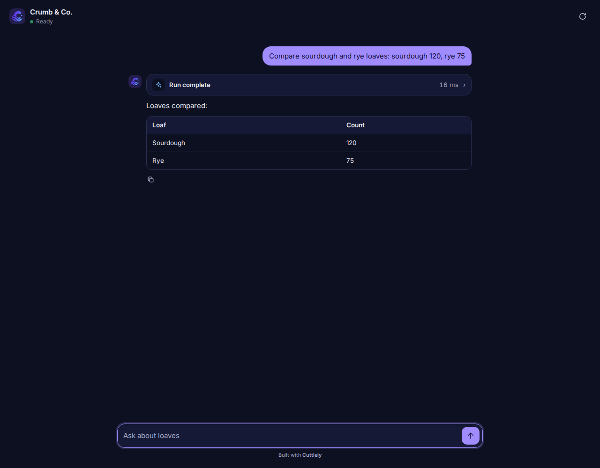

# Share and embed a chat

Any chatflow can be shared as a link or added to your website, including a chatflow that runs a harness. Both use Cuttlely's own chat, which your Cuttlely server serves at `/embed/chat.js`. The script always matches your server's version, and nothing loads from a CDN.

The examples use a made-up bakery, Crumb & Co.

## Share a link

1. Open the chatflow and select **API Endpoint** (the `</>` button at the top right).
2. Open the **Share Chatbot** tab.
3. Turn on **Make Public**. Only a public chatflow opens for people who are not signed in.
4. Select **Copy Link**, or **Open New Tab** to try it. The link is `https://<your Cuttlely>/chatbot/<chatflow id>`.


Before the first question, the chat shows the welcome message and the chatflow's starter prompts.



The chat follows the visitor's light or dark system setting.



On a phone the chat fills the screen.



### What the chat shows

-   **Answers as they are written**, with a stop button while the model is writing.
-   **Formatting**: lists, tables, code blocks with a copy button, links and images.
-   **Sources** under the answer when the chatflow returns source documents.
-   **Starter prompts** on the welcome screen and **follow-up prompts** under an answer, when the chatflow has them.
-   **Thumbs up and down** under each answer when **Chat Feedback** is on for the chatflow, and a copy button on every answer.
-   **Image uploads** (picker, paste or drag) when the chatflow accepts images.
-   **Harness runs**: a run card with the route and each specialist's time, then the answer and any charts the team made.



Model output is always shown as text: HTML in an answer is never run, even when **Render HTML on the chat** is on. Links and images only use `http`, `https`, `mailto` and your server's own paths.

### Not in the shared chat yet

**Speech to Text**, **Text to Speech**, **Leads**, and **File Upload** (whole files for the chatflow to read) don't show in the shared chat or the embed yet. Try them in the canvas chat.

### Private chatflows

A chatflow that is not public, or that needs an API key, does not open for visitors. The link shows `This chat is private or needs a key.` instead.

## Change the look

The chat uses Cuttlely's colors and type by default. The chatflow's share settings change it:

-   **Share Chatbot** tab: **Title**, **Title Avatar Link**, **Welcome Message**, **Error Message**, **Font Size**, **TextInput Placeholder**, the title, message and input colors, the send button color, and **Start new session when chatbot link is opened or refreshed**.
-   **Configuration** (the settings button on the canvas): **Starter Prompts**, **Follow-up Prompts**, **Chat Feedback**, and **Allowed Domains**.

A color you leave at the dialog's default keeps Cuttlely's theme. Colors are used as you pick them; check that text stays readable on your background.

## Embed it on your website

1. Make the chatflow public, as above.
2. Open **API Endpoint** and the **Embed** tab.
3. Copy a snippet and paste it into your page.

**Popup Html** adds a chat button in the bottom right corner:

```html
<script src="https://your-cuttlely.example.com/embed/chat.js" data-flow-id="YOUR_CHATFLOW_ID" defer></script>
```

**Fullpage Html** puts the chat where the `div` is:

```html
<div id="cuttlely-chat" style="height: 100vh"></div>
<script
    src="https://your-cuttlely.example.com/embed/chat.js"
    data-flow-id="YOUR_CHATFLOW_ID"
    data-mode="page"
    data-target="#cuttlely-chat"
    defer
></script>
```

The React tabs give a component that loads the same script. **Show Embed Chat Config** shows every option: `theme` (`auto`, `light` or `dark`), `open`, and `config` overrides for the title, welcome message, placeholder, starter prompts and colors.

### Embed with @cuttlely/chat

`@cuttlely/chat` is the same widget. The script above is still served by your Cuttlely server at `/embed/chat.js`, so it matches that server. An application can also install the package and mount the chat. Set `apiHost` to your Cuttlely server.

```bash
npm install @cuttlely/chat
```

The package version follows the server release. To match your server, pin the same version, for example `npm install @cuttlely/chat@1.3.2` for a 1.3.2 server.

```js
import { mount } from '@cuttlely/chat'

mount(document.querySelector('#chat'), {
    flowId: 'YOUR_CHATFLOW_ID',
    apiHost: 'https://your-cuttlely.example.com',
    mode: 'page'
})
```

`flowId` is the chatflow or agentflow id. `mode` is `bubble` (the default) or `page`. `theme` is `auto`, `light` or `dark`. `mount` returns a controller with `open()`, `close()`, `reset()` and `destroy()`. The script tag's `window.cuttlelyChat.mount` takes the same options. The package file for a script tag is `@cuttlely/chat/chat.js`; set `data-api-host` when that file is not loaded from your Cuttlely server.


### Allowed domains

With no **Allowed Domains** set, any site can embed a public chatflow. With a list set, only those sites can; the chat on any other site says `This chat is not available on this site.`

### Charts on another site

A chart a harness makes is a file saved with the chat. The share link and an embed on the same site as Cuttlely always show it. An embed on another site shows it when that site is in the chatflow's **Allowed Domains**: the browser on your site may then read the chart files of that chatflow, and only for the chat it is in. Sites that aren't listed, and other chatflows' files, are not opened to it.

With no **Allowed Domains** set, chart files on another site follow your server's `CORS_ORIGINS` setting, as before. To show charts in an embed, add your site to **Allowed Domains**.


## Troubleshooting

| What you see                                    | Why                                                                                  |
| ----------------------------------------------- | ------------------------------------------------------------------------------------ |
| `This chat is private or needs a key.`          | The chatflow is not public, or it has an API key. Embeds and links can't send a key. |
| `This chat is not available on this site.`      | The site is not in the chatflow's **Allowed Domains**.                               |
| `This chat could not be found.`                 | The chatflow id is wrong, or the chatflow was deleted.                               |
| `This chart could not be shown here.`           | The embed is on another site that is not in the chatflow's **Allowed Domains**.      |
| No chat button on your page                     | The script URL is not your Cuttlely server, or `data-flow-id` is missing.            |
| `The chat widget is not built. Run pnpm build.` | A from-source server was started without building. Run `pnpm build`.                 |
