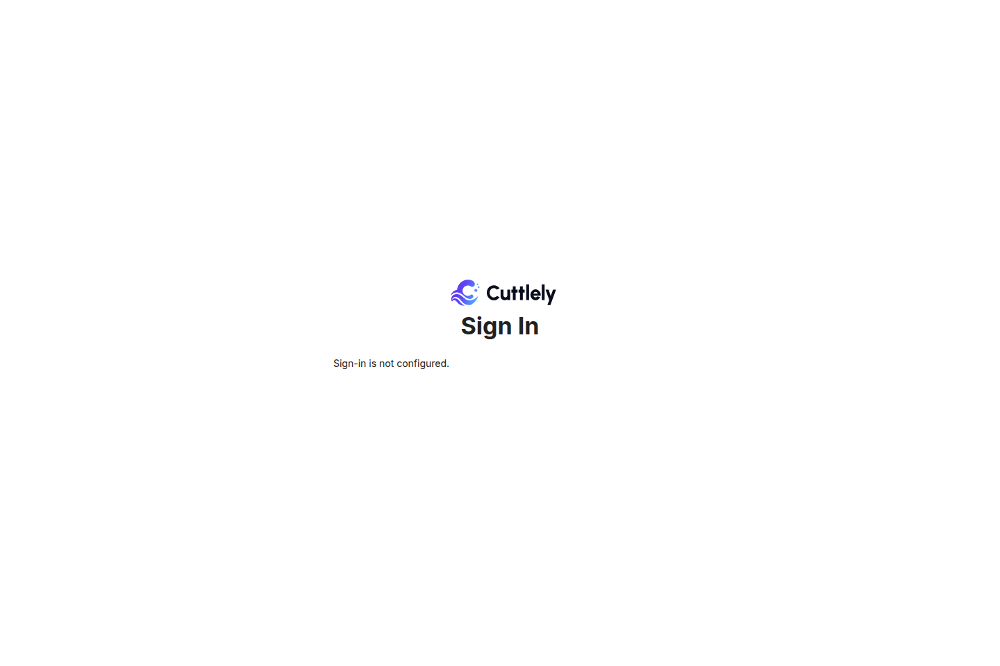
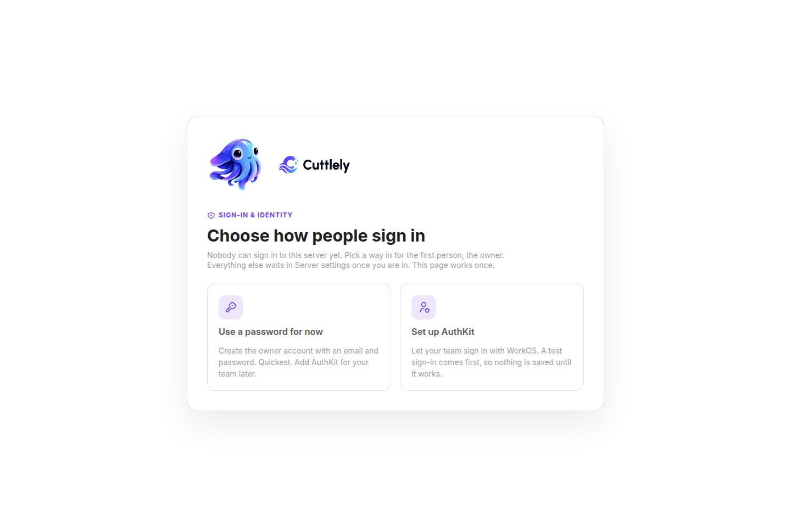
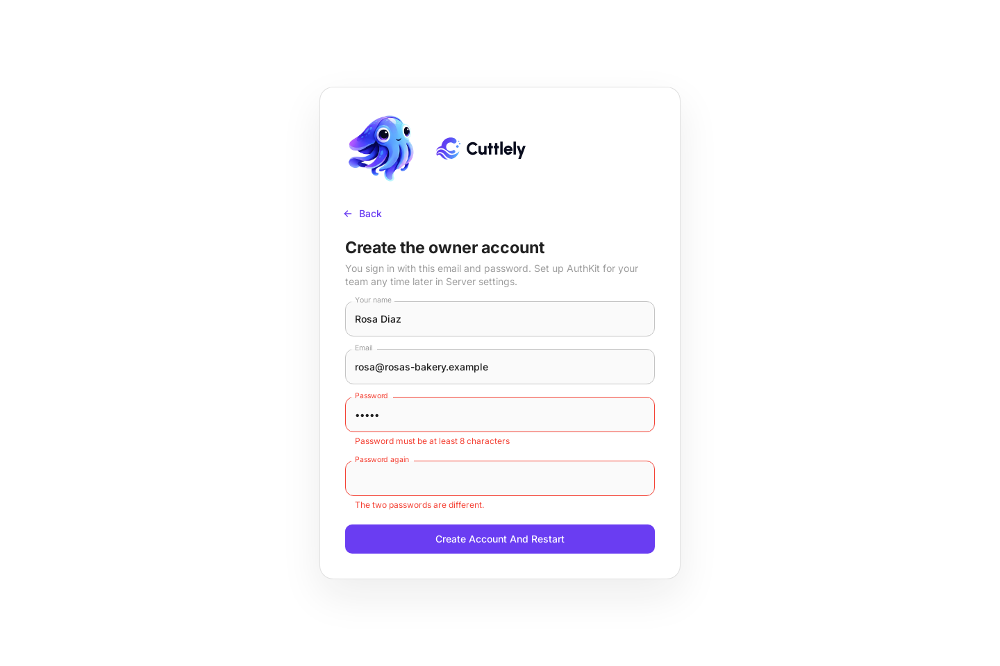
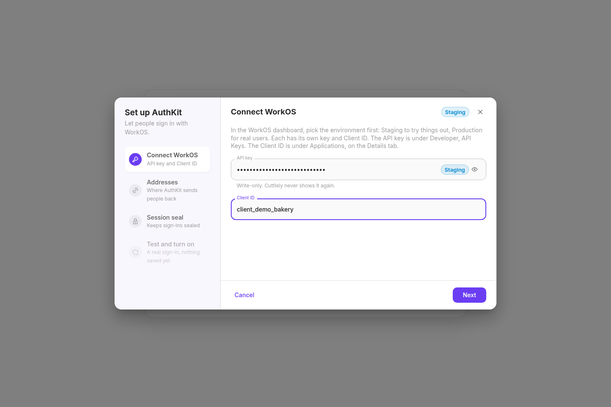
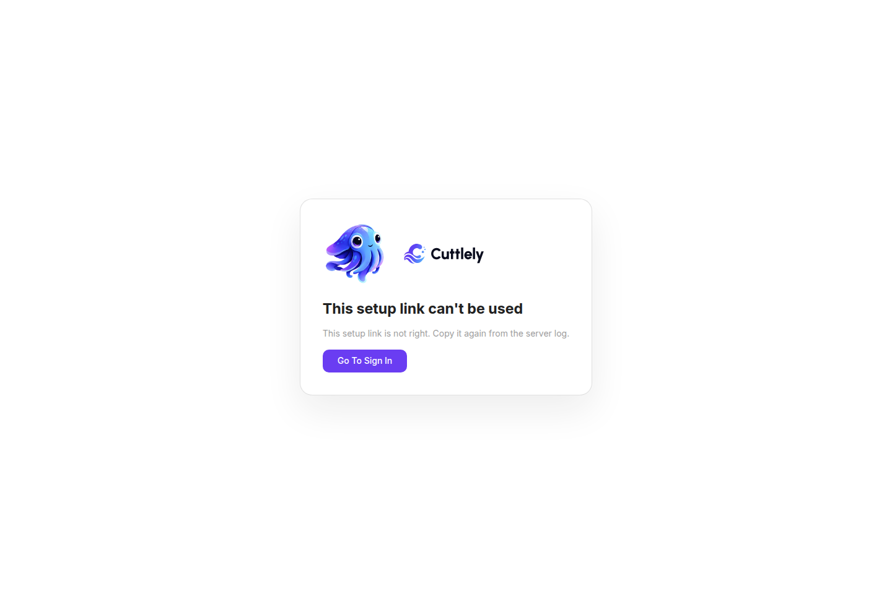
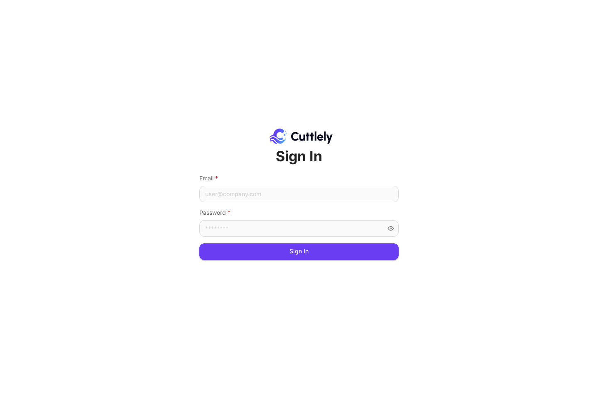
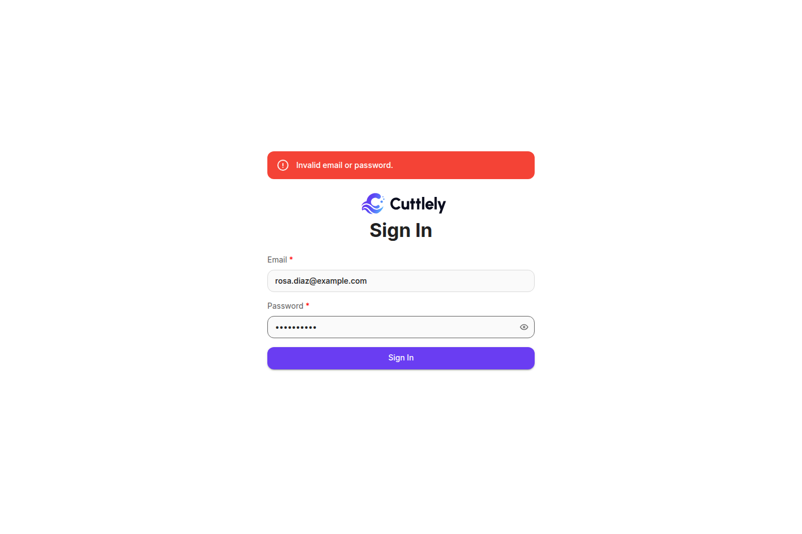
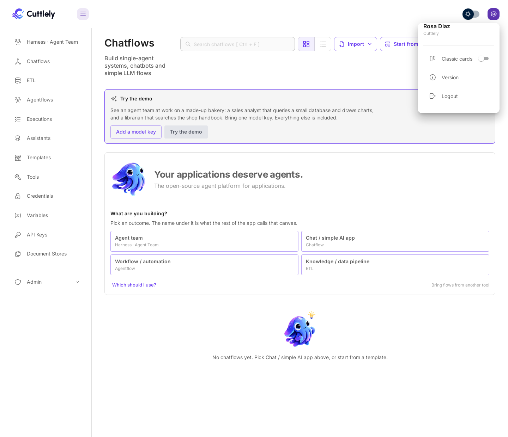

# Sign in

A new Cuttlely install has no users. You create one local account, the owner, and sign in with its email and password. That account is the **break-glass** account: it keeps working when nothing else does. When several people need to sign in, add WorkOS and let them sign in with their own identity. See [Sign in with WorkOS](#sign-in-with-workos). To let people who already have a password sign in without AuthKit, see [Users without AuthKit](./users-without-authkit.md). That switch is off by default. Invited people still have no password until a sign-in link exists.

Install first: [Docker](./docker.md), [From source](./from-source.md), or [Render](./render.md). Render turns the local password form off and uses WorkOS.

## Turn on the local account

The password form shows only when the server runs with `CUTTLELY_LOCAL_ADMIN=true`, exactly `true`. A local install has it on by default.

| Install     | Default                                                                                                                                                                                                      |
| ----------- | ------------------------------------------------------------------------------------------------------------------------------------------------------------------------------------------------------------ |
| From source | On. `scripts/start-cuttlely.sh` sets it unless you set it yourself, `packages/server/.env` sets it, or `WORKOS_API_KEY` is set.                                                                              |
| Docker      | On. The start script turns it on for Docker when it is unset or blank. Set `CUTTLELY_LOCAL_ADMIN=false` in `.env`, then `docker compose up -d`, when you use WorkOS or publish the port beyond your machine. |
| Render      | Off. Set it in the Dashboard only to recover the account, then remove it.                                                                                                                                    |

With the flag off and no WorkOS, the sign-in page says `Sign-in is not configured.`



### When nobody can sign in yet

A server with no account, the password sign-in off and no AuthKit (for example Render without the WorkOS values) prints a one-time setup link when it starts:

```text
2026-10-09 12:00:00 [INFO]: 🔑 [server]: No sign-in method is on yet. Open https://your-service.onrender.com/server-setup?code=... to set one up. The link works once.
```

The link uses Render's public address, or `APP_URL` when it is set. It opens only **Sign-in & identity**, with two choices:

-   **Use a password for now** creates the owner account and turns the password sign-in on.
-   **Set up AuthKit** runs the same four steps as Server settings. The owner email is required, and the test sign-in must use it. Nothing is saved until the test passes.

Either way Cuttlely restarts when it can, or lists what to do. The link stops working as soon as it has been used, the first account exists, or a sign-in method is on. A new code is printed on every start while nobody can sign in.

If accounts already exist but no sign-in method is on (for example a `.env` that lost `CUTTLELY_LOCAL_ADMIN=true`), there is no setup link. The browser opens the Sign In page with **Sign-in is not configured.**, and the log says how to get back in:

```text
2026-10-09 12:00:00 [INFO]: 🔑 [server]: No sign-in method is on, so nobody can sign in. Turn on the password sign-in (CUTTLELY_LOCAL_ADMIN=true) or AuthKit on the host, then restart.
```









## Create the first account

The first account is the owner, shown as **Super User**. You can create it in the browser or in a terminal. Either way it works only while the install has no users.

### In the browser

On a new install with the flag on, opening the app shows **Setup Account**. Fill in the name, email, and password, then select **Sign Up**. The page is pictured in [From source](./from-source.md#in-the-browser).

From the machine where Cuttlely runs, for example a from-source install opened at `localhost`, that is all. Through Docker's published port the request doesn't come from that machine, so open the setup link the server prints when it starts with no account:

```bash
docker compose logs cuttlely | grep "No account yet"
```

```text
2026-10-09 12:00:00 [INFO]: 👋 [server]: No account yet. Open http://localhost:43117/organization-setup?code=... to create yours.
```

The code in the link is new on every start and stops working once the first account exists. Without it, **Sign Up** through the published port says `Open the setup link from the server log to create the first account.`

After **Sign Up** you are signed in and land in Cuttlely. Keeping a copy in GitHub is optional and waits in **Version History**; see [Right after setup](./versioning.md#right-after-setup).

### In a terminal

Run `pnpm user` with the email. It asks for the password and doesn't show what you type.

From source, in the repository root, against the same database the server uses:

```bash
CUTTLELY_LOCAL_ADMIN=true pnpm user --email you@example.com
```

Docker:

```bash
docker compose exec -u node -it Cuttlely pnpm user --email you@example.com
```

It ends with:

```text
[INFO]: Super User created for you@example.com.
```

The password needs 8 to 128 characters, with a lowercase letter, an uppercase letter, a digit, and a special character. A password that misses a rule is refused, with one line for each rule it misses:

```text
[ERROR]: Password must be at least 8 characters
[ERROR]: Password must contain at least one uppercase letter
[ERROR]: Password must contain at least one digit
[ERROR]: Password must contain at least one special character
```

Without a terminal, for example in a script, the command reads the password from standard input until the input closes. Never put the password on the command line.

## Sign in

1. Open `/signin` on your server, for example [http://localhost:43117/signin](http://localhost:43117/signin). Opening any page while signed out also brings you here.
2. Type your **Email** and **Password**.
3. Select **Sign in**. With WorkOS also on, the button is **Sign in with password**, under **Sign in with WorkOS**.



The app opens **Chatflows**, or the page you were going to.

A wrong email or password shows `Invalid email or password.` After 10 failed tries in 15 minutes, the form says `Too many sign-in attempts. Try again later.` Wait, then try again.



## Sign out

Select the gear at the top right. The menu shows your name, then **Version** and **Logout**. Select **Logout**.



## Accounts and passwords

| Task                       | Command                                                                                | Result                                                                   |
| -------------------------- | -------------------------------------------------------------------------------------- | ------------------------------------------------------------------------ |
| List the accounts          | `pnpm user`, with no email                                                             | `Email addresses: ...` and `Email count: N`.                             |
| Reset a forgotten password | `pnpm user --email you@example.com`, with the email of an existing account             | `Password updated for you@example.com.` The new password works at once.  |
| Add a second account       | Not from the terminal. `pnpm user` with a new email prints `No account exists for ...` | Add people with WorkOS. See [Sign in with WorkOS](#sign-in-with-workos). |

With the flag off, `pnpm user` can still reset the owner's password. It refuses everything else, with `Refusing to create a user while the local admin flag is off.` for a new account, or `Refusing to set a password for ...` for another user.

There is no **Forgot password** link. A lost password is reset with `pnpm user`, on the server.

## Sign in with WorkOS

Use WorkOS when several people sign in. Cuttlely sends the browser to WorkOS AuthKit, and AuthKit checks who the person is. Teams, roles, permissions, workspaces, and API keys stay in Cuttlely's database.

1. Set `WORKOS_API_KEY` and `WORKOS_CLIENT_ID` on the server, plus the other WorkOS values in [WorkOS AuthKit setup](../identity/workos-authkit-setup.md), and restart it.
2. On an empty database, also set `CUTTLELY_BOOTSTRAP_EMAIL`. The first person to sign in through AuthKit must have that verified email, and becomes the owner.
3. Open `/signin`. It now shows **Sign in with WorkOS**. The button opens `/api/v1/auth/login`, for example `http://127.0.0.1:43117/api/v1/auth/login` on a local server.

With the local flag also on, the page shows both the WorkOS button and the password form.

To add people, open **Admin**, then **Users**, and select **Add User**. Give each person a name and an email. Cuttlely doesn't send an invitation, so send them the sign-in link yourself. If AuthKit public sign-up is off, also create them in the WorkOS Users directory. Roles, teams, and the permission each page checks are in [Roles and permissions](./roles-and-permissions.md).

The owner can also do steps 1 and 2 in the browser: open **Admin**, then **Server Settings**, then **Sign-in**, and select **Set up AuthKit**. It fills in the redirect addresses, makes the session seal, and runs a real test sign-in with the new values before anything is saved. Password sign-in can be turned off only after that test passes. The values apply when Cuttlely restarts.

Field-by-field setup, redirect URIs, and WorkOS troubleshooting are in [WorkOS AuthKit setup](../identity/workos-authkit-setup.md).

## Troubleshooting

| You see                                                            | What to do                                                                                                                                           |
| ------------------------------------------------------------------ | ---------------------------------------------------------------------------------------------------------------------------------------------------- |
| `Sign-in is not configured.`                                       | Neither the local account nor WorkOS is on. Start the server with `CUTTLELY_LOCAL_ADMIN=true`, or set the WorkOS variables.                          |
| `Invalid email or password.`                                       | Check the email. To set a new password, run `pnpm user --email` with that email.                                                                     |
| `Too many sign-in attempts. Try again later.`                      | 10 failed tries in 15 minutes. Wait 15 minutes.                                                                                                      |
| `Refusing to create a user while the local admin flag is off.`     | Run `pnpm user` with `CUTTLELY_LOCAL_ADMIN=true`.                                                                                                    |
| `No account exists for ...`                                        | The install already has an owner, and the terminal only creates the first account. Use the owner's email to reset it, or add people with WorkOS.     |
| `Error in registering account: Not Found` on **Setup Account**     | An account already exists. Sign in instead.                                                                                                          |
| `Open the setup link from the server log ...` on **Setup Account** | You're not on the server itself, for example through Docker's published port. Open the link from `docker compose logs cuttlely`, or use `pnpm user`. |
| `First-user setup is not available.` after WorkOS sign-in          | On an empty database, `CUTTLELY_BOOTSTRAP_EMAIL` is unset or doesn't match the email you signed in with. Set it to your email and restart.           |
