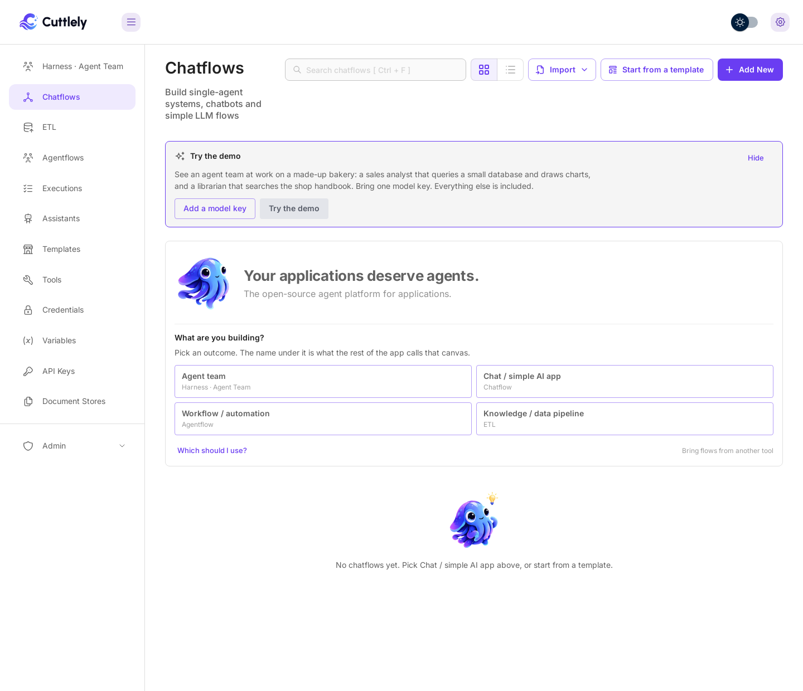
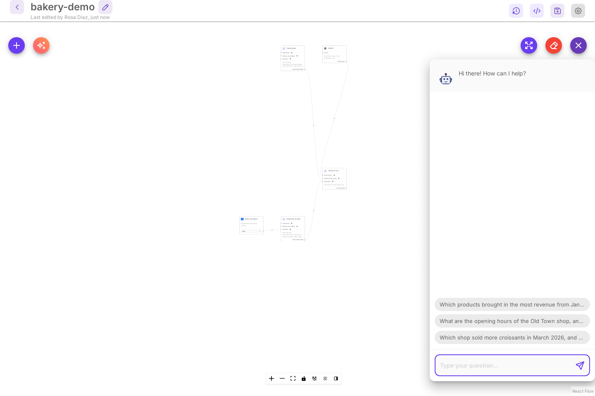

# Try the demo

The demo shows an agent team at work in about a minute. It runs on a made-up bakery with two shops: an analyst queries a small sales database and draws charts, and a librarian searches the shop handbook. You bring one model key. Everything else ships with Cuttlely.

## Open it

1. Sign in. While you have no chatflows, **Chatflows** shows a **Try the demo** card.

    

2. Select **Add a model key**, pick your provider (for example **OpenAI API**), give the key a name, paste it and select **Add**. The list shows only key types a chat model can use, the popular ones first. A key you saved earlier is picked for you, and **Model key** lets you choose when you have more than one.

    

3. Select **Try the demo**. Cuttlely sets up the **bakery-demo** team on your key and opens it with the test chat open and three starter questions:

    - Which products brought in the most revenue from January to June? Show it as a bar chart.
    - What are the opening hours of the Old Town shop, and which items contain nuts?
    - Which shop sold more croissants in March 2026, and by how many?

    

4. Select the first question. The run card shows that Harness Prime sent the work to the analyst, with the model, the time and the tokens each step took. The chart and the numbers appear in the chat.

    

On a laptop the answer usually arrives in 10 to 20 seconds. If the agent runtime is still starting, the question waits for it, up to a minute (`CUTTLELY_HERMES_START_WAIT_MS`).

## What the demo makes

-   **bakery-demo**, an agent team under **Harness · Agent Team**. Harness Prime sends sales questions to `analyst` and shop questions to `librarian`, and asks both when a question needs both.
-   **analyst** answers with Python on a SQLite database of made-up sales from January to June 2026, and draws charts with a small chart helper.
-   **librarian** searches the **Bakery Handbook**, a knowledge pipeline under **ETL** built from a made-up shop handbook. It runs once when the demo is set up, with local embeddings, so it needs no second key.

All of it uses the key you picked. Selecting **Try the demo** again opens the same team (the card then says **Open the demo**). Change the team like any other: open a card, edit a specialist, or rebuild it with **Build with AI**.

**Hide** removes the card for this browser. The card also goes away once you have a chatflow.

## Next

-   [Build your own team](./harnesses.md#build-a-team-with-ai)
-   [Give a specialist its own tables](./analyst.md)
-   [Put a pipeline behind a team](./etl.md)
-   [Call the team from your app](./harnesses.md#call-the-harness-from-a-chatflow)
