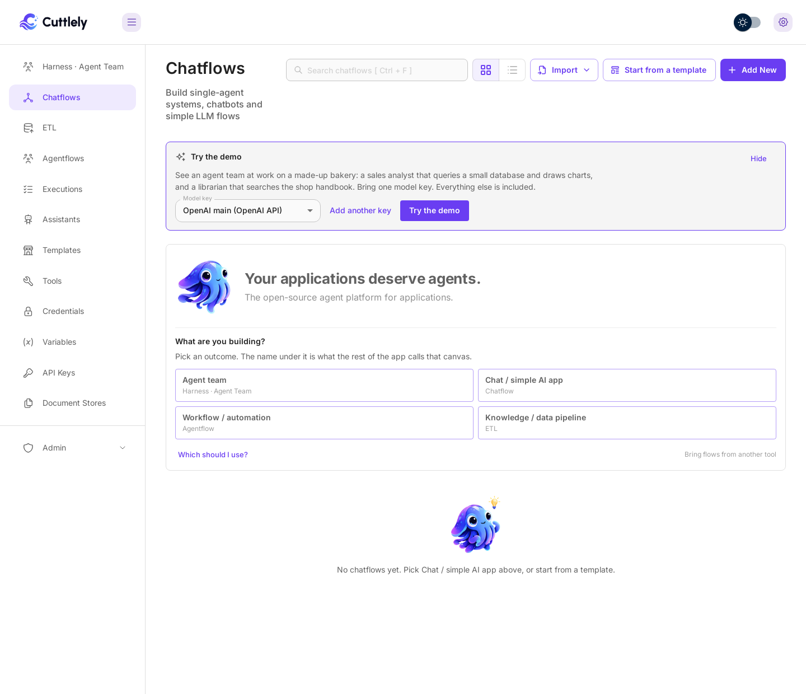
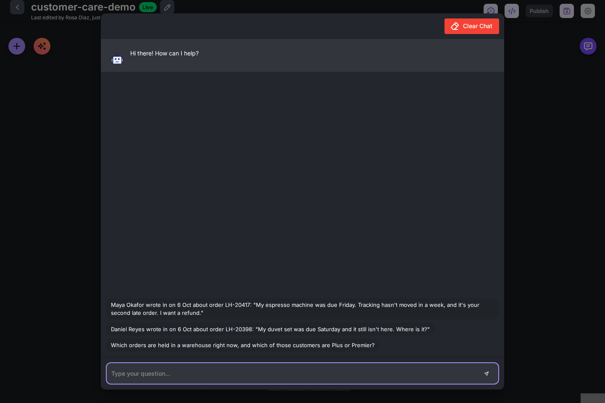
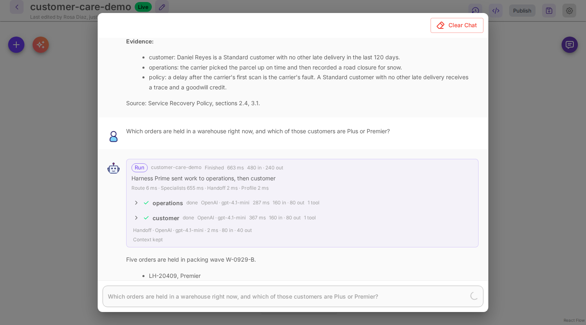

# Try the demo

The demo shows an agent team at work in about a minute. A customer writes in about a late order from Larkfield Home, a made-up online home goods store, and three specialists work out what happened: a customer specialist reads the account, an operations specialist traces the parcel, and a policy specialist checks the written service policy. Harness Prime writes the decision, the reply to the customer, the actions and the evidence. You bring one model key. Everything else ships with Cuttlely, and all the data is made up.

A smaller bakery team is on the same card as a [quickstart](#the-bakery-quickstart).

## Open it

1. Sign in. While you have no chatflows, **Chatflows** shows a **Try the demo** card.

    ![The Chatflows page with the Try the demo card above What are you building. The card says: Watch an agent team resolve a late-order complaint. A customer specialist reads the account, an operations specialist traces the parcel, a policy specialist checks the written policy, and Harness Prime writes the reply and the actions, with the evidence. Bring one model key. Everything else is included, and all the data is made up. Model key is OpenAI demo (OpenAI API), with Add another key, Try the demo and Or start with the bakery quickstart.](../images/try-the-demo/try-the-demo-card.png)

2. Select **Add a model key**, pick your provider (for example **OpenAI API**), give the key a name, paste it and select **Add**. The list shows only key types a chat model can use, the popular ones first. A key you saved earlier is picked for you, and **Model key** lets you choose when you have more than one.

    

3. Select **Try the demo**. Cuttlely sets up the **customer-care-demo** team on your key and opens it with the test chat open and three starter questions:

    - Maya Okafor wrote in on 6 Oct about order LH-20417: "My espresso machine was due Friday. Tracking hasn't moved in a week, and it's your second late order. I want a refund."
    - Daniel Reyes wrote in on 6 Oct about order LH-20398: "My duvet set was due Saturday and it still isn't here. Where is it?"
    - Which orders are held in a warehouse right now, and which of those customers are Plus or Premier?

    

4. Select the first question. The run card shows Harness Prime sending the work to `customer` and `operations` at the same time, then to `policy` once operations has finished, with the model, the time and the tokens each step took. Open a row to see the task Harness Prime gave that specialist and the tools it ran.

    

5. Scroll down for the rest of the answer: the reply to send the customer, the actions for the team, and the evidence from each specialist with the policy sections it rests on.

    ![The end of the answer. The reply to Maya explains that a warehouse error kept the parcel from the carrier, offers an Express reship arriving Thursday, October 8 or a refund, and adds a store credit and a call from the Customer Care Lead. Actions lists the shipping refund, the reship from Reno, the recall from the Columbus warehouse, the store credit, the Care Lead call, and an operations incident for packing wave W-0929-B, which held 5 orders. Evidence has one line each for customer, operations and policy, and the source line reads Source: Service Recovery Policy, sections 1.2, 2.1, 2.3, 2.5, 3.1, 3.2, 3.3, 3.4.](../images/try-the-demo/customer-care-answer.png)

On a laptop the answer usually arrives in 15 to 20 seconds. If the agent runtime is still starting, the question waits for it, up to a minute (`CUTTLELY_HERMES_START_WAIT_MS`). The wording changes from run to run, but the facts, the amounts and the policy sections come from the specialists' tools.

## Why the answer is not the obvious one

Maya's tracking page has not moved in a week, so it looks like a carrier delay. Under the policy a carrier delay gets a goodwill credit, and Maya already had one 52 days ago, so she would get nothing more. The specialists find something else:

-   **operations** sees that the parcel was packed, failed the warehouse's outbound scale check (9.8 kg expected, 4.1 kg measured) and went to an exception cage. The carrier only ever scanned "Label created": it never had the parcel. Four other orders from the same packing wave are held for the same reason, and the Reno warehouse can reship by Express for Thursday.
-   **policy** reads that a delay before the carrier's first pickup scan is Larkfield's fault, so the goodwill limit does not apply, and prints the remedy for every tier from the policy tables.
-   **customer** finds that Maya is a Plus customer whose last order was 3 days late, 52 days ago. A second late delivery in 120 days lifts her to the Premier remedy: 20% of the item price as store credit, and a call from the Customer Care Lead.

Harness Prime puts it together: whose fault it was, which remedy applies and why, and every action, including the operations incident because the problem held more than 3 orders.

The second starter is the contrast. Daniel's duvet set was picked up on time and held by a road closure for snow, so it is the carrier's fault. Daniel is a Standard customer, so he gets a carrier trace and a $10 goodwill credit, and a reship only if the carrier has no new scan for 3 business days.

The third starter crosses both systems in the other order: operations lists the held orders, then customer looks up who placed them.

## What the demo makes

-   **customer-care-demo**, an agent team under **Harness · Agent Team**, with Harness Prime and three specialists. Each specialist runs Python in its own folder, with its own made-up data and a small tool file.
-   **customer** has the support desk: a SQLite database of customers, orders and past contacts, and `support_desk.py` with `account_snapshot()`.
-   **operations** has the fulfillment systems: a SQLite database of warehouse scans, shipments, carrier scans, stock and transit times, and `fulfillment.py` with `investigate()`, `held_orders()` and `stock()`.
-   **policy** has the Larkfield Home Service Recovery Policy as a Markdown file, and `policy_book.py` with `read_policy()` and `remedy_table()`, which works the amounts out from the policy's tables so they are exact.

The files are in `samples/demo/customer-care` in the repository. [How the customer care demo works](./customer-care-demo.md) walks through them and shows how to build the same kind of team on your own data.

All of it uses the key you picked. Selecting **Try the demo** again opens the same team (the card then says **Open the demo**). Change the team like any other: open a card, edit a specialist, or rebuild it with **Build with AI**.

**Hide** removes the card for this browser. The card also goes away once you have a chatflow.

## The bakery quickstart

Select **Or start with the bakery quickstart** on the card for a smaller team on a made-up bakery with two shops: an analyst queries a small sales database and draws charts, and a librarian searches the shop handbook.

-   **bakery-demo** has three starter questions: the products that brought in the most revenue from January to June as a bar chart, the Old Town shop's opening hours and the items with nuts, and which shop sold more croissants in March 2026.
-   **analyst** answers with Python on a SQLite database of made-up sales from January to June 2026, and draws charts with a small chart helper.
-   **librarian** searches the **Bakery Handbook**, a knowledge pipeline under **ETL** built from a made-up shop handbook. It runs once when the team is set up, with local embeddings, so it needs no second key.

The March croissant starter answers in units. Riverside sold 335 more croissants than Old Town in March 2026: 1346 against 1011.

`POST /api/v1/demo` with `{"credentialId": "<id>"}` makes the customer care team. Add `"demo": "bakery"` for the bakery team.

## Next

-   [How the customer care demo works](./customer-care-demo.md)
-   [Build your own team](./harnesses.md#build-a-team-with-ai)
-   [Give a specialist its own tables](./analyst.md)
-   [Put a pipeline behind a team](./etl.md)
-   [Call the team from your app](./harnesses.md#call-the-harness-from-a-chatflow)
