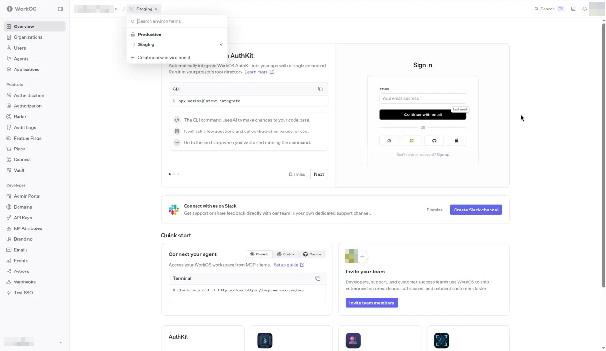
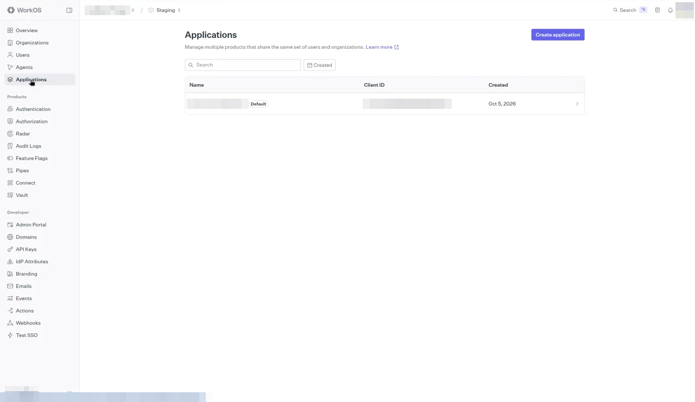
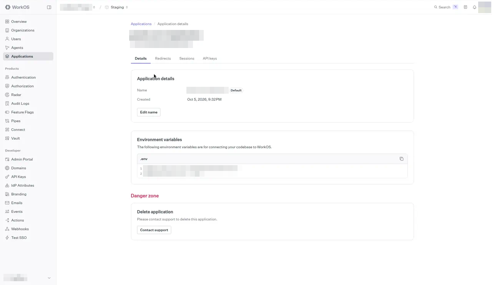
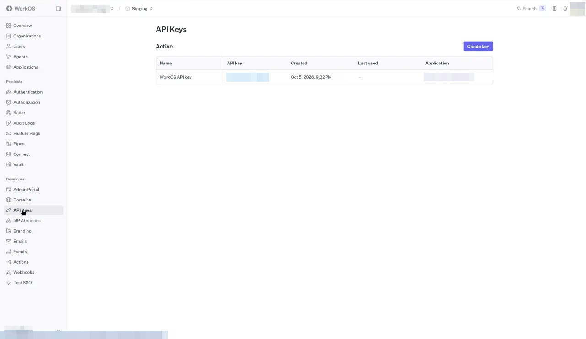
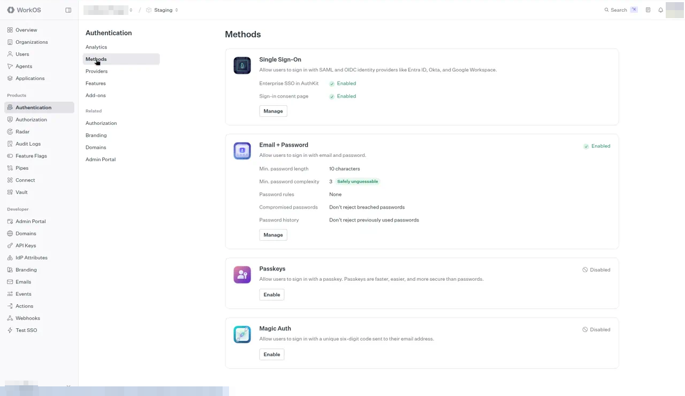
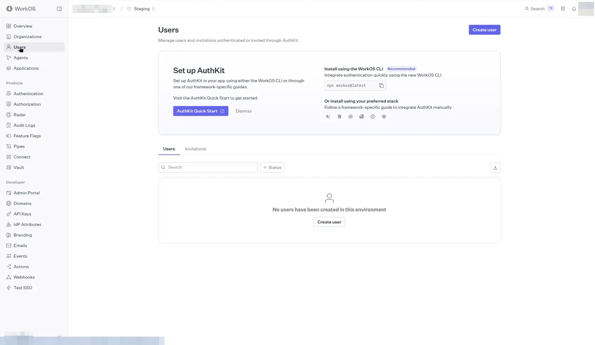
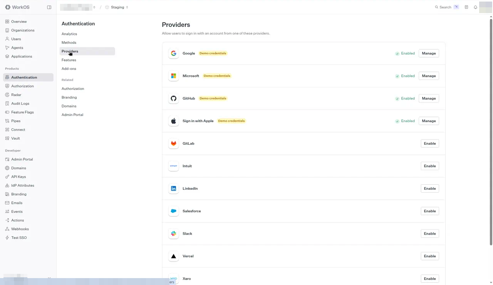
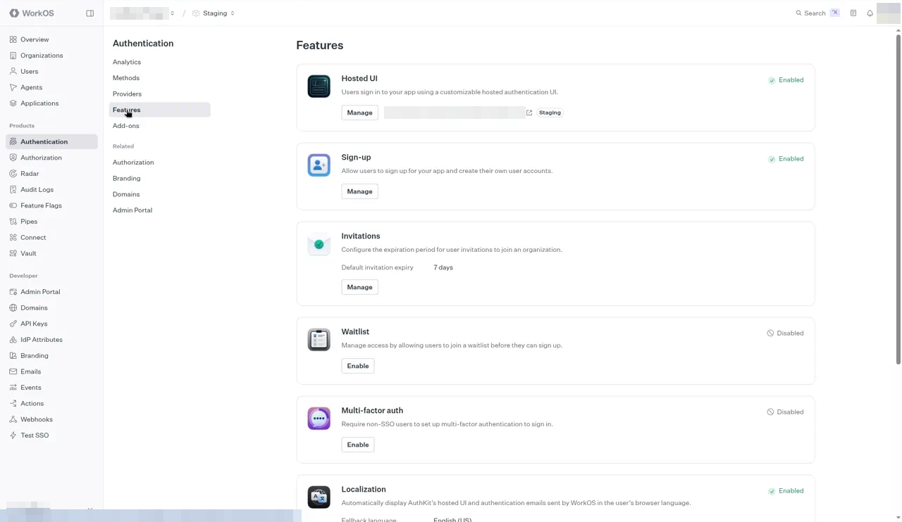

# Set up WorkOS AuthKit for Cuttlely

This guide walks through connecting a Cuttlely install to WorkOS AuthKit, step by step. It matches the identity code in `packages/server/src/identity/` and `render.yaml`. Every environment variable and route named here exists in that code.

The WorkOS dashboard changes often. Menu names, tab names, field labels, and screenshots below were checked against the dashboard in October 2026 but may have moved or been renamed since. If a label does not match, look for the closest equivalent on the same screen.

No secret values appear in this guide. Never paste an API key, a cookie password, or a break-glass password into git, a pull request, a chat, a ticket, or a shell command that lands in history.

## Contents

1. What you are setting up
2. WorkOS account, team, project, and environments
3. Where the settings live in the WorkOS dashboard
4. Redirect values to enter in WorkOS
5. Authentication methods and sign-up
6. Environment variables in Cuttlely
7. First sign-in and adding users
8. Break-glass local admin
9. Troubleshooting
10. Security notes
11. What this install does

## 1. What you are setting up

-   **AuthKit** is WorkOS's hosted sign-in page. Cuttlely never sees a WorkOS password. It sends the browser to AuthKit, AuthKit sends the browser back with a one-time code, and Cuttlely exchanges that code for a user and provider session id. Cuttlely then creates its own database session.
-   **Cuttlely's routes** (all under `/api/v1`):

| Route                            | What it does                                                                                                                                                                                                                                                |
| -------------------------------- | ----------------------------------------------------------------------------------------------------------------------------------------------------------------------------------------------------------------------------------------------------------- |
| `GET /api/v1/auth/login`         | Redirects (302) to the AuthKit authorization URL, built with `WORKOS_CLIENT_ID` and `WORKOS_REDIRECT_URI`. This is the URL that starts AuthKit.                                                                                                             |
| `GET /api/v1/auth/callback`      | AuthKit returns here with `?code=`. Cuttlely exchanges the code, links or bootstraps the user, creates an `identity_local_session` row, sets `cuttlely-local-session`, and redirects to `/`.                                                                |
| `POST /api/v1/auth/refreshToken` | Checks and renews the expiry of the Cuttlely database session. The UI calls it.                                                                                                                                                                             |
| `POST /api/v1/auth/resolve`      | Tells the UI where to go first. With WorkOS configured it answers `/signin`.                                                                                                                                                                                |
| `POST /api/v1/account/logout`    | Deletes the Cuttlely session, clears its cookies, and returns the AuthKit logout URL for a WorkOS session. AuthKit sends the browser to the origin of `WORKOS_REDIRECT_URI` plus `/signin`. If URL creation does not complete, the route returns `/signin`. |
| `POST /api/v1/auth/login`        | Password sign-in for the one local Super User. With Local active it is ordinary sign-in; with another active method it uses recovery treatment. Available only when `CUTTLELY_LOCAL_ADMIN=true` (section 8).                                                |
| `POST /api/v1/account/register`  | Break-glass first-user setup form. Only when `CUTTLELY_LOCAL_ADMIN=true`, the user table is empty, the request sends `x-request-from: internal`, and it carries the one-time code from the setup link in the server log.                                    |

-   **WorkOS counts as configured** only when both `WORKOS_API_KEY` and `WORKOS_CLIENT_ID` are set. When either is missing, AuthKit is off. Cuttlely can still run as one built-in Super User. That path is section 8. A missing WorkOS configuration does not turn it on.
-   **Teams, roles, permissions, and API keys stay in Cuttlely's database.** WorkOS only proves who the person is. Cuttlely decides what they can do.

## 2. WorkOS account, team, project, and environments

The WorkOS screenshots in this guide come from a real account, so its own names and secrets are blurred: the team and project names, the application name, the Client ID, keys, the hosted AuthKit address, and the install's hostname. Your own team, project, and application names and your hostname appear in those places.

### 2.1 Create or sign in to a WorkOS account

1. Go to <https://dashboard.workos.com/> and sign up or sign in.
2. Use a WorkOS team that belongs to you or to the Cuttlely project, **not a team owned by your employer**. A WorkOS team is the billing and membership boundary. Keys, users, and audit logs in an employer team are visible to that employer's admins, and leaving the job can cut off your access to production sign-in. If you are already a member of an employer team, create a new team from the team switcher (the team name at the bottom of the left sidebar) and give it a clear name such as "Cuttlely".

    

3. Invite any co-admins to that team only. Give the smallest dashboard role that works.

### 2.2 Project and application

Inside the team, WorkOS groups settings by project and then by application. Use one application for one Cuttlely install (for example one Render web service). If WorkOS created a default project and application for you, you can use those.

### 2.3 Staging and Production environments

Each WorkOS project has two environments. The environment switcher is the environment name (for example **Staging**) next to the project name at the top of the dashboard. Click it to switch:



| Environment | API key prefix | Use it for                                                                                                                           |
| ----------- | -------------- | ------------------------------------------------------------------------------------------------------------------------------------ |
| Staging     | `sk_test_`     | Local development, `http://127.0.0.1:43117`, and trying the Render deploy before real users. Staging allows `http://` redirect URIs. |
| Production  | `sk_live_`     | Real users. Production redirect URIs must use `https://`. A local `http://` callback cannot be registered there.                     |

Each environment has its **own** API key, Client ID, redirect settings, auth-method settings, and user directory. Nothing is shared between them.

**When to move to Production.** Move once the Render deploy works end to end on Staging (sign-in, sign-out, a second user linking) and before anyone outside your own testing depends on it. Plan the switch before the first real Super User signs in, because:

-   WorkOS user IDs differ between Staging and Production. Cuttlely stores the WorkOS user ID on the Cuttlely user row (`externalId`) on first sign-in. If a user first signed in through Staging and you then point Cuttlely at Production, that user's next sign-in fails with "This email is already linked to a different sign-in." (section 9 explains the fix).
-   Production may need billing or domain verification in WorkOS before it accepts real sign-ins. Check the dashboard for any setup checklist.

To switch: repeat sections 3 to 5 in the Production environment, then replace `WORKOS_API_KEY` and `WORKOS_CLIENT_ID` on the server with the Production values and redeploy. `WORKOS_REDIRECT_URI` and `WORKOS_COOKIE_PASSWORD` can stay the same if the public URL does not change. The changed client identity pauses automatic email and invitation linking. Complete a fresh administrator sign-in and acknowledge the warning under **Admin** > **Auth / SSO**; that acknowledgment ends every interactive session, so everyone signs in again.

## 3. Where the settings live in the WorkOS dashboard

Make sure the environment switcher at the top shows the environment you mean (Staging or Production) before you change anything. The left sidebar has three groups: the top group (Overview, Organizations, Users, Agents, Applications), **Products** (Authentication and more), and **Developer** (API Keys and more).

### 3.1 Applications

Click **Applications** in the left sidebar. The list shows each application with its **Client ID** and creation date. WorkOS creates one default application per environment; use it, or use **Create application** for a separate install.



Click the application to open it. It has four tabs: **Details**, **Redirects**, **Sessions**, and **API keys**.

-   **Details tab.** The **Client ID** (starts with `client_`) is the grey chip under the application name. The **Environment variables** box below shows the same Client ID as `WORKOS_CLIENT_ID` and a masked `WORKOS_API_KEY`.

    

-   **Redirects tab.** This is where the URLs in section 4 go. Each row has an edit icon at the right. The rows are:

    -   **Redirect URIs.** Where AuthKit sends the browser after sign-in. When there is more than one, the row shows the first and "+1 more".
    -   **App homepage URL.** Where WorkOS links back to your app, for example from hosted pages.
    -   **Initiate login URI.** The URL AuthKit sends a browser to when sign-in did not start at Cuttlely, for example from a password-reset or invitation email, or a bookmarked AuthKit page.
    -   **Sign-out URIs.** Where AuthKit sends the browser after logout. WorkOS shows an error on logout if none is set.
    -   **Sign-up URL**, **User invitation URL**, and **Password reset URL.** Cuttlely does not need these. Leave them as **Not set**.

    

    Your service's hostname goes where the screenshot is blurred, for example `https://your-service.onrender.com/api/v1/auth/callback`.

### 3.2 API Keys

Click **API Keys** under **Developer** in the left sidebar. The **Active** table lists the environment's secret keys with Name, API key (masked), Created, Last used, and Application. **Create key** is at the top right; the eye icon on a key reveals it. Copy a key straight into the server's environment settings. Do not save it in a file in the repo.



### 3.3 Authentication

Click **Authentication** under **Products** in the left sidebar. It opens on **Analytics**. The settings in section 5 are on the other pages of its menu:

-   **Methods**: Single Sign-On, Email + Password, Passkeys, and Magic Auth, each with its own **Manage** or **Enable** button.
-   **Providers**: social sign-in such as Google, Microsoft, GitHub, and Sign in with Apple.
-   **Features**: Hosted UI (the AuthKit page), **Sign-up**, Invitations, Waitlist, Multi-factor auth, and more.



### 3.4 Users

Click **Users** in the left sidebar. This is the WorkOS user directory for the environment, with **Users** and **Invitations** tabs. **Create user** at the top right adds a person by hand.



## 4. Redirect values to enter in WorkOS

### 4.1 Render

The web service in `render.yaml` is named `cuttlely`. Render assigns the public origin after you apply the Blueprint. Use that origin everywhere this section shows `https://your-service.onrender.com`.

| WorkOS field                | Value                                                    | Why                                                                                                      |
| --------------------------- | -------------------------------------------------------- | -------------------------------------------------------------------------------------------------------- |
| Redirect URI (default)      | `https://your-service.onrender.com/api/v1/auth/callback` | The callback route. Must equal `WORKOS_REDIRECT_URI` character for character.                            |
| Redirect URI (Staging only) | `http://127.0.0.1:43117/api/v1/auth/callback`            | Local development (the start script's default port is 43117). Production does not accept `http://`.      |
| Sign-out URI                | `https://your-service.onrender.com/signin`               | Cuttlely sends `returnTo` = the origin of `WORKOS_REDIRECT_URI` plus `/signin`. It must be on this list. |
| Sign-out URI (Staging only) | `http://127.0.0.1:43117/signin`                          | Local sign-out.                                                                                          |
| App homepage URL            | `https://your-service.onrender.com`                      | The app root.                                                                                            |
| Initiate login URI          | `https://your-service.onrender.com/api/v1/auth/login`    | Recommended. This is the route that actually starts AuthKit. See the trade-off below.                    |

**Initiate login URI: `/api/v1/auth/login`.** Keep this on the AuthKit route, not on `/signin`. WorkOS documents that password-reset and invitation context survives the bounce only when the Initiate login URI starts an AuthKit sign-in. `/signin` shows **Sign in with WorkOS**, which goes to `GET /api/v1/auth/login`. While WorkOS is the durable active method, that page has no ordinary password form and keeps the **Owner recovery** link. People who follow an AuthKit email should still land on `/api/v1/auth/login` directly.

### 4.2 Any other host

Replace `<your-origin>` with the scheme, host, and port people type in the browser, with no trailing slash (for example `https://cuttlely.example.com`).

| WorkOS field       | Value                                |
| ------------------ | ------------------------------------ |
| Redirect URI       | `<your-origin>/api/v1/auth/callback` |
| Sign-out URI       | `<your-origin>/signin`               |
| App homepage URL   | `<your-origin>`                      |
| Initiate login URI | `<your-origin>/api/v1/auth/login`    |

Rules that come from the code:

-   `WORKOS_REDIRECT_URI` is sent to WorkOS unchanged. It must match a registered Redirect URI exactly: scheme, host, port, path, and trailing slash. `http://127.0.0.1:43117/...` and `http://localhost:43117/...` are different URIs.
-   The sign-out return URL is always `new URL(WORKOS_REDIRECT_URI).origin + "/signin"`. You cannot configure it separately.
-   Whether the session cookie gets the `Secure` flag follows the scheme of `WORKOS_REDIRECT_URI`: `https://` sets it, `http://` does not. Use `https://` for anything reachable from another machine.
-   Open Cuttlely in the browser on the same host as the redirect URI. Cookies are per host, so signing in through `127.0.0.1` and then browsing `localhost` looks signed out.

## 5. Authentication methods and sign-up

In the WorkOS dashboard, click **Authentication** under **Products** for the environment (section 3.3):

1. **Pick the methods** on the **Methods** page, and social sign-in on the **Providers** page. Email and password, Google OAuth, Microsoft OAuth, Magic Auth (email code), and others are available. Cuttlely does not care which method a person uses. It only reads the verified email and the WorkOS user ID. Enable only what you need. In Staging, providers can run on WorkOS's shared test credentials, marked **Demo credentials**. For social providers in Production, WorkOS asks for your own OAuth client credentials from the provider.

    

2. **Keep email verification on.** Cuttlely refuses any sign-in whose email WorkOS does not report as verified ("Email is not verified."). If verification is off for email and password, those users can never get in. The Methods and Features pages do not show a separate email verification switch; if your dashboard has one, it is behind the **Manage** button on **Email + Password** or **Sign-up**.
3. **Turn off public sign-up if your plan offers it.** On the **Features** page, the **Sign-up** card ("Allow users to sign up for your app and create their own user accounts") shows Enabled or Disabled and has a **Manage** button. Turning it off means only users you create on the WorkOS **Users** page (or invite) can sign in to AuthKit at all.

    

4. **If sign-up must stay on,** Cuttlely is still closed by default: once any Cuttlely user exists, a verified email with no matching Cuttlely user is refused with "No account exists for this email." On an empty database, only `CUTTLELY_BOOTSTRAP_EMAIL` can create the first account. An open AuthKit sign-up therefore creates WorkOS users who cannot use Cuttlely, which clutters the WorkOS directory but does not grant access.

Recommended setup: public sign-up off, `CUTTLELY_BOOTSTRAP_EMAIL` set to your own email, and every other person added in Cuttlely (section 7) and, if sign-up is off, also created in WorkOS **Users**.

## 6. Environment variables in Cuttlely

| Variable                   | Required                   | Value                                                                                                                                                                                                                                                                                                                                                                          |
| -------------------------- | -------------------------- | ------------------------------------------------------------------------------------------------------------------------------------------------------------------------------------------------------------------------------------------------------------------------------------------------------------------------------------------------------------------------------ |
| `WORKOS_API_KEY`           | Yes, for AuthKit           | The environment's secret API key (`sk_test_...` in Staging, `sk_live_...` in Production). From **API Keys** in the sidebar.                                                                                                                                                                                                                                                    |
| `WORKOS_CLIENT_ID`         | Yes, for AuthKit           | The application's Client ID (`client_...`), from the **Details** tab. Same environment as the API key.                                                                                                                                                                                                                                                                         |
| `WORKOS_REDIRECT_URI`      | Yes, for AuthKit           | The callback URL, for example `https://your-service.onrender.com/api/v1/auth/callback`. Must match a registered Redirect URI exactly. If it is unset, `GET /api/v1/auth/login` shows "Sign-in is unavailable." (503).                                                                                                                                                          |
| `WORKOS_COOKIE_PASSWORD`   | Yes, for AuthKit setup     | At least 32 characters. Generate it with `openssl rand -base64 32` (44 characters). The AuthKit setup test asks WorkOS for a temporary sealed value and opens it again with this value. Current application sessions are database rows and do not depend on it. It is **not** the credential encryption value (`CUTTLELY_SECRETKEY_OVERWRITE`); never reuse one for the other. |
| `CUTTLELY_BOOTSTRAP_EMAIL` | Yes, for the first sign-in | The one email allowed to become Super User when the database has no users. Compared case-insensitively against the verified AuthKit email. If it is unset, first-user setup is refused.                                                                                                                                                                                        |
| `TRUST_PROXY`              | Set when behind a proxy    | Unset or blank trusts no proxies, so `X-Forwarded-For` is ignored (D51). `render.yaml` sets `1` because Render has one proxy hop. Behind nginx or a load balancer, set the number of proxy hops in front of the process. `true` trusts every proxy and is rarely right. Other Express `trust proxy` values (for example an address list) are passed through.                   |
| `CUTTLELY_LOCAL_ADMIN`     | No. Break-glass only       | `true` turns on the local password sign-in for the one Super User (section 8). Leave it unset on Render in normal operation.                                                                                                                                                                                                                                                   |

### 6.1 On Render

`render.yaml` declares `WORKOS_API_KEY`, `WORKOS_CLIENT_ID`, `WORKOS_REDIRECT_URI`, `WORKOS_COOKIE_PASSWORD`, and `CUTTLELY_BOOTSTRAP_EMAIL` with `sync: false` and no value, and sets `TRUST_PROXY` to `1`. It does not declare `CUTTLELY_LOCAL_ADMIN`.

-   **First Blueprint create:** Render prompts for every `sync: false` variable. Paste each value into the prompt.
-   **After create, or to change a value:** Render Dashboard > your web service > **Environment**. Add or edit the variable, then pick the save option that also deploys, so the running process picks up the change.
-   A later Blueprint sync does not overwrite `sync: false` values you entered in the Dashboard.

### 6.2 Locally

The server reads `packages/server/.env` at startup (`packages/server/src/commands/base.ts`, with `override: true`, so values in that file win over the same variables exported in your shell). `packages/server/.env` is gitignored; keep it that way and keep it readable only by you (`chmod 600`).

```bash
# packages/server/.env (example shape, no real values)
WORKOS_API_KEY=<staging API key>
WORKOS_CLIENT_ID=<staging client id>
WORKOS_REDIRECT_URI=http://127.0.0.1:43117/api/v1/auth/callback
WORKOS_COOKIE_PASSWORD=<output of: openssl rand -base64 32>
CUTTLELY_BOOTSTRAP_EMAIL=<your email>
```

Then start Cuttlely as usual (`bash scripts/start-cuttlely.sh` or `pnpm start:harness`) and open `http://127.0.0.1:43117` (use `127.0.0.1`, matching the redirect URI). Leave `TRUST_PROXY` unset unless a proxy sits in front of the process.

## 7. First sign-in and adding users

### 7.1 First sign-in on an empty database

1. Deploy with the variables from section 6, including `CUTTLELY_BOOTSTRAP_EMAIL`.
2. Open `<your-origin>/signin`. Use **Sign in with WorkOS**. That button goes to `GET /api/v1/auth/login` (on Render, `https://your-service.onrender.com/api/v1/auth/login`, using the origin Render assigned). The page also has the discreet **Owner recovery** link, but no ordinary password form while WorkOS is active.
3. Sign in on AuthKit with the bootstrap email (verify the email if AuthKit asks).
4. AuthKit returns to `/api/v1/auth/callback`. Because the database has no users and the verified email matches `CUTTLELY_BOOTSTRAP_EMAIL`, Cuttlely creates the Super User (organization owner) with that email, links it to the WorkOS user, creates the database session, sets `cuttlely-local-session`, and redirects to `/`.
5. From now on, `CUTTLELY_BOOTSTRAP_EMAIL` has no effect while any user exists. You can leave it set.

If the email does not match, or the variable is unset, the callback returns a 403 page ("First-user setup is not available.") and logs the reason (section 9).

### 7.2 Adding more people

An existing active user is linked by email: when a verified AuthKit user signs in and has no linked Cuttlely user yet, Cuttlely looks for exactly one active Cuttlely user with the same email (case-insensitive) that is not linked to anyone, links it by storing the WorkOS user ID, and signs the person in. Later sign-ins match on that stored ID. A new person is different: they are a pending invite, and only their own invite link lets them join.

1. In WorkOS **Users**, create the person (or invite them), unless public sign-up is on.
2. In Cuttlely, as the Super User, open Users and choose Add User. Enter a name and an email, then a team and a role. Leave the password out. Cuttlely stores the user as `invited` (pending) with no local password, and shows a one-time invite link once.
3. Send them that link. They open it, select **Accept invite with WorkOS**, and sign in with the invited email. That sign-in makes them `active` and links the account.

Signing in with **Sign in with WorkOS** without the link does not let a pending person in, even with a verified matching email. They see `You have a pending invite. Open the invite link from your email to join.` An `invited` row from an older database works the same way: make a new link for it with `POST /api/v1/users/:id/reset-link`. Do not invent a password for them. `unverified`, `deleted`, and `disable` still cannot sign in. The full rules are in [Invite people](../how-to/sign-in.md#invite-people).

### 7.3 What stays in Cuttlely

Teams (workspaces), roles, permissions, the active team, and API keys live in Cuttlely's database. WorkOS organizations, roles, and permissions are not read. Removing someone's access is a Cuttlely change (deactivate or remove the user); deleting them in WorkOS stops them from signing in but leaves their Cuttlely row.

## 8. Break-glass local admin

This is also the solo install when AuthKit is not configured. Leave `WORKOS_API_KEY` and `WORKOS_CLIENT_ID` unset, set `CUTTLELY_LOCAL_ADMIN=true`, and create the one Super User on an empty database. `/signin` then shows the password form and hides **Sign in with WorkOS**. That is one organization owner, with no hosted identity provider. The flag does not turn on by itself when WorkOS is missing. `CUTTLELY_BOOTSTRAP_EMAIL` is not this path. It applies only to the first verified AuthKit user.

The same flag keeps the older owner route available on an install that already uses AuthKit. Under WorkOS that route uses recovery treatment, while the always-available `/owner-recovery` page does not require the flag. It exists only for the one Super User. Do not leave it on a public deploy.

1. **Set a password on the Super User.** From the repo root. On Render, use the service **Shell** when the plan offers one. The image working directory is `/usr/src/cuttlely`.

    ```bash
    pnpm user --email you@example.com
    ```

    The password is read from a masked prompt (nothing is echoed) or, when stdin is not a terminal, from stdin (for example `pnpm user --email you@example.com < /path/to/a/chmod-600-file`). It is never taken from a command-line argument. It must be 8 to 128 characters with a lowercase letter, an uppercase letter, a digit, and a special character. It is stored as a salted scrypt hash (`scrypt$...`); no other hash format is accepted.

    - With `CUTTLELY_LOCAL_ADMIN` unset, `pnpm user --email` can only reset the existing Super User's password (recovery). It refuses anyone else and refuses to create users.
    - With `CUTTLELY_LOCAL_ADMIN=true` and an empty user table, the same command creates the Super User.
    - `pnpm user` with no arguments lists the user emails and a count.

2. **Turn on the flag** with `CUTTLELY_LOCAL_ADMIN=true` (in `packages/server/.env` locally, or on the Render **Environment** page in an emergency) and restart.
3. **Sign in.** While Local is active and local users are off, use `/signin`; it shows the owner form and creates an ordinary Local session. While WorkOS is active, use `/owner-recovery`; `/signin` keeps only the WorkOS button and the recovery link. Only an active owner's email works on the owner routes.
4. **Limits.** Ordinary Local attempts use `CUTTLELY_LOGIN_FAILURE_LIMIT` per client address and per email for 15 minutes. Recovery attempts use a limit of five. Both counts are stored in the database, so a restart does not clear them. A successful sign-in does not clear the window.
5. **Session.** The `cuttlely-local-session` cookie lasts 12 hours idle and 7 days at most. An ordinary Local session carries the Local method marker; a recovery session carries the recovery marker.
6. **Turn the flag off afterward** on a public AuthKit deploy, and restart. With the flag off, `POST /api/v1/auth/login` and `POST /api/v1/account/register` answer 404. `/owner-recovery` remains available, and an issued recovery session continues under the normal session rules. A solo owner-only Local install keeps the flag on, because that password form is the ordinary sign-in.

Do not leave `CUTTLELY_LOCAL_ADMIN=true` on a public WorkOS deployment. It keeps the older owner compatibility endpoint available even though `/signin` hides the password form.

## 9. Troubleshooting

**Where to look.** On Render: your web service **Logs** tab. Locally: the terminal running the start script, and `LOG_PATH` if set (the Blueprint sets `/var/cuttlely/logs`). The same files are under **Admin** > **Logs** in the app for an owner or a role with `logs:view`. On the WorkOS side: the dashboard's **Events** or **Logs** pages for the environment, which show failed authorizations and the reason.

| Symptom                                                                                                                                              | Cause and fix                                                                                                                                                                                                                                                                                                       |
| ---------------------------------------------------------------------------------------------------------------------------------------------------- | ------------------------------------------------------------------------------------------------------------------------------------------------------------------------------------------------------------------------------------------------------------------------------------------------------------------- |
| AuthKit shows a `redirect_uri` error, or "invalid redirect URI"                                                                                      | `WORKOS_REDIRECT_URI` does not exactly match a Redirect URI in the same environment's Redirects tab. Compare scheme, host, port, path, and trailing slash. Check the environment switcher: Staging and Production have separate lists.                                                                              |
| `/api/v1/auth/login` shows "Sign-in is unavailable." (503)                                                                                           | `WORKOS_REDIRECT_URI` is unset, or WorkOS could not build the URL.                                                                                                                                                                                                                                                  |
| `/api/v1/auth/login` does not go to AuthKit (404 or an older page)                                                                                   | WorkOS is not configured: `WORKOS_API_KEY` or `WORKOS_CLIENT_ID` is missing, so the route falls through to the older routes. With `CUTTLELY_LOCAL_ADMIN=true` and WorkOS unset, it answers 404 on purpose.                                                                                                          |
| Sign-in or the callback shows "Sign-in is unavailable." (503)                                                                                        | `WORKOS_REDIRECT_URI` is missing, or WorkOS was unreachable during sign-in or the callback (network error, timeout, HTTP 408, 429, or 5xx). Check the setting and the server's connection to WorkOS, then sign in again.                                                                                            |
| The AuthKit setup test says the session seal did not work                                                                                            | `WORKOS_COOKIE_PASSWORD` is missing, shorter than 32 characters, or did not open the temporary value returned by the test. Generate it with `openssl rand -base64 32`, set it, and run the setup test again. This setting does not protect current application sessions.                                            |
| Callback returns 400 "No code provided"                                                                                                              | Something opened `/api/v1/auth/callback` without AuthKit's `code`. Start at `/api/v1/auth/login`. Codes are valid for 10 minutes and once.                                                                                                                                                                          |
| 403 "First-user setup is not available."                                                                                                             | The database has no users and the bootstrap was refused. The log line says which: `CUTTLELY_BOOTSTRAP_EMAIL is unset. Refusing to bootstrap the first user.` or `Verified email did not match CUTTLELY_BOOTSTRAP_EMAIL. Refusing to bootstrap.` Set the variable to the exact email you sign in with and redeploy.  |
| Back on `/signin` with "Email is not verified."                                                                                                      | WorkOS reports the email unverified. Turn on email verification and finish it in AuthKit.                                                                                                                                                                                                                           |
| "No account exists for this email."                                                                                                                  | Users exist and none has this email. Add the user in Cuttlely (section 7.2).                                                                                                                                                                                                                                        |
| "This account is not active."                                                                                                                        | The Cuttlely user is not `active`, often because it was added without a password in phase 1 (section 7.2), or it was deactivated.                                                                                                                                                                                   |
| "This email matches more than one account."                                                                                                          | Two unlinked Cuttlely users share the email. Remove the duplicate.                                                                                                                                                                                                                                                  |
| "This email is already linked to a different sign-in."                                                                                               | The Cuttlely user is linked to another WorkOS user ID: the WorkOS user was deleted and re-created, or Cuttlely moved between Staging and Production. Back up the database, then clear that user's `externalId` column (set it to NULL) on the `user` table; the next verified sign-in links the new ID.             |
| "Too many sign-in attempts. Try again later." (429)                                                                                                  | Break-glass and local-user lockout (section 8). Ten failures in 15 minutes for this client address, or for an email whether or not an account exists. Both the address rows and the email rows are stored in the database, so a restart does not clear either. Wait 15 minutes from the earliest of those failures. |
| Signed in, then immediately signed out, or signed out after each deploy                                                                              | Check the database connection, session lifetime settings, current user status, and that the browser host matches the redirect URI. Changing `WORKOS_COOKIE_PASSWORD` does not end a current database session.                                                                                                       |
| Cookie not kept on plain `http://` from another machine                                                                                              | Fine locally; elsewhere use `https://`. The `Secure` flag follows the redirect URI's scheme.                                                                                                                                                                                                                        |
| Behind a proxy: every request looks like it comes from the proxy, rate limits hit everyone, or the break-glass register form works through the proxy | `TRUST_PROXY` is unset, so Cuttlely sees the proxy's address (with a proxy on the same host, that is `127.0.0.1`). Set `TRUST_PROXY` to the hop count. On Render it must stay `1`.                                                                                                                                  |
| Behind a proxy: `X-Forwarded-For` is spoofable                                                                                                       | `TRUST_PROXY` is larger than the real hop count, or `true`. Set the exact count.                                                                                                                                                                                                                                    |
| Logout shows a WorkOS error page                                                                                                                     | No Sign-out URI is registered, or `<origin of WORKOS_REDIRECT_URI>/signin` is not on the list.                                                                                                                                                                                                                      |

## 10. Security notes

-   **No secrets in git or chat.** API keys, the cookie password, and break-glass passwords go only into the Render **Environment** page or a `chmod 600` `packages/server/.env`. `pnpm verify` includes a secrets scan, but it does not know WorkOS key formats; do not rely on it.
-   **Rotate the WorkOS API credential** in the WorkOS dashboard when access changes and on your regular schedule. Create the replacement, update `WORKOS_API_KEY`, redeploy, confirm sign-in, then revoke the earlier credential. Current Cuttlely database sessions continue.
-   **Changing `WORKOS_COOKIE_PASSWORD` does not sign people out.** It remains an input to the AuthKit setup test, which seals and opens one temporary test value. Current application sessions use `identity_local_session` and `cuttlely-local-session`.
-   **Cookie flags.** `cuttlely-local-session` is `HttpOnly`, `SameSite=Lax`, `Path=/`, and `Secure` whenever `WORKOS_REDIRECT_URI` is `https://`. AuthKit, Local login, and owner recovery all use it. A retired `wos-session` value is cleared when encountered. State-changing requests that rely on the current cookie, including logout, must carry the `x-request-from: internal` header, which the Cuttlely UI sends.
-   **Least privilege in WorkOS.** Keep dashboard membership small, and keep the Cuttlely team separate from any employer team.
-   **Break-glass stays off** on a public AuthKit deploy. A solo install with no AuthKit keeps the flag on, because that password form is the only sign-in.

## 11. What this install does

-   `/signin` shows **Sign in with WorkOS** when `GET /api/v1/auth/signin-options` reports AuthKit. The button goes to `GET /api/v1/auth/login`. Share that login URL with people who are already active. A new person joins from their invite link instead. WorkOS turns off `POST /api/v1/auth/local/login` even when `CUTTLELY_LOCAL_USERS=true`. The page keeps the **Owner recovery** link and does not show an ordinary password form. The first start with WorkOS selected ends existing local sessions and links a verified AuthKit email only when it matches one existing mailbox. See [Turn AuthKit on](../how-to/users-without-authkit.md#turn-authkit-on).
-   With Local active, `/signin` shows the shared local-user form when `CUTTLELY_LOCAL_USERS=true`; otherwise it shows the owner form when `CUTTLELY_LOCAL_ADMIN=true`.
-   Add User takes a name and an email. It does not ask for a password. It shows the one-time invite link, and emails it when mail is set.
-   With AuthKit unset and the local-admin flag off, sign-in answers 404.
-   Other single sign-on providers, Stripe billing, and invite mail are not part of this install. The routes in this guide are the sign-in contract. Datasets, evaluators, and evaluations are in [Evaluations](../how-to/evaluations.md).
