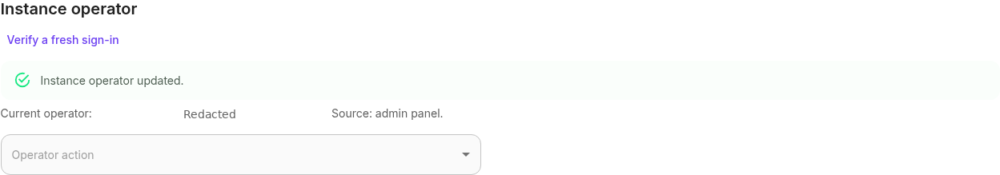
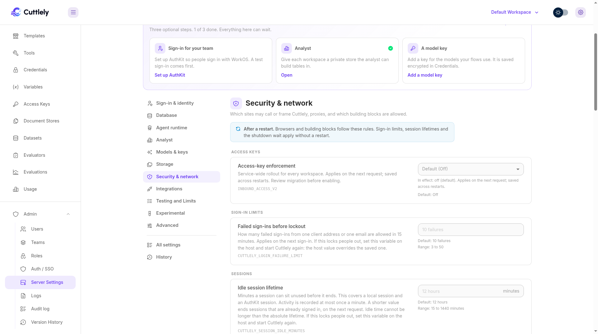

# Upgrading Cuttlely

An upgrade has three steps: back up, upgrade, and check. If something goes wrong, you roll back by restoring the backup and starting the version you had before.

Read the release's entry in the [changelog](../CHANGELOG.md) first. Anything you have to change yourself is listed under **Upgrade notes / breaking changes**. [Releases and support](./releases.md) explains which versions get fixes.

## Upgrading to 1.7.4

Back up the application database, encryption key and settings before upgrading. Use matching 1.7.4 server and widget versions. This patch adds no schema migration and preserves the existing enforcement mode.

Analyst storage is **Auto** when `CUTTLELY_ANALYST` was never set. A host or saved value of `off`, `false`, `0`, or `no` stays off. Auto creates a private store. On Postgres that store is a schema and a login in the application database, created the first time the analyst runs. If that database user cannot create roles, the analyst tool fails and says so. Cuttlely still starts, and `GET /api/v1/ping` still returns `pong`. Set `off`, or set `CUTTLELY_POSTGRES_URL` to a separate database, before upgrading when you do not want that private store. See [Analyst mode](./how-to/analyst.md#which-setting-wins).

Importing a harness attaches one existing credential with the same name and type, including a nested credential id next to an empty credential slot, and stops when the match is missing or ambiguous. **Import & verify** retests saved queries on this server before Publish. Try the demo on a fresh install saves the staged team.

The 1.7.0 operator onboarding and recovery requirements below still apply when upgrading from older versions. Enforcement remains **Off** by default; preparing or installing this patch does not activate it.

## Upgrading to 1.7.3

Back up the application database, encryption key and settings before upgrading. Use matching 1.7.3 server and widget versions. This patch adds no schema migration and preserves the existing enforcement mode.

If a request gets no answer, the page stays in place and says the server could not be reached, instead of showing **Something went wrong**. Importing a saved chatflow keeps a connection that still points at the same input when only the handle type name changed.

Brief connection drops while you edit are retried quietly for reads and option loads. A save that finished while you kept editing no longer marks later edits as saved. Draft and Live saves of an existing flow, without new file data, are kept and retried quietly when a request gets no answer; if that still fails, the canvas keeps the edits and offers Retry. A save with new file data is attempted once per Save and is not resent automatically. After an unanswered create, check your flows in another tab before trying again. Self-hosted installs behind a reverse proxy keep idle connections open for 65 seconds by default; tune this with `HTTP_KEEP_ALIVE_TIMEOUT_MS` and `HTTP_HEADERS_TIMEOUT_MS`. See the [reverse proxy guide](./how-to/reverse-proxy.md).

The 1.7.0 operator onboarding and recovery requirements below still apply when upgrading from older versions. Enforcement remains **Off** by default; preparing or installing this patch does not activate it.

## Upgrading to 1.7.2

Back up the application database, encryption key and settings before upgrading. Use matching 1.7.2 server and widget versions. This patch adds no schema migration and preserves the existing enforcement mode.

**Show tool events** starts Off on chatflows and On on agentflows, multiagent flows and Harness canvases. Choose it in **Configuration > Chat** and select **Save** for that flow. Answers, sources, attachments and Harness run cards remain visible. Shared links and website embeds do not display the other live tool or step status cards; see [Share and embed a chat](./how-to/share-and-embed.md#what-the-chat-shows).

Same-server calls between flows and Harnesses use the parent caller's permissions. With access-key enforcement On, grant every target and its required scopes rather than relying on a saved card credential. Calls from an external Harness worker recheck the key and permissions against the application database. Remote Base URL overrides keep their configured HTTP credential path.

The 1.7.0 operator onboarding and recovery requirements below still apply when upgrading from older versions. Enforcement remains **Off** by default; preparing or installing this patch does not activate it.

## Upgrading to 1.7.1

Back up the application database, encryption key and settings before upgrading. Use matching 1.7.1 server and widget versions. No new schema migration is needed for the PostgreSQL delete fix. Existing bearer values, grants, quotas and enforcement mode are preserved.

For an existing prediction key that was saved without view permission, edit it in **Access Keys** and add the permission named by the refusal (`chatflows:view` or `agentflows:view`). A referenced Harness needs its own grant and `harness:run`; execution uses view permission while edits still need edit rights. New flow-first presets include these prerequisites.

Duplicated flows start **Private** and explicitly omit copied key grants. Pick or create access for the copy's new ID before calling it. API Endpoint reloads saved access and confirms saves. Review workspace-wide keys, which can also call private flows.

The 1.7.0 operator onboarding and recovery requirements below still apply when upgrading from older versions. Enforcement remains **Off** by default; upgrade preparation does not activate it.

## 1.7.0 security-exception upgrade

The 1.7.0 security-exception release changes previously allowed browser service administration under the approved [security exception](./releases.md#what-counts-as-a-breaking-change). Back up before upgrading and retain a host/CLI recovery route.

1. Back up the application database, installation encryption key and saved settings, including the host-only operator binding when one exists.
2. Only an actual valid host CLI operator binding is inherited automatically. Legacy accounts without one—including older CLI-password owners—must complete the one-time **Admin > Server settings > Instance operator > CLAIM** flow with a code printed only in the host log, available in the hosting dashboard or Docker/Compose logs. No account is inferred. The CLI is emergency recovery when nobody can sign in or host files are unsafe; run it as the application OS user.
3. On a fresh install, configure sign-in on the host, create/sign in to the intended active owner, then explicitly claim from the panel with host-log proof. Browser setup codes create accounts only. A supported host CLI first-owner create/reset already records a verified binding and needs no claim.
4. Only the designated instance operator can change service-wide settings; other owners retain tenant permissions. With `CUTTLELY_INSTANCE_OPERATOR` entirely unset, a valid managed binding applies. JSON overrides it; `none`, empty or invalid overrides close claims and browser authority. Every defined override disables panel transfer/revoke/rebind/recovery. Removing an override can reveal a prior managed binding.
5. Use the panel for routine transfer or revoke. Revocation leaves a Disabled tombstone. Disabled/corrupt state needs separately confirmed host-log recovery proof; a changed database requires a fresh host-log REBIND by the previously bound active owner. No ordinary bootstrap reopens after revocation or a DB change. Keep authority/tombstones outside generic database/settings restores.
6. Recreate containers with the same Compose file/options for host override changes. All shipped root/directory/queue/worker services omit an unset operator override and preserve explicit empty/none/JSON values; a plain restart retains the old container environment.
7. Access-key enforcement remains **Off** by default. Back up the encryption key and database, rehearse migrations on a restored test installation, resolve review findings and custom-assistant incompatibilities, then plan the separate confirmed Off → Shadow → On activation. MySQL/MariaDB migrations can commit partially; see [access-key rollout](./reference/access-keys.md#rollout-and-migration).

Read [operator onboarding and recovery](./how-to/instance-operator.md) before deployment. Operator enrollment and access-key activation are separate steps.





These sanitized figures were captured on product 1.6.1 at feature head `5c08b125`, before the 1.7.0 version bump. Enrollment did not enable enforcement.

## What to back up

Everything Cuttlely keeps is in one folder:

| Install        | Folder                                                                                         |
| -------------- | ---------------------------------------------------------------------------------------------- |
| Docker Compose | The volume `cuttlely_cuttlely-data`, mounted at `/var/cuttlely`                                |
| `npx cuttlely` | The Docker volume `cuttlely-data`, mounted at `/var/cuttlely`                                  |
| Render         | The disk mounted at `/var/cuttlely`, plus the Postgres database                                |
| From source    | `~/.cuttlely` (database and key) and `<checkout>/.cuttlely` (history, harnesses, ETL, uploads) |

Inside it, `data/database.sqlite` is the database and `data/encryption.key` is the key that decrypts your credentials. A database backup without its key leaves every stored credential unreadable. `versions/` holds every saved version of your flows. `harnesses/`, `etl/` and `storage/` hold harness records, pipelines and uploads.

`settings/` holds the server settings file the admin panel saves (`server.json`, its last good copy and a change history). Secrets in it are encrypted with the same key. The separate host-only `instance-operator.json` binds the CLI break-glass account to the database connection; browser/CLI settings restore never restores it.

If you set `DATABASE_PATH`, `SECRETKEY_PATH`, `CUTTLELY_DATA_DIR` or `FLOWISE_SECRETKEY_OVERWRITE` yourself, back up what they point to, and keep the key value. `CUTTLELY_SECRETKEY_OVERWRITE` is the same key. If both are set and the values differ, Cuttlely refuses to start.

## 1. Back up

Stop Cuttlely first, so the database file is complete.

**Docker.** Run these from the folder with `docker-compose.yml`. Compose names the volume `cuttlely_cuttlely-data`; `docker volume ls` shows it.

```bash
docker compose stop cuttlely
docker run --rm -v cuttlely_cuttlely-data:/var/cuttlely -v "$PWD":/backup busybox \
    tar czf /backup/cuttlely-backup.tgz -C /var/cuttlely .
```

Keep `cuttlely-backup.tgz` somewhere safe. It holds your encryption key.

**npm launcher.** Run `cuttlely stop`, then use the same `docker run` with the volume name `cuttlely-data`.

**From source.** Stop the server (Ctrl+C in its terminal), then:

```bash
tar czf cuttlely-backup.tgz -C ~ .cuttlely
tar czf cuttlely-checkout-data.tgz -C <checkout> .cuttlely
```

**Render.** Render snapshots the disk once a day and keeps each snapshot for at least seven days. You can restore a snapshot from the service's **Disk** page. For the database, export it with `pg_dump` using the connection string on the database's page in the Render Dashboard, or use the backups your Postgres plan includes.

## 2. Upgrade

**Docker, published image.**

```bash
docker compose pull
docker compose up -d
```

If you pinned a release with `CUTTLELY_IMAGE=ghcr.io/cuttlely/cuttlely:X.Y.Z` in `.env`, change the tag to the new version first.

**Docker, built from your checkout.**

```bash
git pull
docker compose up -d --build
```

**From source.**

```bash
git pull
pnpm install --frozen-lockfile
pnpm build
CUTTLELY_LOCAL_ADMIN=true bash scripts/start-cuttlely.sh
```

To move to a specific release instead of the newest `main`, run `git checkout vX.Y.Z` in place of `git pull`.

**Render.** Every push to `main` deploys. To move to a release, deploy that release's commit.

On the first start, Cuttlely updates its database by itself. That start can take a little longer. Do not stop it part way. A Flowise database that already has application data but not the `3.1.4` workspace schema is refused first, with `unsupported upgrade path, upgrade via Flowise 3.1.4 first`, and that database is not changed. Upgrade it in Flowise `3.1.4` first, then move it: [Move a whole install](./bring-your-flows.md#move-a-whole-install). A database with no application data, including a first start that stopped part way, continues migrating.

## 3. Check

1. Wait for ping to answer `pong`. On Docker: `docker compose exec cuttlely curl -fsS http://127.0.0.1:43117/api/v1/ping`, or `docker compose ps` until it says `healthy`.
2. Check the version: `curl -fsS http://localhost:43117/api/v1/version`, or open the About dialog from the profile menu.
3. Sign in. Open a flow, its **Version history**, **Credentials** and your harnesses. Ask a flow one question.

If you moved a whole Flowise `3.1.4` install into Cuttlely before this start, existing passwords still work. Flowise stored bcrypt password hashes; Cuttlely accepts them and rehashes to its current scheme after the first successful sign-in for each account. If the owner cannot sign in after the move (for example the email changed), reset it from a terminal with:

```bash
pnpm --filter @cuttlely/server user --email you@example.com
```

## Roll back

A new version can change the database in ways the version before it cannot read. To roll back, restore the backup you took and start the version you had before. Do not start an older version on a database a newer one has already opened.

**Docker.**

```bash
docker compose down
docker run --rm -v cuttlely_cuttlely-data:/var/cuttlely -v "$PWD":/backup busybox \
    sh -c 'rm -rf /var/cuttlely/* /var/cuttlely/.[!.]* ; tar xzf /backup/cuttlely-backup.tgz -C /var/cuttlely'
```

Then set `CUTTLELY_IMAGE=ghcr.io/cuttlely/cuttlely:<the version you had>` in `.env` and run `docker compose up -d`.

**From source.** Stop the server, run `git checkout v<the version you had>`, `pnpm install --frozen-lockfile` and `pnpm build`. Put the two backed-up `.cuttlely` folders back in place, then start the server.

**Render.** Restore the disk snapshot from before the upgrade on the **Disk** page, restore the database from your export or backup, and deploy the commit you had before.

## If a server setting stops Cuttlely from starting

Settings saved from **Admin**, **Server Settings** apply when Cuttlely starts. If two starts in a row do not finish after a change, Cuttlely puts back the last settings that started and says so in the log. The settings that did not start are kept beside them as `server.rolled-back.json`.

You can also fix it by hand. Most changes apply at the next start. The sign-in failure limit, the two session lifetimes, and the shutdown wait apply without a restart. A host value overrides the saved one. Secret values are never printed.

| Command                    | What it does                                                  |
| -------------------------- | ------------------------------------------------------------- |
| `pnpm settings list`       | What is set, and whether it comes from the host or the file   |
| `pnpm settings unset NAME` | Removes one saved setting, for example `CUTTLELY_LOCAL_ADMIN` |
| `pnpm settings restore`    | Goes back to the last settings that started                   |

In Docker, run them as the `node` user: `docker compose exec -u node cuttlely pnpm settings list`. To start once without the file, set `CUTTLELY_IGNORE_ADMIN_SETTINGS=1` (in `.env` for Docker, in the shell from source, or as an environment variable on Render).

## Publish check limits set outside their range

Ignoring a host value outside its range, instead of pulling it into range, is intentional. It applies to `CUTTLELY_CHECK_MAX_TOKENS`, `CUTTLELY_CHECK_MAX_SECONDS`, and `CUTTLELY_CHECK_CONCURRENCY`. A number outside the range used to move to the nearest bound. It is now ignored. A saved value inside the range is used, otherwise the default. `CUTTLELY_CHECK_MAX_SECONDS=5` now uses 180, not 10. The log line is `[server]: CUTTLELY_CHECK_MAX_SECONDS is not a usable runtime limit, so another value is used`. The same line names whichever of those variables was ignored. Set a value inside the range if you wanted the old bound.

## AuthKit after local passwords

Configure `WORKOS_API_KEY` and `WORKOS_CLIENT_ID`, restart, then select WorkOS under **Admin** > **Auth / SSO**. That method change ends existing interactive sessions. A verified AuthKit email links the one existing user with that mailbox; two users with the same mailbox are not linked. A later restart does not repeat the session change. Environment-only inference applies only when the first boot after this upgrade has no durable authentication state. [Turn AuthKit on](./how-to/users-without-authkit.md#turn-authkit-on).

## Legacy WorkOS subjects before OIDC activation

An upgrade copies legacy WorkOS subjects from `externalId` into provider-scoped links when the installation has a stable WorkOS provider identity. That attributable state must finish before generic OIDC can be activated. If an installation used WorkOS and later returned to Local login without retaining a stable WorkOS provider identity, those subjects are recorded as unmigrated and inert. They cannot match the configured OIDC provider, do not block OIDC activation, and remain visible as a count on **Admin** > **Auth / SSO**.

## Inbound access-key migration and opt-in

For a build containing the inbound access-key migration, back up the application database and installation encryption key together. Validate on a restored backup before changing live enforcement. With a built server and the restored database's normal connection environment, run:

```bash
node scripts/access-keys-migration-report.cjs
```

This read-only report prints aggregate counts for legacy bindings and Harness-name resolution, without secrets. On SQLite and PostgreSQL, startup applies the migration in a single transaction and a failure rolls it back. On MySQL and MariaDB, `ALTER TABLE` and `CREATE TABLE` commit implicitly, so a failed migration can leave a partially applied schema; recover by stopping the server and restoring the database and installation encryption key from the backup taken before the upgrade, then fix the cause and restart. MySQL/MariaDB migration paths have not been exercised against a live server in this release's validation. Review orphan/cross-workspace bindings and unresolved names; none grant access. Existing bearer values, owners and workspaces are preserved without forced rotation. Existing flow bindings and Harness lists become exact resource grants, never all-resource access. Public share/embed transports and provider credentials remain separate.

`INBOUND_ACCESS_V2=off` is the default. It preserves legacy authorization and leaves new issuance, policy edits and rotation unavailable; revocation remains available. Save **Shadow** in **Admin > Server settings > Security & network > Access keys** (or set host `INBOUND_ACCESS_V2=shadow` and restart) to serve legacy flow decisions while comparing scoped flow authorization. Review access-key use events in **Admin > Audit log** for `shadowMismatch`, `legacyAllowed` and `scopedAllowed`. This does not simulate quota admission or every route: exercise the [route matrix](./reference/access-keys.md#api-route-matrix) separately. Enable `on` only after migration diagnostics and measured parity have been reviewed. The instance-operator panel control applies on the next request and survives restarts. A host mode always overrides it and locks the field; an operator can force `off` there even when the saved mode is `on`. The effective mode and its source are displayed. Review confirmation warns about private custom ASSISTANT integrations returning 401, unresolved Harness names, caller restrictions, quotas and single-instance admission. Disabling is reversible to Off. No installation is activated automatically.

**Access Keys** now holds SDK/Settings and per-flow keys in one workspace list. New keys have no operations or resources. Policy saves replace migration compatibility with the explicit grants/scopes shown, without changing the bearer. Keep `CUTTLELY_API_KEY_INSTANCES=1` (default); RPM is per process and resets on restart, while daily/monthly UTC counters persist in SQL. Redis/multi-instance limiting is not implemented.

To roll back enforcement, restore `off` and restart. Scoped principals are then refused and legacy principals use the compatibility path. Retain the added schema: modern credentials cannot be reconstructed as legacy secrets by downgrading tables. [Full migration and rollback reference](./reference/access-keys.md#rollout-and-migration).

User Management also supports cancellation of a pending invitation, including another pending owner invitation, by an active organization owner or by an Admin in **Users** (`/users`). Admin is the built-in Admin role, or any active team role with `users:manage`. Invite links are revoked. Removing an active or disabled person from every team stays limited to an active organization owner. Accepted invitations, self-removal and the last active owner are refused. Active owners remain read-only in the UI.

## Invites after 1.3.0

From 1.3.0 an invited person joins only through their own one-time invite link. The link is single use, expires after the invite link lifetime (72 hours by default), works only for that person and the email it was sent to, and stops working when a newer link replaces it or the person is disabled or removed from the team or the organization. A sign-in whose email matches a pending invite never activates it, even when the email is verified, and shows `You have a pending invite. Open the invite link from your email to join.`

Check the people who had not joined yet when you upgraded:

-   **Listed as `invited`.** They are pending. An invite link they already have still works until it expires. Otherwise make a new one with `POST /api/v1/users/:id/reset-link` from their team and send it to them.
-   **Added with Add User before 1.3.0 and never signed in.** Those were stored as `active`, so they are not pending and can still join by email match. To make them use a link, remove them and add them again. The new invite shows the link.

An invite link issued before the upgrade keeps working until it expires (at most 168 hours). With Local sign-in active it still sets a password. With a remote sign-in method active, open the link and select **Accept invite with _provider_**; the button names the selected provider, and the link cannot set a local password.

The full rules are in [Invite people](./how-to/sign-in.md#invite-people) and [Security](../SECURITY.md#invites).

## Upgrading to 1.3.1

1.3.1 fixes two security issues in versions up to and including 1.3.0: [GHSA-2v98-33pc-jj6f](https://github.com/cuttlely/cuttlely/security/advisories/GHSA-2v98-33pc-jj6f) (setup code) and [GHSA-4p9j-8j59-gwr7](https://github.com/cuttlely/cuttlely/security/advisories/GHSA-4p9j-8j59-gwr7) (public config endpoints). Upgrade as above. What else changed is in the [changelog](../CHANGELOG.md#131---2026-10-21).

-   **New installs.** A server with no account opens one `/setup` page. The server log prints a ready block with the `/setup#code=` link and a setup code, and prints it again every five minutes while setup is open. The code lasts 60 minutes and works once. An install that already has an owner is not affected.
-   **Building from source.** `pnpm install` now fails on a Node version below 24 (`engine-strict=true`). The Docker image already uses Node 24.
-   **MCP and Orchestrate callers.** JSON bodies over 1 MB are refused with `413`. MCP `POST /api/v1/mcp/<flow id>` now applies the flow's **Rate Limit**, and `GET` answers `405`.
-   **Shared chat pages.** The public chatflow config no longer returns `overrideConfig`, so a shared chat page no longer sends saved overrides with each question.

## How upgrades are tested

Every full `pnpm verify` runs an upgrade check. It starts the current server on data written by an older cuttlely: a chatflow with two saved versions, an agentflow, a harness with two specialists, and a credential. It then checks that each of these survived, and that a question to the chatflow still gets an answer, which proves the credential still decrypts. It also checks that a new save records a version and that a second start works. Run it on its own with `pnpm upgrade:check`.

For maintainers: the data is in `scripts/fixtures/upgrade/`, made by `node scripts/upgrade-fixture.mjs --server-root <built checkout of the older version>`. After each release, refresh it from that release's tag so the check always starts from the last version people run.
