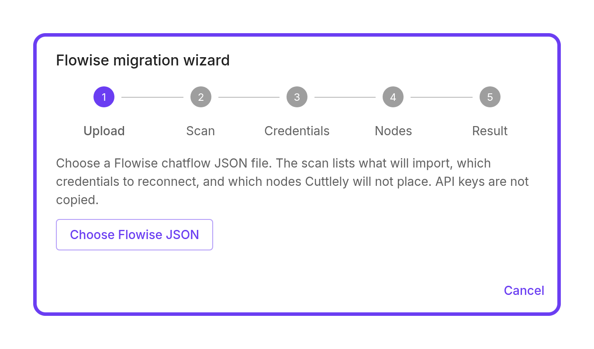
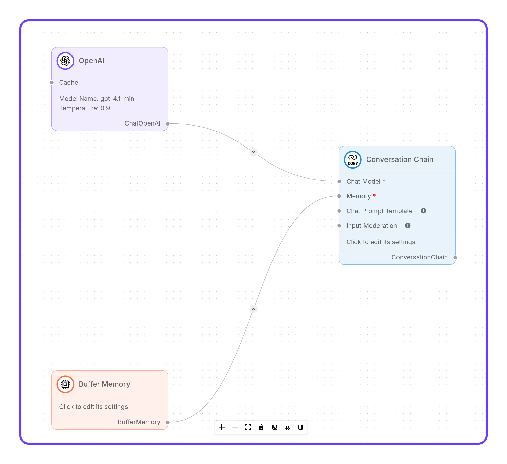

Already have flows? Bring them over.

Cuttlely opens a chatflow or agentflow that you exported from Flowise as a JSON file. A browser wizard checks the file, lists the fixes it made, and opens the flow on the right canvas. You pick your credentials again, check the graph, and save. It's one flow at a time. Import from the **Chatflows** page for a new flow. Import from the gear menu on an open canvas of the same type and it replaces what's on that canvas. With drafts on, the Docker default, **Save** on that existing flow stores a draft. Live changes only after **Publish**. Nothing is saved until you select **Save**.

## Before you start

Here's what you need:

-   Cuttlely 1.7.3 or later, installed and signed in. Haven't set it up yet? The [quickstart](https://github.com/cuttlely/cuttlely/blob/v1.7.3/README.md#your-first-10-minutes) gets you there.
-   The exported JSON file for each flow you want to move.
-   Your model keys. Keys don't travel in the file, so you'll add them in Cuttlely under **Credentials**.

The import runs in the browser wizard. There's no import API or CLI for it.

## Export a flow from Flowise

1. In Flowise, open the flow on its canvas.
2. Select the **Settings** gear in the canvas header.
3. Select **Export Chatflow**. On an agent canvas, the item is **Export Agents**.

Flowise downloads a JSON file named after the flow, such as `Bakery helper Chatflow.json`. The file holds the flow's `nodes` and `edges`. Flowise leaves password, file, and folder fields out of the export, and it strips saved credential ids too.

Cuttlely also accepts a saved flow whose `flowData` holds the nodes and edges, and template files that have `nodes` and `edges`. A whole-workspace export won't import. That's the file with several flows, tools, and variables in it. Export each flow on its own instead.

## Import the JSON file into Cuttlely

1. In Cuttlely, open **Chatflows**. Select **Import** at the top right, then select **Import Flowise JSON**. On a chatflow canvas, the gear menu has **Import Flowise JSON** too.
2. The **Flowise migration wizard** opens on its **Upload** step. Select **Choose Flowise JSON** and pick your file.

_Start the wizard by choosing a Flowise chatflow JSON file. API keys are not copied._

3. On **Scan**, read what the wizard found. It counts the nodes and edges and lists what it fixed, such as a credential it cleared. Select **Next**.
4. On **Credentials**, note each card that needs a credential. Select **Next**.
5. On **Nodes**, look over the list. It shows older nodes that still work but are on their way out, and nodes Cuttlely can't place. Select **Next**.
6. On **Result**, select **Open migrated canvas**. Green means the wizard found nothing left for you to do. Amber means the canvas can open but something still needs you. Expect amber on most imports, because the wizard clears every saved credential.
7. The flow opens on the canvas that fits it. A chatflow goes to the chatflow canvas, and an agentflow goes to the agentflow canvas. Select a credential on each card the wizard named. With the default compact cards, select the card and set its credential in the side panel.

_The imported flow opens on the canvas with its connections in place. Connect your OpenAI credential before you run it._

8. Select **Save**. On a new, unsaved canvas, that first save creates the published flow, and the next canvas save is a draft. On a flow that is already saved, **Save** stores a draft, and Live changes only after **Publish**.

Want the rule-by-rule detail on what Scan checks? It's in [Flowise migration wizard](https://github.com/cuttlely/cuttlely/blob/v1.7.3/docs/flowise-migration-wizard.md).

## Check the flow before you rely on it

Don't put an imported flow to work straight off the wizard. Go over the canvas first and make sure each card connects to the cards you expect. Scan lists the edges the wizard removed so you can connect them again by hand, but check every connection yourself rather than relying on that list.

Then try the flow in the canvas chat. The chat runs your draft, so you can test it before anything goes live.

## What carries over

Here's what comes across:

-   **Nodes.** A node whose name is in Cuttlely's node catalog opens with its settings. The catalog has about 300 nodes. On a chatflow, a node saved with no version or an older one is refreshed to the current node.
-   **Retiring nodes.** Older nodes that are on their way out still open, and the wizard lists them.
-   **Chatflows and agentflows.** Each opens on its own canvas. Older multi-agent and sequential-agent flows open on the legacy agentflow canvas. They run and save there, but that canvas isn't offered for new work.
-   **Custom tools.** On **Tools**, **Load** reads an exported tool JSON file and opens it in the **Add New Tool** dialog, ready to save.

## What doesn't carry over

Some things won't come across. The partial list:

-   Keys, passwords, and saved credential ids. Cuttlely removes them before the canvas opens.
-   A whole-workspace export. Import one flow at a time.
-   LlamaIndex nodes. The wizard names each one and doesn't open the file.
-   A node Cuttlely doesn't have, or a node saved without its input and output lists. The wizard names it and doesn't open the file.
-   The Arize, LangFuse, LangSmith, LangWatch, Lunary, Opik, Phoenix, and AssemblyAI configuration cards. The wizard drops each one with a note on Scan and still opens the file. Set up tracing in **Chatflow Configuration > Analytics**, and transcription in **Speech to Text**.
-   Matching or creating credentials inside the wizard. You pick them on the canvas after it opens.
-   The saved zoom and position of the canvas.

The full list, including moving a whole install with its database, is in [Bring your existing flows](https://github.com/cuttlely/cuttlely/blob/v1.7.3/docs/bring-your-flows.md).

## After the import

Select **Publish** when the flow is ready. On a chatflow or agentflow, the Publish dialog can run a few questions against your draft first. Every save is kept in version history. Both are covered in [Drafts and Publish](https://github.com/cuttlely/cuttlely/blob/v1.7.3/docs/how-to/versioning.md#drafts-and-publish).

New to Cuttlely? [Run the quickstart](https://github.com/cuttlely/cuttlely/blob/v1.7.3/README.md#your-first-10-minutes) and you'll have it running on Docker before you open the wizard. If this got your flows across, [star Cuttlely on GitHub](https://github.com/cuttlely/cuttlely) so other devs can find it.
